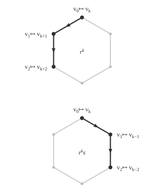
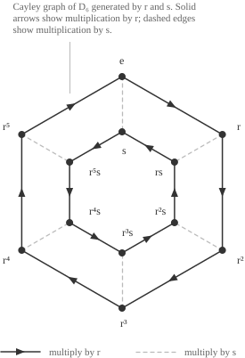
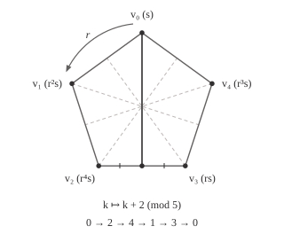

## Definizione

Un gruppo diedrale è il gruppo delle simmetrie di un poligono regolare. Per un poligono $P_n$ con $n\geq 3$ lati, si indica con $D_n$ ed è formato da tutte le isometrie del piano che mandano $P_n$ su sé stesso. Le rotazioni e le riflessioni sono dunque gli elementi del gruppo e si combinano due a due per composizione, cioè applicando prima una simmetria e poi l'altra, ottenendo come risultato una nuova simmetria del poligono. Questa operazione di composizione è associativa, ha per elemento neutro l'identità $e$ e ogni simmetria ha per inversa la trasformazione che ne annulla l'effetto. Numeriamo ora i vertici del nostro poligono $P_n$ in senso antiorario, con i singoli indici in modulo $n:$ 

$$v_0,v_1,\ldots,v_{n-1}$$

Una simmetria manda vertici consecutivi in vertici consecutivi, quindi se $v_0$ va in $v_k,$ per $v_1$ ci sono due possibilità che sono $v_{k+1}$ oppure $v_{k-1}.$ Nel primo caso $v_2$ deve andare in $v_{k+2},$ perché il vertice vicino di $v_{k+1}$ è $v_k,$ già occupato dall'immagine di $v_0$ mentre, nel secondo caso $v_2$ deve andare in $v_{k-2}.$ Per rendere concreto il concetto consideriamo un esagono con una simmetria che sposta i vertici come in figura:

Vediamo ora quali simmetrie realizzano le due possibilità appena descritte. Per mandare $v_0$ in $v_k$ e $v_1$ in $v_{k+1}$ basta ruotare il poligono di $k$ posizioni in senso antiorario attorno al centro. Se $r$ indica la rotazione di un passo, cioè di angolo $2\pi/n,$ questa rotazione è $r^k.$ Per mandare invece $v_1$ in $v_{k-1}$ mantenendo $v_k$ come immagine di $v_0,$ applichiamo prima la riflessione $s$ rispetto alla retta che passa per il centro e per $v_0.$ Questa lascia fermo $v_0$ e porta $v_1$ nel vertice precedente, $v_{-1}.$ La rotazione $r^k$ porta quindi i due vertici nelle posizioni desiderate e quindi scrivendo $r^ks$ per la riflessione seguita dalla rotazione, otteniamo:

$$
\begin{aligned}
r^k  &\colon (v_0,v_1)\longmapsto(v_k,v_{k+1})\\[6pt]
r^ks &\colon (v_0,v_1)\longmapsto(v_k,v_{k-1})
\end{aligned}\tag{1}
$$

Al variare di $k$ da $0$ a $n-1,$ la $(1)$ dà tutte le $n$ rotazioni e le $n$ riflessioni del gruppo diedrale:

$$D_n=\{\ e,r,\ldots,r^{n-1},s,rs,\ldots,r^{n-1}s\ \} \tag{2}$$

> Come nota tenete conto che in un triangolo equilatero ogni permutazione dei vertici è indotta da una delle $3!=6$ simmetrie, quindi $D_3\cong S_3.$ Invece, nel quadrato, delle $4!=24$ permutazioni dei vertici, sono indotte da simmetrie solo le otto che conservano l'adiacenza.

## Generatori e relazioni

Dalla $(2)$ si vede che ogni simmetria è della forma $r^k$ oppure $r^ks,$ quindi $r$ e $s$ generano il gruppo $D_n$ e sono detti generatori. Per calcolarli dobbiamo ricorrere alle seguenti relazioni. Si ha $r^n=e$ perché $n$ rotazioni di un passo compiono un giro completo, e $s^2=e$ perché riflettere due volte rispetto allo stesso asse riporta ogni punto su sé stesso. Per ricavare un'ulteriore relazione, osserviamo che $r$ manda $v_j$ in $v_{j+1}$ e $s$ lo manda in $v_{-j}.$ Confrontiamo dunque $sr$ e $r^{-1}s$ applicando in ciascun caso la trasformazione di destra per prima:

$$
\begin{aligned}
sr(v_j) &= s(v_{j+1}) = v_{-j-1}\\[6pt]
r^{-1}s(v_j) &= r^{-1}(v_{-j}) = v_{-j-1}
\end{aligned}\tag{3}
$$

Poiché nella $(3)$ le due composizioni coincidono su tutti i vertici, si ha che:

$$sr=r^{-1}s \tag{4}$$

Moltiplicando a destra per $s$ e usando $s^2=e,$ si ottiene:

$$srs=r^{-1} \tag{5}$$ 
Geometricamente, dunque, una riflessione inverte il verso di una rotazione e poiché $r$ ha ordine $n\geq 3,$ le rotazioni $r$ e $r^{-1}$ sono distinte. Da questo segue che $sr\neq rs$ e che $D_n$ non è un gruppo abeliano. La $(4)$ permette di portare ogni fattore $s$ a destra delle rotazioni e ogni volta che $s$ passa oltre un fattore $r,$ questo diventa $r^{-1}.$ Per ogni intero $k$ vale quindi la relazione: 

$$sr^k=r^{-k}s \tag{6}$$

Usando la $(6)$ per portare i fattori $s$ a destra e le relazioni $r^n=s^2=e$ per ridurre gli esponenti, si ottiene la forma normale $r^a s^i,$ con $0\leq a\lt n$ e $i\in\{\ 0,1\ \}.$ Questa scrittura è unica, perché le $2n$ forme corrispondono agli elementi distinti della $(2).$ Se moltiplichiamo due elementi scritti in questa forma, $r^a s^i$ e $r^b s^j,$ l'esponente $b$ conserva il segno se $i=0$ e cambia segno se $i=1.$ Possiamo quindi scrivere i due casi in un'unica formula come segue:

$$
\begin{aligned}
(r^a s^i)(r^b s^j) &= r^a(s^i r^b)s^j\\[6pt]
                    &= r^{a+(-1)^i b}s^{i+j}
\end{aligned}\tag{7}
$$

Nella $(7)$ l'esponente di $r$ si legge modulo $n$ e quello di $s$ modulo $2.$ In particolare, il prodotto di due riflessioni $r^as$ e $r^bs$ è la rotazione $r^{a-b}$ e ponendo $a=b$ si vede che ogni riflessione ha ordine $2.$

I generatori $r,s$ e le relazioni appena dimostrate danno quindi la seguente presentazione di $D_n:$

$$D_n = \langle\ r,s \mid r^n=s^2=e,\ srs=r^{-1}\ \rangle \tag{8}$$

Per $n=6,$ i generatori $r$ e $s$ della $(8)$ permettono di costruire il grafo di Cayley di $D_6.$ A ogni simmetria dell'esagono corrisponde un vertice $g,$ dal quale una freccia continua conduce a $gr$ e un segmento tratteggiato a $gs.$

Seguendo una freccia continua, sul ciclo esterno si passa dalla rotazione $r^k$ a $r^{k+1}$ e su quello interno dalla riflessione $r^ks$ a $r^{k-1}s,$ perché $(r^ks)r=r^{k-1}s$ per la $(4).$ Le frecce percorrono quindi i due cicli in versi opposti mentre il segmento tratteggiato si percorre in entrambi i sensi perché moltiplicare a destra per $s$ scambia $r^k$ e $r^ks.$ Le due riflessioni $s$ e $t=rs$ generano quindi il gruppo $D_n$ per ogni $n\geq 3,$ perché dal loro prodotto $ts=rs^2=r$ si ritrova la rotazione della $(8).$ Nell'ordine inverso, per la $(5)$ si ha $st=srs=r^{-1}$ e quindi $st$ ha ordine $n.$ Sostituendo $r=ts$ nella $(8)$ si ottiene la presentazione di Coxeter, che descrive $D_n$ mediante due riflessioni di ordine $2$ il cui prodotto ha ordine $n:$

$$D_n = \langle\ s,t \mid s^2=t^2=(st)^n=e\ \rangle \tag{9}$$

## Ordini degli elementi e centro

L'ordine di un elemento $g$ è il più piccolo intero positivo $m$ tale che $g^m=e,$ cioè il numero minimo di volte che occorre applicare la stessa simmetria affinché ogni vertice di un poligono torni nella posizione iniziale. Se poniamo $d=\gcd(n,k),$ la rotazione $r^k$ genera lo stesso sottogruppo di $r^d$ e ha quindi ordine $n/d.$ In particolare, $r^k$ genera tutte le rotazioni se e solo se $d=1.$ Per $n$ dispari gli elementi di ordine $2$ sono le $n$ riflessioni mentre per $n$ pari si conta anche il mezzo giro $r^{n/2},$ per un totale di $n+1$ elementi.

Vediamo ora come si può determinare il centro del gruppo diedrale $D_n$ stabilendo quali sono gli elementi che commutano con i generatori $r$ e $s.$ Una rotazione $r^k$ commuta sempre con $r$ e, per la $(6),$ commuta con $s$ se e solo se $r^k=r^{-k}.$ Questo equivale a dire che $r^{2k}=e,$ quindi le rotazioni centrali sono l'identità e, per $n$ pari, il mezzo giro $r^{n/2}$ che manda ogni vertice in quello opposto.

Resta da stabilire se anche una riflessione $r^ks$ possa appartenere al centro. Per commutare con $r$ dovrebbe soddisfare $r(r^ks)r^{-1}=r^ks.$ Calcoliamo il primo membro usando $sr^{-1}=rs,$ come segue dalla $(6)$ con esponente $-1:$

$$
\begin{aligned}
r(r^ks)r^{-1} &= r^{k+1}(sr^{-1})\\[6pt]
              &= r^{k+1}rs = r^{k+2}s
\end{aligned}\tag{10}
$$

Poiché $r$ ha ordine $n\geq 3,$ si ha $r^2\neq e$ e quindi $r^{k+2}s\neq r^ks.$ La $(10)$ esclude così tutte le riflessioni dal centro, che contiene soltanto le rotazioni individuate sopra:

$$Z(D_n) = \begin{cases} \{\ e \ \} & n \ \text{dispari} \\[6pt] \{\ e, r^{n/2} \ \} & n \ \text{pari} \end{cases}$$

## Assi di riflessione e classi di coniugio

Nel quadrato un quarto di giro porta una diagonale sull'altra, mentre nessuna simmetria porta una diagonale sulla retta che unisce i punti medi di due lati opposti. Il legame con il coniugio si vede osservando che, se $s_L$ ha asse $L,$ il suo coniugato $gs_Lg^{-1}$ ha asse $g(L).$ Due riflessioni sono dunque coniugate in $D_n$ se e solo se una simmetria del poligono manda un asse nell'altro.

La riflessione $r^ks$ manda $v_j$ in $v_{k-j}.$ Il vertice $v_j$ è quindi fisso, e appartiene all'asse, esattamente quando $j$ e $k-j$ coincidono modulo $n,$ ossia quando vale:

$$2j\equiv k\pmod n \tag{11}$$

Se $n$ è dispari, $2$ è invertibile modulo $n$ e la $(11)$ ha un'unica soluzione e ogni asse passa quindi per un solo vertice e per il punto medio del lato opposto. Invece, quando $n$ è pari, la $(11)$ ha due soluzioni per $k$ pari, mentre per $k$ dispari non ha soluzioni.

Poiché ogni simmetria manda vertici in vertici, i due tipi di asse restano distinti. La $(10)$ collega tra loro tutti gli esponenti pari e, separatamente, tutti quelli dispari e si ottengono così due classi di $n/2$ riflessioni ciascuna.

## Sottogruppi

La distinzione tra rotazioni e riflessioni della $(2)$ permette di descrivere anche i sottogruppi di $D_n.$ Sia $H$ un sottogruppo generico di $D_n,$ le rotazioni di $H$ formano un sottogruppo del gruppo ciclico $\langle r\rangle,$ quindi sono tutte e sole le potenze di $r^d$ per un unico divisore positivo $d$ di $n.$ Se $H$ contiene soltanto rotazioni, si ha $H=\langle r^d\rangle$ e il suo ordine è $n/d.$

Se $H$ contiene una riflessione $t=r^is,$ allora $r^d$ e $t$ generano tutto $H.$ Infatti, per ogni riflessione $u=r^js$ di $H,$ dalla $(7)$ si ottiene:

$$ut=(r^js)(r^is)=r^{j-i}\in\langle r^d\rangle \tag{12}$$

Poiché $t^2=e,$ moltiplicando la $(12)$ a destra per $t$ si ricava $u=r^{j-i}t.$ Moltiplicando a destra per $t$ ciascuna delle $n/d$ rotazioni di $H,$ si ottengono altrettante riflessioni distinte. Per la $(12)$ sono tutte le riflessioni di $H,$ quindi $H=\langle r^d,t\rangle$ ha ordine $2n/d.$ Se $n/d\geq 3,$ i due generatori soddisfano le relazioni della $(8)$ con $n/d$ al posto di $n,$ perciò $H\cong D_{n/d}.$

Se consideriamo un esagono regolare e prendiamo i vertici alterni $v_0,v_2,v_4$ questi formano un triangolo equilatero e una rotazione $r^2$ manda ciascuno di questi vertici nel successivo. Sul triangolo si ottengono così le tre rotazioni e le tre riflessioni di $D_3,$ realizzate dai sei elementi del sottogruppo $\langle r^2,s\rangle$ di $D_6.$