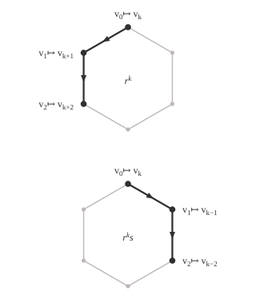
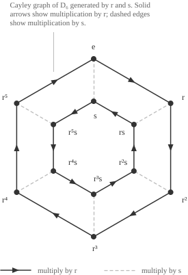
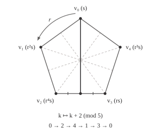

## Definition

A dihedral group is the symmetry group of a regular polygon. For a polygon $P_n$ with $n\geq 3$ sides, this group is denoted by $D_n$ and consists of all isometries of the plane that map $P_n$ onto itself. The rotations and reflections are thus the elements of the group, and we combine two of them by composition, applying one symmetry and then the other to obtain another symmetry of the polygon. Composition is associative, the identity $e$ is its neutral element, and the inverse of each symmetry is the transformation that undoes it. We label the vertices of $P_n$ counterclockwise, taking the indices modulo $n:$

$$v_0,v_1,\ldots,v_{n-1}$$

A symmetry sends consecutive vertices to consecutive vertices, so if it sends $v_0$ to $v_k,$ the two possible images of $v_1$ are $v_{k+1}$ and $v_{k-1}.$ In the first case, $v_2$ must go to $v_{k+2}$ because the other neighbor of $v_{k+1}$ is $v_k,$ already the image of $v_0,$ while in the second case $v_2$ must go to $v_{k-2}.$ To see this concretely, consider a symmetry of a hexagon that moves its vertices as shown in the figure:

We can now identify the symmetries that realize these two possibilities. To send $v_0$ to $v_k$ and $v_1$ to $v_{k+1},$ it suffices to rotate the polygon counterclockwise about its center by $k$ steps. If $r$ denotes a rotation by one step, that is, through an angle of $2\pi/n,$ then this rotation is $r^k.$ To send $v_1$ to $v_{k-1}$ while keeping $v_k$ as the image of $v_0,$ we first apply the reflection $s$ across the line through the center and $v_0.$ This reflection fixes $v_0$ and sends $v_1$ to the preceding vertex, $v_{-1}.$ The rotation $r^k$ then takes the two vertices to the desired positions, so writing $r^ks$ for the reflection followed by the rotation, we obtain:

$$
\begin{aligned}
r^k  &\colon (v_0,v_1)\longmapsto(v_k,v_{k+1})\\[6pt]
r^ks &\colon (v_0,v_1)\longmapsto(v_k,v_{k-1})
\end{aligned}\tag{1}
$$

As $k$ ranges from $0$ to $n-1,$ equation $(1)$ gives all $n$ rotations and all $n$ reflections of the dihedral group:

$$D_n=\{\ e,r,\ldots,r^{n-1},s,rs,\ldots,r^{n-1}s\ \} \tag{2}$$

> Note that every permutation of the vertices of an equilateral triangle is induced by one of its $3!=6$ symmetries, so $D_3\cong S_3.$ Of the $4!=24$ permutations of the vertices of a square, only the eight that preserve adjacency are induced by symmetries.

## Generators and relations

Equation $(2)$ shows that every symmetry has the form $r^k$ or $r^ks,$ so $r$ and $s$ generate the group $D_n$ and are called generators. To calculate with them, we use the following relations. We have $r^n=e$ because $n$ one-step rotations make a full turn, and $s^2=e$ because reflecting twice across the same axis returns every point to its original position. To derive another relation, observe that $r$ sends $v_j$ to $v_{j+1}$ and $s$ sends it to $v_{-j}.$ We can therefore compare $sr$ and $r^{-1}s$ by applying the rightmost transformation first in each case:

$$
\begin{aligned}
sr(v_j) &= s(v_{j+1}) = v_{-j-1}\\[6pt]
r^{-1}s(v_j) &= r^{-1}(v_{-j}) = v_{-j-1}
\end{aligned}\tag{3}
$$

Since the two compositions in $(3)$ agree on every vertex, it follows that:

$$sr=r^{-1}s \tag{4}$$

Multiplying on the right by $s$ and using $s^2=e,$ we obtain:

$$srs=r^{-1} \tag{5}$$
Geometrically, a reflection reverses the direction of a rotation, and since $r$ has order $n\geq 3,$ the rotations $r$ and $r^{-1}$ are distinct. It follows that $sr\neq rs$ and that $D_n$ is nonabelian. Equation $(4)$ allows us to move each factor $s$ to the right of the rotations, and whenever $s$ moves past a factor $r,$ that factor becomes $r^{-1}.$ Thus the following relation holds for every integer $k:$

$$sr^k=r^{-k}s \tag{6}$$

Using $(6)$ to move the factors $s$ to the right and the relations $r^n=s^2=e$ to reduce the exponents, we obtain the normal form $r^a s^i,$ with $0\leq a\lt n$ and $i\in\{\ 0,1\ \}.$ This expression is unique because the $2n$ forms correspond to the distinct elements in $(2).$ When we multiply two elements in this form, $r^a s^i$ and $r^b s^j,$ the exponent $b$ retains its sign if $i=0$ and changes sign if $i=1.$ We can therefore express both cases in a single formula:

$$
\begin{aligned}
(r^a s^i)(r^b s^j) &= r^a(s^i r^b)s^j\\[6pt]
                    &= r^{a+(-1)^i b}s^{i+j}
\end{aligned}\tag{7}
$$

In $(7)$ the exponent of $r$ is taken modulo $n$ and that of $s$ modulo $2.$ In particular, the product of two reflections $r^as$ and $r^bs$ is the rotation $r^{a-b},$ and setting $a=b$ shows that every reflection has order $2.$

The generators $r$ and $s$ and the relations just derived therefore give the following presentation of $D_n:$

$$D_n = \langle\ r,s \mid r^n=s^2=e,\ srs=r^{-1}\ \rangle \tag{8}$$

For $n=6,$ the generators $r$ and $s$ in $(8)$ can be used to construct the Cayley graph of $D_6.$ Each symmetry of the hexagon corresponds to a vertex $g,$ from which a solid arrow leads to $gr$ and a dashed edge leads to $gs.$

Following a solid arrow takes us from the rotation $r^k$ to $r^{k+1}$ on the outer cycle and from the reflection $r^ks$ to $r^{k-1}s$ on the inner cycle, since $(r^ks)r=r^{k-1}s$ by $(4).$ The arrows thus run in opposite directions around the two cycles, while each dashed edge can be traversed in either direction because right multiplication by $s$ interchanges $r^k$ and $r^ks.$ The two reflections $s$ and $t=rs$ therefore generate $D_n$ for every $n\geq 3,$ since their product $ts=rs^2=r$ recovers the rotation in $(8).$ In the reverse order, $(5)$ gives $st=srs=r^{-1},$ so $st$ has order $n.$ Substituting $r=ts$ in $(8)$ gives the Coxeter presentation, which describes $D_n$ in terms of two reflections of order $2$ whose product has order $n:$

$$D_n = \langle\ s,t \mid s^2=t^2=(st)^n=e\ \rangle \tag{9}$$

## Element orders and the center

The order of an element $g$ is the smallest positive integer $m$ such that $g^m=e,$ that is, the least number of times the same symmetry must be applied for every vertex of the polygon to return to its original position. If we set $d=\gcd(n,k),$ the rotation $r^k$ generates the same subgroup as $r^d$ and therefore has order $n/d.$ In particular, $r^k$ generates all the rotations if and only if $d=1.$ For odd $n,$ the elements of order $2$ are the $n$ reflections, while for even $n$ the half-turn $r^{n/2}$ brings the total to $n+1.$

To determine the center of the dihedral group $D_n,$ we find the elements that commute with both generators $r$ and $s.$ A rotation $r^k$ always commutes with $r$ and, by $(6),$ commutes with $s$ if and only if $r^k=r^{-k}.$ This is equivalent to $r^{2k}=e,$ so the central rotations are the identity and, for even $n,$ the half-turn $r^{n/2}$ that sends each vertex to the opposite vertex.

It remains to determine whether a reflection $r^ks$ can also belong to the center. To commute with $r,$ it would have to satisfy $r(r^ks)r^{-1}=r^ks.$ We calculate the left-hand side using $sr^{-1}=rs,$ which follows from $(6)$ with exponent $-1:$

$$
\begin{aligned}
r(r^ks)r^{-1} &= r^{k+1}(sr^{-1})\\[6pt]
              &= r^{k+1}rs = r^{k+2}s
\end{aligned}\tag{10}
$$

Since $r$ has order $n\geq 3,$ we have $r^2\neq e$ and hence $r^{k+2}s\neq r^ks.$ Equation $(10)$ thus rules out all reflections, leaving only the rotations identified above in the center:

$$Z(D_n) = \begin{cases} \{\ e \ \} & n \ \text{odd} \\[6pt] \{\ e, r^{n/2} \ \} & n \ \text{even} \end{cases}$$

## Reflection axes and conjugacy classes

A quarter-turn of a square takes one diagonal to the other, while no symmetry takes a diagonal to the line joining the midpoints of two opposite sides. To see the connection with conjugation, observe that if $s_L$ has axis $L,$ then its conjugate $gs_Lg^{-1}$ has axis $g(L).$ Two reflections are therefore conjugate in $D_n$ if and only if a symmetry of the polygon takes one axis to the other.

The reflection $r^ks$ sends $v_j$ to $v_{k-j}.$ Thus the vertex $v_j$ is fixed, and lies on the axis, precisely when $j$ and $k-j$ are congruent modulo $n,$ that is, when the following congruence holds:

$$2j\equiv k\pmod n \tag{11}$$

If $n$ is odd, $2$ is invertible modulo $n$ and $(11)$ has a unique solution, so each axis passes through exactly one vertex and the midpoint of the opposite side. If $n$ is even, $(11)$ has two solutions for even $k$ and none for odd $k.$

Since every symmetry sends vertices to vertices, the two types of axes remain distinct. Equation $(10)$ connects all the even exponents and, separately, all the odd exponents, giving two classes of $n/2$ reflections each.

## Subgroups

The distinction between rotations and reflections in $(2)$ also allows us to describe the subgroups of $D_n.$ For any subgroup $H$ of $D_n,$ the rotations in $H$ form a subgroup of the cyclic group $\langle r\rangle,$ so they are precisely the powers of $r^d$ for a unique positive divisor $d$ of $n.$ If $H$ contains only rotations, then $H=\langle r^d\rangle$ and has order $n/d.$

If $H$ contains a reflection $t=r^is,$ then $r^d$ and $t$ generate all of $H.$ Indeed, for any reflection $u=r^js$ in $H,$ equation $(7)$ gives:

$$ut=(r^js)(r^is)=r^{j-i}\in\langle r^d\rangle \tag{12}$$

Since $t^2=e,$ multiplying $(12)$ on the right by $t$ gives $u=r^{j-i}t.$ Right multiplication by $t$ sends the $n/d$ rotations in $H$ to the same number of distinct reflections. By $(12),$ these are all the reflections in $H,$ so $H=\langle r^d,t\rangle$ has order $2n/d.$ If $n/d\geq 3,$ the two generators satisfy the relations in $(8)$ with $n/d$ in place of $n,$ so $H\cong D_{n/d}.$

If we take the alternate vertices $v_0,v_2,v_4$ of a regular hexagon, they form an equilateral triangle, and the rotation $r^2$ sends each of these vertices to the next. This gives the three rotations and three reflections of $D_3$ on the triangle, all realized by the six elements of the subgroup $\langle r^2,s\rangle$ of $D_6.$
