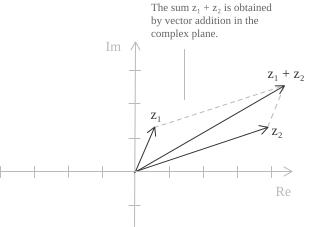

## Introduzione

Prima di passare a illustrare le operazioni con i numeri complessi, è utile ricordare che l'insieme $\mathbb{C}$ è dotato di addizione e moltiplicazione e soddisfa una serie di assiomi che lo rendono un campo.

+ Il primo assioma è la proprietà di chiusura secondo cui il risultato della somma e del prodotto di due numeri complessi appartiene a $\mathbb{C}.$
+ L'addizione e la moltiplicazione sono operazioni commutative e associative, come in $\mathbb{R}.$
+ Il numero $0 = 0 + 0i$ è l'elemento neutro dell'addizione e $1 = 1 + 0i$ lo è per la moltiplicazione.
+ L'opposto di un numero $z = a + bi$ è $-z = -a - bi$ e vale la relazione $z + (-z) = 0.$
+ Per ogni $z \neq 0$ esiste un unico inverso moltiplicativo $z^{-1} \in \mathbb{C}$ tale che $z \cdot z^{-1} = 1.$

Un'altra proprietà di $\mathbb{C}$ è che, a differenza di $\mathbb{R}$ non esiste un ordine totale compatibile con le operazioni di campo. Inoltre, $\mathbb{C}$ è algebricamente chiuso, ovvero, per il teorema fondamentale dell'algebra, ogni polinomio non costante con coefficienti in $\mathbb{C}$ ha almeno una radice in $\mathbb{C}$ (a differenza di $\mathbb{R},$ dove polinomi come $x^2 + 1$ non hanno radici reali).

## Operazioni

Consideriamo due numeri complessi in forma algebrica.

$$
\begin{align}
z_1 &= a + bi \\[6pt]
z_2 &= c + di
\end{align} \tag{1}
$$

La loro somma e la loro differenza sono definite componente per componente, cioè trattando separatamente le parti reali e immaginarie secondo le seguenti identità:

$$
\begin{align}
z_1 + z_2 &= (a + c) + (b + d)i \notag \\[6pt]
z_1 - z_2 &= (a - c) + (b - d)i \tag{2}
\end{align}
$$

Quindi supponiamo di avere $z_1 = 2 - 3i$ e $z_2 = 3 + 5i$ e di voler calcolare $z_1 - z_2.$ Sottraendo le parti reali di ciascun numero e quelle immaginarie, otteniamo il seguente risultato:

$$
\begin{align}
z_1 - z_2 &= (2 - 3i) - (3 + 5i) \\[6pt]
          &= (2 - 3) + (-3 - 5)i \\[6pt]
          &= -1 - 8i
\end{align}
$$

Come abbiamo mostrato nella voce introduttiva dei numeri complessi, dal punto di vista geometrico, essi si possono rappresentare come vettori nel piano complesso. Quindi, dati due numeri complessi qualsiasi, la loro somma $z_1 + z_2$ corrisponde alla somma vettoriale secondo la regola del parallelogramma per cui si ottiene quanto segue:

+ Il vettore $z_2$ viene traslato in modo che la sua origine coincida con l'estremo del vettore corrispondente a $z_1.$
+ Il vettore che congiunge l'origine al nuovo estremo rappresenta il numero complesso risultante $z_1 + z_2.$

Nel caso della differenza, $z_1 - z_2$ si ottiene sommando a $z_1$ l'opposto $-z_2,$ il cui vettore è il simmetrico di $z_2$ rispetto all'origine.

- - -

Vediamo ora il prodotto, considerando sempre due numeri complessi nella forma $(1).$ L'operazione è data dalla seguente relazione:

$$(a + bi)(c + di) = (ac - bd) + (ad + bc)i \tag{3}$$

Per ricavare la $(3),$ applichiamo la proprietà distributiva, moltiplicando ciascun termine del primo fattore per ciascun termine del secondo. Per la commutatività abbiamo $(bi)(di) = bdi^2,$ che vale $-bd$ perché $i^2 = -1.$ Quindi, svolgendo i calcoli, otteniamo proprio la $(3):$

$$
\begin{align}
(a + bi)(c + di) &= ac + adi + bci + bdi^2 \\[6pt]
                 &= ac + adi + bci - bd \\[6pt]
                 &= (ac - bd) + (ad + bc)i
\end{align}
$$

Per un numero complesso $z = a + bi,$ il modulo è dato dalla formula seguente.

$$|z| = \sqrt{a^2 + b^2} \tag{4}$$

Consideriamo due numeri nella forma $(1)$ e applichiamo la formula $(4)$ alle parti reale e immaginaria del prodotto, date dalla $(3).$ Sviluppando i quadrati otteniamo:

$$
\begin{align}
|z_1 \cdot z_2|^2 &= (ac - bd)^2 + (ad + bc)^2 \\[6pt]
                  &= a^2c^2 - 2abcd + b^2d^2 + a^2d^2 + 2abcd + b^2c^2 \\[6pt]
                  &= a^2(c^2 + d^2) + b^2(c^2 + d^2) \\[6pt]
                  &= (a^2 + b^2)(c^2 + d^2) \\[6pt]
                  &= |z_1|^2 \cdot |z_2|^2
\end{align}
$$

Quindi vale la seguente identità:

$$|z_1 \cdot z_2| = |z_1| \cdot |z_2| \tag{5}$$

La stessa proprietà si estende anche alla divisione, per cui, per ogni $z_1, z_2 \in \mathbb{C}$ con $z_2 \neq 0$ vale la seguente relazione:

$$\left|\frac{z_1}{z_2}\right| = \frac{|z_1|}{|z_2|} \tag{6}$$

Ricordiamo anche che, geometricamente, il modulo di un numero complesso è la lunghezza del vettore che lo rappresenta, mentre l'argomento è l'angolo orientato dall'asse reale positivo al vettore. Consideriamo $z_1$ e $z_2$ non nulli e $\theta_2$ un argomento di $z_2.$ Nel piano complesso, per ottenere il prodotto $z_1z_2,$ ruotiamo il vettore di $z_1$ attorno all'origine di un angolo $\theta_2$ e poi moltiplichiamo la sua lunghezza per $|z_2|,$ come indica la $(5).$ Invece, per calcolare il quoziente $z_1/z_2,$ ruotiamo lo stesso vettore di un angolo $-\theta_2$ e dividiamo la sua lunghezza per $|z_2|,$ come indica la $(6).$

- - -

Vediamo ora alcune identità algebriche del coniugato complesso che per un generico $z$ sappiamo essere uguale a:

$$\overline{z} = a - bi \tag{7}$$

Per prima cosa, quando applichiamo due volte l'operazione di coniugazione otteniamo il numero iniziale per cui:

$$\overline{\overline{z}} = z \tag{8}$$

Inoltre, la coniugazione è compatibile con l'addizione, la sottrazione e la moltiplicazione, per cui valgono le seguenti relazioni:

$$
\begin{align}
\overline{z_1 + z_2} &= \overline{z_1} + \overline{z_2} \notag \\[6pt]
\overline{z_1 - z_2} &= \overline{z_1} - \overline{z_2} \notag \\[6pt]
\overline{z_1 \cdot z_2} &= \overline{z_1} \cdot \overline{z_2} \tag{9}
\end{align}
$$

La coniugazione è un automorfismo del campo $\mathbb{C},$ ovvero un'applicazione biiettiva da $\mathbb{C}$ in se stesso che conserva l'addizione e la moltiplicazione. La $(8)$ mostra che la coniugazione è la propria inversa, e dunque è biiettiva, mentre le identità $(9)$ mostrano che conserva le due operazioni. Infine, se si moltiplica un numero complesso per il proprio coniugato, si ottiene il seguente numero reale:

$$z \cdot \overline{z} = a^2 + b^2 = |z|^2 \tag{10}$$

La $(10)$ è utile perché permette di riscrivere un'espressione che contiene una frazione con denominatore complesso come una frazione equivalente con denominatore reale. Se infatti moltiplichiamo il numeratore e il denominatore per $\overline{z},$ il denominatore diventa $|z|^2,$ che è reale, e questo in alcuni casi può aiutare a semplificare i calcoli.

- - -

Vediamo adesso come funziona la divisione nel campo complesso. Consideriamo sempre due numeri complessi come nella $(1),$ con $z_2 \neq 0$ per non rendere nullo il denominatore e calcoliamo $z_1/z_2.$ Per prima cosa applichiamo la $(10)$ e moltiplichiamo numeratore e denominatore per $\overline{z_2} = c - di$ così da ottenere un numero reale. Sviluppando i calcoli otteniamo:

$$ \tag{11}
\begin{align}
\frac{z_1}{z_2} &= \frac{a + bi}{c + di} \\[6pt]
                &= \frac{(a + bi)(c - di)}{(c + di)(c - di)} \\[6pt]
                &= \frac{ac - adi + bci - bdi^2}{c^2 + d^2} \\[6pt]
                &= \frac{(ac + bd) + (bc - ad)i}{c^2 + d^2} \\[6pt]
                &= \frac{ac + bd}{c^2 + d^2} + \frac{bc - ad}{c^2 + d^2}i
\end{align}
$$

Ad esempio, consideriamo $z_1 = 5 + 3i$ e $z_2 = 2 - i$ e calcoliamo il quoziente. Seguendo la $(11)$ si ottiene:
$$
\begin{align}
\frac{5 + 3i}{2 - i} &= \frac{(5 + 3i)(2 + i)}{(2 - i)(2 + i)} \\[6pt]
                    &= \frac{10 + 5i + 6i + 3i^2}{4 + 1} \\[6pt]
                    &= \frac{10 + 11i + 3(-1)}{5} \\[6pt]
                    &= \frac{7 + 11i}{5} \\[6pt]
                    &= \frac{7}{5} + \frac{11}{5}i
\end{align}
$$

- - -

Infine, vediamo come si calcola il reciproco $z^{-1}$ di un numero complesso $z$ che è un caso particolare della $(11):$

$$ \tag{12}
\begin{align}
z^{-1} &= \frac{1}{a + bi} \\[6pt]
       &= \frac{a - bi}{a^2 + b^2} \\[6pt]
       &= \frac{a}{a^2 + b^2} - \frac{b}{a^2 + b^2}i
\end{align}
$$

Per fare un esempio immediato, calcoliamo il reciproco di $z = 3 - 2i.$ Per la $(12)$ si ha:

$$
\begin{align}
\frac{1}{3 - 2i} &= \frac{3 + 2i}{(3 - 2i)(3 + 2i)} \\[6pt]
                 &= \frac{3 + 2i}{9 + 4} \\[6pt]
                 &= \frac{3 + 2i}{13} \\[6pt]
                 &= \frac{3}{13} + \frac{2}{13}i
\end{align}
$$

Le formule di questa voce descrivono le operazioni in $\mathbb{C}$ a partire dalla forma algebrica $(1).$ Le stesse operazioni valgono quando i numeri complessi sono espressi nella loro forma trigonometrica ed esponenziale. La trattazione di tali operazioni è illustrata nel dettaglio nelle voci dedicate.
