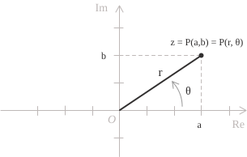
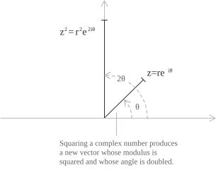

## Definizione

Come abbiamo visto nella definizione, la forma algebrica di un numero complesso esprime un numero $z$ esplicitando la sua componente reale e quella immaginaria ed è data dalla seguente espressione:

$$z = a + bi \tag{1}$$

Ogni numero complesso non nullo della forma $(1)$ si può anche descrivere ricorrendo a delle grandezze geometriche. Se immaginiamo un generico punto $z$ come coppia di coordinate sull'asse reale e sull'asse immaginario, possiamo considerare la distanza dall'origine del punto e la sua posizione angolare nel piano complesso. In questo modo otteniamo la forma esponenziale di un numero complesso che è espressa dalla seguente identità:

$$z = re^{i\theta} \tag{2}$$

$r$ è il modulo, ossia la distanza di $z$ dall'origine nel piano complesso, ed è dato da:

$$r = |z| = \sqrt{a^2 + b^2} \tag{3}$$

Geometricamente corrisponde alla lunghezza dell'ipotenusa del triangolo rettangolo determinato dalla parte reale e da quella immaginaria. $\theta = \arg(z)$ è invece l'argomento, e cioè l'angolo in radianti tra il semiasse reale positivo e il vettore che rappresenta $z.$

Vediamo adesso come possiamo ricavare la forma esponenziale $(2)$ dalla forma algebrica $(1).$ Come discusso nella voce sulla forma trigonometrica, le componenti reale e immaginaria sono date da $a = r\cos(\theta)$ e $b = r\sin(\theta).$ Sostituendo queste espressioni nella $(1)$ si ottiene:

$$z = r[\cos(\theta) + i\sin(\theta)] \tag{4}$$

La formula di Eulero consente di esprimere il termine tra parentesi nella $(4)$ mediante un esponenziale complesso ed è data dalla seguente identità:

$$e^{i\theta} = \cos(\theta) + i\sin(\theta) \tag{5}$$

Sostituendo la $(5)$ nella $(4)$ si ricava la forma esponenziale $(2):$

$$
\begin{align}
z &= r[\cos(\theta) + i\sin(\theta)] \\[6pt]
  &= re^{i\theta} \tag{6}
\end{align}
$$

- - -

Abbiamo visto che il coniugato di un numero complesso in forma algebrica è dato dalla seguente identità:

$$\overline{z} = a-ib \tag{7}$$

La stessa caratterizzazione del coniugato si può ottenere nella forma esponenziale sostituendo $\theta$ con $-\theta$ nella $(2).$ Geometricamente, questo corrisponde a riflettere $z$ rispetto all'asse reale. Poiché il coseno è una funzione pari e il seno è invece dispari, dalla formula di Eulero $(5)$ si ottiene:

$$\overline{z} = re^{-i\theta} \tag{8}$$

## Operazioni

Di seguito vengono illustrate le principali operazioni sui numeri complessi espressi in forma esponenziale, iniziando dal prodotto. Consideriamo due numeri complessi non nulli:

$$
\begin{align}
z_1 &= r_1e^{i\theta_1} \\[6pt]
z_2 &= r_2e^{i\theta_2}
\tag{9}
\end{align}
$$

Il prodotto dei numeri della $(9)$ si ottiene moltiplicando i moduli e sommando gli argomenti:

$$z_1 z_2 = r_1 r_2 e^{i(\theta_1 + \theta_2)} \tag{10}$$

Ad esempio proviamo a moltiplicare i seguenti numeri $z_1 = 2e^{i\pi/3}$ e $z_2 = 3e^{i\pi/6}.$ Applicando la $(10),$ il prodotto è pari a:

$$z_1 z_2 = 2 \cdot 3 \cdot e^{i(\pi/3 + \pi/6)} = 6e^{i\pi/2} \tag{11}$$

A livello geometrico, moltiplicare $z_1$ per un numero complesso non nullo $z_2$ significa moltiplicare la sua distanza dall'origine per $r_2$ e ruotare il vettore che lo rappresenta di un angolo $\theta_2.$ Questa rotazione avviene in senso antiorario se $\theta_2 > 0$ e in senso orario se $\theta_2 < 0.$ Analogamente alla $(10),$ il quoziente si ottiene dividendo i moduli e sottraendo gli argomenti:

$$\frac{z_1}{z_2} = \frac{r_1}{r_2}e^{i(\theta_1 - \theta_2)} \tag{12}$$

Nella $(12)$ $z_2$ deve essere diverso da $0.$ Oltre al prodotto e al quoziente, anche le potenze intere si calcolano direttamente. Per ogni intero $n,$ con base non nulla quando $n \leq 0,$ abbiamo:

$$z^n = (re^{i\theta})^n = r^n e^{in\theta} \tag{13}$$

Applicando la formula di Eulero a $e^{in\theta},$ la $(13)$ equivale al teorema di De Moivre e si ottiene:

$$(\cos\theta + i\sin\theta)^n = \cos(n\theta) + i\sin(n\theta) \tag{14}$$

Per esempio, applicando la $(13)$ con $n = 2$ si ottiene:

$$z^2 = r^2 e^{i2\theta} \tag{15}$$

Il numero complesso della $(15)$ ha modulo $r^2$ e argomento $2\theta.$ Geometricamente, la lunghezza del vettore rappresentativo di $z$ viene moltiplicata per $r$ e il suo angolo viene raddoppiato.

- - -

La forma esponenziale permette anche di calcolare le radici $n$-esime di un numero complesso. Se consideriamo la generica equazione equazione $w^n = z$ ha esattamente $n$ soluzioni distinte in $\mathbb{C},$ date dalla seguente uguaglianza:

$$w_k = \sqrt[n]{r}e^{i(\theta + 2k\pi)/n} \tag{23}$$

Nella $(23)$ il modulo di ogni radice è $\sqrt[n]{r}$ e $k$ è un intero da $0$ a $n-1,$ che individua una delle $n$ radici distinte. Gli argomenti sono equidistanti, con una separazione di $2\pi/n.$ Quando $n \geq 3,$ le radici corrispondono ai vertici di un poligono inscritto in una circonferenza di raggio $\sqrt[n]{r}$ e centro nell'origine. Per fare un esempio, consideriamo le radici cubiche di $z = 8.$ Scrivendo $z = 8e^{i\cdot 0},$ si ha $r = 8$ e $\theta = 0,$ quindi dalla $(23)$ le tre radici sono:

$$w_k = \sqrt[3]{8}e^{i\cdot 2k\pi/3} = 2e^{i\cdot 2k\pi/3} \qquad k = 0, 1, 2 \tag{24}$$

Possiamo calcolare ciascuna radice della $(24)$ mediante la formula di Eulero, ottenendo:

$$
\begin{align}
w_0 &= 2e^{i\cdot 0} = 2 \\[6pt]
w_1 &= 2e^{i\cdot 2\pi/3} = 2\left(-\frac{1}{2} + i\frac{\sqrt{3}}{2}\right) = -1 + i\sqrt{3} \\[6pt]
w_2 &= 2e^{i\cdot 4\pi/3} = 2\left(-\frac{1}{2} - i\frac{\sqrt{3}}{2}\right) = -1 - i\sqrt{3}
\tag{25}
\end{align}
$$

## Esempi

Proponiamo ora un paio d'esempi per vedere in pratica come si passa dalla forma algebrica a quella esponenziale. Consideriamo il seguente numero complesso e procediamo alla sua riscrittura in forma esponenziale:

$$z = 2 + 3i$$

Con la $(3)$ calcoliamo il modulo ponendo $a = 2$ e $b = 3:$

$$
\begin{align}
r = |z| &= \sqrt{a^2 + b^2} \\[6pt]
        &= \sqrt{2^2 + 3^2} \\[6pt]
        &= \sqrt{4 + 9} \\[6pt]
        &= \sqrt{13}
\tag{16}
\end{align}
$$

Per il calcolo dell'argomento, poiché $a = 2 > 0$ e $b = 3 > 0,$ il numero appartiene al primo quadrante e per la formula dell'arcotangente otteniamo:

$$\theta = \arctan\left(\frac{b}{a}\right) = \arctan\left(\frac{3}{2}\right) \approx 0.98 \text{ rad} \tag{17}$$

Sostituendo quindi i valori della $(16)$ e della $(17)$ nella $(2)$ otteniamo:

$$z \approx \sqrt{13}e^{i\cdot 0.98} \tag{18}$$

- - -

Facciamo un ulteriore esempio considerando il numero:

$$z = -1 + i$$

Per convertirlo in forma esponenziale dobbiamo ricalcolare il modulo con $a = -1$ e $b = 1$ ottenendo:

$$
\begin{align}
r = |z| &= \sqrt{(-1)^2 + 1^2} \\[6pt]
        &= \sqrt{1 + 1} \\[6pt]
        &= \sqrt{2}
\tag{19}
\end{align}
$$

Per l'argomento, poiché $a = -1 < 0$ e $b = 1 > 0,$ il numero appartiene al secondo quadrante. Anche in questo caso applicando la formula dell'arcotangente otteniamo:

$$\arctan\left(\frac{b}{a}\right) = \arctan\left(\frac{1}{-1}\right) = \arctan(-1) = -\frac{\pi}{4} \tag{20}$$

Il valore della $(20)$ corrisponde però al quarto quadrante e non è quindi l'argomento corretto di $z,$ perciò dobbiamo aggiungere una correzione pari a $\pi$ per tenere conto del segno di $a$ così da ottenere:

$$\theta = -\frac{\pi}{4} + \pi = \frac{3\pi}{4} \tag{21}$$

Infine, sostituendo i valori della $(19)$ e della $(21)$ nella $(2)$ si ottiene:

$$z = \sqrt{2}e^{i\frac{3\pi}{4}} \tag{22}$$