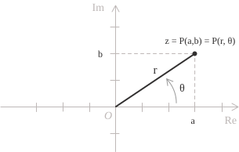

## Definizione

Come abbiamo visto nella [definizione](../complex-numbers/), la forma algebrica di un numero complesso esprime un numero $z$ esplicitando la sua componente reale e quella immaginaria ed è data dalla seguente espressione:

$$z = a + bi \tag{1}$$

Ogni numero complesso non nullo della forma $(1)$ si può anche descrivere ricorrendo a delle grandezze geometriche. Se immaginiamo un generico punto $z$ come coppia di coordinate sull'asse reale e sull'asse immaginario possiamo considerare la distanza dall'origine del punto e la sua posizione angolare nel piano complesso. In questo modo otteniamo la forma trigonometrica, detta anche forma polare, di un numero complesso che è espressa dalla seguente identità:

$$z = r(\cos\theta + i\sin\theta) \tag{2}$$

$r$ è il [modulo](../complex-numbers/), ossia la distanza di $z$ dall'origine nel piano complesso ed è dato da:

$$r = |z| = \sqrt{a^2 + b^2}\tag{3}$$

Geometricamente corrisponde alla lunghezza dell'ipotenusa del triangolo rettangolo determinato dalla parte reale e da quella immaginaria. $\theta = \arg(z)$ è invece l'argomento, e cioè l'[angolo in radianti](../angles-and-angular-measure/) tra il semiasse reale positivo e il [vettore](../vectors/) che rappresenta $z.$

Vediamo adesso come possiamo ricavare la forma trigonometrica $(2)$ dalla forma algebrica $(1).$ Consideriamo il punto $P(a, b)$ che rappresenta $z$ nel piano complesso. Le sue coordinate si ottengono proiettando il vettore $\overrightarrow{OP},$ di modulo $r,$ sui due assi. Il [coseno](../cosine-function/) e il [seno](../sine-function/) dell'argomento $\theta$ determinano rispettivamente la componente reale e quella immaginaria, con i segni corrispondenti al quadrante in cui si trova $P:$

$$ \tag{4}
\begin{align}
a &= r\cos(\theta) \\[6pt]
b &= r\sin(\theta)
\end{align}
$$

Sostituendo le espressioni delle coordinate date dalla $(4)$ nella forma algebrica $(1)$ si ricava la forma trigonometrica $(2):$

$$
\begin{align}
z = (a, b) &= a + ib \\[6pt]
           &= r\cos(\theta) + ir\sin(\theta) \\[6pt]
           &= r[\cos(\theta) + i\sin(\theta)]
\end{align}
$$

Una forma equivalente alla $(2)$ è data dalla [rappresentazione esponenziale](../complex-numbers-exponential-form/), espressa dalla seguente identità:

$$z = re^{i\theta} \tag{5}$$

La $(5),$ come discusso nella voce dedicata, deriva dalla [formula di Eulero](../euler-formula/) che consente di esprimere il termine tra parentesi nella $(2)$ mediante un esponenziale complesso ed è data dalla seguente identità:

$$e^{i\theta} = \cos(\theta) + i\sin(\theta) \tag{6}$$

- - -

Abbiamo visto che il [coniugato](../complex-numbers/) di un numero complesso in forma algebrica è dato dalla seguente identità:

$$\overline{z} = a-ib \tag{7}$$

La stessa caratterizzazione di coniugato si può ottenere nella forma trigonometrica e si ottiene sostituendo $\theta$ con $-\theta$ nella $(2).$ Geometricamente, questo corrisponde a riflettere $z$ rispetto all'asse reale e poiché il coseno è una funzione pari e il seno è invece dispari, si ottiene che il coniugato è dato da:

$$\overline{z} = r(\cos\theta - i\sin\theta) \tag{8}$$

Applicando lo stesso ragionamento sulla parità alla rappresentazione esponenziale mediante la formula di Eulero, si ottiene l'identità analoga per il coniugato in forma esponenziale, che viene indicato come:

$$\overline{z} = re^{-i\theta} \tag{9}$$

## Operazioni

Di seguito vengono illustrate le principali operazioni sui numeri complessi espressi in forma trigonometrica iniziando dal prodotto. Consideriamo due numeri $z_1$ e $z_2$ entrambi in forma trigonometrica:

$$
\begin{align}
z_1 &= r_1[\cos(\theta_1) + i\sin(\theta_1)] \\[6pt]
z_2 &= r_2[\cos(\theta_2) + i\sin(\theta_2)]
\end{align}
$$

Il loro prodotto è un numero complesso che ha per modulo il prodotto dei moduli e per argomento la somma degli argomenti:

$$z_1 \cdot z_2 = r_1 r_2[\cos(\theta_1 + \theta_2) + i\sin(\theta_1 + \theta_2)] \tag{10}$$

Geometricamente, moltiplicare $z_1$ per un numero complesso non nullo $z_2$ significa moltiplicare la sua distanza dall'origine per $r_2$ e ruotare il vettore che lo rappresenta di un angolo $\theta_2.$ Questa rotazione avviene in senso antiorario se $\theta_2 > 0$ e in senso orario se $\theta_2 < 0.$ Si ottiene così un numero complesso di modulo $r_1r_2$ e argomento $\theta_1 + \theta_2,$ come espresso nella $(10).$

Per il quoziente, con $z_2 \neq 0,$ la regola del prodotto $(10)$ si modifica sostituendo il prodotto dei moduli con il loro rapporto e la somma degli argomenti con la loro differenza. Il modulo di $z_1/z_2$ è quindi $r_1/r_2$ e il suo argomento è $\theta_1 - \theta_2:$

$$\frac{z_1}{z_2} = \frac{r_1}{r_2}\left[\cos(\theta_1 - \theta_2) + i\sin(\theta_1 - \theta_2)\right] \tag{11}$$

Per l'addizione non si dispone di una regola altrettanto semplice quanto quelle del prodotto $(10)$ e del quoziente $(11)$ e generalmente si passa alla forma algebrica e si sommano separatamente le parti reali e quelle immaginarie. Per prima cosa scriviamo la somma come:

$$z_1 + z_2 = x + iy \tag{12}$$

Le componenti $x$ e $y$ della $(12)$ sono date da:

$$
\begin{align}
x &= r_1\cos\theta_1 + r_2\cos\theta_2 \\[6pt]
y &= r_1\sin\theta_1 + r_2\sin\theta_2
\end{align}
$$

Per esprimere la $(12)$ in forma trigonometrica dobbiamo prima calcolare il modulo e poi l'argomento. Per il modulo otteniamo:

$$r = \sqrt{x^2 + y^2}$$

Per il calcolo dell'argomento occorre considerare il quadrante del punto $(x, y)$ nel piano complesso. Come indicato nell'[introduzione ai numeri complessi](../complex-numbers/), quando $x > 0,$ l'argomento è dato da:

$$\theta = \arctan\left(\frac{y}{x}\right)$$

> Quando $x < 0,$ al valore dell'arcotangente si aggiunge $\pi$ se $y \geq 0,$ oppure si sottrae $\pi$ se $y < 0.$ Quando $x = 0,$ l'argomento è $\pi/2$ se $y > 0$ e $-\pi/2$ se $y < 0.$ Se $x = y = 0,$ la somma è nulla e il suo argomento non è definito.

## Esempio

Proviamo a riscrivere in forma trigonometrica il seguente complesso:

$$z = 1 + i \tag{13}$$

Come prima cosa calcoliamo il modulo. Poiché $a = 1$ e $b = 1,$ si ottiene:

$$r = \sqrt{a^2 + b^2} = \sqrt{1^2 + 1^2} = \sqrt{2}$$

Per determinare l'argomento osserviamo che il punto $(1, 1)$ appartiene al primo quadrante del piano complesso, dove entrambe le componenti sono positive. Poiché $a > 0,$ l'argomento è dato dalla seguente catena di uguaglianze:

$$\theta = \arctan\left(\frac{b}{a}\right) = \arctan\left(\frac{1}{1}\right) = \arctan(1) = \frac{\pi}{4} \tag{14}$$

Il risultato ottenuto concorda con la posizione geometrica del numero della $(13)$ e appartiene alla bisettrice del primo quadrante, che forma un angolo di $\pi/4$ radianti con il semiasse reale positivo. Sostituendo i valori ottenuti dalla $(13)$ e dalla $(14)$ nella $(2)$ otteniamo la forma trigonometrica del numero $(13):$

$$z = \sqrt{2}\left(\cos\frac{\pi}{4} + i\sin\frac{\pi}{4}\right)$$

- - -

Consideriamo ora $z = -\sqrt{3} - i$ e scriviamolo nella forma trigonometrica. Il modulo è:

$$r = \sqrt{(-\sqrt{3})^2 + (-1)^2} = 2$$

Il rapporto tra la parte immaginaria e quella reale è positivo, quindi:

$$\arctan\left(\frac{-1}{-\sqrt{3}}\right) = \arctan\left(\frac{1}{\sqrt{3}}\right) = \frac{\pi}{6}$$

L'angolo $\pi/6$ appartiene però al primo quadrante, mentre il punto $(-\sqrt{3}, -1)$ si trova nel terzo, quindi per ottenere l'argomento principale sottraiamo $\pi:$

$$\theta = \frac{\pi}{6} - \pi = -\frac{5\pi}{6}$$

La forma trigonometrica cercata è quindi:

$$z = 2\left[\cos\left(-\frac{5\pi}{6}\right) + i\sin\left(-\frac{5\pi}{6}\right)\right]$$

> Se arrivati a questo punto la costruzione dell'argomento non dovesse essere ancora chiara, per una spiegazione delle correzioni da applicare nel calcolo dell'argomento in base al quadrante, rimandiamo alla voce sui [numeri complessi](../complex-numbers/), dove viene illustrato come si determina l'argomento a partire dalle componenti reale e immaginaria.
