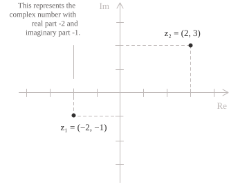
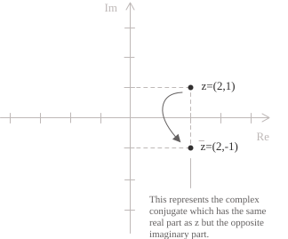
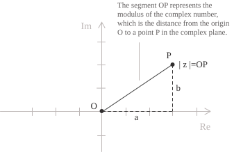

## Costruzione

I numeri complessi nascono per superare alcune limitazioni dell'insieme dei numeri reali $\mathbb{R},$ in particolare l'impossibilità di estrarre radici di indice pari di numeri negativi. Una conseguenza di questa restrizione è che le equazioni di secondo grado con discriminante negativo non hanno soluzioni reali. Un esempio è dato dalla seguente equazione:

$$x^2 + 1 = 0 \tag{1}$$

Nell'insieme $\mathbb{R}$ nessun numero ha un quadrato uguale a $-1,$ perché il quadrato di ogni numero reale è sempre non negativo e quindi anche la $(1)$ non ha soluzioni in $\mathbb{R}.$ Per risolvere questo problema è stata introdotta l'unità immaginaria $i,$ definita dalla seguente proprietà:

$$i^2 = -1 \tag{2}$$

Con questa definizione la $(1)$ ammette due radici complesse distinte pari a $\pm i.$ Questa costruzione è ridotta a una mera convenzione di notazione che però lascia aperta una domanda, e cioè se $i$ esista e in quale senso matematico. Per rispondere a questo problema partiamo dal considerare il prodotto cartesiano $\mathbb{R}^2$, e cioè l'insieme di tutte le coppie ordinate di numeri reali. Ogni elemento è una coppia della forma $(a, b)$ con $a, b \in \mathbb{R}$ rappresentata sul piano euclideo. Consideriamo ora di voler dotare questo insieme di una struttura algebrica che lo renda un campo. Come sappiamo dalla definizione, per caratterizzare un campo, dobbiamo definire l'operazione di addizione e moltiplicazione su $\mathbb{R}^2$.

Iniziamo dall'addizione, definendola componente per componente e cioè date due coppie $(a, b)$ e $(c, d),$ la loro somma è pari alla $(3)$:

$$ \tag{3}
(a, b) + (c, d) \ = \ (a + c, \ b + d)
$$

Questa definizione è esattamente uguale all'operazione di addizione dei vettori su un piano, come è stato trattato nella specifica voce. La moltiplicazione, invece, è ciò che distingue la struttura algebrica dei numeri complessi da quella di $\mathbb{R}^2$ considerato come spazio vettoriale. Infatti il prodotto di due coppie è definito come:

$$
(a, b) \cdot (c, d) \ = \ (ac - bd, \ ad + bc) \tag{4}
$$

Con l'addizione $(3)$ e la moltiplicazione $(4),$ $\mathbb{R}^2$ è un campo che estende $\mathbb{R}.$ Perciò l'insieme $\mathbb{R}^2$ in cui sono definite la $(3)$ e la $(4)$ si indica con $\mathbb{C}$ e i suoi elementi sono proprio i numeri complessi. Quindi, nella rappresentazione che abbiamo appena introdotto, i numeri reali corrispondono alle coppie con seconda componente uguale a zero. La coppia $(0, 1)$ è quindi un numero complesso non reale e per calcolarne il quadrato, applichiamo la regola $(4)$ ottenendo:

$$
(0, 1) \cdot (0, 1) \ = \ (0 \cdot 0 - 1 \cdot 1,\ 0 \cdot 1 + 1 \cdot 0) \ =\ (-1,0)
$$

L'elemento $(0, 1)$ di $\mathbb{C}$ soddisfa dunque la relazione $(2)$ richiesta al simbolo $i$ che viene rappresentato anche come:

$$i = (0, 1) \tag{5}$$

Con la notazione appena introdotta, ogni numero complesso $(a, b)$ si può scomporre come la combinazione dei due elementi di base $(1, 0)$ e $(0, 1),$ che corrispondono rispettivamente a $1$ e a $i.$ Quello che otteniamo è quindi la forma algebrica di un numero complesso data da:

$$z = a+bi\tag{6}$$

Nella $(6),$ $a$ prende il nome di parte reale $\mathrm{Re}(z) = a$ e $b$ di parte immaginaria $\mathrm{Im}(z) = b.$ La $(6)$ deriva dalla seguente catena di uguaglianze:

$$
\begin{align}
(a, \ b) &= (a,\ 0) + (0,\ b) \\[6pt]
&= a\cdot(1,\ 0) + b\cdot(0,\ 1) \\[6pt]
&= a + bi
\end{align}
$$

Ad esempio, il numero $z = 2 + 3i$ ha parte reale $2$ e parte immaginaria $3,$ mentre i numeri della forma $z = ib$ sono numeri immaginari puri. Oltre alla forma algebrica data dalla $(6)$, possiamo esprimere un numero complesso mediante due forme molto utili che hanno una trattazione a parte. La prima è la forma trigonometrica o forma polare data dalla seguente relazione:

$$z = r(\cos\theta + i\sin\theta) \tag{7}$$

La seconda invece è la forma esponenziale:

$$z = re^{i\theta} \tag{8}$$

Formalmente, possiamo quindi rappresentare l'insieme dei numeri complessi con la seguente scrittura:

$$ \tag{9}
\mathbb{C} := \{ z = a + ib \mid a, b \in \mathbb{R}\}
$$
## Piano complesso

Come abbiamo visto nella definizione, l'insieme $\mathbb{C}$ ha la struttura di un prodotto cartesiano, perciò i numeri complessi si possono rappresentare geometricamente nel piano complesso, detto anche piano di Gauss o di Argand, dove la parte reale corrisponde alla coordinata $x$ e la parte immaginaria alla coordinata $y.$

Il generico numero complesso $z = x + iy$ si rappresenta quindi come il punto $(x, y)$ nel piano complesso mentre un numero immaginario puro è rappresentato, per esempio, dalla coppia ordinata $i = (0,1).$

## Coniugato e modulo

Il coniugato e il modulo di un numero complesso $z$ si ricavano dalle sue parti reale e immaginaria e ammettono entrambi un'interpretazione geometrica nel piano complesso. Nello specifico, dato un numero complesso $z$ in forma algebrica, il suo coniugato è definito come segue:

$$\overline{z} = a - bi\tag{10}$$

Sul piano di Gauss $\overline{z}$ è il punto simmetrico di $z$ rispetto all'asse reale, come rappresentato nell'immagine:

Il modulo, invece, corrisponde alla distanza dall'origine del punto $(a,b)$ ed è definito come:

$$
|z| = \sqrt{a^2 + b^2} \tag{11}
$$

La $(11)$ segue direttamente dal teorema di Pitagora, in quanto il modulo è la lunghezza dell'ipotenusa di un triangolo rettangolo i cui cateti hanno lunghezze $|a|$ e $|b|.$

Per esempio, se consideriamo il numero complesso $z = 3 + 2i$ e sostituiamo $a = 3$ e $b = 2$ nella $(11)$ otteniamo che il modulo è pari a:

$$|z| = \sqrt{3^2 + 2^2} = \sqrt{9 + 4} = \sqrt{13}$$

## Argomento

L'argomento di un numero complesso, indicato come $\arg(z),$ è l'angolo $\theta$ tra il semiasse reale positivo e il segmento che congiunge l'origine al punto $(a, b)$ nel piano complesso e si misura in radianti, in senso antiorario a partire dal semiasse reale positivo. L'argomento non è mai univoco. Infatti, se $\theta$ è un argomento di $z,$ anche $\theta + 2k\pi$ lo è per ogni intero $k.$ Tra tutti questi angoli, l'argomento principale $\mathrm{Arg}(z)$ è l'unico che soddisfa la seguente condizione:

$$
-\pi < \mathrm{Arg}(z) \leq \pi \tag{13}
$$

Quando calcoliamo l'argomento dobbiamo tener conto dei valori di $a$ e $b$ e ricorrere all'arcotangente. Quando $a > 0,$ il punto individuato dal numero complesso $z$ si trova nel semipiano destro e l'argomento principale è dato da:

$$
\mathrm{Arg}(z) = \arctan \left(\frac{b}{a}\right) \tag{14}
$$

Quando $a < 0$ e $b \geq 0,$ il punto appartiene al secondo quadrante o al semiasse reale negativo e occorre aggiungere un $\pi$ per ottenere l'angolo nell'intervallo corretto:

$$
\mathrm{Arg}(z) = \arctan \left(\frac{b}{a}\right) + \pi \tag{15}
$$

Quando $a < 0$ e $b < 0,$ il punto appartiene al terzo quadrante e bisogna aggiungere $-\pi:$

$$
\mathrm{Arg}(z) = \arctan \left(\frac{b}{a}\right) - \pi \tag{15}
$$

Infine, quando $a = 0,$ il punto appartiene all'asse immaginario e il rapporto nell'arcotangente non è definito. In questo caso, se $b > 0,$ allora $\mathrm{Arg}(z) = \pi/2,$ mentre se $b < 0,$ abbiamo che $\mathrm{Arg}(z) = -\pi/2.$ Il caso $z = 0$ è escluso, perché l'argomento nell'origine non è definito.

Come esempio, consideriamo il numero complesso $z = -1 + i.$ La parte reale è negativa e la parte immaginaria è positiva, quindi il punto appartiene al secondo quadrante del piano complesso. Applicando l'arcotangente al rapporto $b/a = 1/(-1) = -1$ si ottiene $\arctan(-1) = -\pi/4,$ che appartiene al quarto quadrante e non è quindi l'argomento corretto. Poiché $a < 0$ e $b \geq 0,$ dobbiamo applicare la correzione della $(15)$ così da ottenere:

$$
\mathrm{Arg}(z) = -\frac{\pi}{4} + \pi = \frac{3\pi}{4}
$$

## Proprietà di $\mathbb{C}$

Analizziamo adesso le proprietà fondamentali dei numeri complessi partendo dalla proprietà associativa della somma e del prodotto per cui si hanno le seguenti relazioni.

$$ \tag{16}
\begin{align}
(z_1 + z_2) + z_3 &= z_1 + (z_2 + z_3) \\[6pt]
(z_1 \cdot z_2) \cdot z_3 &= z_1 \cdot (z_2 \cdot z_3)
\end{align}
$$

Per la proprietà commutativa, invece, abbiamo:

$$\tag{17}
\begin{align}
z_1 + z_2 &= z_2 + z_1 \\[6pt]
z_1 \cdot z_2 &= z_2 \cdot z_1
\end{align}
$$

Infine, per la proprietà distributiva vale la seguente uguaglianza:

$$z_1 \cdot (z_2 + z_3) = z_1 \cdot z_2 + z_1 \cdot z_3 \tag{18}$$

- - -

Vediamo ora come si comporta l'elemento neutro nell'addizione e nella moltiplicazione. Nel caso della somma l'elemento neutro è $0 + 0i$ in quanto vale:

$$
\begin{align}
z + (0 + 0i) &= (a + bi) + (0 + 0i) \\[6pt]
&= (a + 0) + (b + 0)i \\[6pt]
&= a + bi \\[6pt]
&= z
\end{align}
$$

Nella moltiplicazione, invece, l'elemento neutro è $1 + 0i$ e infatti si ha:

$$
\begin{align}
z \cdot (1 + 0i) &= (a + bi) \cdot (1 + 0i) \\[6pt]
&= a \cdot 1 + a \cdot 0i + bi \cdot 1 + bi \cdot 0i \\[6pt]
&= a + bi \\[6pt]
&= z
\end{align}
$$

L'opposto di $a + bi$ è il numero complesso dato da:

$$-(a + bi) = -a - bi$$

Infine, il reciproco di un numero complesso non nullo $z = a + bi$ è il numero complesso:

$$\frac{1}{z} = \frac{a}{a^2 + b^2} - \frac{b}{a^2 + b^2} i$$

Poiché $z \neq 0,$ si ha $a^2 + b^2 > 0.$ Per verificare la formula, moltiplichiamo il numero indicato per $z$.

$$
(a + bi)\frac{a - bi}{a^2 + b^2}
= \frac{a^2 - b^2 i^2}{a^2 + b^2}
= 1
$$

Nel caso dei numeri complessi è importante fare questa precisazione e cioè che l'insieme $\mathbb{C}$ non può essere ordinato in modo compatibile con l'addizione e la moltiplicazione. Supponiamo ad esempio che esista un ordine totale $\leq$ su $\mathbb{C}$ compatibile con queste operazioni. Se questo fosse possibile, dovremmo poter confrontare $i$ con $0$ e poiché $i \neq 0,$ i casi possibili sono due.

+ Se $i > 0,$ moltiplicando entrambi i membri per $i$ si ottiene $i^2 = -1 > 0,$ in contraddizione con le proprietà di un campo ordinato.
+ Se $i < 0,$ moltiplicando entrambi i membri per $i$ e invertendo il verso della disuguaglianza si ottiene ancora $-1 > 0,$ e cioè la stessa contraddizione.

Quindi, poiché nessuno dei due casi è possibile, su $\mathbb{C}$ non esiste un ordine totale compatibile con le operazioni di campo.