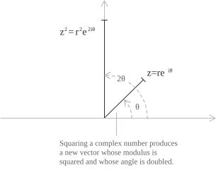
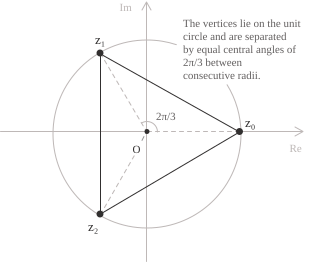

## Enunciato

Il teorema di De Moivre fornisce un metodo basato sulla forma trigonometrica per semplificare il calcolo della potenza di un numero complesso. L'elevamento al quadrato di un numero $z$ in forma algebrica è semplice e si ottiene con la formula del quadrato di un binomio:

$$ \tag{1}
\begin{align}
z^2 &= (a + ib)^2 \\[6pt]
    &= a^2 + 2iab - b^2
\end{align}
$$

Tuttavia, al crescere dell'esponente, il calcolo diventa poco pratico poiché il numero dei termini prodotti dallo sviluppo binomiale di $(a+ib)^n$ cresce con $n,$ ed è per questo che il teorema di De Moivre offre una valida e più semplice alternativa. Consideriamo un numero complesso non nullo $z$ di modulo $r$ e argomento $\theta$ e rappresentiamolo nella sua forma trigonometrica:

$$z = r(\cos\theta + i\sin\theta) \tag{2}$$

Il teorema di De Moivre afferma che, per ogni intero $n,$ la potenza $z^n$ della $(2)$ ha modulo $r^n$ e argomento $n\theta$ ed è quindi pari a:

$$z^n = r^n(\cos(n\theta) + i\sin(n\theta)) \tag{3}$$

Se l'esponente è un numero razionale $p/q$ scritto ai minimi termini, con $q > 0,$ i valori di $z^{p/q}$ sono le soluzioni dell'equazione $w^q = z^p.$ Per la $(3),$ il numero $z^p$ ha modulo $r^p$ e argomenti $p\theta + 2k\pi,$ con $k \in \mathbb{Z}.$ Applicando la $(3)$ anche a $w^q,$ ricaviamo il modulo di $w$ prendendo la radice $q$-esima di $r^p$ e i suoi argomenti dividendo per $q$ quelli di $z^p.$ Si ottengono così i $q$ valori distinti per $k = 0, 1, \ldots, q-1:$

$$w_k = r^{p/q}\left(\cos\left(\frac{p\theta + 2k\pi}{q}\right) + i\sin\left(\frac{p\theta + 2k\pi}{q}\right)\right) \tag{4}$$

Il teorema di De Moivre si applica anche quando un numero complesso è scritto in forma esponenziale:

$$z = re^{i\theta} \tag{5}$$

In questo caso si ottiene:

$$z^n = (re^{i\theta})^n = r^n e^{in\theta} \tag{6}$$

- - -

Vediamo ora la dimostrazione del teorema, dimostrando la $(3)$ per induzione, andando a verificare prima il caso base e poi la validità del passo $n$ che implica la validità del passo $n+1.$ Partiamo dal caso base, ponendo $n = 1.$ In questo caso la $(3)$ si riduce banalmente alla forma trigonometrica standard data dalla $(2).$ Supponiamo ora che la $(3)$ valga per un intero $n \geq 1.$ Quindi dobbiamo passare da $z^n$ a $z^{n+1},$ e per farlo usiamo la seguente identità:

$$z^{n+1} = z^n z \tag{7}$$

Moltiplichiamo quindi entrambi i membri della $(3)$ per $z = r(\cos\theta + i\sin\theta)$ e sviluppiamo i calcoli ottenendo:

$$z^{n+1} = r^{n+1}\bigl[(\cos(n\theta)\cos\theta - \sin(n\theta)\sin\theta) + i(\sin(n\theta)\cos\theta + \cos(n\theta)\sin\theta)\bigr] \tag{8}$$

Le due espressioni tra parentesi della $(8)$ sono le formule di addizione del coseno e del seno che consentono di riscrivere la $(8)$ come:

$$z^{n+1} = r^{n+1}(\cos((n+1)\theta) + i\sin((n+1)\theta)) \tag{9}$$

La $(9)$ è la $(3)$ con esponente $n+1.$ Questo conclude l'induzione per gli interi positivi. Quando $n=0,$ il primo membro della $(3)$ è $z^0=1$ e il secondo vale $1.$ Quando abbiamo invece un esponente negativo applichiamo la $(3)$ a $z^n$ e ne calcoliamo il reciproco, ottenendo:

$$
\begin{aligned}
z^{-n} &= \frac{1}{z^n} \\[6pt]
       &= r^{-n}(\cos(n\theta) - i\sin(n\theta)) \\[6pt]
       &= r^{-n}(\cos(-n\theta) + i\sin(-n\theta))
\end{aligned}
\tag{10}
$$

L'ultimo membro della $(10)$ coincide con quello della $(3)$ per l'esponente $-n.$

- - -

Per mostrare l'effetto dell'elevamento al quadrato di un numero complesso nel piano, scriviamo $z$ in forma esponenziale. Applicando la $(6)$ con $n=2$ il modulo passa da $r$ a $r^2$ e l'argomento da $\theta$ a $2\theta,$ quindi l'effetto sul piano è quello rappresentato in figura:

$$z^2 = (re^{i\theta})^2 = r^2 e^{2i\theta}$$

Facciamo un altro esempio e calcoliamo la quarta potenza di $z=2+2i.$ In questo caso $z$ si trova sulla bisettrice del primo quadrante, quindi bisogna ricordare che ha argomento principale $\pi/4.$ Per prima cosa riscriviamo $z$ in forma trigonometrica e applichiamo la $(3)$ con $n=4,$ ottenendo:

$$
\begin{align}
|z| &= \sqrt{2^2 + 2^2} = 2\sqrt{2} \\[6pt]
z &= 2\sqrt{2}\bigl(\cos(\pi/4) + i\sin(\pi/4)\bigr) \\[6pt]
z^4 &= (2\sqrt{2})^4(\cos\pi + i\sin\pi) \\[6pt]
    &= -64
\end{align}
$$

## Applicazioni

Il teorema di De Moivre trova una sua applicazione nella derivazione delle formule del seno e del coseno degli angoli multipli. Ad esempio, quando $n = 3,$ applicando il teorema otteniamo:

$$(\cos\theta + i\sin\theta)^3 = \cos(3\theta) + i\sin(3\theta) \tag{11}$$

Il procedimento consiste nello sviluppare il primo membro del teorema mediante il teorema binomiale e poi separare il risultato nelle parti reale e immaginaria, ottenendo:

$$
\begin{align}
\cos(3\theta) + i\sin(3\theta)
&= (\cos\theta + i\sin\theta)^3 \\[6pt]
&= \cos^3\theta + 3i\cos^2\theta\sin\theta + 3i^2\cos\theta\sin^2\theta + i^3\sin^3\theta \\[6pt]
&= (\cos^3\theta - 3\cos\theta\sin^2\theta) + i(3\cos^2\theta\sin\theta - \sin^3\theta)
\end{align}
$$

Uguagliando le parti reali e immaginarie con quelle del secondo membro del teorema si ottengono le formule di triplicazione:

$$
\begin{align}
\cos(3\theta) &= \cos^3\theta - 3\cos\theta\sin^2\theta \\[6pt]
\sin(3\theta) &= 3\cos^2\theta\sin\theta - \sin^3\theta
\end{align}
$$

- - -

Per ogni intero positivo $n,$ il teorema di De Moivre permette di calcolare le radici $n$-esime di un numero complesso risolvendo l'equazione seguente.

$$z^n = w \tag{12}$$

Supponiamo che $w \neq 0$ abbia modulo $r$ e argomento $\theta.$ Poiché tutti i suoi argomenti sono della forma $\theta + 2k\pi,$ con $k \in \mathbb{Z},$ possiamo scrivere $w$ in forma esponenziale.

$$w = re^{i(\theta + 2k\pi)} \tag{13}$$

Per risolvere la $(12),$ scriviamo $z$ in forma esponenziale e applichiamo la $(6)$ a $z^n.$ Confrontando il risultato con la $(13),$ ricaviamo il modulo di $z$ prendendo la radice $n$-esima di $r$ e gli argomenti delle soluzioni dividendo per $n$ quelli di $w.$ Si ottengono così le radici $n$-esime di $w$ con $k = 0, 1, \ldots, n-1:$

$$z_k = \sqrt[n]{r}\cdot e^{i\left(\frac{\theta + 2k\pi}{n}\right)} \tag{14}$$

Dalla $(14),$ i valori $z_0, z_1, \ldots, z_{n-1}$ sono le $n$ radici complesse che stavamo cercando. A livello geometrico, queste radici possono essere rappresentate su una circonferenza di raggio $\sqrt[n]{r}$ e centro nell'origine e sono equidistanti, con una separazione angolare di $2\pi/n.$ Per $n \geq 3,$ sono i vertici di un poligono regolare di $n$ lati inscritto in tale circonferenza come mostrato nel seguente esempio. Supponiamo di voler risolvere:

$$z^3 = 1$$

La soluzione reale $z = 1$ è immediata, ma in $\mathbb{C}$ l'equazione ha tre soluzioni distinte, equidistanti sulla circonferenza unitaria come rappresentato nell'immagine:

Poiché l'argomento di $1$ è definito modulo $2\pi,$ il numero si scrive in forma esponenziale come:

$$1 = e^{i \cdot 2k\pi} \qquad k \in \mathbb{Z}$$

Applicando la formula generale delle radici con $r = 1,$ $\theta = 0$ e con $k = 0, 1, 2$ si ottiene:

$$ \tag{15}
\begin{align}
z_k &= \sqrt[3]{1}\cdot e^{i\left(\frac{2k\pi}{3}\right)} \\[6pt]
    &= e^{i \cdot \frac{2k\pi}{3}}
\end{align}
$$

A questo punto sostituendo $k$ nella $(15)$ otteniamo le tre radici complesse:

$$
\begin{align}
z_0 &= e^{i \cdot 0} = \cos(0) + i\sin(0) = 1 \\[6pt]
z_1 &= e^{i \cdot \frac{2\pi}{3}} = \cos\left(\frac{2\pi}{3}\right) + i\sin\left(\frac{2\pi}{3}\right) = -\frac{1}{2} + i\frac{\sqrt{3}}{2} \\[6pt]
z_2 &= e^{i \cdot \frac{4\pi}{3}} = \cos\left(\frac{4\pi}{3}\right) + i\sin\left(\frac{4\pi}{3}\right) = -\frac{1}{2} - i\frac{\sqrt{3}}{2}
\end{align}
$$
