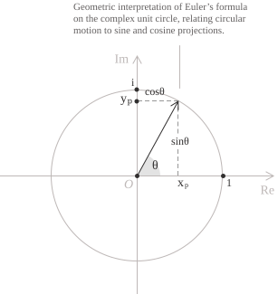

## Enunciato

La formula di Eulero mette in relazione la funzione esponenziale complessa con il seno e il coseno e per ogni $\theta \in \mathbb{R}$ è data dalla seguente identità:

$$e^{i\theta} = \cos\theta + i\sin\theta \tag{1}$$

Il membro a destra della $(1)$ separa $e^{i\theta}$ nelle sue parti reale e immaginaria, permettendo così di calcolarne il modulo:

$$|e^{i\theta}|^2 = \cos^2\theta + \sin^2\theta = 1 \tag{2}$$

Per la $(2),$ i valori di $e^{i\theta}$ appartengono alla circonferenza unitaria. Al crescere di $\theta,$ le coordinate $(\cos\theta,\sin\theta)$ percorrono la circonferenza in senso antiorario e tornano al punto di partenza dopo un incremento di $2\pi.$

La $(1)$ permette di passare dalla forma trigonometrica alla forma esponenziale di un numero complesso e da essa si ricavano anche il teorema di De Moivre e la rappresentazione delle radici dell'unità.

## Dimostrazione con le serie di Taylor

La dimostrazione diretta della $(1)$ utilizza lo sviluppo in serie di Taylor delle funzioni esponenziale, seno e coseno. In particolare, per una variabile reale $x,$ le serie delle tre funzioni sono:

$$ \tag{3}
\begin{align}
e^x &= \sum_{n=0}^{\infty} \frac{x^n}{n!} \\[6pt]
\cos x &= \sum_{n=0}^{\infty} (-1)^n \frac{x^{2n}}{(2n)!} \\[6pt]
\sin x &= \sum_{n=0}^{\infty} (-1)^n \frac{x^{2n+1}}{(2n+1)!}
\end{align}
$$

Per definire $e^z$ per $z \in \mathbb{C},$ riprendiamo la prima serie della $(3),$ quella di $e^x,$ e sostituiamo $x^n$ con $z^n$ in ogni termine.

$$e^z := \sum_{n=0}^{\infty} \frac{z^n}{n!}$$

Questa serie converge assolutamente per ogni $z,$ perché vale la seguente identità:

$$\sum_{n=0}^{\infty} \frac{|z|^n}{n!} = e^{|z|} \tag{4}$$

Sostituendo $z = i\theta$ nella definizione di $e^z$ otteniamo:

$$e^{i\theta} = \sum_{n=0}^{\infty} \frac{(i\theta)^n}{n!} = \sum_{n=0}^{\infty} \frac{i^n \ \theta^n}{n!} \tag{5}$$

Il comportamento della $(5)$ dipende dalle potenze dell'unità immaginaria e con un calcolo diretto si ottiene:

$$ \tag{6}
\begin{align}
i^0 &= 1 \\[6pt]
i^1 &= i \\[6pt]
i^2 &= -1 \\[6pt]
i^3 &= -i
\end{align}
$$

> Notate che dalla quarta potenza la struttura della $(6)$ si ripete, poiché $i^4 = (i^2)^2 = 1$ e quindi $i^{n+4} = i^n$ per ogni $n.$ Il valore di $i^n$ dipende soltanto dal resto di $n$ modulo $4.$

Separiamo ora la serie per $n = 2k$ e $n = 2k+1$ e determiniamo le corrispondenti potenze di $i$ che sono $i^{2k} = (i^2)^k = (-1)^k$ e $i^{2k+1} = i \cdot (-1)^k.$ A questo punto possiamo raccogliere i contributi separatamente, ottenendo la seguente uguaglianza:

$$ \tag{7}
\begin{align}
e^{i\theta} &= \sum_{k=0}^{\infty} \frac{i^{2k} \ \theta^{2k}}{(2k)!} + \sum_{k=0}^{\infty} \frac{i^{2k+1} \ \theta^{2k+1}}{(2k+1)!} \\[6pt]
&= \sum_{k=0}^{\infty} (-1)^k \frac{\theta^{2k}}{(2k)!} + i \sum_{k=0}^{\infty} (-1)^k \frac{\theta^{2k+1}}{(2k+1)!}
\end{align}
$$

Ponendo $x = \theta$ nella $(3),$ vediamo che la prima somma nell'ultima riga della $(7)$ vale $\cos\theta$ e che la somma che moltiplica $i$ vale $\sin\theta.$ L'ultimo membro della $(7)$ vale dunque $\cos\theta + i\sin\theta$ e così abbiamo ottenuto proprio la $(1).$

## Dimostrazione con un'equazione differenziale

La $(1)$ si può anche dimostrare con il ricorso alle equazioni differenziali, verificando che i due membri soddisfano la stessa equazione e assumono lo stesso valore in $\theta = 0.$ Per farlo, indichiamo con $f : \mathbb{R} \to \mathbb{C}$ la funzione data dal secondo membro della $(1):$

$$f(\theta) = \cos\theta + i\sin\theta \tag{8}$$

Deriviamo separatamente le parti reale e immaginaria della $(8)$ ottenendo un'equazione che lega $f$ alla sua derivata:

$$ \tag{9}
\begin{align}
f'(\theta) &= -\sin\theta + i\cos\theta \\[6pt]
&= i(\cos\theta + i\sin\theta) \\[6pt]
&= if(\theta)
\end{align}
$$

Poniamo ora $g(\theta) = e^{i\theta}.$ La serie di potenze della $(5)$ ha raggio di convergenza infinito, quindi possiamo derivarla termine a termine. Semplifichiamo $n/n! = 1/(n-1)!$ e poniamo $k = n-1,$ ottenendo:

$$ \tag{10}
\begin{align}
g'(\theta) &= \sum_{n=1}^{\infty} \frac{i^n\theta^{n-1}}{(n-1)!} \\[6pt]
&= i\sum_{k=0}^{\infty} \frac{(i\theta)^k}{k!} \\[6pt]
&= ig(\theta)
\end{align}
$$

Le $(9)$ e $(10)$ mostrano che la derivata di ciascuna funzione è uguale alla funzione stessa moltiplicata per $i.$ In $\theta = 0$ i due valori coincidono, perché $f(0) = \cos 0 + i\sin 0 = 1$ e $g(0) = e^0 = 1.$ Se indichiamo con $u$ una delle due funzioni, possiamo quindi scrivere queste condizioni:

$$ \tag{11}
\begin{align}
u'(\theta) &= iu(\theta) \\[6pt]
u(0) &= 1
\end{align}
$$

La $(11)$ ha un'unica soluzione su $\mathbb{R}$ e dunque $f(\theta) = g(\theta)$ per ogni $\theta \in \mathbb{R},$ come afferma la $(1).$

## Conseguenze e identità di Eulero

Dalla $(1)$ possiamo esprimere il seno e il coseno in termini di funzioni esponenziali. Per prima cosa sostituiamo $\theta$ con $-\theta$ ottenendo:

$$e^{-i\theta} = \cos\theta - i\sin\theta \tag{12}$$

Sommando la $(12)$ alla $(1)$ ricaviamo la forma esponenziale del coseno, mentre sottraendola dalla $(1)$ ricaviamo quella del seno:

$$ \tag{13}
\begin{align}
\cos\theta &= \frac{e^{i\theta} + e^{-i\theta}}{2} \\[6pt]
\sin\theta &= \frac{e^{i\theta} - e^{-i\theta}}{2i}
\end{align}
$$

La $(13)$ permette di estendere il seno e il coseno agli argomenti complessi e di collegarli alle funzioni iperboliche. Se invece moltiplichiamo entrambi i membri della $(1)$ per il modulo $r,$ passiamo dalla forma trigonometrica alla forma esponenziale $z = re^{i\theta}.$ In questa forma, il coniugato si ottiene cambiando il segno di $\theta.$ Più in generale, per $x,y \in \mathbb{R}$ si può scrivere $e^{x+iy} = e^xe^{iy}$ e applicare la $(1)$ al secondo fattore ottenendo:

$$e^{x+iy} = e^x(\cos y + i\sin y) \tag{14}$$

Se infine sostituiamo $\theta = \pi$ nella $(1)$ e aggiungiamo $1$ a entrambi i membri otteniamo l'identità di Eulero:

$$ \tag{15}
\begin{align}
e^{i\pi} &= \cos\pi + i\sin\pi = -1 + i\cdot 0 = -1 \\[6pt]
e^{i\pi} + 1 &= -1 + 1 \\[6pt]
e^{i\pi} + 1 &= 0
\end{align}
$$
