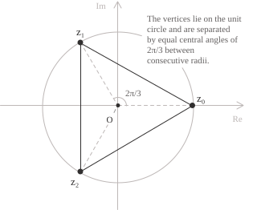

## Calcolo e proprietà delle radici

Una radice $n$-esima dell'unità è un numero complesso $z$ che per un intero positivo $n$ soddisfa la seguente equazione:

$$z^n = 1 \tag{1}$$

L'equazione $(1)$ ha esattamente $n$ soluzioni in $\mathbb{C}.$ Per determinarle, usiamo la formula di Eulero, che per ogni $\theta \in \mathbb{R}$ dà l'identità

$$e^{i\theta} = \cos\theta + i\sin\theta \tag{2}$$

Prendendo il modulo di entrambi i membri della $(1)$ si ottiene $|z|^n = 1,$ quindi $|z| = 1.$ Possiamo perciò scrivere $z = e^{i\theta}$ e sostituirlo nella $(1),$ ottenendo:

$$e^{in\theta} = 1 \tag{3}$$

Dalla $(2)$ segue che la $(3)$ equivale alle condizioni $\cos(n\theta) = 1$ e $\sin(n\theta) = 0$ che valgono solo se $n\theta = 2\pi k$ per un intero $k,$ da cui si ha $\theta = 2\pi k/n.$ Scegliendo $k = 0, 1, \ldots, n-1$ otteniamo tutti gli argomenti distinti in $[0, 2\pi)$ e quindi le $n$ radici che sono date dalla seguente espressione:

$$z_k = e^{2\pi ik/n} \tag{4}$$

Applicando la $(2)$ a ciascuna radice della $(4)$ si ottiene la rappresentazione algebrica delle radici:

$$z_k = \cos\left(\frac{2\pi k}{n}\right) + i\sin\left(\frac{2\pi k}{n}\right) \tag{5}$$

Dalla $(4)$ si ottiene $z_0 = 1$ per ogni $n.$ Per $n = 2,$ gli argomenti sono $0$ e $\pi,$ a cui corrispondono le radici $1$ e $-1.$ Per $n = 4,$ gli argomenti sono $0, \pi/2, \pi, 3\pi/2$ e le radici corrispondenti sono $1, i, -1, -i.$ La $(5)$ mostra anche come si ottiene la coniugata di una radice. Se sostituiamo $k$ con $n-k,$ l'angolo $2\pi k/n$ diventa $2\pi - 2\pi k/n$ e si ottiene la seguente identità:
$$z_{n-k} = \overline{z_k} \tag{6}$$

Nella $(6)$ gli indici sono intesi modulo $n.$ Le radici non reali si presentano quindi in coppie coniugate distinte.

- - -

Mostriamo adesso come l'insieme delle radici $n$-esime dell'unità date dalla $(4)$ che indichiamo con $\mu_n$ è un gruppo. La moltiplicazione nel campo complesso preserva la condizione che definisce le radici nella $(1),$ quindi affinché $\mu_n$ sia un gruppo rispetto a questa operazione devono valere i seguenti assiomi.

Il primo assioma è quello della chiusura, ovvero il prodotto di due elementi di $\mu_n$ deve appartenere ancora a $\mu_n.$ Dalla $(4)$ si ottiene $z_j z_k = e^{2\pi i(j+k)/n}.$ Ridurre $j+k$ modulo $n$ modifica l'argomento di un multiplo di $2\pi$ e lascia invariato il prodotto. Si ottiene così la legge di moltiplicazione in $\mu_n$.

   $$z_j z_k = z_{(j+k) \bmod n} \tag{7}$$

Il secondo assioma è l'associatività. Poiché la moltiplicazione è associativa in $\mathbb{C},$ per ogni $z_j, z_k, z_\ell \in \mu_n$ si ha:

$$(z_j z_k)z_\ell = z_j(z_k z_\ell) \tag{8}$$ 

Il terzo assioma richiede l'esistenza dell'elemento neutro. Questo si dimostra facilmente in quanto dalla $(4)$ si ottiene $z_0 = 1.$ Poiché $1$ è l'elemento neutro della moltiplicazione in $\mathbb{C},$ per ogni $z_k \in \mu_n$ si ha:

$$z_0 z_k = z_k z_0 = z_k \tag{9}$$

L'ultimo assioma richiede che ogni radice abbia un inverso in $\mu_n.$ Poiché gli indici $k$ e $n-k$ hanno somma congruente a $0$ modulo $n,$ dalla $(7)$ si ottiene:

$$z_k z_{n-k} = z_{n-k}z_k = z_0 \tag{10}$$

L'inverso di $z_k$ è quindi $z_{n-k},$ che per la $(6)$ coincide con il suo coniugato $\overline{z_k}.$

La legge di moltiplicazione $(7)$ mostra che moltiplicare una radice per $z_1 = e^{2\pi i/n}$ equivale ad aumentare il suo indice di $1$ modulo $n.$ Partendo dall'elemento neutro $z_0$ si ottengono così, nell'ordine, tutte le radici. Per ogni $k = 0, 1, \ldots, n-1$ vale l'identità:

$$z_1^k = z_k \tag{11}$$

Per la $(11),$ il gruppo $\mu_n$ è ciclico di ordine $n$ e ha come generatore $z_1.$ È inoltre abeliano, perché la moltiplicazione complessa è un'operazione commutativa.

- - -

Dalla $(4)$ si vede che le radici giacciono sulla circonferenza unitaria e che due radici consecutive sono separate da un angolo di $2\pi/n.$ Quando $n \geq 3$ queste radici sono i vertici di un poligono regolare di $n$ lati, con il primo vertice in $z_0 = 1.$ Per $n = 3,$ la $(5)$ dà i vertici del triangolo equilatero mostrato in figura:

$$
\begin{aligned}
z_0 &= 1 \\[6pt]
z_1 &= e^{2\pi i/3} = -\frac{1}{2} + i\frac{\sqrt{3}}{2} \\[6pt]
z_2 &= e^{4\pi i/3} = -\frac{1}{2} - i\frac{\sqrt{3}}{2}
\end{aligned}
\tag{12}
$$

La legge $(7)$ descrive anche la rotazione dei vertici in quanto moltiplicare per $z_1$ ruota il piano di $2\pi/n$ attorno all'origine e manda ciascun vertice nel successivo, secondo la seguente relazione:

$$z_1 z_k = z_{(k+1) \bmod n} \tag{13}$$

Ripetendo la rotazione $(13)$ si ottengono tutte le $n$ simmetrie di rotazione del poligono, compresa l'identità

## Radici primitive

Dalla $(11)$ si vede che ogni radice di $\mu_n$ si ottiene come potenza di $z_1$ e in questo senso si dice che $z_1$ genera $\mu_n.$ Una radice $z_k$ si dice primitiva se anch'essa genera $\mu_n,$ cioè se le sue potenze, a partire da $z_k^0 = 1,$ danno tutte le $n$ radici prima di tornare a $1.$ In questo caso, il suo ordine è $n.$

Per determinare l'ordine di $z_k,$ osserviamo che dalla $(11)$ segue $z_k^m = z_1^{km}.$ Poiché $z_1$ ha ordine $n,$ si ha $z_k^m = 1$ se e solo se $n$ divide $km.$ Ponendo $d = \gcd(k,n),$ questa condizione equivale a richiedere che $n/d$ divida $m,$ perché $k/d$ e $n/d$ sono coprimi. Il più piccolo intero positivo che la soddisfa è quindi $n/d$ e l'ordine di $z_k$ è dato dalla seguente relazione:

$$\mathrm{ord}(z_k) = \frac{n}{\gcd(k,n)} \tag{14}$$

Dalla $(14)$ segue il criterio che $z_k$ è primitiva se e solo se $\gcd(k,n) = 1.$ Per esempio, quando $n = 6,$ gli unici indici coprimi con $6$ tra $0$ e $5$ sono $1$ e $5.$ Dalla $(4)$ si ottengono quindi le due radici primitive $z_1 = e^{\pi i/3}$ e $z_5 = e^{5\pi i/3}.$ Se $n$ è primo, ogni indice da $1$ a $n-1$ è coprimo con $n,$ perciò tutte le radici tranne $z_0 = 1$ sono primitive. Quindi, se $\zeta$ è una qualsiasi radice primitiva, le sue prime $n$ potenze, a partire da $\zeta^0 = 1,$ danno l'intero insieme:

$$\mu_n = \{1, \zeta, \zeta^2, \ldots, \zeta^{n-1}\}$$

## Somma e prodotto delle radici

Una caratteristica particolare della somma di tutte le radici $n$-esime dell'unità è che questa somma è nulla per ogni $n \geq 2.$ Per dimostrarlo osserviamo che il polinomio $z^n - 1$ può essere fattorizzato come:

$$z^n - 1 = (z - z_0)(z - z_1) \cdots (z - z_{n-1}) \tag{15}$$

Nel membro a destra della $(15),$ un termine di grado $n-1$ si ottiene scegliendo il termine costante $-z_k$ da un solo fattore e il termine $z$ da ciascuno degli altri $n-1$ fattori. Ogni scelta contribuisce con $-z_k z^{n-1},$ perciò il coefficiente di $z^{n-1}$ è $-(z_0 + z_1 + \cdots + z_{n-1}).$ A sinistra della $(15)$ questo coefficiente è zero, perché per $n \geq 2$ il polinomio $z^n-1$ ha solo il termine di grado $n$ e il termine costante. Uguagliando i due coefficienti si ottiene:

$$\sum_{k=0}^{n-1} z_k = 0 \tag{16}$$

Una dimostrazione alternativa usa la formula della serie geometrica. Poiché $z_1 \neq 1$ quando $n \geq 2,$ vale:

$$\sum_{k=0}^{n-1} z_1^k = \frac{z_1^n - 1}{z_1 - 1} = \frac{1 - 1}{z_1 - 1} = 0 \tag{17}$$

Per la $(16),$ la media delle radici è zero. Quando $n \geq 3,$ questo significa che il baricentro dei vertici del poligono regolare coincide con l'origine mentre per $n = 2,$ lil punto medio tra $1$ e $-1$ è dato dall'origine.

Dopo la somma, vediamo come si calcola il prodotto delle radici. Per farlo basta porre $z = 0$ nella $(15)$ e in questo modo si ottiene la formula di Viète per il prodotto delle radici che è data dalla seguente uguaglianza:

$$\prod_{k=0}^{n-1} z_k = (-1)^{n+1} \tag{18}$$

La $(18)$ si può verificare anche con il teorema di De Moivre. Per la $(11),$ il prodotto delle radici è $z_1^{n(n-1)/2}.$ Il teorema dà per questa potenza modulo $1$ e argomento $\pi(n-1),$ da cui il valore $(-1)^{n-1} = (-1)^{n+1}.$

## Polinomi ciclotomici

Nella fattorizzazione $(15)$ ogni radice $z_k$ dà un fattore lineare $z-z_k.$ Possiamo raggruppare questi fattori in base all'ordine delle radici. Il prodotto dei fattori associati alle radici di ordine esattamente $n$ è l'$n$-esimo polinomio ciclotomico $\Phi_n.$ Per la $(14)$ queste sono le radici con $\gcd(k,n)=1,$ quindi il polinomio è dato da:

$$\Phi_n(z) = \prod_{\substack{0 \leq k < n \\ \gcd(k,n)=1}} (z-z_k) \tag{19}$$

La $(19)$ contiene un fattore per ciascuna radice primitiva $n$-esima dell'unità. Più in generale, l'ordine $d$ di una radice della $(15)$ divide $n.$ Viceversa, se $d$ divide $n,$ ogni radice primitiva $d$-esima soddisfa anche $z^n=1,$ perché $z^n=(z^d)^{n/d}.$ Il gruppo di fattori associati alle radici di ordine $d$ forma quindi $\Phi_d(z),$ e la $(15)$ si può riscrivere nella seguente forma:

$$z^n-1 = \prod_{d \mid n} \Phi_d(z) \tag{20}$$

Per esempio, quando $n=4,$ la radice $1$ ha ordine $1,$ la radice $-1$ ha ordine $2$ e le radici $i$ e $-i$ hanno ordine $4.$ Raggruppando i fattori secondo questi ordini, la $(20)$ dà:

$$z^4-1 = \Phi_1(z)\Phi_2(z)\Phi_4(z) = (z-1)(z+1)(z^2+1) \tag{21}$$
