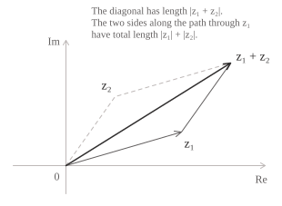
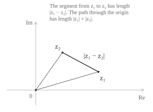

## Definizione

La disuguaglianza triangolare consente di maggiorare il modulo della somma di due numeri complessi $z_1$ e $z_2$ con la somma dei loro moduli ed è data dalla seguente relazione:

$$|z_1 + z_2| \leq |z_1| + |z_2| \tag{1}$$

Per dimostrare la $(1)$ usiamo l'identità $|z|^2 = z\overline{z}$ e la seguente proprietà del coniugato di una somma.

$$\overline{z_1 + z_2} = \overline{z_1} + \overline{z_2} \tag{2}$$

Calcoliamo quindi $|z_1 + z_2|^2$ e otteniamo:

$$
\begin{aligned}
|z_1 + z_2|^2 &= (z_1 + z_2)\overline{(z_1 + z_2)} \\[6pt]
              &= (z_1 + z_2)(\overline{z_1} + \overline{z_2}) \\[6pt]
              &= |z_1|^2 + z_1\overline{z_2} + \overline{z_1}z_2 + |z_2|^2
\end{aligned}
\tag{3}
$$

Nell'ultima uguaglianza della $(3)$ i termini $z_1\overline{z_2}$ e $\overline{z_1}z_2$ sono coniugati. La loro somma è quindi il doppio della parte reale di ciascuno.

$$z_1\overline{z_2} + \overline{z_1}z_2 = 2\mathrm{Re}(z_1\overline{z_2}) \tag{4}$$

La $(4)$ riduce la stima dei termini misti a quella di $\mathrm{Re}(z_1\overline{z_2}).$ Per ogni numero complesso $w = a + bi$ si ha $\mathrm{Re}(w) \leq |w|,$ poiché $\mathrm{Re}(w) = a \leq |a|$ e $|a| = \sqrt{a^2} \leq \sqrt{a^2 + b^2} = |w|.$ Se poniamo $w = z_1\overline{z_2}$ otteniamo $\mathrm{Re}(z_1\overline{z_2}) \leq |z_1\overline{z_2}| = |z_1||z_2|,$ poiché il modulo è moltiplicativo e $|\overline{z_2}| = |z_2|.$ Usiamo dunque questa maggiorazione nello sviluppo di $|z_1 + z_2|^2$ della $(3)$ e otteniamo:

$$
\begin{aligned}
|z_1 + z_2|^2 &= |z_1|^2 + 2\mathrm{Re}(z_1\overline{z_2}) + |z_2|^2 \\[6pt]
              &\leq |z_1|^2 + 2|z_1||z_2| + |z_2|^2 \\[6pt]
              &= (|z_1| + |z_2|)^2
\end{aligned}
\tag{5}
$$

Applichiamo ora la radice quadrata ai due membri della disuguaglianza $(5)$ e otteniamo:

$$|z_1 + z_2| = \sqrt{|z_1 + z_2|^2} \leq \sqrt{(|z_1| + |z_2|)^2} = |z_1| + |z_2|$$

Abbiamo così dimostrato la $(1).$

- - -

L'uguaglianza nella $(1)$ equivale all'uguaglianza nella $(5),$ perché la radice quadrata è strettamente crescente sui reali non negativi.

Quando i vettori $z_1$ e $z_2$ non sono allineati, i segmenti che li congiungono all'origine sono i lati adiacenti di un parallelogramma. Il vettore somma $z_1 + z_2$ è la diagonale che per la $(1)$ ha lunghezza che non supera quella del percorso tra gli stessi vertici lungo i lati consecutivi.

Applicando la $(1)$ a $z_1$ e $-z_2$ e usando $|-z_2| = |z_2|,$ otteniamo una maggiorazione per il modulo della differenza.

$$|z_1 - z_2| \leq |z_1| + |z_2| \tag{6}$$

Il membro sinistro è la lunghezza del segmento che unisce $z_1$ e $z_2.$ Il membro destro è la lunghezza del percorso da $z_1$ a $z_2$ che passa per l'origine.

- - -

La disuguaglianza triangolare si può generalizzare estendendola a somme finite di lunghezza arbitraria. A livello generale, per ogni $n \geq 1$ e per ogni scelta di numeri complessi $z_1, z_2, \ldots, z_n$ vale la seguente relazione:

$$\left|\sum_{k=1}^{n} z_k\right| \leq \sum_{k=1}^{n} |z_k| \tag{12}$$

La dimostrazione della $(12)$ procede per induzione su $n.$ Quando $n = 1$ entrambi i membri valgono $|z_1|.$ Supponiamo invece che la $(12)$ valga per un intero $n \geq 1.$ Per passare a $n + 1$ addendi, applichiamo la $(1)$ alla somma dei primi $n$ addendi e all'ultimo addendo ottenendo:

$$\left|\sum_{k=1}^{n+1} z_k\right| = \left|\sum_{k=1}^{n} z_k + z_{n+1}\right| \leq \left|\sum_{k=1}^{n} z_k\right| + |z_{n+1}| \tag{13}$$

Applicando l'ipotesi induttiva al primo termine del secondo membro si ottiene:

$$\left|\sum_{k=1}^{n+1} z_k\right| \leq \sum_{k=1}^{n} |z_k| + |z_{n+1}| = \sum_{k=1}^{n+1} |z_k| \tag{14}$$

Poiché stima vale anche al passo $n + 1$ l'induzione è completa e la $(12)$ dimostrata.

- - -

Nella $(12)$ vale l'uguaglianza se e solo se tutti gli addendi non nulli giacciono su una stessa semiretta uscente dall'origine. Se due addendi non nulli $z_j$ e $z_k$ hanno direzioni diverse, dalla $(1)$ otteniamo:

$$|z_j + z_k| < |z_j| + |z_k|$$ 
Raggruppando questi addendi e applicando la $(12)$ alla somma così ottenuta, si ha una disuguaglianza stretta. Viceversa, se tutti gli addendi non nulli hanno la stessa direzione, possiamo scrivere $z_k = r_k e^{i\alpha}$ con $r_k = |z_k|$ e con lo stesso $\alpha$ per tutti gli indici. Raccogliendo $e^{i\alpha},$ che ha modulo $1,$ si ottiene l'uguaglianza nella $(12).$

La $(12)$ è utile perché permette di dimostrare che ogni serie a termini complessi assolutamente convergente è convergente. Ad esempio poniamo:

$$S_n = \sum_{k=1}^{n} z_k$$

Per il criterio di Cauchy basta mostrare che $|S_n - S_m|$ diventa arbitrariamente piccolo quando $n > m$ e $m$ è abbastanza grande. Sottraendo $S_m$ da $S_n$ si cancellano i primi $m$ addendi. Applicando la $(12)$ agli addendi rimasti otteniamo la seguente stima:

$$|S_n - S_m| = \left|\sum_{k=m+1}^{n} z_k\right| \leq \sum_{k=m+1}^{n} |z_k| \tag{15}$$

Indichiamo con $T_n$ e $T_m$ le somme parziali della serie dei moduli $\sum_{k=1}^{\infty} |z_k|.$

$$
\begin{align}
T_n &= \sum_{k=1}^{n} |z_k| \\[6pt]
T_m &= \sum_{k=1}^{m} |z_k|
\end{align}
$$

Il membro destro della $(15)$ è la somma finita:

$$\sum_{k=m+1}^{n} |z_k| = T_n - T_m$$

Per ipotesi la serie $\sum_{k=1}^{\infty} |z_k|$ converge, quindi $T_n - T_m$ tende a zero quando $n > m$ e $m \to \infty.$ Dalla $(15)$ quindi segue che anche $|S_n - S_m|$ tende a zero e per il criterio di Cauchy, la serie $\sum_{k=1}^{\infty} z_k$ converge.

## Disuguaglianza triangolare inversa

La disuguaglianza triangolare inversa permette di stimare dal basso la distanza tra due numeri complessi $z_1$ e $z_2$ conoscendo soltanto i loro moduli ed è data dalla seguente espressione:

$$\bigl||z_1| - |z_2|\bigr| \leq |z_1 - z_2| \tag{7}$$

Per dimostrare la $(7),$ scriviamo $z_1 = (z_1 - z_2) + z_2$ e applichiamo la $(1)$ ai due addendi, ottenendo:

$$|z_1| \leq |z_1 - z_2| + |z_2| \tag{8}$$

Sottraendo $|z_2|$ da entrambi i membri della $(8)$ otteniamo la prima stima:

$$|z_1| - |z_2| \leq |z_1 - z_2| \tag{9}$$

Se nella $(9)$ scambiamo $z_1$ e $z_2$ e usiamo $|z_2 - z_1| = |z_1 - z_2|,$ otteniamo la seconda stima:

$$|z_2| - |z_1| \leq |z_1 - z_2| \tag{10}$$

La $(9)$ e la $(10)$ mostrano che sia $|z_1| - |z_2|$ sia $|z_2| - |z_1|$ sono minori o uguali a $|z_1 - z_2|.$ La stessa stima vale per il loro massimo, che è $\bigl||z_1| - |z_2|\bigr|.$ In questo modo abbiamo dimostrato la $(7).$

- - -

Per stabilire quando si ha l'uguaglianza nella $(7),$ confrontiamo i quadrati dei suoi membri, che sono entrambi non negativi. Sostituendo $z_2$ con $-z_2$ nella prima riga della $(5)$ e sottraendo il quadrato della differenza dei moduli, otteniamo l'identità seguente.

$$|z_1 - z_2|^2 - (|z_1| - |z_2|)^2 = 2\bigl(|z_1||z_2| - \mathrm{Re}(z_1\overline{z_2})\bigr) \tag{11}$$

Per la $(11),$ i quadrati sono uguali se e solo se $\mathrm{Re}(z_1\overline{z_2}) = |z_1\overline{z_2}|.$ È la stessa condizione di uguaglianza della $(1).$ Nel piano complesso si verifica quando almeno uno dei due numeri è nullo oppure quando entrambi si trovano sulla stessa semiretta uscente dall'origine.

> Dalla $(7)$ segue che il modulo è uniformemente continuo su $\mathbb{C}.$ La $(7)$ dice che la variazione in valore assoluto del modulo non supera la distanza tra i due punti. In questo senso il modulo è lipschitziano con costante $1.$ Per mantenere la variazione del modulo al di sotto di una tolleranza $\varepsilon > 0,$ basta quindi scegliere $\delta = \varepsilon.$ Per ogni coppia $z_1, z_2 \in \mathbb{C}$ con $|z_1 - z_2| < \delta,$ si ha infatti $\bigl||z_1| - |z_2|\bigr| < \varepsilon.$ La stessa soglia $\delta$ vale per tutti i punti del piano complesso.