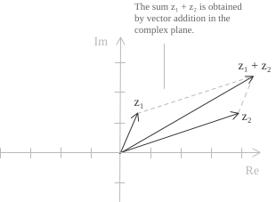

## Introduction

Before examining operations on complex numbers, it is useful to recall that the set $\mathbb{C}$ is equipped with addition and multiplication and satisfies the [axioms of a field](../fields/).

+ The first axiom is closure, which states that the sum and product of any two complex numbers belong to $\mathbb{C}.$
+ Addition and multiplication are commutative and associative, as in $\mathbb{R}.$
+ The number $0 = 0 + 0i$ is the additive identity, and $1 = 1 + 0i$ is the multiplicative identity.
+ The additive inverse of $z = a + bi$ is $-z = -a - bi,$ and it satisfies $z + (-z) = 0.$
+ For every $z \neq 0,$ there is a unique multiplicative inverse $z^{-1} \in \mathbb{C}$ such that $z \cdot z^{-1} = 1.$

Another property of $\mathbb{C}$ is that, unlike $\mathbb{R},$ it admits no total order compatible with the field operations. Furthermore, $\mathbb{C}$ is algebraically closed, meaning that by the [fundamental theorem of algebra](../roots-of-a-polynomial/) every [nonconstant polynomial](../polynomials/) with coefficients in $\mathbb{C}$ has at least one root in $\mathbb{C}$ (unlike in $\mathbb{R},$ where polynomials such as $x^2 + 1$ have no real roots).

## Operations

Consider two complex numbers in algebraic form.

$$
\begin{align}
z_1 &= a + bi \\[6pt]
z_2 &= c + di
\end{align} \tag{1}
$$

Their sum and difference are defined componentwise, with the real and imaginary parts treated separately as shown in the following identities.

$$
\begin{align}
z_1 + z_2 &= (a + c) + (b + d)i \notag \\[6pt]
z_1 - z_2 &= (a - c) + (b - d)i \tag{2}
\end{align}
$$

Suppose we have $z_1 = 2 - 3i$ and $z_2 = 3 + 5i$ and want to calculate $z_1 - z_2.$ Subtracting the real parts and the imaginary parts separately gives the following result.

$$
\begin{align}
z_1 - z_2 &= (2 - 3i) - (3 + 5i) \\[6pt]
          &= (2 - 3) + (-3 - 5)i \\[6pt]
          &= -1 - 8i
\end{align}
$$

As we showed in the [introduction to complex numbers](../complex-numbers/), they can be represented geometrically as vectors in the complex plane. For any two complex numbers, their sum $z_1 + z_2$ corresponds to [vector addition by the parallelogram rule](../vectors/), which gives the following construction.

+ The vector $z_2$ is translated so that its tail coincides with the tip of the vector corresponding to $z_1.$
+ The vector from the origin to the new tip represents the resulting complex number $z_1 + z_2.$

For the difference, we obtain $z_1 - z_2$ by adding the additive inverse $-z_2$ to $z_1,$ where the vector for $-z_2$ is the reflection of the vector for $z_2$ through the origin.

- - -

We now turn to multiplication, again using two complex numbers in the form given in $(1).$ The following identity gives their product.

$$(a + bi)(c + di) = (ac - bd) + (ad + bc)i \tag{3}$$

To derive $(3),$ we use the [distributive law](../properties-of-real-numbers/) to multiply each term of the first factor by each term of the second. By commutativity, $(bi)(di) = bdi^2,$ which equals $-bd$ because $i^2 = -1.$ Carrying out the calculation gives $(3).$

$$
\begin{align}
(a + bi)(c + di) &= ac + adi + bci + bdi^2 \\[6pt]
                 &= ac + adi + bci - bd \\[6pt]
                 &= (ac - bd) + (ad + bc)i
\end{align}
$$

For a complex number $z = a + bi,$ its modulus is given by the following formula.

$$|z| = \sqrt{a^2 + b^2} \tag{4}$$

We take two numbers in the form given in $(1)$ and apply formula $(4)$ to the real and imaginary parts of the product given by $(3).$ Expanding the squares gives the following calculation.

$$
\begin{align}
|z_1 \cdot z_2|^2 &= (ac - bd)^2 + (ad + bc)^2 \\[6pt]
                  &= a^2c^2 - 2abcd + b^2d^2 + a^2d^2 + 2abcd + b^2c^2 \\[6pt]
                  &= a^2(c^2 + d^2) + b^2(c^2 + d^2) \\[6pt]
                  &= (a^2 + b^2)(c^2 + d^2) \\[6pt]
                  &= |z_1|^2 \cdot |z_2|^2
\end{align}
$$

The following identity then holds.

$$|z_1 \cdot z_2| = |z_1| \cdot |z_2| \tag{5}$$

The same property extends to division, so the following identity holds for all $z_1, z_2 \in \mathbb{C}$ with $z_2 \neq 0.$

$$\left|\frac{z_1}{z_2}\right| = \frac{|z_1|}{|z_2|} \tag{6}$$

Recall also that, geometrically, the [modulus](../complex-numbers/) of a complex number is the length of the vector that represents it, while its [argument](../complex-numbers-trigonometric-form/) is the directed angle from the positive real axis to that vector. Take nonzero $z_1$ and $z_2,$ and let $\theta_2$ be an argument of $z_2.$ To obtain the product $z_1z_2$ in the complex plane, we rotate the vector for $z_1$ about the origin through an angle $\theta_2$ and then multiply its length by $|z_2|,$ as in $(5).$ To calculate the quotient $z_1/z_2,$ we instead rotate the same vector through an angle $-\theta_2$ and divide its length by $|z_2|,$ as in $(6).$

- - -

We now examine some algebraic identities for the [complex conjugate](../complex-numbers/), which, for an arbitrary $z,$ is given by the following formula.

$$\overline{z} = a - bi \tag{7}$$

First, applying conjugation twice gives back the original number, so the following identity holds.

$$\overline{\overline{z}} = z \tag{8}$$

Conjugation also respects addition, subtraction, and multiplication, as the following identities show.

$$
\begin{align}
\overline{z_1 + z_2} &= \overline{z_1} + \overline{z_2} \notag \\[6pt]
\overline{z_1 - z_2} &= \overline{z_1} - \overline{z_2} \notag \\[6pt]
\overline{z_1 \cdot z_2} &= \overline{z_1} \cdot \overline{z_2} \tag{9}
\end{align}
$$

Conjugation is an [automorphism](../homomorphisms-and-isomorphisms/) of the field $\mathbb{C},$ that is, a [bijection](../injective-surjective-and-bijective-functions/) from $\mathbb{C}$ to itself that preserves addition and multiplication. Equation $(8)$ shows that conjugation is its own inverse and hence bijective, while the identities in $(9)$ show that it preserves the two operations. Finally, multiplying a complex number by its conjugate gives the following real number.

$$z \cdot \overline{z} = a^2 + b^2 = |z|^2 \tag{10}$$

Equation $(10)$ lets us replace a fraction with a complex denominator by an equivalent fraction with a real denominator. Multiplying the numerator and denominator by $\overline{z}$ gives the real denominator $|z|^2,$ which can simplify the calculation in some cases.

- - -

We now examine division in the complex field. We again take two complex numbers as in $(1),$ requiring $z_2 \neq 0$ to avoid a zero denominator, and calculate $z_1/z_2.$ We first apply $(10)$ by multiplying the numerator and denominator by $\overline{z_2} = c - di$ to obtain a real denominator. Working through the algebra gives the following result.

$$ \tag{11}
\begin{align}
\frac{z_1}{z_2} &= \frac{a + bi}{c + di} \\[6pt]
                &= \frac{(a + bi)(c - di)}{(c + di)(c - di)} \\[6pt]
                &= \frac{ac - adi + bci - bdi^2}{c^2 + d^2} \\[6pt]
                &= \frac{(ac + bd) + (bc - ad)i}{c^2 + d^2} \\[6pt]
                &= \frac{ac + bd}{c^2 + d^2} + \frac{bc - ad}{c^2 + d^2}i
\end{align}
$$

For example, take $z_1 = 5 + 3i$ and $z_2 = 2 - i$ and calculate their quotient. Applying $(11)$ gives the following calculation.

$$
\begin{align}
\frac{5 + 3i}{2 - i} &= \frac{(5 + 3i)(2 + i)}{(2 - i)(2 + i)} \\[6pt]
                    &= \frac{10 + 5i + 6i + 3i^2}{4 + 1} \\[6pt]
                    &= \frac{10 + 11i + 3(-1)}{5} \\[6pt]
                    &= \frac{7 + 11i}{5} \\[6pt]
                    &= \frac{7}{5} + \frac{11}{5}i
\end{align}
$$

- - -

Finally, we calculate the reciprocal $z^{-1}$ of a complex number $z$ as a special case of $(11).$

$$ \tag{12}
\begin{align}
z^{-1} &= \frac{1}{a + bi} \\[6pt]
       &= \frac{a - bi}{a^2 + b^2} \\[6pt]
       &= \frac{a}{a^2 + b^2} - \frac{b}{a^2 + b^2}i
\end{align}
$$

As a simple example, we calculate the reciprocal of $z = 3 - 2i.$ Applying $(12)$ gives the following result.

$$
\begin{align}
\frac{1}{3 - 2i} &= \frac{3 + 2i}{(3 - 2i)(3 + 2i)} \\[6pt]
                 &= \frac{3 + 2i}{9 + 4} \\[6pt]
                 &= \frac{3 + 2i}{13} \\[6pt]
                 &= \frac{3}{13} + \frac{2}{13}i
\end{align}
$$

The formulas in this article describe the operations in $\mathbb{C}$ using the algebraic form in $(1).$ The same operations apply when complex numbers are expressed in [trigonometric](../complex-numbers-trigonometric-form/) or [exponential form](../complex-numbers-exponential-form/). The articles on those forms discuss the operations in detail.
