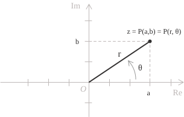
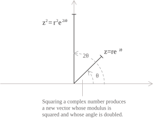

## Definition

As we saw in the [definition](../complex-numbers/), the [algebraic form](../complex-numbers/) of a complex number expresses a number $z$ by specifying its real and imaginary components and is given by the following expression:

$$z = a + bi \tag{1}$$

Every nonzero complex number of the form $(1)$ can also be described in terms of geometric quantities. If we view a general point $z$ as a pair of coordinates on the real and imaginary axes, we can consider its distance from the origin and its angular position in the complex plane. This gives the exponential form of a complex number, expressed by the following identity:

$$z = re^{i\theta} \tag{2}$$

$r$ is the [modulus](../complex-numbers/), that is, the distance of $z$ from the origin in the complex plane, and is given by:

$$r = |z| = \sqrt{a^2 + b^2} \tag{3}$$

Geometrically, it is the length of the hypotenuse of the [right triangle](../right-triangle-trigonometry/) determined by the real and imaginary parts. $\theta = \arg(z)$ is the [argument](../complex-numbers/), that is, the [angle in radians](../angles-and-angular-measure/) between the positive real axis and the [vector](../vectors/) representing $z.$

We now derive the exponential form $(2)$ from the algebraic form $(1).$ As discussed in the entry on [trigonometric form](../complex-numbers-trigonometric-form/), the real and imaginary components are given by $a = r\cos(\theta)$ and $b = r\sin(\theta).$ Substituting these expressions into $(1)$ gives:

$$z = r[\cos(\theta) + i\sin(\theta)] \tag{4}$$

[Euler's formula](../euler-formula/) allows the expression in parentheses in $(4)$ to be written as a complex exponential and is given by the following identity:

$$e^{i\theta} = \cos(\theta) + i\sin(\theta) \tag{5}$$

Substituting $(5)$ into $(4)$ yields the exponential form $(2):$

$$
\begin{align}
z &= r[\cos(\theta) + i\sin(\theta)] \\[6pt]
  &= re^{i\theta} \tag{6}
\end{align}
$$

- - -

We have seen that the [conjugate](../complex-numbers/) of a complex number in algebraic form is given by the following identity:

$$\overline{z} = a-ib \tag{7}$$

The same characterization of the conjugate can be obtained in exponential form by replacing $\theta$ with $-\theta$ in $(2).$ Geometrically, this corresponds to reflecting $z$ across the real axis. Since cosine is an [even function](../even-and-odd-functions/) and sine is [odd](../even-and-odd-functions/), Euler's formula $(5)$ gives:

$$\overline{z} = re^{-i\theta} \tag{8}$$

## Operations

The main [operations on complex numbers](../complex-number-operations/) expressed in exponential form are presented below, beginning with multiplication. Consider two nonzero complex numbers:

$$
\begin{align}
z_1 &= r_1e^{i\theta_1} \\[6pt]
z_2 &= r_2e^{i\theta_2}
\tag{9}
\end{align}
$$

The product of the numbers in $(9)$ is obtained by multiplying their moduli and adding their arguments:

$$z_1 z_2 = r_1 r_2 e^{i(\theta_1 + \theta_2)} \tag{10}$$

For example, we multiply the following numbers $z_1 = 2e^{i\pi/3}$ and $z_2 = 3e^{i\pi/6}.$ Applying $(10),$ the product is:

$$z_1 z_2 = 2 \cdot 3 \cdot e^{i(\pi/3 + \pi/6)} = 6e^{i\pi/2} \tag{11}$$

Geometrically, multiplying $z_1$ by a nonzero complex number $z_2$ means multiplying its distance from the origin by $r_2$ and rotating the vector representing it through an angle $\theta_2.$ This rotation is counterclockwise if $\theta_2 > 0$ and clockwise if $\theta_2 < 0.$ In a similar way to $(10),$ the quotient is obtained by dividing the moduli and subtracting the arguments:

$$\frac{z_1}{z_2} = \frac{r_1}{r_2}e^{i(\theta_1 - \theta_2)} \tag{12}$$

In $(12),$ $z_2$ must be different from $0.$ In addition to products and quotients, [integer powers](../powers/) can also be calculated directly. For every integer $n,$ with a nonzero base when $n \leq 0,$ we have:

$$z^n = (re^{i\theta})^n = r^n e^{in\theta} \tag{13}$$

Applying Euler's formula to $e^{in\theta},$ $(13)$ is equivalent to [De Moivre's theorem](../de-moivre-theorem/) and gives:

$$(\cos\theta + i\sin\theta)^n = \cos(n\theta) + i\sin(n\theta) \tag{14}$$

For example, applying $(13)$ with $n = 2$ gives:

$$z^2 = r^2 e^{i2\theta} \tag{15}$$

The complex number in $(15)$ has modulus $r^2$ and argument $2\theta.$ Geometrically, the length of the vector representing $z$ is multiplied by $r$ and its angle is doubled.

## Examples

We now give a couple of examples to illustrate how to convert from algebraic to exponential form. Consider the following complex number and rewrite it in exponential form:

$$z = 2 + 3i$$

Using $(3),$ we calculate the modulus by setting $a = 2$ and $b = 3:$

$$
\begin{align}
r = |z| &= \sqrt{a^2 + b^2} \\[6pt]
        &= \sqrt{2^2 + 3^2} \\[6pt]
        &= \sqrt{4 + 9} \\[6pt]
        &= \sqrt{13}
\tag{16}
\end{align}
$$

To calculate the argument, since $a = 2 > 0$ and $b = 3 > 0,$ the number lies in the first quadrant, and the [arctangent](../arctangent-function/) formula gives:

$$\theta = \arctan\left(\frac{b}{a}\right) = \arctan\left(\frac{3}{2}\right) \approx 0.98 \text{ rad} \tag{17}$$

Substituting the values from $(16)$ and $(17)$ into $(2)$ then gives:

$$z \approx \sqrt{13}e^{i\cdot 0.98} \tag{18}$$

- - -

For another example, consider the number:

$$z = -1 + i$$

To convert it to exponential form, we must calculate the modulus again with $a = -1$ and $b = 1,$ obtaining:

$$
\begin{align}
r = |z| &= \sqrt{(-1)^2 + 1^2} \\[6pt]
        &= \sqrt{1 + 1} \\[6pt]
        &= \sqrt{2}
\tag{19}
\end{align}
$$

For the argument, since $a = -1 < 0$ and $b = 1 > 0,$ the number lies in the second quadrant. Applying the arctangent formula in this case also gives:

$$\arctan\left(\frac{b}{a}\right) = \arctan\left(\frac{1}{-1}\right) = \arctan(-1) = -\frac{\pi}{4} \tag{20}$$

However, the value in $(20)$ corresponds to the fourth quadrant and is therefore not the correct argument of $z,$ so we must add a correction of $\pi$ to account for the sign of $a,$ obtaining:

$$\theta = -\frac{\pi}{4} + \pi = \frac{3\pi}{4} \tag{21}$$

Finally, substituting the values from $(19)$ and $(21)$ into $(2)$ gives:

$$z = \sqrt{2}e^{i\frac{3\pi}{4}} \tag{22}$$

## Roots in exponential form

The exponential form also allows us to calculate the $n$th roots of a complex number. For example, consider $z = re^{i\theta}$ with $r > 0$ and an integer $n \geq 1.$ The equation $w^n = z$ has exactly $n$ distinct solutions in $\mathbb{C},$ given by the following equality:

$$w_k = \sqrt[n]{r}e^{i(\theta + 2k\pi)/n} \tag{23}$$

In $(23),$ the modulus of each root is $\sqrt[n]{r}$ and $k$ is an integer taking the values $0, 1, \ldots, n-1,$ each of which identifies one of the $n$ distinct roots. The arguments are equally spaced, with a separation of $2\pi/n.$ For $n \geq 3,$ the roots correspond geometrically to the vertices of a regular polygon inscribed in a [circle](../circumference/) of radius $\sqrt[n]{r}$ centered at the origin. When $r = 1$ and $\theta = 0,$ we obtain the [roots of unity](../roots-of-unity/) on the unit circle. As an example, consider the cube roots of $z = 8.$ Writing $z = 8e^{i\cdot 0},$ we have $r = 8$ and $\theta = 0,$ so $(23)$ gives the three roots:

$$w_k = \sqrt[3]{8}e^{i\cdot 2k\pi/3} = 2e^{i\cdot 2k\pi/3} \qquad k = 0, 1, 2 \tag{24}$$

We can calculate each root in $(24)$ using Euler's formula, obtaining:

$$
\begin{align}
w_0 &= 2e^{i\cdot 0} = 2 \\[6pt]
w_1 &= 2e^{i\cdot 2\pi/3} = 2\left(-\frac{1}{2} + i\frac{\sqrt{3}}{2}\right) = -1 + i\sqrt{3} \\[6pt]
w_2 &= 2e^{i\cdot 4\pi/3} = 2\left(-\frac{1}{2} - i\frac{\sqrt{3}}{2}\right) = -1 - i\sqrt{3}
\tag{25}
\end{align}
$$

The roots we have found all have the same modulus and are separated by angles of $2\pi/3,$ and they form the vertices of an equilateral triangle inscribed in a circle of radius $2$ centered at the origin.
