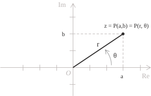

## Definition

As we saw in the [definition](../complex-numbers/), the [algebraic form](../complex-numbers/) of a complex number expresses a number $z$ by specifying its real and imaginary components and is given by the following expression:

$$z = a + bi \tag{1}$$

Every nonzero complex number of the form $(1)$ can also be described in terms of geometric quantities. If we view a general point $z$ as a pair of coordinates on the real and imaginary axes, we can consider its distance from the origin and its angular position in the complex plane. This gives the trigonometric form, also called the [polar form](../polar-coordinates/), of a complex number, expressed by the following identity:

$$z = r(\cos\theta + i\sin\theta) \tag{2}$$

$r$ is the [modulus](../complex-numbers/), that is, the distance of $z$ from the origin in the complex plane, and is given by:

$$r = |z| = \sqrt{a^2 + b^2}\tag{3}$$

Geometrically, it is the length of the hypotenuse of the [right triangle](../right-triangle-trigonometry/) determined by the real and imaginary parts. $\theta = \arg(z)$ is the argument, that is, the [angle in radians](../angles-and-angular-measure/) between the positive real axis and the [vector](../vectors/) representing $z.$

We now derive the trigonometric form $(2)$ from the algebraic form $(1).$ Consider the point $P(a, b)$ representing $z$ in the complex plane. Its coordinates are obtained by projecting the vector $\overrightarrow{OP},$ of modulus $r,$ onto the two axes. The [cosine](../cosine-function/) and [sine](../sine-function/) of the argument $\theta$ determine the real and imaginary components, respectively, with signs corresponding to the quadrant containing $P:$

$$ \tag{4}
\begin{align}
a &= r\cos(\theta) \\[6pt]
b &= r\sin(\theta)
\end{align}
$$

Substituting the coordinate expressions given in $(4)$ into the algebraic form $(1)$ yields the trigonometric form $(2):$

$$
\begin{align}
z = (a, b) &= a + ib \\[6pt]
           &= r\cos(\theta) + ir\sin(\theta) \\[6pt]
           &= r[\cos(\theta) + i\sin(\theta)]
\end{align}
$$

An equivalent form of $(2)$ is the [exponential representation](../complex-numbers-exponential-form/), expressed by the following identity:

$$z = re^{i\theta} \tag{5}$$

As discussed in the dedicated entry, $(5)$ follows from [Euler's formula](../euler-formula/), which allows the expression in parentheses in $(2)$ to be written as a complex exponential and is given by the following identity:

$$e^{i\theta} = \cos(\theta) + i\sin(\theta) \tag{6}$$

- - -

We have seen that the [conjugate](../complex-numbers/) of a complex number in algebraic form is given by the following identity:

$$\overline{z} = a-ib \tag{7}$$

The same characterization of the conjugate can be obtained in trigonometric form by replacing $\theta$ with $-\theta$ in $(2).$ Geometrically, this corresponds to reflecting $z$ across the real axis, and since cosine is an [even function](../even-and-odd-functions/) and sine is [odd](../even-and-odd-functions/), the conjugate is given by:

$$\overline{z} = r(\cos\theta - i\sin\theta) \tag{8}$$

Applying the same reasoning about parity to the exponential representation through Euler's formula yields the analogous identity for the conjugate in exponential form, written as:

$$\overline{z} = re^{-i\theta} \tag{9}$$

## Operations

The main [operations on complex numbers](../complex-number-operations/) expressed in trigonometric form are presented below, beginning with multiplication. Consider two numbers $z_1$ and $z_2,$ both in trigonometric form:

$$
\begin{align}
z_1 &= r_1[\cos(\theta_1) + i\sin(\theta_1)] \\[6pt]
z_2 &= r_2[\cos(\theta_2) + i\sin(\theta_2)]
\end{align}
$$

Their product is a complex number whose modulus is the product of their moduli and whose argument is the sum of their arguments:

$$z_1 \cdot z_2 = r_1 r_2[\cos(\theta_1 + \theta_2) + i\sin(\theta_1 + \theta_2)] \tag{10}$$

Geometrically, multiplying $z_1$ by a nonzero complex number $z_2$ means multiplying its distance from the origin by $r_2$ and rotating the vector representing it through an angle $\theta_2.$ This rotation is counterclockwise if $\theta_2 > 0$ and clockwise if $\theta_2 < 0.$ The resulting complex number has modulus $r_1r_2$ and argument $\theta_1 + \theta_2,$ as expressed in $(10).$

For the [quotient](../complex-number-operations/), with $z_2 \neq 0,$ the product rule $(10)$ is modified by replacing the product of the moduli with their ratio and the sum of the arguments with their difference. The modulus of $z_1/z_2$ is therefore $r_1/r_2$ and its argument is $\theta_1 - \theta_2:$

$$\frac{z_1}{z_2} = \frac{r_1}{r_2}\left[\cos(\theta_1 - \theta_2) + i\sin(\theta_1 - \theta_2)\right] \tag{11}$$

For [addition](../complex-number-operations/), there is no rule as simple as those for the product $(10)$ and quotient $(11),$ and we generally switch to algebraic form and add the real and imaginary parts separately. First, we write the sum as:

$$z_1 + z_2 = x + iy \tag{12}$$

The components $x$ and $y$ in $(12)$ are given by:

$$
\begin{align}
x &= r_1\cos\theta_1 + r_2\cos\theta_2 \\[6pt]
y &= r_1\sin\theta_1 + r_2\sin\theta_2
\end{align}
$$

To express $(12)$ in trigonometric form, we must first calculate the modulus and then the argument. For the modulus, we obtain:

$$r = \sqrt{x^2 + y^2}$$

To calculate the argument, we must consider the quadrant containing the point $(x, y)$ in the complex plane. As stated in the [introduction to complex numbers](../complex-numbers/), when $x > 0,$ the argument is given by:

$$\theta = \arctan\left(\frac{y}{x}\right)$$

> When $x < 0,$ we add $\pi$ to the [arctangent](../arctangent-function/) value if $y \geq 0,$ or subtract $\pi$ if $y < 0.$ When $x = 0,$ the argument is $\pi/2$ if $y > 0$ and $-\pi/2$ if $y < 0.$ If $x = y = 0,$ the sum is zero and its argument is undefined.

## Example

We rewrite the following complex number in trigonometric form:

$$z = 1 + i \tag{13}$$

First, we calculate the modulus. Since $a = 1$ and $b = 1,$ we obtain:

$$r = \sqrt{a^2 + b^2} = \sqrt{1^2 + 1^2} = \sqrt{2}$$

To determine the argument, we observe that the point $(1, 1)$ lies in the first quadrant of the complex plane, where both components are positive. Since $a > 0,$ the argument is given by the following chain of equalities:

$$\theta = \arctan\left(\frac{b}{a}\right) = \arctan\left(\frac{1}{1}\right) = \arctan(1) = \frac{\pi}{4} \tag{14}$$

The result agrees with the geometric position of the number in $(13),$ which lies on the bisector of the first quadrant, at an angle of $\pi/4$ radians to the positive real axis. Substituting the values obtained from $(13)$ and $(14)$ into $(2)$ gives the trigonometric form of the number $(13):$

$$z = \sqrt{2}\left(\cos\frac{\pi}{4} + i\sin\frac{\pi}{4}\right)$$

- - -

Now consider $z = -\sqrt{3} - i$ and write it in trigonometric form. Its modulus is:

$$r = \sqrt{(-\sqrt{3})^2 + (-1)^2} = 2$$

The ratio of the imaginary part to the real part is positive, so:

$$\arctan\left(\frac{-1}{-\sqrt{3}}\right) = \arctan\left(\frac{1}{\sqrt{3}}\right) = \frac{\pi}{6}$$

However, the angle $\pi/6$ lies in the first quadrant, whereas the point $(-\sqrt{3}, -1)$ lies in the third, so we subtract $\pi$ to obtain the [principal argument](../complex-numbers/):

$$\theta = \frac{\pi}{6} - \pi = -\frac{5\pi}{6}$$

The required trigonometric form is therefore:

$$z = 2\left[\cos\left(-\frac{5\pi}{6}\right) + i\sin\left(-\frac{5\pi}{6}\right)\right]$$

> If the determination of the argument is still unclear at this point, for an explanation of the corrections required when calculating the argument according to the quadrant, we refer to the entry on [complex numbers](../complex-numbers/), which explains how the argument is determined from the real and imaginary components.
