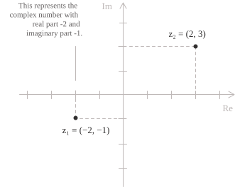
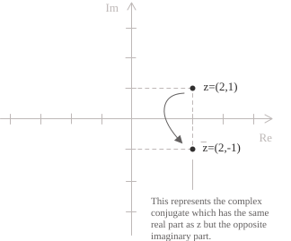
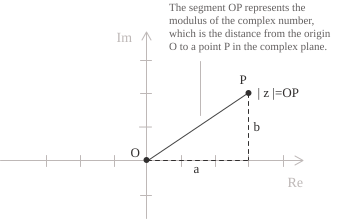

## Construction

Complex numbers were introduced to overcome certain limitations of the set of [real numbers](../real-numbers/) $\mathbb{R},$ in particular the impossibility of taking even roots of negative numbers. As a consequence, [quadratic equations](../quadratic-equations/) with a [negative discriminant](../quadratic-formula/) have no real solutions. The following equation is an example:

$$x^2 + 1 = 0 \tag{1}$$

No number in $\mathbb{R}$ has square $-1,$ because the square of every real number is nonnegative, so equation $(1)$ has no solutions in $\mathbb{R}.$ To solve this problem, the imaginary unit $i$ was introduced, defined by the following property:

$$i^2 = -1 \tag{2}$$

With this definition, equation $(1)$ has two distinct complex roots, $\pm i.$ This construction amounts to a convention of notation that leaves open the question of whether $i$ exists and in what mathematical sense. To answer this question, we start with the [Cartesian product](../cartesian-product/) $\mathbb{R}^2,$ the set of all ordered pairs of real numbers. Each element is a pair $(a, b)$ with $a, b \in \mathbb{R}$ and is represented in the Euclidean plane. We now seek to give this set an algebraic structure that makes it [a field](../fields/). The definition of a field requires us to specify [addition and multiplication](../complex-number-operations/) on $\mathbb{R}^2.$

We start by defining addition componentwise, so the sum of two pairs $(a, b)$ and $(c, d)$ is given by equation $(3):$

$$ \tag{3}
(a, b) + (c, d) \ = \ (a + c, \ b + d)
$$

This definition is identical to that of [vector addition](../vectors/) in the plane, as discussed in the entry on vectors. Multiplication distinguishes the algebraic structure of the complex numbers from that of $\mathbb{R}^2$ as a [vector space](../vector-spaces/). The product of two pairs is defined as follows:

$$
(a, b) \cdot (c, d) \ = \ (ac - bd, \ ad + bc) \tag{4}
$$

With addition $(3)$ and multiplication $(4),$ $\mathbb{R}^2$ is a field that extends $\mathbb{R}.$ We therefore denote the set $\mathbb{R}^2$ equipped with operations $(3)$ and $(4)$ by $\mathbb{C},$ and its elements are the complex numbers. In this representation, the real numbers correspond to pairs whose second component is zero. The pair $(0, 1)$ is therefore a nonreal complex number, and we apply rule $(4)$ to calculate its square:

$$
(0, 1) \cdot (0, 1) \ = \ (0 \cdot 0 - 1 \cdot 1,\ 0 \cdot 1 + 1 \cdot 0) \ =\ (-1,0)
$$

The element $(0, 1)$ of $\mathbb{C}$ thus satisfies relation $(2)$ for the symbol $i,$ which can also be written as follows:

$$i = (0, 1) \tag{5}$$

With this notation, every complex number $(a, b)$ can be expressed as a combination of the two basis elements $(1, 0)$ and $(0, 1),$ which correspond to $1$ and $i,$ respectively. This gives the algebraic form of a complex number:

$$z = a+bi\tag{6}$$

In equation $(6),$ $a$ is called the real part, $\mathrm{Re}(z) = a,$ and $b$ is called the imaginary part, $\mathrm{Im}(z) = b.$ Equation $(6)$ follows from the following chain of equalities:

$$
\begin{align}
(a, \ b) &= (a,\ 0) + (0,\ b) \\[6pt]
&= a\cdot(1,\ 0) + b\cdot(0,\ 1) \\[6pt]
&= a + bi
\end{align}
$$

For example, the number $z = 2 + 3i$ has real part $2$ and imaginary part $3,$ while numbers of the form $z = ib$ are purely imaginary. In addition to the algebraic form in equation $(6),$ we can express a complex number in two useful forms discussed in separate entries. The first is the [trigonometric or polar form](../complex-numbers-trigonometric-form/), given by the following equation:

$$z = r(\cos\theta + i\sin\theta) \tag{7}$$

The second is the [exponential form](../complex-numbers-exponential-form/):

$$z = re^{i\theta} \tag{8}$$

We can therefore write the set of complex numbers formally as follows:

$$ \tag{9}
\mathbb{C} := \{ z = a + ib \mid a, b \in \mathbb{R}\}
$$
## Complex plane

As we saw in the definition, the set $\mathbb{C}$ has the structure of a Cartesian product, so complex numbers can be represented geometrically in the complex plane, also called the Gauss or Argand plane, where the real part gives the $x$-coordinate and the imaginary part gives the $y$-coordinate.

A complex number $z = x + iy$ is thus represented by the point $(x, y)$ in the complex plane, while a purely imaginary number is represented, for example, by the ordered pair $i = (0,1).$

## Conjugate and modulus

The conjugate and modulus of a complex number $z$ can be found from its real and imaginary parts, and both have a geometric interpretation in the complex plane. Given a complex number $z$ in algebraic form, its conjugate is defined as follows:

$$\overline{z} = a - bi\tag{10}$$

In the Gauss plane, $\overline{z}$ is the reflection of $z$ across the real axis, as shown in the figure:

The modulus is the distance from the origin to the point $(a,b)$ and is defined as follows:

$$
|z| = \sqrt{a^2 + b^2} \tag{11}
$$

Equation $(11)$ follows directly from the [Pythagorean theorem](../pythagorean-theorem/), since the modulus is the length of the hypotenuse of a right triangle whose legs have lengths $|a|$ and $|b|.$

For example, if we take the complex number $z = 3 + 2i$ and substitute $a = 3$ and $b = 2$ into equation $(11),$ we obtain the following modulus:

$$|z| = \sqrt{3^2 + 2^2} = \sqrt{9 + 4} = \sqrt{13}$$

## Argument

The argument of a complex number, denoted by $\arg(z),$ is the angle $\theta$ between the positive real axis and the segment joining the origin to the point $(a, b)$ in the complex plane, [measured in radians](../angles-and-angular-measure/) counterclockwise from the positive real axis. The argument is never unique. If $\theta$ is an argument of $z,$ then so is $\theta + 2k\pi$ for every integer $k.$ Of all these angles, the principal argument $\mathrm{Arg}(z)$ is the only one that satisfies the following condition:

$$
-\pi < \mathrm{Arg}(z) \leq \pi \tag{13}
$$

To calculate the argument, we use the [arctangent](../arctangent-function/) and take into account the values of $a$ and $b.$ When $a > 0,$ the point representing the complex number $z$ lies in the right half-plane, and the principal argument is given by:

$$
\mathrm{Arg}(z) = \arctan \left(\frac{b}{a}\right) \tag{14}
$$

When $a < 0$ and $b \geq 0,$ the point lies in the second quadrant or on the negative real axis, and we add $\pi$ to obtain an angle in the correct interval:

$$
\mathrm{Arg}(z) = \arctan \left(\frac{b}{a}\right) + \pi \tag{15}
$$

When $a < 0$ and $b < 0,$ the point lies in the third quadrant, and we subtract $\pi:$

$$
\mathrm{Arg}(z) = \arctan \left(\frac{b}{a}\right) - \pi \tag{15}
$$

Finally, when $a = 0,$ the point lies on the imaginary axis and the ratio inside the arctangent is undefined. In this case, if $b > 0,$ then $\mathrm{Arg}(z) = \pi/2,$ while if $b < 0,$ then $\mathrm{Arg}(z) = -\pi/2.$ The case $z = 0$ is excluded because the argument at the origin is undefined.

As an example, consider the complex number $z = -1 + i.$ Its real part is negative and its imaginary part is positive, so the point lies in the second quadrant of the complex plane. Taking the arctangent of the ratio $b/a = 1/(-1) = -1$ gives $\arctan(-1) = -\pi/4,$ an angle in the fourth quadrant, so it cannot be the correct argument. Since $a < 0$ and $b \geq 0,$ we apply the correction in equation $(15)$ to obtain:

$$
\mathrm{Arg}(z) = -\frac{\pi}{4} + \pi = \frac{3\pi}{4}
$$

## Properties of $\mathbb{C}$

We examine the basic properties of complex numbers, starting with the following identities for the associativity of addition and multiplication.

$$ \tag{16}
\begin{align}
(z_1 + z_2) + z_3 &= z_1 + (z_2 + z_3) \\[6pt]
(z_1 \cdot z_2) \cdot z_3 &= z_1 \cdot (z_2 \cdot z_3)
\end{align}
$$

Commutativity gives the following identities:

$$\tag{17}
\begin{align}
z_1 + z_2 &= z_2 + z_1 \\[6pt]
z_1 \cdot z_2 &= z_2 \cdot z_1
\end{align}
$$

Finally, the distributive property gives the following equality:

$$z_1 \cdot (z_2 + z_3) = z_1 \cdot z_2 + z_1 \cdot z_3 \tag{18}$$

- - -

We now consider the identity elements for addition and multiplication. The additive identity is $0 + 0i,$ as the following calculation shows:

$$
\begin{align}
z + (0 + 0i) &= (a + bi) + (0 + 0i) \\[6pt]
&= (a + 0) + (b + 0)i \\[6pt]
&= a + bi \\[6pt]
&= z
\end{align}
$$

The multiplicative identity is $1 + 0i,$ as the following calculation shows:

$$
\begin{align}
z \cdot (1 + 0i) &= (a + bi) \cdot (1 + 0i) \\[6pt]
&= a \cdot 1 + a \cdot 0i + bi \cdot 1 + bi \cdot 0i \\[6pt]
&= a + bi \\[6pt]
&= z
\end{align}
$$

The additive inverse of $a + bi$ is given by:

$$-(a + bi) = -a - bi$$

Finally, the reciprocal of a nonzero complex number $z = a + bi$ is given by:

$$\frac{1}{z} = \frac{a}{a^2 + b^2} - \frac{b}{a^2 + b^2} i$$

Since $z \neq 0,$ we have $a^2 + b^2 > 0.$ To verify the formula, we multiply the stated expression by $z.$

$$
(a + bi)\frac{a - bi}{a^2 + b^2}
= \frac{a^2 - b^2 i^2}{a^2 + b^2}
= 1
$$

The set $\mathbb{C}$ cannot be ordered in a way that is compatible with addition and multiplication. Suppose, for example, that there is a total order $\leq$ on $\mathbb{C}$ compatible with these operations. We would then be able to compare $i$ with $0,$ and since $i \neq 0,$ there are two possibilities.

+ If $i > 0,$ multiplying both sides by $i$ gives $i^2 = -1 > 0,$ contradicting the properties of an ordered field.
+ If $i < 0,$ multiplying both sides by $i$ and reversing the inequality again gives $-1 > 0,$ the same contradiction.

Since neither case is possible, $\mathbb{C}$ admits no total order compatible with the field operations.
