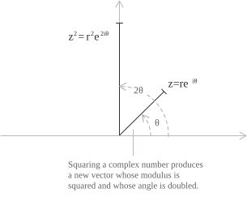
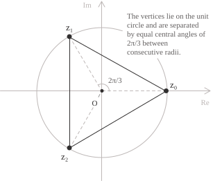

## Statement

De Moivre's theorem uses [trigonometric form](../complex-numbers-trigonometric-form/) to simplify the calculation of powers of [complex numbers](../complex-numbers/). Squaring a complex number $z$ in algebraic form is straightforward using the formula for the [square of a binomial](../binomials/):

$$ \tag{1}
\begin{align}
z^2 &= (a + ib)^2 \\[6pt]
    &= a^2 + 2iab - b^2
\end{align}
$$

As the exponent increases, however, the calculation becomes impractical because the number of terms in the [binomial expansion](../binomial-theorem/) of $(a+ib)^n$ grows with $n,$ so De Moivre's theorem provides a simpler way to compute the power. Consider a nonzero complex number $z$ with modulus $r$ and argument $\theta$ and write it in trigonometric form:

$$z = r(\cos\theta + i\sin\theta) \tag{2}$$

De Moivre's theorem states that for every integer $n,$ the power $z^n$ of the number in $(2)$ has modulus $r^n$ and argument $n\theta,$ so it can be written as follows:

$$z^n = r^n(\cos(n\theta) + i\sin(n\theta)) \tag{3}$$

If the exponent is a [rational number](../rational-numbers/) $p/q$ in lowest terms with $q > 0,$ the values of $z^{p/q}$ are the solutions of the equation $w^q = z^p.$ By $(3),$ the number $z^p$ has modulus $r^p$ and arguments $p\theta + 2k\pi,$ where $k \in \mathbb{Z}.$ Applying $(3)$ to $w^q$ as well, we find the modulus of $w$ by taking the $q$th root of $r^p$ and its arguments by dividing the arguments of $z^p$ by $q.$ This gives $q$ distinct values for $k = 0, 1, \ldots, q-1:$

$$w_k = r^{p/q}\left(\cos\left(\frac{p\theta + 2k\pi}{q}\right) + i\sin\left(\frac{p\theta + 2k\pi}{q}\right)\right) \tag{4}$$

De Moivre's theorem also applies when a complex number is written in [exponential form](../complex-numbers-exponential-form/):

$$z = re^{i\theta} \tag{5}$$

In this form, the theorem gives the following identity:

$$z^n = (re^{i\theta})^n = r^n e^{in\theta} \tag{6}$$

- - -

To prove the theorem, we establish $(3)$ by [induction](../principle-of-mathematical-induction/), first verifying the base case and then showing that the result for $n$ implies the result for $n+1.$ We start with the base case by setting $n = 1.$ In this case, $(3)$ reduces directly to the standard trigonometric form given in $(2).$ Now suppose $(3)$ holds for an integer $n \geq 1.$ To pass from $z^n$ to $z^{n+1},$ we use the following identity:

$$z^{n+1} = z^n z \tag{7}$$

We then multiply both sides of $(3)$ by $z = r(\cos\theta + i\sin\theta)$ and expand the product:

$$z^{n+1} = r^{n+1}\bigl[(\cos(n\theta)\cos\theta - \sin(n\theta)\sin\theta) + i(\sin(n\theta)\cos\theta + \cos(n\theta)\sin\theta)\bigr] \tag{8}$$

The two expressions in parentheses in $(8)$ are the [addition formulas for cosine and sine](../trigonometric-identities/), which allow us to rewrite $(8)$ as follows:

$$z^{n+1} = r^{n+1}(\cos((n+1)\theta) + i\sin((n+1)\theta)) \tag{9}$$

Equation $(9)$ is $(3)$ with exponent $n+1.$ This completes the induction for positive integers. When $n=0,$ the left-hand side of $(3)$ is $z^0=1$ and the right-hand side is also $1.$ For a [negative exponent](../powers/), we apply $(3)$ to $z^n$ and take its reciprocal:

$$
\begin{aligned}
z^{-n} &= \frac{1}{z^n} \\[6pt]
       &= r^{-n}(\cos(n\theta) - i\sin(n\theta)) \\[6pt]
       &= r^{-n}(\cos(-n\theta) + i\sin(-n\theta))
\end{aligned}
\tag{10}
$$

The last expression in $(10)$ agrees with the right-hand side of $(3)$ for exponent $-n.$

- - -

To show the effect of squaring a complex number in the complex plane, we write $z$ in exponential form. Applying $(6)$ with $n=2$ changes the modulus from $r$ to $r^2$ and the argument from $\theta$ to $2\theta,$ as shown in the figure:

$$z^2 = (re^{i\theta})^2 = r^2 e^{2i\theta}$$

For another example, we calculate the fourth power of $z=2+2i.$ Here $z$ lies on the bisector of the first quadrant, so recall that its [principal argument](../complex-numbers/) is $\pi/4.$ We first write $z$ in trigonometric form and apply $(3)$ with $n=4$:

$$
\begin{align}
|z| &= \sqrt{2^2 + 2^2} = 2\sqrt{2} \\[6pt]
z &= 2\sqrt{2}\bigl(\cos(\pi/4) + i\sin(\pi/4)\bigr) \\[6pt]
z^4 &= (2\sqrt{2})^4(\cos\pi + i\sin\pi) \\[6pt]
    &= -64
\end{align}
$$

## Applications

One application of De Moivre's theorem is to derive formulas for the sine and cosine of multiple angles. For example, setting $n = 3$ in the theorem gives the following identity:

$$(\cos\theta + i\sin\theta)^3 = \cos(3\theta) + i\sin(3\theta) \tag{11}$$

We expand the left-hand side using the binomial theorem and separate the resulting expression into its real and imaginary parts:

$$
\begin{align}
\cos(3\theta) + i\sin(3\theta)
&= (\cos\theta + i\sin\theta)^3 \\[6pt]
&= \cos^3\theta + 3i\cos^2\theta\sin\theta + 3i^2\cos\theta\sin^2\theta + i^3\sin^3\theta \\[6pt]
&= (\cos^3\theta - 3\cos\theta\sin^2\theta) + i(3\cos^2\theta\sin\theta - \sin^3\theta)
\end{align}
$$

Equating the real and imaginary parts with their counterparts on the right-hand side of the identity gives the [triple-angle formulas](../trigonometric-identities/):

$$
\begin{align}
\cos(3\theta) &= \cos^3\theta - 3\cos\theta\sin^2\theta \\[6pt]
\sin(3\theta) &= 3\cos^2\theta\sin\theta - \sin^3\theta
\end{align}
$$

- - -

For every positive integer $n,$ De Moivre's theorem allows us to compute the $n$th roots of a complex number by solving the following equation:

$$z^n = w \tag{12}$$

Suppose $w \neq 0$ has modulus $r$ and argument $\theta.$ Since all its arguments have the form $\theta + 2k\pi,$ where $k \in \mathbb{Z},$ we can write $w$ in exponential form:

$$w = re^{i(\theta + 2k\pi)} \tag{13}$$

To solve $(12),$ we write $z$ in exponential form and apply $(6)$ to $z^n.$ Comparing the result with $(13),$ we find the modulus of $z$ by taking the $n$th root of $r$ and the arguments of the solutions by dividing the arguments of $w$ by $n.$ This gives the $n$th roots of $w$ for $k = 0, 1, \ldots, n-1:$

$$z_k = \sqrt[n]{r}\cdot e^{i\left(\frac{\theta + 2k\pi}{n}\right)} \tag{14}$$

By $(14),$ the values $z_0, z_1, \ldots, z_{n-1}$ are the $n$ complex roots we sought. Geometrically, these roots are equally spaced on a circle of radius $\sqrt[n]{r}$ centered at the origin, with an angular separation of $2\pi/n.$ For $n \geq 3,$ they are the vertices of a regular $n$-sided polygon inscribed in that circle, as the next example shows. Suppose we want to solve the following equation:

$$z^3 = 1$$

The real solution $z = 1$ is immediate, but in $\mathbb{C}$ the equation has three distinct solutions, equally spaced on the [unit circle](../unit-circle/) as shown in the figure.

Since the argument of $1$ is defined modulo $2\pi,$ we can write the number in exponential form:

$$1 = e^{i \cdot 2k\pi} \qquad k \in \mathbb{Z}$$

We apply the general formula for the roots with $r = 1,$ $\theta = 0,$ and $k = 0, 1, 2:$

$$ \tag{15}
\begin{align}
z_k &= \sqrt[3]{1}\cdot e^{i\left(\frac{2k\pi}{3}\right)} \\[6pt]
    &= e^{i \cdot \frac{2k\pi}{3}}
\end{align}
$$

Substituting these values of $k$ into $(15)$ gives the [three complex roots](../roots-of-unity/):

$$
\begin{align}
z_0 &= e^{i \cdot 0} = \cos(0) + i\sin(0) = 1 \\[6pt]
z_1 &= e^{i \cdot \frac{2\pi}{3}} = \cos\left(\frac{2\pi}{3}\right) + i\sin\left(\frac{2\pi}{3}\right) = -\frac{1}{2} + i\frac{\sqrt{3}}{2} \\[6pt]
z_2 &= e^{i \cdot \frac{4\pi}{3}} = \cos\left(\frac{4\pi}{3}\right) + i\sin\left(\frac{4\pi}{3}\right) = -\frac{1}{2} - i\frac{\sqrt{3}}{2}
\end{align}
$$
