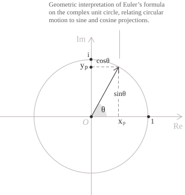

## Statement

Euler's formula relates the complex exponential function to [sine and cosine](../sine-and-cosine/) and is given by the following identity for every $\theta \in \mathbb{R}$:

$$e^{i\theta} = \cos\theta + i\sin\theta \tag{1}$$

The right-hand side of $(1)$ separates $e^{i\theta}$ into its [real and imaginary parts](../complex-numbers/), so we can calculate its modulus as follows:

$$|e^{i\theta}|^2 = \cos^2\theta + \sin^2\theta = 1 \tag{2}$$

By $(2),$ the values of $e^{i\theta}$ lie on the [unit circle](../unit-circle/). As $\theta$ increases, the point with coordinates $(\cos\theta,\sin\theta)$ moves counterclockwise around the circle and returns to its starting point after an increase of $2\pi.$

Equation $(1)$ converts a complex number from [trigonometric form](../complex-numbers-trigonometric-form/) to [exponential form](../complex-numbers-exponential-form/) and also yields [De Moivre's theorem](../de-moivre-theorem/) and the representation of the [roots of unity](../roots-of-unity/).

## Proof using Taylor series

The direct proof of $(1)$ uses the [Taylor expansions](../taylor-series/) of the [exponential](../exponential-function/), sine, and cosine functions. In particular, for a real variable $x,$ the series for the three functions are as follows:

$$ \tag{3}
\begin{align}
e^x &= \sum_{n=0}^{\infty} \frac{x^n}{n!} \\[6pt]
\cos x &= \sum_{n=0}^{\infty} (-1)^n \frac{x^{2n}}{(2n)!} \\[6pt]
\sin x &= \sum_{n=0}^{\infty} (-1)^n \frac{x^{2n+1}}{(2n+1)!}
\end{align}
$$

To define $e^z$ for $z \in \mathbb{C},$ we take the first series in $(3),$ the one for $e^x,$ and replace $x^n$ with $z^n$ in each term.

$$e^z := \sum_{n=0}^{\infty} \frac{z^n}{n!}$$

This series converges absolutely for every $z$ by the following identity:

$$\sum_{n=0}^{\infty} \frac{|z|^n}{n!} = e^{|z|} \tag{4}$$

Substituting $z = i\theta$ into the definition of $e^z$ gives the following series:

$$e^{i\theta} = \sum_{n=0}^{\infty} \frac{(i\theta)^n}{n!} = \sum_{n=0}^{\infty} \frac{i^n \ \theta^n}{n!} \tag{5}$$

The behavior of the series in $(5)$ depends on the powers of the imaginary unit, which we can calculate directly as follows:

$$ \tag{6}
\begin{align}
i^0 &= 1 \\[6pt]
i^1 &= i \\[6pt]
i^2 &= -1 \\[6pt]
i^3 &= -i
\end{align}
$$

The pattern in $(6)$ repeats starting with the fourth power, since $i^4 = (i^2)^2 = 1$ and hence $i^{n+4} = i^n$ for every $n.$ The value of $i^n$ depends only on the remainder when $n$ is divided by $4.$ We now split the series into terms with $n = 2k$ and terms with $n = 2k+1$ and compute the corresponding powers of $i,$ which are $i^{2k} = (i^2)^k = (-1)^k$ and $i^{2k+1} = i \cdot (-1)^k.$ We can then group the two sets of terms separately to obtain the following equality:

$$ \tag{7}
\begin{align}
e^{i\theta} &= \sum_{k=0}^{\infty} \frac{i^{2k} \ \theta^{2k}}{(2k)!} + \sum_{k=0}^{\infty} \frac{i^{2k+1} \ \theta^{2k+1}}{(2k+1)!} \\[6pt]
&= \sum_{k=0}^{\infty} (-1)^k \frac{\theta^{2k}}{(2k)!} + i \sum_{k=0}^{\infty} (-1)^k \frac{\theta^{2k+1}}{(2k+1)!}
\end{align}
$$

Setting $x = \theta$ in $(3),$ we see that the first sum in the last line of $(7)$ equals $\cos\theta$ and that the sum multiplying $i$ equals $\sin\theta.$ The final expression in $(7)$ is therefore $\cos\theta + i\sin\theta,$ which gives $(1).$

## Proof using a differential equation

We can also prove $(1)$ using a [differential equation](../differential-equations/) by checking that both sides satisfy the same equation and take the same value at $\theta = 0.$ To do this, let $f : \mathbb{R} \to \mathbb{C}$ be the function given by the right-hand side of $(1):$

$$f(\theta) = \cos\theta + i\sin\theta \tag{8}$$

Differentiating the real and imaginary parts of $(8)$ separately gives an equation relating $f$ to its [derivative](../derivatives/):

$$ \tag{9}
\begin{align}
f'(\theta) &= -\sin\theta + i\cos\theta \\[6pt]
&= i(\cos\theta + i\sin\theta) \\[6pt]
&= if(\theta)
\end{align}
$$

Now let $g(\theta) = e^{i\theta}.$ The power series in $(5)$ has an infinite [radius of convergence](../power-series/), so we can differentiate it term by term. Simplifying $n/n! = 1/(n-1)!$ and setting $k = n-1$ gives the following calculation:

$$ \tag{10}
\begin{align}
g'(\theta) &= \sum_{n=1}^{\infty} \frac{i^n\theta^{n-1}}{(n-1)!} \\[6pt]
&= i\sum_{k=0}^{\infty} \frac{(i\theta)^k}{k!} \\[6pt]
&= ig(\theta)
\end{align}
$$

Equations $(9)$ and $(10)$ show that the derivative of each function equals the function itself multiplied by $i.$ The two functions have the same value at $\theta = 0$ because $f(0) = \cos 0 + i\sin 0 = 1$ and $g(0) = e^0 = 1.$ If $u$ denotes either function, we can write these conditions as follows:

$$ \tag{11}
\begin{align}
u'(\theta) &= iu(\theta) \\[6pt]
u(0) &= 1
\end{align}
$$

The problem in $(11)$ has a unique solution on $\mathbb{R},$ so $f(\theta) = g(\theta)$ for every $\theta \in \mathbb{R},$ as stated in $(1).$

## Consequences and Euler's identity

From $(1)$ we can express sine and cosine in terms of exponential functions. We first replace $\theta$ with $-\theta$ to obtain the following identity:

$$e^{-i\theta} = \cos\theta - i\sin\theta \tag{12}$$

Adding $(12)$ to $(1)$ gives the exponential expression for cosine, while subtracting $(12)$ from $(1)$ gives the corresponding expression for sine:

$$ \tag{13}
\begin{align}
\cos\theta &= \frac{e^{i\theta} + e^{-i\theta}}{2} \\[6pt]
\sin\theta &= \frac{e^{i\theta} - e^{-i\theta}}{2i}
\end{align}
$$

Equation $(13)$ lets us extend sine and cosine to complex arguments and relate them to the [hyperbolic functions](../hyperbolic-sine-and-cosine/). Multiplying both sides of $(1)$ by the modulus $r$ converts the trigonometric form to the exponential form $z = re^{i\theta}.$ In this form, we obtain the complex conjugate by reversing the sign of $\theta.$ More generally, for $x,y \in \mathbb{R}$ we can write $e^{x+iy} = e^xe^{iy}$ and apply $(1)$ to the second factor to obtain the following expression:

$$e^{x+iy} = e^x(\cos y + i\sin y) \tag{14}$$

Finally, substituting $\theta = \pi$ into $(1)$ and adding $1$ to both sides gives Euler's identity:

$$ \tag{15}
\begin{align}
e^{i\pi} &= \cos\pi + i\sin\pi = -1 + i\cdot 0 = -1 \\[6pt]
e^{i\pi} + 1 &= -1 + 1 \\[6pt]
e^{i\pi} + 1 &= 0
\end{align}
$$
