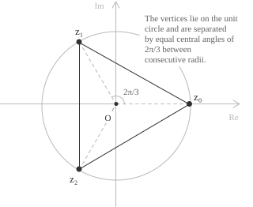

## Finding the roots and their properties

For a positive integer $n,$ an $n$th root of unity is a [complex number](../complex-numbers/) $z$ that satisfies the [equation](../polynomial-equations/):

$$z^n = 1 \tag{1}$$

Equation $(1)$ has exactly $n$ solutions in $\mathbb{C}.$ To find them, we use [Euler's formula](../eulers-formula/), which gives the following identity for every $\theta \in \mathbb{R}$

$$e^{i\theta} = \cos\theta + i\sin\theta \tag{2}$$

Taking the modulus of both sides of $(1)$ gives $|z|^n = 1,$ so $|z| = 1.$ We can therefore write $z = e^{i\theta}$ and substitute it into $(1),$ obtaining:

$$e^{in\theta} = 1 \tag{3}$$

By $(2),$ equation $(3)$ is equivalent to the conditions $\cos(n\theta) = 1$ and $\sin(n\theta) = 0,$ which hold only when $n\theta = 2\pi k$ for some integer $k,$ giving $\theta = 2\pi k/n.$ Taking $k = 0, 1, \ldots, n-1$ gives all the distinct arguments in $[0, 2\pi)$ and hence the $n$ roots, given by:

$$z_k = e^{2\pi ik/n} \tag{4}$$

Applying $(2)$ to each root in $(4)$ gives the roots in algebraic form:

$$z_k = \cos\left(\frac{2\pi k}{n}\right) + i\sin\left(\frac{2\pi k}{n}\right) \tag{5}$$

Equation $(4)$ gives $z_0 = 1$ for every $n.$ For $n = 2,$ the arguments are $0$ and $\pi,$ with corresponding roots $1$ and $-1.$ For $n = 4,$ the arguments are $0, \pi/2, \pi, 3\pi/2$ and the corresponding roots are $1, i, -1, -i.$ Equation $(5)$ also shows how to find the [conjugate](../complex-numbers/) of a root. Replacing $k$ with $n-k$ changes the angle $2\pi k/n$ to $2\pi - 2\pi k/n$ and gives the following identity:
$$z_{n-k} = \overline{z_k} \tag{6}$$

In $(6)$ the indices are taken [modulo](../modulo-operator/) $n.$ The nonreal roots therefore occur in distinct conjugate pairs.

- - -

We now show that the set of $n$th roots of unity given by $(4),$ which we denote by $\mu_n,$ is a group. [Complex multiplication](../complex-number-operations/) preserves the condition defining the roots in $(1),$ so the following axioms must hold for $\mu_n$ to be a group under this operation.

The first axiom is closure, meaning that the product of two elements of $\mu_n$ must also belong to $\mu_n.$ Equation $(4)$ gives $z_j z_k = e^{2\pi i(j+k)/n}.$ Reducing $j+k$ modulo $n$ changes the [argument](../complex-numbers/) by a multiple of $2\pi$ and leaves the product unchanged. This gives the multiplication law in $\mu_n$.

   $$z_j z_k = z_{(j+k) \bmod n} \tag{7}$$

The second axiom is associativity. Since multiplication is associative in $\mathbb{C},$ for every $z_j, z_k, z_\ell \in \mu_n$ we have:

$$(z_j z_k)z_\ell = z_j(z_k z_\ell) \tag{8}$$ 

The third axiom requires an identity element. This follows immediately from $(4),$ which gives $z_0 = 1.$ Since $1$ is the multiplicative identity in $\mathbb{C},$ for every $z_k \in \mu_n$ we have:

$$z_0 z_k = z_k z_0 = z_k \tag{9}$$

The final axiom requires every root to have an inverse in $\mu_n.$ Since the sum of the indices $k$ and $n-k$ is congruent to $0$ modulo $n,$ equation $(7)$ gives:

$$z_k z_{n-k} = z_{n-k}z_k = z_0 \tag{10}$$

The inverse of $z_k$ is therefore $z_{n-k},$ which by $(6)$ is its complex conjugate $\overline{z_k}.$

The multiplication law $(7)$ shows that multiplying a root by $z_1 = e^{2\pi i/n}$ increases its index by $1$ modulo $n.$ Starting from the identity element $z_0,$ this gives all the roots in order. For each $k = 0, 1, \ldots, n-1,$ we have the identity:

$$z_1^k = z_k \tag{11}$$

By $(11),$ the group $\mu_n$ is [cyclic](../groups/) of order $n$ with generator $z_1.$ It is also abelian because complex multiplication is commutative.

- - -

Equation $(4)$ shows that the roots lie on the [unit circle](../unit-circle/) and that consecutive roots are separated by an [angle](../angles-and-angular-measure/) of $2\pi/n.$ For $n \geq 3,$ these roots are the vertices of a regular $n$-gon, with the first vertex at $z_0 = 1.$ For $n = 3,$ equation $(5)$ gives the vertices of the equilateral triangle shown in the figure:

$$
\begin{aligned}
z_0 &= 1 \\[6pt]
z_1 &= e^{2\pi i/3} = -\frac{1}{2} + i\frac{\sqrt{3}}{2} \\[6pt]
z_2 &= e^{4\pi i/3} = -\frac{1}{2} - i\frac{\sqrt{3}}{2}
\end{aligned}
\tag{12}
$$

The multiplication law $(7)$ also describes how the vertices rotate, since multiplication by $z_1$ rotates the plane through $2\pi/n$ about the origin and sends each vertex to the next, as expressed by:

$$z_1 z_k = z_{(k+1) \bmod n} \tag{13}$$

Successive applications of the rotation in $(13)$ give all $n$ rotational symmetries of the polygon, including the identity.

## Primitive roots

Equation $(11)$ shows that every root in $\mu_n$ is a power of $z_1,$ which is what it means for $z_1$ to generate $\mu_n.$ A root $z_k$ is called primitive if it also generates $\mu_n,$ meaning that its powers, starting at $z_k^0 = 1,$ give all $n$ roots before returning to $1.$ In this case, its order is $n.$

To find the order of $z_k,$ note that $(11)$ gives $z_k^m = z_1^{km}.$ Since $z_1$ has order $n,$ we have $z_k^m = 1$ if and only if $n$ divides $km.$ Setting $d = \gcd(k,n),$ we can write this condition equivalently as requiring $n/d$ to divide $m,$ since $k/d$ and $n/d$ are [coprime](../integers/). The smallest positive integer satisfying the condition is therefore $n/d,$ and the order of $z_k$ is given by:

$$\mathrm{ord}(z_k) = \frac{n}{\gcd(k,n)} \tag{14}$$

Equation $(14)$ shows that $z_k$ is primitive if and only if $\gcd(k,n) = 1.$ For example, when $n = 6,$ the only indices from $0$ to $5$ that are coprime to $6$ are $1$ and $5.$ Equation $(4)$ therefore gives the two primitive roots $z_1 = e^{\pi i/3}$ and $z_5 = e^{5\pi i/3}.$ If $n$ is prime, every index from $1$ to $n-1$ is coprime to $n,$ so every root except $z_0 = 1$ is primitive. Thus, if $\zeta$ is any primitive root, its first $n$ powers, starting at $\zeta^0 = 1,$ give the entire set:

$$\mu_n = \{1, \zeta, \zeta^2, \ldots, \zeta^{n-1}\}$$

## Sum and product of the roots

A property of the sum of all the $n$th roots of unity is that it vanishes for every $n \geq 2.$ To prove this, note that the [polynomial](../polynomials/) $z^n - 1$ factors as follows:

$$z^n - 1 = (z - z_0)(z - z_1) \cdots (z - z_{n-1}) \tag{15}$$

On the right-hand side of $(15),$ a term of degree $n-1$ is obtained by taking the constant term $-z_k$ from one factor and the term $z$ from each of the other $n-1$ factors. Each choice contributes $-z_k z^{n-1},$ so the coefficient of $z^{n-1}$ is $-(z_0 + z_1 + \cdots + z_{n-1}).$ On the left-hand side of $(15)$ this coefficient is zero, because for $n \geq 2$ the polynomial $z^n-1$ has only a term of degree $n$ and a constant term. Equating the two coefficients gives:

$$\sum_{k=0}^{n-1} z_k = 0 \tag{16}$$

An alternative proof uses the [geometric series](../geometric-series/) formula. Since $z_1 \neq 1$ for $n \geq 2,$ we have:

$$\sum_{k=0}^{n-1} z_1^k = \frac{z_1^n - 1}{z_1 - 1} = \frac{1 - 1}{z_1 - 1} = 0 \tag{17}$$

By $(16),$ the mean of the roots is zero. For $n \geq 3,$ this means that the centroid of the vertices of the regular polygon is at the origin, while for $n = 2,$ the origin is the midpoint between $1$ and $-1.$

Having found the sum, we now calculate the product of the roots. Setting $z = 0$ in $(15)$ gives [Viète's formula](../vieta-formulas/) for the product of the roots:

$$\prod_{k=0}^{n-1} z_k = (-1)^{n+1} \tag{18}$$

Equation $(18)$ can also be verified using [De Moivre's theorem](../de-moivre-theorem/). By $(11),$ the product of the roots is $z_1^{n(n-1)/2}.$ The theorem gives this power a modulus of $1$ and an argument of $\pi(n-1),$ so its value is $(-1)^{n-1} = (-1)^{n+1}.$

## Cyclotomic polynomials

In the [factorization](../unique-factorization-of-polynomials/) $(15),$ each root $z_k$ gives a linear factor $z-z_k.$ We can group these factors by the order of their roots. The product of the factors corresponding to roots of order exactly $n$ is the $n$th cyclotomic polynomial $\Phi_n.$ By $(14),$ these are the roots with $\gcd(k,n)=1,$ so the polynomial is given by:

$$\Phi_n(z) = \prod_{\substack{0 \leq k < n \\ \gcd(k,n)=1}} (z-z_k) \tag{19}$$

Equation $(19)$ contains one factor for each primitive $n$th root of unity. More generally, the order $d$ of a root in $(15)$ divides $n.$ Conversely, if $d$ divides $n,$ every primitive $d$th root of unity also satisfies $z^n=1,$ since $z^n=(z^d)^{n/d}.$ The factors corresponding to roots of order $d$ therefore form $\Phi_d(z),$ and $(15)$ can be written as:

$$z^n-1 = \prod_{d \mid n} \Phi_d(z) \tag{20}$$

For example, when $n=4,$ the root $1$ has order $1,$ the root $-1$ has order $2,$ and the roots $i$ and $-i$ have order $4.$ Grouping the factors by these orders, we obtain from $(20)$:

$$z^4-1 = \Phi_1(z)\Phi_2(z)\Phi_4(z) = (z-1)(z+1)(z^2+1) \tag{21}$$
