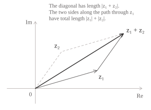
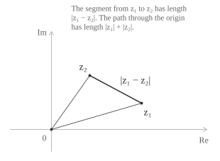

## Definition

The triangle inequality bounds the modulus of the sum of two [complex numbers](../complex-numbers/) $z_1$ and $z_2$ by the sum of their moduli and takes the following form.

$$|z_1 + z_2| \leq |z_1| + |z_2| \tag{1}$$

To prove $(1),$ we use the identity $|z|^2 = z\overline{z}$ and the following property of the [conjugate of a sum](../complex-number-operations/).

$$\overline{z_1 + z_2} = \overline{z_1} + \overline{z_2} \tag{2}$$

We can then expand $|z_1 + z_2|^2$ as follows.

$$
\begin{aligned}
|z_1 + z_2|^2 &= (z_1 + z_2)\overline{(z_1 + z_2)} \\[6pt]
              &= (z_1 + z_2)(\overline{z_1} + \overline{z_2}) \\[6pt]
              &= |z_1|^2 + z_1\overline{z_2} + \overline{z_1}z_2 + |z_2|^2
\end{aligned}
\tag{3}
$$

In the last equality of $(3),$ the terms $z_1\overline{z_2}$ and $\overline{z_1}z_2$ are complex conjugates. Their sum is therefore twice the real part of either term.

$$z_1\overline{z_2} + \overline{z_1}z_2 = 2\mathrm{Re}(z_1\overline{z_2}) \tag{4}$$

Equation $(4)$ reduces the task of bounding the cross terms to bounding $\mathrm{Re}(z_1\overline{z_2}).$ For any complex number $w = a + bi,$ we have $\mathrm{Re}(w) \leq |w|,$ since $\mathrm{Re}(w) = a \leq |a|$ and $|a| = \sqrt{a^2} \leq \sqrt{a^2 + b^2} = |w|.$ Setting $w = z_1\overline{z_2}$ gives $\mathrm{Re}(z_1\overline{z_2}) \leq |z_1\overline{z_2}| = |z_1||z_2|,$ since the modulus is multiplicative and $|\overline{z_2}| = |z_2|.$ Applying this bound to the expansion of $|z_1 + z_2|^2$ in $(3)$ gives the following estimate.

$$
\begin{aligned}
|z_1 + z_2|^2 &= |z_1|^2 + 2\mathrm{Re}(z_1\overline{z_2}) + |z_2|^2 \\[6pt]
              &\leq |z_1|^2 + 2|z_1||z_2| + |z_2|^2 \\[6pt]
              &= (|z_1| + |z_2|)^2
\end{aligned}
\tag{5}
$$

Taking the [square root](../radicals/) of both sides of the inequality in $(5)$ gives the following.

$$|z_1 + z_2| = \sqrt{|z_1 + z_2|^2} \leq \sqrt{(|z_1| + |z_2|)^2} = |z_1| + |z_2|$$

This proves $(1).$

- - -

Equality in $(1)$ is equivalent to equality in $(5),$ because the square root is strictly increasing on the [nonnegative real numbers](../real-numbers/).

When the [vectors](../vectors/) $z_1$ and $z_2$ are not collinear, the segments joining them to the origin form adjacent sides of a parallelogram. The sum vector $z_1 + z_2$ is the diagonal whose length, by $(1),$ is at most the length of the path between the same vertices along two consecutive sides.

Applying $(1)$ to $z_1$ and $-z_2$ and using $|-z_2| = |z_2|,$ we obtain an upper bound for the modulus of the difference.

$$|z_1 - z_2| \leq |z_1| + |z_2| \tag{6}$$

The left-hand side is the length of the segment joining $z_1$ and $z_2.$ The right-hand side is the length of the path from $z_1$ to $z_2$ through the origin.

## Reverse triangle inequality

The reverse triangle inequality gives a lower bound on the distance between two complex numbers $z_1$ and $z_2$ using only their moduli and takes the following form.

$$\bigl||z_1| - |z_2|\bigr| \leq |z_1 - z_2| \tag{7}$$

To prove $(7),$ we write $z_1 = (z_1 - z_2) + z_2$ and apply $(1)$ to the two summands to obtain the following inequality.

$$|z_1| \leq |z_1 - z_2| + |z_2| \tag{8}$$

Subtracting $|z_2|$ from both sides of $(8)$ gives the first bound.

$$|z_1| - |z_2| \leq |z_1 - z_2| \tag{9}$$

In $(9),$ interchanging $z_1$ and $z_2$ and using $|z_2 - z_1| = |z_1 - z_2|$ gives the second bound.

$$|z_2| - |z_1| \leq |z_1 - z_2| \tag{10}$$

Inequalities $(9)$ and $(10)$ show that both $|z_1| - |z_2|$ and $|z_2| - |z_1|$ are at most $|z_1 - z_2|.$ The same bound holds for their maximum, which is $\bigl||z_1| - |z_2|\bigr|.$ This proves $(7).$

- - -

To determine when equality holds in $(7),$ we compare the squares of its two sides, both of which are nonnegative. Replacing $z_2$ with $-z_2$ in the first line of $(5)$ and subtracting the square of the difference of the moduli gives the following identity.

$$|z_1 - z_2|^2 - (|z_1| - |z_2|)^2 = 2\bigl(|z_1||z_2| - \mathrm{Re}(z_1\overline{z_2})\bigr) \tag{11}$$

By $(11),$ the squares are equal if and only if $\mathrm{Re}(z_1\overline{z_2}) = |z_1\overline{z_2}|.$ This is the same condition for equality as in $(1).$ In the complex plane, this condition holds when at least one of the numbers is zero or when both lie on the same ray from the origin.

> It follows from $(7)$ that the modulus is [uniformly continuous](../uniform-continuity/) on $\mathbb{C}.$ Inequality $(7)$ states that the [absolute change](../absolute-value/) in modulus does not exceed the distance between the two points. In this sense the modulus is Lipschitz with constant $1.$ To keep the change in modulus below a tolerance $\varepsilon > 0,$ it therefore suffices to choose $\delta = \varepsilon.$ Indeed, for every pair $z_1, z_2 \in \mathbb{C}$ with $|z_1 - z_2| < \delta,$ we have $\bigl||z_1| - |z_2|\bigr| < \varepsilon.$ The same threshold $\delta$ applies to all points in the complex plane.
