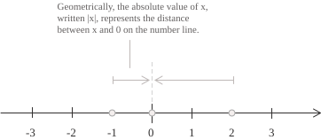
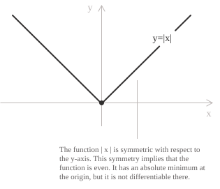
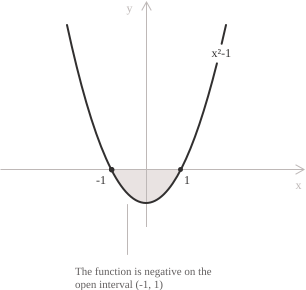
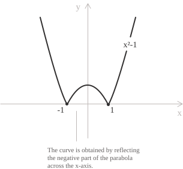

## Definition

Before discussing the absolute value function, we briefly recall the concept of the [absolute value](../absolute-value/) of a [real number](../real-numbers/) $x,$ which is denoted by $|x|$ and is defined according to the sign of $x$ as follows:

$$ \tag{1}
|x| =
\begin{cases}
+x & \text{if } x \geq 0 \\[6pt]
-x & \text{if } x < 0
\end{cases}
\quad \forall \ x \in \mathbb{R}
$$

In other words, the absolute value of a real number $x$ represents its distance from zero on the real line and is therefore always non-negative. In the following figure, for example, the points $-1$ and $2$ are respectively $1$ and $2$ units away from zero, so $|-1| = 1$ and $|2| = 2.$

More generally, the distance between two points $x$ and $a$ is given by $|x - a|$ and the following equality holds:

$$|x-a| = |a-x| \tag{2}$$

From $(2),$ since $a - x = -(x - a)$ we also have:

$$|a - x| = |-(x - a)| = |x - a|$$

With this preliminary discussion in place, we can introduce the absolute value function, which assigns to each real number $x$ its absolute value $|x|$ and, consistently with $(1),$ is defined [piecewise](../piecewise-functions/) as:

$$ \tag{3}
y = |x| =
\begin{cases}
+x & \text{if } x \geq 0 \\[6pt]
-x & \text{if } x < 0
\end{cases}
$$

Its graph consists of two half-lines that meet at the origin of the [Cartesian plane](../the-cartesian-coordinate-plane/) and is symmetric with respect to the vertical axis, so the function is [even](../even-and-odd-functions/) and satisfies the identity:

$$|{-x}| = |x| \quad \text{for all } x \in \mathbb{R}$$

## Properties

From $\tag{3}$ we obtain the main properties of the absolute value function, which are listed below.

+ [Domain](../determining-the-domain-of-a-function/): $\mathbb{R}$
+ [Range](../functions/): $\mathbb{R}^+_0$
+ Regarding [monotonicity](../increasing-and-decreasing-functions/), the function is decreasing on $(-\infty, 0]$ and increasing on $[0, +\infty).$
+ The function is even, since $|{-x}| = |x|.$
+ The function is [continuous](../continuous-functions/) on the entire real line $\mathbb{R}.$
+ The function is differentiable at every point except at $x = 0,$ where it has a [corner point](../points-of-non-differentiability/).
+ The function has an [absolute minimum](../maximum-minimum-and-inflection-points/) at $x = 0,$ where $|x| = 0,$ and has no maximum.
+ The limits at the endpoints of the domain are:

$$
\begin{align}
\lim_{x \to -\infty} |x| &= +\infty \\[6pt]
\lim_{x \to +\infty} |x| &= +\infty
\end{align}
$$

The graph of the absolute value of a function is obtained through a [transformation](../transformations-of-functions/), reflecting across the $x$-axis the parts of the original graph that lie below that axis. Consider, for example, the graph of the [parabola](../parabola/) defined by the equation:

$$y = x^2 - 1 \tag{4}$$

By [studying the sign](../sign-analysis-in-inequalities/) of the function, we verify that $(4)$ is negative in the interval between $-1$ and $1$, that is, when the following [inequality](../quadratic-inequalities/) holds:

$$x^2 - 1 < 0$$
We now apply a transformation to $(4)$ so that the following holds:

$$f(x) = |x^2 - 1|$$

To plot this function, we keep the parts of the graph with values greater than or equal to zero unchanged, while reflecting the negative parts, that is, those lying precisely in the interval between $-1$ and $1,$ to obtain:

## Limits, derivatives, and integrals of the absolute value function

We now examine some useful aspects of the absolute value function that arise in the calculation of [limits](../limits/) and in differential and integral calculus. We begin with a standard limit involving the absolute value function:

$$\lim_{x \to 0} \frac{|x|}{x} \tag{5}$$

The existence of the limit requires the left-hand and right-hand limits to coincide. In this case, however, the two one-sided limits are different, so the limit does not exist:

$$
\begin{align}
\lim_{x \to 0^-} \frac{|x|}{x} &= -1 \\[6pt]
\lim_{x \to 0^+} \frac{|x|}{x} &= 1
\end{align}
$$

Thus, since the two one-sided limits of the [difference quotient](../difference-quotient/) are different, $|x|$ is not differentiable at $x = 0.$ As for the [derivative](../derivatives/), by differentiating each branch of the absolute value function, we obtain the following piecewise expression for its derivative:

$$
\frac{d}{dx} |x| =
\begin{cases}
1 & \text{if } x > 0 \\[6pt]
-1 & \text{if } x < 0
\end{cases}
$$

Since, as we have seen, the limit at $x=0$ does not exist, the derivative does not exist at $x = 0,$ because the function has a corner point there. The [indefinite integral](../indefinite-integrals/) of the absolute value function is:

$$\int |x| \ dx = \frac{x^2 \cdot \mathrm{sgn}(x)}{2} + c \tag{6}$$

The [sign function](../sign-function/) appearing in $(6),$ which allows the two branches of the antiderivative to be combined into a single expression, is defined by:

$$
\mathrm{sgn}(x) =
\begin{cases}
-1 & \text{if } x < 0 \\[6pt]
0 & \text{if } x = 0 \\[6pt]
1 & \text{if } x > 0
\end{cases}
$$
