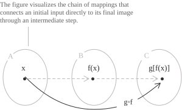

## Definition of composition

Function composition is an operation that applies two or more [functions](../functions/) in succession, using the output of each as the input to the next. More formally, given any two functions $f$ and $g,$ their composition is the function obtained by applying $f$ first and then $g$ to the output of $f,$ and is written as follows:

$$
(g \circ f)(x) = g(f(x)) \tag{1}
$$

The functions in $(1)$ are applied from right to left. To clarify this operation, we can illustrate the composition with the following diagram, considering the functions $f : A \rightarrow B$ and $g : B \rightarrow C.$

First, an arbitrary input $x$ in $A$ is mapped by $f$ to the value $f(x)$ in $B,$ and then by $g$ to the value $g(f(x))$ in $C.$ The outer arrow corresponds to the composition given in $(1).$ Since $f(x) \in B$ for every $x \in A$ and $B$ is the domain of $g,$ the value $g(f(x))$ is defined for every $x \in A.$ Thus $g \circ f$ is a function from $A$ to $C$ defined by the following mapping rule:

$$
\begin{align}
&g \circ f \colon A \rightarrow C \\[6pt]
&x \mapsto g(f(x))
\end{align}
$$

We must also consider the [domain](../determining-the-domain-of-a-function/) of the composite function. For the composite in $(1)$ to be defined, two conditions must hold:

+ The point $x$ must belong to the domain of $f.$
+ The value $f(x)$ must belong to the domain of $g.$

The domain of the composite function is therefore the set of points that satisfy both conditions:

$$
\mathrm{dom}(g \circ f) = \{\ x \in \mathrm{dom}(f) \mid f(x) \in \mathrm{dom}(g)\ \}
$$

The second condition distinguishes composition from the other usual operations on functions. For example, the sum and product of two functions are defined on the [intersection](../sets/) of their respective domains, and the same holds for the quotient after excluding the zeros of the denominator. In a composition, then, every condition on the input to $g$ becomes a condition on $f(x).$ We therefore determine the domain of a composite function in three steps:

+ First, determine $\mathrm{dom}(f),$ considering the inner function in $(1).$
+ Next, write the conditions that define $\mathrm{dom}(g)$ and replace the variable of $g$ with the expression $f(x)$ in each condition.
+ Finally, solve these conditions and intersect their solution set with $\mathrm{dom}(f).$

However, simplifying the expression $g(f(x))$ immediately, before determining the domain of the composite function, can lead to an incorrect result. Consider, for example, the following composition of $f$ and $g:$

$$
\begin{align}
f(x) &= x - 3 \\[6pt]
g(x) &= \sqrt{x}
\end{align}
$$

The first is a [polynomial function](../polynomial-function/), which we know is defined on all of $\mathbb{R},$ while the second is a [root of even index](../radicals/), defined when its argument is nonnegative. We can therefore write:

$$ \tag{2}
\begin{align}
\mathrm{dom}(f) &= \mathbb{R} \\[6pt]
\mathrm{dom}(g) &= [0, +\infty)
\end{align}
$$

Substituting $x - 3$ into the expression for $g,$ we obtain:

$$
(g \circ f)(x) = g(x - 3) = \sqrt{x - 3} \tag{3}
$$

In $(2),$ the second relation therefore imposes a restriction on the domain, so the domain of $g \circ f$ is the [interval](../intervals/) $[3, +\infty),$ a proper subset of the domain of $f.$

[shortcode="intervals"]

|     | $-\infty$ | $0$      | $3$        |     |
| :-- | --------- | -------- | ---------- | --- |
|     | sign+l    |          |            |     |
|     |           | sign+l-c |            |     |
|     |           |          | sign+l-c   |     |
|     |           |          | sign+l-c-h |     |
[/shortcode]

Reversing the order of composition need not preserve the domain of $(3).$ Suppose instead that we have:

$$
(f \circ g)(x) = f(\sqrt{x}) = \sqrt{x} - 3
$$

In this order of composition, the inner function is $g,$ so the input $x$ must belong to its domain $[0, +\infty).$ The outer function $f,$ on the other hand, is defined on all of $\mathbb{R},$ so it can be applied to every resulting value $\sqrt{x}$ without imposing any further restrictions. Listing the domain of the inner function first and that of the outer function second, we have:

$$
\begin{align}
\mathrm{dom}(g) &= [0, +\infty) \\[6pt]
\mathrm{dom}(f) &= \mathbb{R}
\end{align}
$$

The domain of $f \circ g$ is therefore the interval $[0, +\infty),$ which coincides with the domain of the inner function $g.$

This shows that composition is not a commutative operation.

- - -

For a further example, consider the functions:

$$ \tag{4}
\begin{align}
f(x) &= \frac{x + 1}{x - 2} \\[6pt]
g(x) &= \ln x
\end{align}
$$

The function $f$ is a [rational function](../rational-functions/) defined for $x \neq 2,$ while the [logarithm](../logarithmic-function/) in $g$ is defined for strictly positive arguments. Applying $(1)$ gives the following composite function:

$$
(g \circ f)(x) = \ln \frac{x + 1}{x - 2}
$$

As we saw above, the domain condition for the outer function must also be applied to the quotient, which must be strictly positive:

$$
\frac{x + 1}{x - 2} > 0
$$

The numerator vanishes at $x = -1$ and the denominator at $x = 2.$ A [sign analysis](../sign-analysis-in-inequalities/) gives:

[class="table-sign"]

|                             |                  |       $-1$       |       $2$        |
| :-------------------------: | :--------------: | :--------------: | :--------------: |
|        $$x + 1 > 0$$        | $-$ | $+$ | $+$ |
|        $$x - 2 > 0$$        | $-$ | $-$ | $+$ |
| $$\frac{x + 1}{x - 2} > 0$$ | $+$ | $-$ | $+$ |
[/class]

The sign analysis shows that the quotient is positive where the numerator and denominator have the same sign, that is, for $x < -1$ and for $x > 2.$ The point $x = 2$ does not belong to this set, so the domain is:

$$
\mathrm{dom}(g \circ f) = (-\infty, -1) \cup (2, +\infty)
$$

Again, composing in the opposite order gives:

$$ \tag{5}
(f \circ g)(x) = \frac{\ln x + 1}{\ln x - 2}
$$

To determine the domain of the composite function in $(5),$ we observe that the quotient contains the logarithm $\ln x,$ which is defined only for $x > 0.$ In addition, the denominator $\ln x - 2$ must be nonzero, so we must exclude the values for which $\ln x = 2,$ that is, $x = e^2.$ The domain therefore contains all positive real numbers except $e^2,$ so we can write:

$$
\mathrm{dom}(f \circ g) = (0, e^2) \cup (e^2, +\infty)
$$

## Associativity and order of composition

We now examine the composition of three functions. These can be composed in two ways, both of which give the same result. Consider, for example:

$$ \tag{6}
((h \circ g) \circ f)(x)
$$

Applying $(1)$ twice to the left grouping in $(6),$ we obtain:

$$
(h \circ g)(f(x)) = h(g(f(x))) \tag{7}
$$

Applying $(1)$ again, but this time to the right grouping in $(6),$ gives the same result:

$$
h((g \circ f)(x)) = h(g(f(x))) \tag{8}
$$

Since $(7)$ and $(8)$ give the same value $h(g(f(x))),$ we can write:

$$
(h \circ g) \circ f = h \circ (g \circ f) = h \circ g \circ f \tag{9}
$$

Equation $(9)$ therefore shows that function composition is associative, meaning that we can change the grouping of the functions without changing the result, provided that their order remains unchanged. Associativity thus concerns only the grouping, not the order in which the operations are performed. Composition is not commutative, as we have shown in the expressions for the composite functions in the examples.

## Decomposing a function

In the previous examples, we started with two functions and calculated their composition. We can also start with a given function and look for functions that, when applied in succession, reproduce its expression. Consider, for example, the following function:

$$
F(x) = \sqrt{\ln(x^2 + 1)}
$$

To write $F$ as a composition, we identify the operations to be performed starting from the input $x:$

$$ \tag{10}
\begin{align}
&h(x) = x^2 + 1 \\[10pt]
&g(h(x)) = \ln(x^2 + 1) \\[6pt]
&f(g(h(x))) = \sqrt{\ln(x^2 + 1)} = F(x)
\end{align}
$$

Identifying the component functions is useful, for example, when applying the [chain rule](../chain-rule/), which specifies how to combine the [derivatives](../derivatives/) of the individual functions in $(10)$ to obtain the derivative of $F.$

When [integrating by substitution](../integration-by-substitution/), identifying an inner function in an integrand with no immediately apparent [antiderivative](../indefinite-integrals/) also helps us choose an expression to use as the new variable. Consider, for example, the integral:

$$
\int 2x\cos(x^2) \ dx
$$

In the factor $\cos(x^2),$ we recognize the composition of the inner function $x^2$ with the [cosine function](../cosine-function/). The factor $2x$ multiplying it is precisely the derivative of $x^2,$ so we choose $u = x^2.$ Since $du = 2x \ dx,$ the substitution transforms the integral into:

$$
\int \cos u \ du = \sin u + C \tag{11}
$$

Returning to the variable $x$ in $(11),$ we obtain the antiderivatives for the original integrand, given by:

$$\sin(x^2) + C$$

## Monotonicity and parity

Studying the [monotonicity](../increasing-and-decreasing-functions/) of a composite function reduces to studying the behavior of its component functions. To illustrate this in practice, we determine the monotonicity of the following composite function on the interval $x \gt 0:$

$$
\begin{align}
&f(x) = x^3 \\[6pt]
&g(t) = \frac{1}{t}\\[6pt]
&g(f(x)) = 1/x^3
\end{align}
$$

The function $f$ is strictly increasing, while $g$ decreases as $x$ increases. The composite function is therefore strictly decreasing on the interval under consideration. Now suppose that $f$ is strictly monotone on an arbitrary interval $I$ and that $g$ is strictly monotone on the image $f(I).$ We must distinguish two cases:

+ If $f$ and $g$ are both increasing or both decreasing, the composite function is strictly increasing.
+ If, on the other hand, one function is increasing and the other decreasing, the composite function is strictly decreasing.

- - -

To study the [parity](../even-and-odd-functions/) of a composite function, we must, by definition, compare its values at $x$ and $-x,$ assuming that its domain is symmetric about the origin. If the inner function $f$ is even, we have $f(-x) = f(x).$ The outer function $g$ therefore receives the same input in both cases and returns the same value:

$$
g(f(-x)) = g(f(x))
$$

The composite function is therefore even, regardless of the parity of $g.$ For example, $e^{-x^2}$ is even because $-x^2$ is even. If $f$ is odd, on the other hand, we have $f(-x) = -f(x).$ In this case, the parity of the function depends on $g.$ If $g$ is even, changing the sign of its input does not affect the result, and the composite function is even. For example, $\sin^2 x$ behaves in this way, since the [sine function](../sine-function/) is odd, while the squaring function is even. When we replace $x$ with $-x,$ the sine changes sign, but squaring gives positive values, so we obtain:

$$
\sin^2(-x) = (-\sin x)^2 = \sin^2 x
$$

The composite function is therefore even.

## Injectivity and surjectivity

We now consider two functions $f \colon A \rightarrow B$ and $g \colon B \rightarrow C.$ If both are [injective](../injective-surjective-and-bijective-functions/), their composition is also injective. To verify this, take two inputs $x_1$ and $x_2$ in $A$ and suppose that the composite function returns the same value:

$$
g(f(x_1)) = g(f(x_2)) \tag{12}
$$

Since $g$ is injective, the equality in $(12)$ implies that its inputs are equal, so $f(x_1) = f(x_2).$ But $f$ is also injective, so we must have $x_1 = x_2.$ We have therefore shown that $g(f(x_1)) = g(f(x_2))$ implies $x_1 = x_2,$ so the composite function $g \circ f$ is injective.

If instead we know that the composite function is injective, we can immediately conclude that $f$ is injective. Indeed, if $f$ mapped two distinct inputs to the same value, applying $g$ would still give the same value, and the composition would not be injective. However, we cannot conclude that $g$ is also injective on all of $B.$ Consider, for example, the following case:

$$
\begin{gathered}
f(x) = x \\[6pt]
g(t) = t^2 \\[6pt]
(g \circ f)(x) = x^2
\end{gathered}
$$

The composite function is injective on its domain $[0, +\infty).$ The function $g,$ however, is not injective on $\mathbb{R},$ because, for example, $g(-1) = g(1) = 1.$ This issue does not arise in the composition because $f$ takes only nonnegative values, on which $g$ is injective.

- - -

We now turn to surjectivity. Suppose that $f$ is surjective onto $B$ and that $g$ is surjective onto $C.$ We want to show that the composite function can take every value in $C.$ If we choose any $c \in C,$ the surjectivity of $g$ guarantees that an element $b \in B$ exists such that $g(b) = c.$ Moreover, since $f$ is surjective, a number $a \in A$ exists such that $f(a) = b.$ We can therefore write the following relation, which shows that the composite function is surjective:

$$
(g \circ f)(a) = g(f(a)) = g(b) = c
$$

If instead $g \circ f$ is surjective onto $C,$ we can conclude that $g$ is surjective onto $C,$ because every value taken by the composition is also a value taken by $g.$ However, $f$ need not be surjective onto $B.$ For example, consider the following situation:

$$
\begin{align}
f(x) = x^2 \\[6pt]
g(t) = t^2
\end{align}
$$

The function $f$ is not surjective onto its codomain $\mathbb{R},$ because it does not take negative values. The composite function $(g \circ f)(x) = x^4,$ on the other hand, is surjective onto $[0, +\infty),$ because every number $c \ge 0$ is obtained by choosing $x = \sqrt[4]{c}.$ In this case, the nonnegative values produced by $f$ are sufficient for $g$ to reach the entire codomain of the composition.

Finally, if $f$ and $g$ are both bijective, their composition is both injective and surjective, and is therefore bijective.

## Boundedness

To study the boundedness of a composite function, we begin by considering the outer function $g.$ If it is bounded on its domain, all the values it returns lie between two constants. The values $g(f(x))$ necessarily satisfy these bounds as well, so the composite function is bounded. For example, the sine function always takes values between $-1$ and $1,$ regardless of its input, and for any real-valued function $f$ we have:

$$
-1 \le \sin(f(x)) \le 1
$$

If it is the inner function that is bounded, however, this does not guarantee that the composite function is also bounded. Consider, for example, the functions:

$$
\begin{align}
f(x) &= \frac{1}{1 + x^2} \\[6pt]
g(t) &= \frac{1}{t}
\end{align}
$$

The function $f$ is bounded because $0 < f(x) \le 1$ for every real $x.$ Composition gives:

$$
(g \circ f)(x) = 1 + x^2
$$

The result of the composition is therefore an unbounded function.

## Continuity, limits and differentiability

To determine whether a composite function is continuous, we consider the behavior of its component functions. Suppose that $f$ is [continuous](../continuous-functions/) at $x_0$ and that $g$ is continuous at $f(x_0).$ As $x$ tends to $x_0,$ the values $f(x)$ tend to $f(x_0).$ The continuity of $g$ at this point then guarantees the following equality:

$$\tag{13}
\lim_{x \to x_0} g(f(x)) = g(f(x_0))
$$

The [limit](../limits/) in $(13)$ equals the value of the composite function at $x_0,$ so $g \circ f$ is continuous at that point. For example, the function $\ln(x^2 + 1)$ is continuous on all of $\mathbb{R},$ because the polynomial $x^2 + 1$ is itself continuous and takes only positive values, at which the logarithm is continuous.

The same reasoning is used to calculate the limit of a composite function when $f$ tends to a finite value $L.$ When $L$ belongs to the domain of $g$ and $g$ is continuous at $L,$ we can write:

$$
\lim_{x \to x_0} f(x) = L
\quad \Longrightarrow \quad
\lim_{x \to x_0} g(f(x)) = g(L)
$$

Consider, for example, $f(x) = x$ and the piecewise-defined function $g:$

$$
g(t) =
\begin{cases}
1 & \text{if } t \neq 0 \\[6pt]
0 & \text{if } t = 0
\end{cases}
$$

As $x \to 0,$ the function $f$ tends to zero, but $g$ is [discontinuous](../discontinuities-of-real-functions/) at that point and, for every $x \neq 0,$ we have $g(f(x)) = 1,$ so we can write:

$$
\lim_{x \to 0} g(f(x)) = 1 \neq 0 = g(0)
$$

- - -

Now suppose that $f$ is [uniformly continuous](../uniform-continuity/) on a set $A$ and that $g$ is uniformly continuous on the image $f(A).$ We want to show that $g \circ f$ is also uniformly continuous on $A.$ By the uniform continuity of $g,$ there exists $\eta > 0$ such that, for a fixed number $\epsilon \gt 0$ and every $u,v \in f(A),$ we have:

$$
|u - v| < \eta \quad \Longrightarrow \quad |g(u) - g(v)| < \varepsilon \tag{14}
$$

The uniform continuity of $f$ then allows us to choose $\delta > 0$ such that, for every $x,y \in A,$ we have:

$$
|x - y| < \delta \quad \Longrightarrow \quad |f(x) - f(y)| < \eta
$$

Apply $(14)$ with $u = f(x)$ and $v = f(y)$ to obtain:

$$
|x - y| < \delta \quad \Longrightarrow \quad |g(f(x)) - g(f(y))| < \varepsilon
$$

Since the same $\delta$ works for every pair of points in $A,$ the composite function is uniformly continuous on $A.$

- - -

Finally, we mention that the derivative of a composite function is calculated using the chain rule, given by the following relation:

$$
(g \circ f)'(x_0) = g'(f(x_0))f'(x_0)
$$

For a detailed treatment, see the relevant entry.

## Composition with the inverse function

When $f$ has an [inverse function](../inverse-function/), composing it with its inverse gives identity functions on different sets:

$$ \tag{15}
\begin{align}
(f^{-1} \circ f)(x) &= x \\[6pt]
(f \circ f^{-1})(y) &= y
\end{align}
$$

The first identity holds for every $x$ in the domain of $f,$ and the second for every $y$ in its image. Invertibility requires $f$ to be injective and surjective onto the chosen codomain. A non-injective function may have an invertible restriction, in which case the two identities hold on the restricted sets. If $f$ and $g$ are both bijective, the inverse of their composition is obtained by composing their respective inverses in reverse order:

$$
(g \circ f)^{-1} = f^{-1} \circ g^{-1}
$$

For example, consider the function $f(x)=x^2$ with its domain restricted to the nonnegative numbers. On this domain, $f$ is bijective because every nonnegative number is the square of a unique nonnegative number. The inverse of $f$ is the [square root function](../irrational-functions/). Applying $f$ first and then its inverse returns the original input, as stated in the first equality of $(15):$

$$
(f^{-1} \circ f)(x) = \sqrt{x^2} = x
$$

If instead we extend the definition of $f(x) = x^2$ to all of $\mathbb{R},$ the resulting function is not injective because two opposite numbers, such as $-3$ and $3,$ always have the same square. Unlike in the previous case, the square root function cannot therefore be its inverse on all of $\mathbb{R}.$ We can still compose the two functions, in the same order as in the first equality of $(15),$ but in this case the result is:

$$
\sqrt{x^2} = |x|
$$

For negative inputs, we therefore do not recover the original value. For example, starting from $-3,$ squaring gives $9,$ and the square root of $9$ gives $3,$ rather than $-3.$ In the opposite order, the square root requires $x \ge 0,$ and for every input satisfying this condition we obtain:

$$
(\sqrt{x})^2 = x
$$

## Composition with a piecewise-defined function

We now examine a particular case of composition in which the outer function is [defined piecewise](../piecewise-functions/). In such cases, every condition that selects a branch of $g$ must also be imposed on $f(x).$ Consider, for example, the function:

$$
g(t) =
\begin{cases}
1 - t & t < 0 \\[6pt]
1 + t^2 & t \ge 0
\end{cases}
$$

Suppose that $f(x) = x^2 - 1$ is the inner function. To calculate $g(f(x)),$ we replace $t$ with $x^2 - 1$ both in the expressions for $g$ and in the conditions that determine which expression to use. The first expression, $1 - t,$ is used when the input to $g$ is negative. Since this input is $x^2 - 1$ in the composition, we must require:

$$
x^2 - 1 < 0 \quad \Longleftrightarrow \quad -1 < x < 1
$$

For these values of $x,$ we therefore use the first expression for $g,$ replacing $t$ with $x^2 - 1,$ to obtain:

$$
(g \circ f)(x) = 1 - (x^2 - 1) = 2 - x^2
$$

The second expression, $1 + t^2,$ is used when the input to $g$ is nonnegative, so in this case the condition is:

$$
x^2 - 1 \ge 0 \quad \Longleftrightarrow \quad x \in (-\infty, -1] \cup [1, +\infty)
$$

For these values of $x,$ we replace $t$ with $x^2 - 1$ in the second expression for $g,$ obtaining:

$$
(g \circ f)(x) = 1 + (x^2 - 1)^2
$$

Combining all three pieces, the composite function is therefore:

$$
(g \circ f)(x) =
\begin{cases}
1 + (x^2 - 1)^2 & x \le -1 \\[6pt]
2 - x^2 & -1 < x < 1 \\[6pt]
1 + (x^2 - 1)^2 & x \ge 1
\end{cases}
$$
