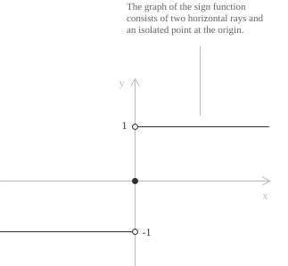
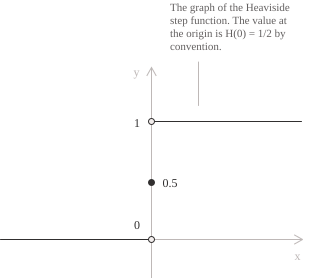

## Introduction to the sign function

The sign function is a discontinuous function that assigns each [real number](../real-numbers/) its sign, regardless of its [absolute value](../absolute-value/), and is [defined piecewise](../piecewise-functions/) by the following relations:

$$ \tag{1}
y = \mathrm{sgn}(x) =
\begin{cases}
-1 & \text{if } x < 0 \\[6pt]
0 & \text{if } x = 0 \\[6pt]
1 & \text{if } x > 0
\end{cases}
\quad \forall \ x \in \mathbb{R}
$$

For example, applying $(1)$ to real numbers gives:

$$
\begin{align}
\mathrm{sgn}(-7) &= -1 \\[6pt]
\mathrm{sgn}(0) &= 0 \\[6pt]
\mathrm{sgn}(4) &= 1
\end{align}
$$

The graph of $(1)$ consists of two horizontal rays and an isolated point. The first ray lies on the line $y = -1$ and includes all points with $x < 0,$ while the second lies on the line $y = 1$ and includes all points with $x > 0.$ The origin $(0, 0)$ is the isolated point.

As the graph shows, the sign function is an [odd function](../even-and-odd-functions/), since for every $x \in \mathbb{R}$ it satisfies the identity:

$$
\mathrm{sgn}(-x) = -\mathrm{sgn}(x)
$$

## Properties and limits

The main properties of the sign function follow from $(1)$ and are listed below.

+ [Domain](../determining-the-domain-of-a-function/): $\mathbb{R}$
+ [Range](../functions/): $\{-1,\ 0,\ 1\}$
+ The function is odd, since $\mathrm{sgn}(-x) = -\mathrm{sgn}(x).$
+ The function has a unique zero at $x = 0.$
+ The function is constant on $(-\infty, 0)$ and on $(0, +\infty)$ and, since its values are $-1,$ $0$ and $1,$ in that order, it is [non-decreasing](../increasing-and-decreasing-functions/) on $\mathbb{R}.$
+ The function has a [discontinuity](../discontinuities-of-real-functions/) at $x = 0$ and is [continuous](../continuous-functions/) at every other point.
+ The function is not differentiable at $x = 0$ but is differentiable, with zero derivative, at every other point.

The sign function is multiplicative, meaning that the sign of a product equals the product of the signs of its factors. Formally, the following identity therefore holds for every $x, y \in \mathbb{R}$:

$$\mathrm{sgn}(xy) = \mathrm{sgn}(x)\mathrm{sgn}(y) \tag{2}$$

Equation $(2)$ expresses the sign rule for multiplication. If both factors are nonzero and have the same sign, their product is positive and both sides equal $1.$ If they have opposite signs, the product is negative and both sides equal $-1.$ If at least one factor is zero, the product is also zero and both sides equal $0.$ As for the limits, since the sign function equals $-1$ for $x < 0$ and $1$ for $x > 0,$ the [one-sided limits](../limits/) at the origin are:

$$
\begin{align}
\lim_{x \to 0^-} \mathrm{sgn}(x) &= -1 \\[6pt]
\lim_{x \to 0^+} \mathrm{sgn}(x) &= 1
\end{align}
$$

If the function had a limit $L$ as $x \to 0,$ both one-sided limits would also have to equal $L.$ By the [uniqueness theorem for limits](../theorems-on-limits/), we would then have both $L = -1$ and $L = 1,$ which is impossible, so the following limit does not exist:

$$\lim_{x \to 0} \mathrm{sgn}(x)$$

As $x$ tends to $\pm \infty$ the sign function remains constant:

$$
\begin{align}
\lim_{x \to -\infty} \mathrm{sgn}(x) &= -1 \\[6pt]
\lim_{x \to +\infty} \mathrm{sgn}(x) &= 1
\end{align}
$$

These results follow from the fact that $\mathrm{sgn}(x) = -1$ for every $x < 0$ and $\mathrm{sgn}(x) = 1$ for every $x > 0.$ The value of the function therefore remains unchanged as $x$ moves away from zero along either half-line.

## Derivative and integral

As we saw when discussing its properties, the sign function has zero [derivative](../derivatives/) for $x \neq 0:$

$$
\frac{d}{dx} \mathrm{sgn}(x) = 0
$$

At $x = 0$ the derivative does not exist because the function is discontinuous there. Moving across the origin from left to right, the function changes from $-1$ to $1,$ with a jump of size $2$, namely $1 - (-1).$ In a more advanced treatment, beyond the scope of this discussion, distribution theory extends the notion of a derivative so that this jump can be represented using a quantity $\delta(x),$ called the Dirac delta. For our purposes, we simply note that the derivative in the sense of distributions is given by:

$$
\frac{d}{dx} \mathrm{sgn}(x) = 2\delta(x)
$$

On each of the two [intervals](../intervals/) $(-\infty, 0)$ and $(0, +\infty),$ the [indefinite integral](../indefinite-integrals/) of the sign function is given by:

$$
\int \mathrm{sgn}(x) \ dx = |x| + c
$$

The constant $c$ can be chosen independently on the two intervals. This result is consistent with the fact that the derivative of $|x|$ equals $\mathrm{sgn}(x)$ at every point where $|x|$ is differentiable.

## Relationship with the absolute value function and the Heaviside step function

A direct algebraic relationship connects the sign function to the [absolute value](../absolute-value-function/). For every $x \neq 0,$ the following identity holds:

$$
\mathrm{sgn}(x) = \frac{x}{|x|} \tag{3}
$$

Equation $(3)$ agrees with the definition of the sign function in $(1)$. Indeed, when $x > 0,$ the ratio equals $1,$ when $x < 0,$ the ratio is $-1,$ and at $x = 0,$ the ratio is undefined and the value $\mathrm{sgn}(0) = 0$ is assigned by convention. Equation $(3)$ also implies that the absolute value can be expressed in terms of the sign function through the following relation, which holds for every $x \in \mathbb{R},$ including $x = 0,$ where both sides are zero:

$$
|x| = x \cdot \mathrm{sgn}(x) \tag{4}
$$

Two further identities follow from $(4)$. The first expresses every real number as the product of its absolute value and its sign, as follows:

$$
x = |x| \cdot \mathrm{sgn}(x) \tag{5}
$$

The second uses the equality $|x| = \sqrt{x^2},$ valid for every $x \in \mathbb{R},$ to give the following alternative expression for the sign function when $x \neq 0$:

$$
\mathrm{sgn}(x) = \frac{x}{\sqrt{x^2}} \tag{6}
$$
- - -

Another fundamental algebraic relationship connects the sign function to the [Heaviside step function](../heaviside-function/) $H(x),$ which is defined as:

$$ \tag{7}
H(x) =
\begin{cases}
0 & \text{if } x < 0 \\[6pt]
\dfrac{1}{2} & \text{if } x = 0 \\[8pt]
1 & \text{if } x > 0
\end{cases}
$$

The graph of $(7)$ is shown in the following figure and, as can be seen, resembles that of the sign function:

Indeed, the two functions are related by the following [transformation](../transformations-of-functions/):

$$
\mathrm{sgn}(x) = 2H(x) - 1 \tag{8}
$$

Equivalently, $(8)$ shows that the Heaviside function can be obtained from the sign function through the following transformation:

$$
H(x) = \frac{1 + \mathrm{sgn}(x)}{2}
$$
