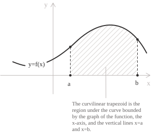
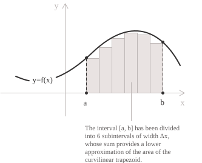
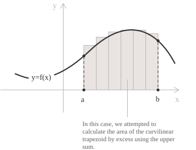
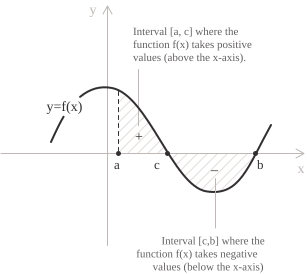
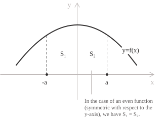
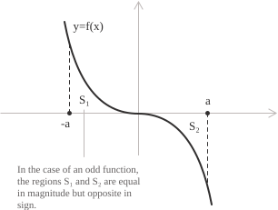

## Definizione

Un integrale definito rappresenta l'accumulazione di una quantità data da una funzione $y=f(x)$ all'interno di un intervallo. In termini un po' meno precisi, ma comunque validi, l'integrale definito misura l'area con segno tra una certa curva e l'asse delle $x,$ dove le porzioni sopra l'asse 𝑥 si sommano e quelle sotto si sottraggono. Vediamo come questo ragionamento si traduce a livello più formale, considerando una funzione $f(x)$ definita su un intervallo chiuso $[a, b]$, con $a < b$. Se $f(x)$ è continua e non negativa nell'intervallo si ha che il suo grafico, l'asse delle $x$ e le rette $x = a$ e $x = b$ delimitano un cosiddetto trapezoide curvilineo la cui area è data dal seguente integrale definito:

$$\int_{a}^{b} f(x) \ dx \tag{1}$$

Nella $(1),$ $a$ e $b$ sono gli estremi di integrazione, $f$ è la funzione integranda e $dx$ indica che si integra rispetto a $x.$ In generale, per l'area di un trapezoide curvilineo come quello in figura non si dispone di una formula geometrica elementare:

Per capire come si arriva alla $(1),$ partiamo dalla considerazione che l'area del trapezoide può essere approssimata suddividendo l'intervallo $[a, b]$ in $n$ sottointervalli di uguale ampiezza che definiamo in questo modo::

$$\Delta x = \frac{b - a}{n}\tag{2}$$

Ciascun sottointervallo approssima la regione con un rettangolo, la cui area è semplice da calcolare, e la somma delle aree di questi rettangoli fornisce una stima dell'area totale. Se indichiamo i punti della partizione con $x_i = a + i\Delta x,$ per $i=0,\ldots,n,$ si ha che $x_0=a$ e $x_n=b,$ e l'$i$-esimo sottointervallo è $[x_{i-1},x_i].$ Indicando con $m_i$ e $M_i$ l'estremo inferiore e l'estremo superiore di $f(x)$ su questo sottointervallo, la somma inferiore $s_n^{-}$ che approssima l'area del trapezionide per difetto:

$$s_n^{-} = \sum_{i=1}^{n} m_i \Delta x \tag{3}$$

Allo stesso modo possiamo definire la somma superiore $s_n^{+}$ che invece l'approssima per eccesso:

$$s_n^{+} = \sum_{i=1}^{n} M_i \Delta x \tag{4}$$

Possiamo schematizzare questo ragionamento nella seguente tabella:

| Rettangolo | Sottointervallo | Altezza inferiore | Altezza superiore | Area inferiore | Area superiore |
| :-------: | :-------------: | :----------: | :----------: | :-----------: | :-----------: |
|    $1$    |   $[x_0,x_1]$   |    $m_1$     |    $M_1$     | $m_1\Delta x$ | $M_1\Delta x$ |
|    $2$    |   $[x_1,x_2]$   |    $m_2$     |    $M_2$     | $m_2\Delta x$ | $M_2\Delta x$ |
|    $3$    |   $[x_2,x_3]$   |    $m_3$     |    $M_3$     | $m_3\Delta x$ | $M_3\Delta x$ |
| $\vdots$  |    $\vdots$     |   $\vdots$   |   $\vdots$   |   $\vdots$    |   $\vdots$    |
|    $n$    | $[x_{n-1},x_n]$ |    $m_n$     |    $M_n$     | $m_n\Delta x$ | $M_n\Delta x$ |

Le formule $(3)$ e $(4)$ si estendono a una partizione arbitraria $P$ di $[a,b]$ con punti di suddivisione del tipo:

$$a=x_0<x_1<\cdots<x_n=b$$

In questo caso, in ciascun termine, all'ampiezza comune $\Delta x$ si sostituisce la lunghezza $x_i-x_{i-1}$ del sottointervallo su cui si calcolano $m_i$ e $M_i,$ ottenendo così la somma inferiore e la somma superiore associate a $P.$

$$
\begin{align}
L(f,P) &= \sum_{i=1}^{n} m_i(x_i-x_{i-1}) \tag{5} \\[6pt]
U(f,P) &= \sum_{i=1}^{n} M_i(x_i-x_{i-1}) \tag{6}
\end{align}
$$

Se a $P$ aggiungiamo dei punti di suddivisione, possiamo ottenere una partizione $P'$ più fine. In questo modo, su ciascuna porzione di un sottointervallo suddiviso, l'estremo inferiore di $f$ è almeno pari a quello sull'intero sottointervallo, mentre l'estremo superiore è al più pari al precedente. Poiché le lunghezze delle porzioni hanno per somma la lunghezza del sottointervallo originario, dalle formule $(5)$ e $(6)$ otteniamo la seguente catena di disuguaglianze:

$$
L(f,P) \leq L(f,P') \leq U(f,P') \leq U(f,P) \tag{7}
$$

Per la $(7),$ passando a un raffinamento comune di due partizioni si deduce che ogni somma inferiore è minore o uguale a ogni somma superiore. Per $f$ limitata su $[a,b],$ si definiscono gli integrali inferiore e superiore al variare di $P$ tra tutte le partizioni di $[a,b]$ mediante le seguenti formule:

$$\tag{9}
\begin{align}
L(f,[a,b]) &= \sup_P L(f,P)\\[6pt]
U(f,[a,b]) &= \inf_P U(f,P) 
\end{align}
$$

Dalla $(9)$ segue che:

$$L(f,[a,b])\leq U(f,[a,b]) \tag{10}$$

La funzione $f$ si dice integrabile secondo Riemann se e solo se nella $(10) $vale l'uguaglianza e in quel caso si ha:

$$
\int_a^b f(x) \ dx = L(f,[a,b]) = U(f,[a,b]) \tag{11}
$$

La $(11)$ ammette una formulazione equivalente mediante le somme di Riemann. In ciascun sottointervallo di ampiezza $\Delta x_i=x_i-x_{i-1}$ scegliamo un punto campione vosì indicato:

$$\xi_i\in[x_{i-1},x_i] \tag{12}$$

Poiché $m_i\leq f(\xi_i)\leq M_i,$ la somma di Riemann è compresa tra le somme di Darboux per cui si ha:

$$
L(f,P)\leq \sum_{i=1}^{n} f(\xi_i)\Delta x_i \leq U(f,P) \tag{13}
$$

Definiamo norma della partizione, $\|P\|=\max_{1\leq i\leq n}\Delta x_i,$ la lunghezza del sottointervallo più ampio. La funzione limitata $f$ è integrabile se e solo se, al tendere di $\|P\|$ a zero, le somme di Riemann della $(13)$ convergono a uno stesso valore per ogni scelta delle partizioni e dei punti campione. In questo modo, il limite coincide con l'integrale della $(11)$ e si ha:

$$
\lim_{\|P\|\to 0}\sum_{i=1}^{n} f(\xi_i)\Delta x_i = \int_a^b f(x) \ dx \tag{14}
$$

Quando $f$ è continua su $[a,b],$ la continuità uniforme garantisce che $\max_i(M_i-m_i)$ tende a zero con $\|P\|.$ Anche la differenza tra le somme superiore e inferiore della $(13)$ tende quindi a zero, poiché

$$
\begin{align}
U(f,P)-L(f,P) &= \sum_{i=1}^{n}(M_i-m_i)\Delta x_i \\[6pt]
&\leq (b-a)\max_i(M_i-m_i) \tag{15}
\end{align}
$$

La differenza tra l'integrale superiore e quello inferiore è compresa tra zero e $U(f,P)-L(f,P).$ Per la $(15)$ deve quindi essere nulla, perciò $f$ è integrabile secondo Riemann su $[a,b].$

## Modalità di calcolo e proprietà

Per prima cosa vediamo qual è il metodo generale per il calcolo di un integrale definito, partendo dal fatto che la continuità di $f$ su $[a,b]$ garantisce l'esistenza dell'integrale anche su ogni sottointervallo $[a,x].$ Lasciando variare $x$ si ottiene la funzione integrale:

$$
A(x)=\int_a^x f(t) \ dt \tag{16}
$$

Per il teorema fondamentale del calcolo integrale, $A'(x)=f(x)$ per ogni $x\in(a,b)$ e se $F$ è una primitiva di $f$ su $(a,b)$ ed è continua su $[a,b],$ la differenza $F-A$ è costante, perché ha derivata nulla. Dalla $(16)$ si ha $A(a)=0,$ quindi la costante è $F(a).$ Valutando $A$ in $b$ si ottiene la formula di calcolo data da:

$$
\int_a^b f(x) \ dx = F(b)-F(a) \tag{17}
$$

Vediamo ora alcune proprietà utili nella risoluzione dei problemi con gli integrali definiti. Partiamo dal caso semplice in cui i due estremi di integrazione coincidono e l'integrale si annulla:

$$\int_{a}^{a} f(x) \ dx = 0 \tag{18}$$

Nella $(18)$ la differenza tra i valori della primitiva si riduce a $F(a)-F(a)=0$ mentre se si scambiano gli estremi nella $(17),$ la differenza diventa $F(a)-F(b)$ e l'integrale cambia segno:

$$
\int_b^a f(x) \ dx = -\int_a^b f(x) \ dx \tag{19}
$$

Un'altra proprietà riguarda il prodotto per una costante. Se $f(x) = k$ è costante su $[a, b]$, il suo integrale è dato da:

$$\int_{a}^{b} k \ dx = k(b - a) \tag{20}$$

Un fattore costante può essere portato fuori dal segno di integrale ottenendo:

$$\int_{a}^{b} kf(x) \ dx = k \int_{a}^{b} f(x) \ dx \tag{21}$$

Se $f$ e $g$ sono integrabili su $[a,b],$ anche la loro somma è integrabile e vale la proprietà di additività:

$$
\int_a^b (f(x)+g(x)) \ dx = \int_a^b f(x) \ dx + \int_a^b g(x) \ dx \tag{22}
$$

Come per l'integrale indefinito, l'additività e la regola del fattore costante $(21)$ esprimono la linearità dell'integrale. L'additività vale anche rispetto all'intervallo di integrazione. Se $f$ è integrabile su $[a,c]$ e $b\in[a,c],$ possiamo dividere l'intervallo in $b$ e sommare gli integrali sui due sottointervalli, ottenendo:

$$
\int_a^c f(x) \ dx = \int_a^b f(x) \ dx + \int_b^c f(x) \ dx \tag{23}
$$

Per la regola $(19)$ la $(23)$ vale in qualunque ordine si presentino i tre punti, purché $f$ sia integrabile sull'intervallo che li comprende. Per una funzione definita a tratti conviene scegliere come punti di suddivisione i punti di raccordo.

Se $f$ e $g$ sono integrabili su $[a,b]$ e $f(x)\leq g(x)$ per ogni $x\in[a,b],$ la differenza $g-f$ è non negativa e ha quindi integrale non negativo. Per la linearità espressa dalle $(21)$ e $(22),$ l'integrale di $g-f$ è la differenza dei rispettivi integrali. Si ottiene così la proprietà di confronto:

$$
\int_a^b f(x) \ dx \leq \int_a^b g(x) \ dx \tag{24}
$$

Dalla proprietà di confronto $(24)$ si ricavano due stime per l'integrale di una funzione integrabile $f$ su $[a,b].$ La prima si usa quando si conoscono l'estremo inferiore $m$ e l'estremo superiore $M$ di $f$ sull'intervallo. Confrontando $f$ con le costanti $m$ e $M$ e calcolandone gli integrali mediante la $(20),$ si ottiene:

$$
m(b-a) \leq \int_a^b f(x) \ dx \leq M(b-a) \tag{25}
$$

La seconda stima riguarda il valore assoluto dell'integrale. Poiché anche $|f|$ è integrabile, possiamo applicare la $(24)$ alle disuguaglianze $-|f(x)|\leq f(x)\leq |f(x)|.$ Ne segue la disuguaglianza triangolare per l'integrale:

$$
\left|\int_a^b f(x) \ dx\right| \leq \int_a^b |f(x)| \ dx \tag{26}
$$

## Esempi

Vediamo ora alcuni esempi per il calcolo degli integrali definiti e partiamo dal seguente integrale:

$$
\int_0^3 (3x-x^2) \ dx
$$

Per linearità, integriamo separatamente i due termini e valutiamo la primitiva agli estremi mediante la $(17):$

$$
\begin{align}
\int_0^3 (3x-x^2) \ dx
&= \left[\frac{3x^2}{2}-\frac{x^3}{3}\right]_0^3 \\[6pt]
&= \frac{27}{2}-9 = \frac{9}{2} \tag{27}
\end{align}
$$

Poiché $3x-x^2=x(3-x)$ è non negativo su $[0,3],$ il valore della $(27)$ è l'area compresa tra la parabola e l'asse delle $x$ su questo intervallo. Consideriamo ora il secondo integrale:

$$
\int_0^\pi (x+\sin x) \ dx
$$

Una primitiva è $F(x)=x^2/2-\cos x.$ In questo caso $F(0)=-1,$ quindi anche l'estremo inferiore contribuisce al risultato:

$$
\begin{align}
\int_0^\pi (x+\sin x) \ dx
&= \left[\frac{x^2}{2}-\cos x\right]_0^\pi \\[6pt]
&= \left(\frac{\pi^2}{2}+1\right)-(-1)
 = \frac{\pi^2}{2}+2 \tag{28}
\end{align}
$$

Anche nella $(28)$ l'integrale coincide con l'area sotto il grafico, perché $x$ e $\sin x$ sono entrambi non negativi su $[0,\pi].$ Calcoliamo infine l'integrale dell'esponenziale:

$$
\int_0^2 e^{2x} \ dx
$$

Per calcolarlo usiamo le somme di Riemann della $(14).$ Dividiamo l'intervallo in $n$ parti di ampiezza $2/n$ e scegliamo come punti campione gli estremi destri $x_k=2k/n.$ Poiché $f$ è crescente, la somma così ottenuta è una somma superiore. Le altezze dei rettangoli sono $e^{4k/n}=q_n^k,$ dove $q_n=e^{4/n}.$ Sommando la progressione geometrica e osservando che $q_n^n=e^4,$ otteniamo:

$$
\begin{align}
R_n &= \frac{2}{n}\sum_{k=1}^n q_n^k \\[6pt]
    &= \frac{2}{n}\frac{q_n(q_n^n-1)}{q_n-1} \\[6pt]
    &= \frac{2q_n(e^4-1)}{n(q_n-1)} \tag{29}
\end{align}
$$

Quando $n$ tende all'infinito, $q_n$ tende a $1$ e il limite notevole $(e^t-1)/t\to 1$ per $t\to 0$ dà $n(q_n-1)=4\frac{e^{4/n}-1}{4/n}\to 4.$ Passando al limite nella $(29)$ si ricava l'area richiesta:

$$
\int_0^2 e^{2x} \ dx = \lim_{n\to\infty} R_n = \frac{e^4-1}{2}\tag{30}
$$

> Tenete a mente che negli esercizi di calcolo si cerca di solito una primitiva, ricorrendo quando serve alla sostituzione o all'integrazione per parti, e la si valuta agli estremi mediante la $(17).$ Per la $(30)$ basta la primitiva $F(x)=e^{2x}/2.$ Il calcolo con le somme di Riemann nella $(29)$ mostra solo come si ottiene lo stesso valore direttamente dalla definizione.

## Teorema della media integrale

Il teorema della media integrale è l'analogo, nel calcolo integrale, del teorema di Lagrange e si ottiene applicando quest'ultimo alla funzione integrale $A$ definita nella $(16).$ Dividendo la $(25)$ per $b-a>0,$ si ottiene una stima per il valore medio di $f$ su $[a,b],$ definito da:

$$
\frac{1}{b-a}\int_a^b f(x) \ dx \tag{31}
$$

Questo valore è compreso tra $m$ e $M,$ quindi se $f$ è continua su $[a,b],$ assume questo valore in almeno un punto interno all'intervallo $[a,b]$. Infatti, per il teorema di Lagrange esiste $c\in(a,b)$ tale che

$$
\begin{align}
f(c)=A'(c) &= \frac{A(b)-A(a)}{b-a} \\[6pt]
&= \frac{1}{b-a}\int_a^b f(x) \ dx \tag{32}
\end{align}
$$

Dalla $(32)$ segue che il rettangolo di base $b-a$ e altezza $|f(c)|$ ha area con segno $(b-a)f(c),$ uguale all'integrale di $f$ su $[a,b].$

## Integrali definiti con aree positive e negative

Negli esempi $(27)$ e $(28)$ la funzione era non negativa, quindi l'integrale coincideva con l'area tra il grafico e l'asse delle $x$ ma se la funzione cambia segno, l'integrale misura l'area orientata, ottenuta sottraendo dall'area sopra l'asse quella sotto l'asse. A livello grafico, una situazione del genere si ha quando una funzione ha un comportamento simile a questo:

Supponiamo quindi, come nel caso dell'immagine, che $f(x)\geq 0$ su $[a,c]$ e $f(x)\leq 0$ su $[c,b].$ Dividendo l'intervallo in $c$ e applicando l'additività $(23)$ otteniamo:

$$
\int_a^b f(x) \ dx = \int_a^c f(x) \ dx + \int_c^b f(x) \ dx \tag{33}
$$

Il secondo integrale nella $(33)$ è non positivo e quindi per sommare le due aree geometriche prendiamo l'opposto di quel termine, il che equivale a integrare $|f|$ su tutto l'intervallo:

$$
\begin{align}
S &= \int_a^c f(x) \ dx - \int_c^b f(x) \ dx \\[6pt]
  &= \int_a^b |f(x)| \ dx \tag{34}
\end{align}
$$

Su un intervallo simmetrico $[-a,a]$ con $a>0$ conviene dividere l'integrale nell'origine. Se $f$ è pari, i valori in $x$ e in $-x$ coincidono, quindi le due metà danno lo stesso contributo all'integrale:

$$
\int_{-a}^a f(x) \ dx = 2\int_0^a f(x) \ dx \tag{35}
$$

Se invece $f$ è dispari, nei punti simmetrici $x$ e $-x$ assume valori opposti. I due integrali su $[-a,0]$ e $[0,a]$ sono quindi l'uno l'opposto dell'altro e la loro somma è nulla:

$$
\int_{-a}^a f(x) \ dx = 0 \tag{36}
$$

Per calcolare l'area geometrica usiamo la $(34).$ Sia per $f$ pari sia per $f$ dispari vale $|f(-x)|=|f(x)|,$ quindi possiamo applicare la $(35)$ alla funzione pari $|f|$ e raddoppiare l'area su $[0,a],$ ottenendo:

$$
S = \int_{-a}^a |f(x)| \ dx = 2\int_0^a |f(x)| \ dx \tag{37}
$$

In entrambi i casi, se $f(x)\geq 0$ su $[0,a],$ in questo intervallo si ha $|f(x)|=f(x)$ e la $(37)$ si riduce a:

$$
S = 2\int_0^a f(x) \ dx \tag{38}
$$

La voce sul calcolo delle aree mediante integrazione raccoglie altri esempi.

- - -

Vale la pena fare una breve introduzione agli integrali impropri. Finora abbiamo integrato funzioni limitate su intervalli limitati. Per estendere l'integrazione a $[a,+\infty),$ supponiamo che $f$ sia integrabile secondo Riemann su ogni $[a,t]$ con $t>a.$ Calcoliamo l'integrale fino a $t$ e facciamo tendere $t$ a $+\infty:$

$$
\int_a^{+\infty} f(x) \ dx := \lim_{t\to+\infty}\int_a^t f(x) \ dx \tag{39}
$$

L'integrale della $(39)$ è detto improprio e converge se il limite esiste ed è finito. Per una trattazione completa di questi integrali vi rimando alla voce dedicata.

