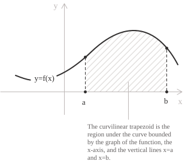
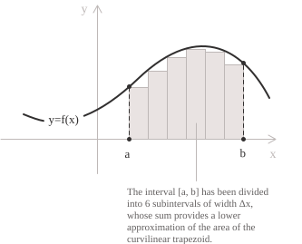
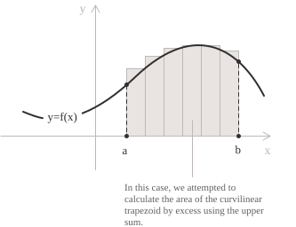
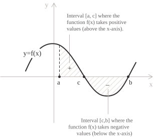
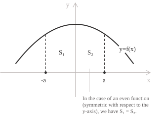
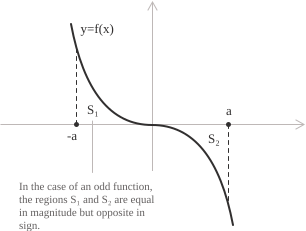

## Definition

A definite integral represents the accumulation over an interval of a quantity described by a function $y=f(x)$. In less formal terms, the definite integral measures the signed area between a curve and the $x$-axis, with the areas above the axis added and those below it subtracted. To make this idea more precise, consider a function $f(x)$ defined on a [closed interval](../intervals/) $[a, b]$ with $a \lt b$. If $f(x)$ is [continuous](../continuous-functions/) and nonnegative on the interval, its graph, the $x$-axis, and the lines $x = a$ and $x = b$ bound a region called a curvilinear trapezoid, whose area is given by the following definite integral:

$$\int_{a}^{b} f(x) \ dx \tag{1}$$

In $(1)$, $a$ and $b$ are the limits of integration, $f$ is the integrand, and $dx$ indicates that we integrate with respect to $x$. In general, there is no elementary geometric formula for the area of a curvilinear trapezoid like the one shown here:

To see how we arrive at $(1)$, we can approximate the area of the curvilinear trapezoid by dividing the interval $[a, b]$ into $n$ subintervals of equal width, where the width is given by:

$$\Delta x = \frac{b - a}{n}\tag{2}$$

On each subinterval, we approximate the corresponding part of the region by a rectangle whose area is easy to calculate, and the sum of these areas gives an estimate of the total area. If we write the partition points as $x_i = a + i\Delta x$ for $i=0,\ldots,n$, then $x_0=a$, $x_n=b$, and the $i$th subinterval is $[x_{i-1},x_i]$. Denoting the [infimum and supremum](../supremum-and-infimum/) of $f(x)$ on this subinterval by $m_i$ and $M_i$, respectively, we obtain the lower sum $s_n^{-}$, which approximates the area of the curvilinear trapezoid from below:

$$s_n^{-} = \sum_{i=1}^{n} m_i \Delta x \tag{3}$$

Similarly, we can define the upper sum $s_n^{+}$, which approximates the area from above:

$$s_n^{+} = \sum_{i=1}^{n} M_i \Delta x \tag{4}$$

The following table summarizes the construction:

| Rectangle | Subinterval | Lower height | Upper height | Lower area estimate | Upper area estimate |
| :-------: | :-------------: | :----------: | :----------: | :-----------: | :-----------: |
|    $1$    |   $[x_0,x_1]$   |    $m_1$     |    $M_1$     | $m_1\Delta x$ | $M_1\Delta x$ |
|    $2$    |   $[x_1,x_2]$   |    $m_2$     |    $M_2$     | $m_2\Delta x$ | $M_2\Delta x$ |
|    $3$    |   $[x_2,x_3]$   |    $m_3$     |    $M_3$     | $m_3\Delta x$ | $M_3\Delta x$ |
| $\vdots$  |    $\vdots$     |   $\vdots$   |   $\vdots$   |   $\vdots$    |   $\vdots$    |
|    $n$    | $[x_{n-1},x_n]$ |    $m_n$     |    $M_n$     | $m_n\Delta x$ | $M_n\Delta x$ |

Formulas $(3)$ and $(4)$ extend to an arbitrary partition $P$ of $[a,b]$ with partition points of the form:

$$a=x_0 \lt x_1 \lt \cdots \lt x_n=b$$

In each term we replace the common width $\Delta x$ by the length $x_i-x_{i-1}$ of the subinterval on which $m_i$ and $M_i$ are calculated, obtaining the lower and upper sums associated with $P$.

$$
\begin{align}
L(f,P) &= \sum_{i=1}^{n} m_i(x_i-x_{i-1}) \tag{5} \\[6pt]
U(f,P) &= \sum_{i=1}^{n} M_i(x_i-x_{i-1}) \tag{6}
\end{align}
$$

Adding partition points to $P$ gives a finer partition $P'$. On each part of a subdivided interval, the infimum of $f$ is at least as large as on the whole subinterval, and the supremum is at most as large. Since the lengths of the parts add up to the length of the original subinterval, formulas $(5)$ and $(6)$ give the following chain of inequalities:

$$
L(f,P) \leq L(f,P') \leq U(f,P') \leq U(f,P) \tag{7}
$$

Applying $(7)$ to a common refinement of two partitions shows that every lower sum is less than or equal to every upper sum. For a bounded function $f$ on $[a,b]$, the lower and upper integrals are defined by the following formulas, where $P$ ranges over all partitions of $[a,b]$:

$$\tag{9}
\begin{align}
L(f,[a,b]) &= \sup_P L(f,P)\\[6pt]
U(f,[a,b]) &= \inf_P U(f,P) 
\end{align}
$$

It follows from $(9)$ that:

$$L(f,[a,b])\leq U(f,[a,b]) \tag{10}$$

A function $f$ is [Riemann integrable](../riemann-integrability-criteria/) if and only if equality holds in $(10)$, in which case:

$$
\int_a^b f(x) \ dx = L(f,[a,b]) = U(f,[a,b]) \tag{11}
$$

An equivalent formulation of $(11)$ uses Riemann sums. In each subinterval of width $\Delta x_i=x_i-x_{i-1}$, we choose a sample point as follows:

$$\xi_i\in[x_{i-1},x_i] \tag{12}$$

Since $m_i\leq f(\xi_i)\leq M_i$, the Riemann sum lies between the lower and upper Darboux sums:

$$
L(f,P)\leq \sum_{i=1}^{n} f(\xi_i)\Delta x_i \leq U(f,P) \tag{13}
$$

The mesh of the partition, $\|P\|=\max_{1\leq i\leq n}\Delta x_i$, is the length of its widest subinterval. A bounded function $f$ is integrable if and only if, as $\|P\|$ tends to zero, the Riemann sums in $(13)$ converge to the same value for every choice of partitions and sample points. This limit is the integral in $(11)$, so:

$$
\lim_{\|P\|\to 0}\sum_{i=1}^{n} f(\xi_i)\Delta x_i = \int_a^b f(x) \ dx \tag{14}
$$

When $f$ is continuous on $[a,b]$, [uniform continuity](../uniform-continuity/) ensures that $\max_i(M_i-m_i)$ tends to zero as $\|P\|$ tends to zero. The difference between the upper and lower sums in $(13)$ therefore tends to zero as well, since

$$
\begin{align}
U(f,P)-L(f,P) &= \sum_{i=1}^{n}(M_i-m_i)\Delta x_i \\[6pt]
&\leq (b-a)\max_i(M_i-m_i) \tag{15}
\end{align}
$$

The difference between the upper and lower integrals lies between zero and $U(f,P)-L(f,P)$. By $(15)$ this difference must be zero, so $f$ is Riemann integrable on $[a,b]$.

## Evaluation and properties

To derive the general method for evaluating a definite integral, we begin by observing that if $f$ is continuous on $[a,b]$, its integral exists on each subinterval $[a,x]$. Allowing $x$ to vary gives the accumulation function:

$$
A(x)=\int_a^x f(t) \ dt \tag{16}
$$

By the [fundamental theorem of calculus](../fundamental-theorem-of-calculus/), $A'(x)=f(x)$ for every $x\in(a,b)$, and if $F$ is an antiderivative of $f$ on $(a,b)$ and is continuous on $[a,b]$, then $F-A$ is constant because its derivative is zero. By $(16)$, $A(a)=0$, so the constant is $F(a)$. Evaluating $A$ at $b$ gives the formula:

$$
\int_a^b f(x) \ dx = F(b)-F(a) \tag{17}
$$

We now consider some properties that are useful in problems involving definite integrals. We begin with the simple case in which the two limits of integration coincide and the integral is zero:

$$\int_{a}^{a} f(x) \ dx = 0 \tag{18}$$

In $(18)$ the difference between the values of the antiderivative reduces to $F(a)-F(a)=0$, whereas reversing the limits in $(17)$ gives $F(a)-F(b)$ and changes the sign of the integral:

$$
\int_b^a f(x) \ dx = -\int_a^b f(x) \ dx \tag{19}
$$

Another property concerns multiplication by a constant. If $f(x) = k$ is constant on $[a, b]$, its integral is given by:

$$\int_{a}^{b} k \ dx = k(b - a) \tag{20}$$

A constant factor can be taken outside the integral sign, giving:

$$\int_{a}^{b} kf(x) \ dx = k \int_{a}^{b} f(x) \ dx \tag{21}$$

If $f$ and $g$ are integrable on $[a,b]$, their sum is also integrable and the following additivity property holds:

$$
\int_a^b (f(x)+g(x)) \ dx = \int_a^b f(x) \ dx + \int_a^b g(x) \ dx \tag{22}
$$

As with the [indefinite integral](../indefinite-integrals/), additivity and the constant multiple rule $(21)$ express the linearity of integration. The integral is also additive over intervals. If $f$ is integrable on $[a,c]$ and $b\in[a,c]$, we can split the interval at $b$ and add the integrals over the two subintervals:

$$
\int_a^c f(x) \ dx = \int_a^b f(x) \ dx + \int_b^c f(x) \ dx \tag{23}
$$

By $(19)$, identity $(23)$ holds for any ordering of the three points, provided $f$ is integrable on the interval containing them. For a [piecewise-defined function](../piecewise-functions/), it is convenient to split the interval where the pieces meet.

If $f$ and $g$ are integrable on $[a,b]$ and $f(x)\leq g(x)$ for every $x\in[a,b]$, then $g-f$ is nonnegative and therefore has a nonnegative integral. By linearity, as expressed in $(21)$ and $(22)$, the integral of $g-f$ equals the difference of their integrals. This gives the comparison property:

$$
\int_a^b f(x) \ dx \leq \int_a^b g(x) \ dx \tag{24}
$$

The comparison property $(24)$ gives two estimates for the integral of an integrable function $f$ on $[a,b]$. The first applies when we know the infimum $m$ and the supremum $M$ of $f$ on the interval. Comparing $f$ with the constants $m$ and $M$ and evaluating their integrals using $(20)$ gives:

$$
m(b-a) \leq \int_a^b f(x) \ dx \leq M(b-a) \tag{25}
$$

The second estimate concerns the [absolute value](../absolute-value/) of the integral. Since $|f|$ is also integrable, we can apply $(24)$ to the inequalities $-|f(x)|\leq f(x)\leq |f(x)|$. This gives the triangle inequality for integrals:

$$
\left|\int_a^b f(x) \ dx\right| \leq \int_a^b |f(x)| \ dx \tag{26}
$$

## Examples

As a first example of how to evaluate definite integrals, consider the following integral:

$$
\int_0^3 (3x-x^2) \ dx
$$

By linearity, we integrate the two terms separately and use $(17)$ to evaluate the antiderivative at the endpoints:

$$
\begin{align}
\int_0^3 (3x-x^2) \ dx
&= \left[\frac{3x^2}{2}-\frac{x^3}{3}\right]_0^3 \\[6pt]
&= \frac{27}{2}-9 = \frac{9}{2} \tag{27}
\end{align}
$$

Since $3x-x^2=x(3-x)$ is nonnegative on $[0,3]$, the value in $(27)$ is the area between the [parabola](../parabola/) and the $x$-axis over this interval. Now consider the second integral:

$$
\int_0^\pi (x+\sin x) \ dx
$$

One antiderivative is $F(x)=x^2/2-\cos x$. Here $F(0)=-1$, so the lower limit of integration also contributes to the result:

$$
\begin{align}
\int_0^\pi (x+\sin x) \ dx
&= \left[\frac{x^2}{2}-\cos x\right]_0^\pi \\[6pt]
&= \left(\frac{\pi^2}{2}+1\right)-(-1)
 = \frac{\pi^2}{2}+2 \tag{28}
\end{align}
$$

In $(28)$ the integral again equals the area under the graph, since both $x$ and $\sin x$ are nonnegative on $[0,\pi]$. Finally, consider the [integral of the exponential function](../integral-of-the-exponential-function/):

$$
\int_0^2 e^{2x} \ dx
$$

To evaluate it, we use the Riemann sums in $(14)$. We divide the interval into $n$ parts of width $2/n$ and take the right endpoints $x_k=2k/n$ as the sample points. Since $f$ is [increasing](../increasing-and-decreasing-functions/), this choice gives an upper sum. The heights of the rectangles are $e^{4k/n}=q_n^k$, where $q_n=e^{4/n}$. Summing the [geometric progression](../geometric-sequence/) and using $q_n^n=e^4$, we obtain:

$$
\begin{align}
R_n &= \frac{2}{n}\sum_{k=1}^n q_n^k \\[6pt]
    &= \frac{2}{n}\frac{q_n(q_n^n-1)}{q_n-1} \\[6pt]
    &= \frac{2q_n(e^4-1)}{n(q_n-1)} \tag{29}
\end{align}
$$

As $n$ tends to infinity, $q_n$ tends to $1$, and the [standard limit](../remarkable-limits/) $(e^t-1)/t\to 1$ as $t\to 0$ gives $n(q_n-1)=4\frac{e^{4/n}-1}{4/n}\to 4$. Taking the limit in $(29)$ gives the required area:

$$
\int_0^2 e^{2x} \ dx = \lim_{n\to\infty} R_n = \frac{e^4-1}{2}\tag{30}
$$

> Keep in mind that in exercises on evaluating integrals, we usually find an antiderivative, using [substitution](../integration-by-substitution/) or [integration by parts](../integration-by-parts/) as needed, and evaluate it at the endpoints using $(17)$. For $(30)$, the antiderivative $F(x)=e^{2x}/2$ suffices. The Riemann sum calculation in $(29)$ simply shows how to obtain the same value directly from the definition.

## Mean value theorem for integrals

The [mean value theorem for integrals](../mean-value-theorem-for-integrals/) is the integral counterpart of the [mean value theorem for derivatives](../lagrange-theorem/) and follows by applying the latter to the accumulation function $A$ defined in $(16)$. Dividing $(25)$ by $b-a \gt 0$ gives bounds on the average value of $f$ over $[a,b]$, which is defined by:

$$
\frac{1}{b-a}\int_a^b f(x) \ dx \tag{31}
$$

This value lies between $m$ and $M$, so if $f$ is continuous on $[a,b]$, it attains its average value at some point in the interior of $[a,b]$. Indeed, by the mean value theorem for derivatives, there is a point $c\in(a,b)$ such that

$$
\begin{align}
f(c)=A'(c) &= \frac{A(b)-A(a)}{b-a} \\[6pt]
&= \frac{1}{b-a}\int_a^b f(x) \ dx \tag{32}
\end{align}
$$

It follows from $(32)$ that the rectangle with base $b-a$ and height $|f(c)|$ has signed area $(b-a)f(c)$, equal to the integral of $f$ over $[a,b]$.

## Definite integrals and signed area

In examples $(27)$ and $(28)$, the function was nonnegative, so the integral equaled the area between the graph and the $x$-axis, but when the function changes sign, the integral gives the signed area, obtained by subtracting the area below the axis from the area above it. The following figure shows a function with this behavior:

Suppose, as in the figure, that $f(x)\geq 0$ on $[a,c]$ and $f(x)\leq 0$ on $[c,b]$. Splitting the interval at $c$ and applying additivity $(23)$ gives:

$$
\int_a^b f(x) \ dx = \int_a^c f(x) \ dx + \int_c^b f(x) \ dx \tag{33}
$$

The second integral in $(33)$ is nonpositive, so to add the two geometric areas we reverse the sign of that term, which amounts to integrating $|f|$ over the whole interval:

$$
\begin{align}
S &= \int_a^c f(x) \ dx - \int_c^b f(x) \ dx \\[6pt]
  &= \int_a^b |f(x)| \ dx \tag{34}
\end{align}
$$

On a symmetric interval $[-a,a]$ with $a \gt 0$, it is convenient to split the integral at the origin. If $f$ is even, its values at $x$ and $-x$ are equal, so the two halves contribute equally to the integral:

$$
\int_{-a}^a f(x) \ dx = 2\int_0^a f(x) \ dx \tag{35}
$$

If $f$ is odd, its values at the symmetric points $x$ and $-x$ are opposites. The integrals over $[-a,0]$ and $[0,a]$ are therefore opposites and their sum is zero:

$$
\int_{-a}^a f(x) \ dx = 0 \tag{36}
$$

To find the geometric area, we use $(34)$. Whether $f$ is [even or odd](../even-and-odd-functions/), we have $|f(-x)|=|f(x)|$, so we can apply $(35)$ to the even function $|f|$ and double the area over $[0,a]$:

$$
S = \int_{-a}^a |f(x)| \ dx = 2\int_0^a |f(x)| \ dx \tag{37}
$$

In either case, if $f(x)\geq 0$ on $[0,a]$, then $|f(x)|=f(x)$ throughout that interval, and $(37)$ reduces to:

$$
S = 2\int_0^a f(x) \ dx \tag{38}
$$

The entry on [finding areas by integration](../finding-areas-by-integration/) gives further examples.

- - -

We conclude with a brief introduction to improper integrals. So far we have integrated bounded functions over bounded intervals. To extend integration to $[a,+\infty)$, suppose that $f$ is Riemann integrable on every interval $[a,t]$ with $t \gt a$. We evaluate the integral up to $t$ and let $t$ tend to $+\infty$:

$$
\int_a^{+\infty} f(x) \ dx := \lim_{t\to+\infty}\int_a^t f(x) \ dx \tag{39}
$$

The integral in $(39)$ is called an improper integral and converges if the limit exists and is finite. For a full treatment of [improper integrals](../improper-integrals/), see the entry on that topic.

