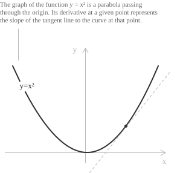
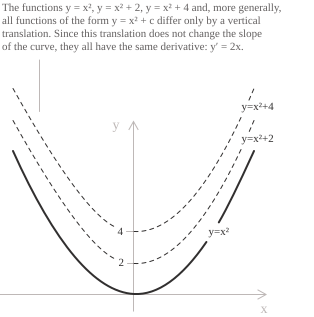

## A friendly introduction to integrals

Integrals have a notoriously bad reputation among secondary school students and university students in their first few years. When students first encounter them, at least, they see them as mathematical objects whose sheer complexity makes them, to put it mildly, rather forbidding.
There is some truth to that.
Take, for example, the following [improper integral](../improper-integrals/) over the entire real line, known as the [Gaussian integral](../gaussian-function/):

$$
\int_{-\infty}^{+\infty} e^{-x^2}\,dx = \sqrt{\pi}
$$

It looks harmless enough at first glance, but try evaluating it with elementary integration methods and you soon find yourself at a loss. The usual story is that Gauss worked it out when he was about thirty, so until you reach that age, at least, you can consider yourself excused if you cannot find its value.
Another integral that inspires a certain awe is Dirichlet's, which is simple to write down but very difficult to evaluate:

$$
\int_{0}^{\infty} \frac{\sin x}{x}\,dx = \frac{\pi}{2}
$$

Fortunately, most of us have more modest ambitions than winning a _Fields Medal_, so the integrals we encounter in our studies are, by and large, within reach of any student willing to put in the work (unless they have the misfortune to come across a particularly sadistic professor along the way).

The good news is that many of these integrals can be evaluated using routine procedures and a little intuition, which comes only with plenty of practice applying the main rules of integration and the usual shortcuts that save a good deal of work.

- - -

In the paragraphs that follow, I will give a rigorous definition of integrals, particularly indefinite integrals, the subject of this entry and the starting point for our discussion of [definite integrals](../definite-integrals/). I would first like to give you an intuitive picture, starting with [differentiation](../derivatives/), which, as we will see when we discuss _antiderivatives_, is the inverse of integration.

Consider the simple function $y=x^2.$ Its graph is a [parabola](../parabola/) through the origin. We know from the [rules of differentiation](../differentiation-rules/) that it has a unique derivative, $y'=2x,$ whose value at each $x$ is the slope of the tangent line to the graph at that point. For example, at $x=2$ we get $y'(2)=2 \cdot 2 = 4.$ This means that the tangent line to the parabola at $(2,4)$ has a slope of exactly $4.$

Now consider the reverse problem, where we are given a derivative, say $y'=2x,$ and want to find an antiderivative. From the calculation above, we know that $y=x^2$ is an antiderivative of $2x.$

To describe all the antiderivatives of $2x$ on $\mathbb{R},$ we need an arbitrary constant: every antiderivative has the form $y=x^2+c,$ with $c\in\mathbb{R}.$ The reason is simple, yet it is surprising how many experienced students struggle to explain it on the spot. The graph makes this easier to see. Imagine shifting the graph of $y=x^2$ up and down along the vertical axis and you get infinitely many functions whose graphs have the same shape and whose formulas differ only in the constant term.

A [vertical shift](../transformations-of-functions/) leaves the slope of the curve unchanged. The functions $y=x^2,$ $y=x^2+1,$ $y=x^2-3$ and, more generally, all functions of the form $y=x^2+c$ therefore have exactly the same derivative, $y'=2x.$

This simple geometric observation explains why a function has a unique derivative, while that same function can have infinitely many antiderivatives, each differing from the others by a constant.

To conclude this introduction, keep the following distinction in mind: given a derivative, the indefinite integral determines the family of antiderivatives, while the definite integral, the subject of a separate entry, gives the [signed area](../finding-areas-by-integration/) between a curve and the horizontal axis over a given interval. The following paragraphs list the main antiderivatives and properties of integrals. Unfortunately for you, you will have to learn them all by heart (and I do mean all of them) if you are to have any chance of working out the more complicated integrals we will encounter later.

I leave you with the Feynman path integral, one of the fundamental tools of quantum mechanics and quantum field theory. It is, of course, well beyond our reach here.

$$
\langle x_f,t_f \mid x_i,t_i\rangle
=
\int_{x(t_i)=x_i}^{x(t_f)=x_f}
\mathcal{D}x(t)\,
\exp\left(\frac{i}{\hbar}S[x(t)]\right)
$$

Keep it in mind, though, just so you have some idea of what might lie ahead.

## Antiderivatives

As we know from studying derivatives, every differentiable function has a unique derivative. The reverse problem is to determine whether a given function $f$ is the derivative of some function $F.$ Consider a function $f\colon I \to \mathbb{R}$ defined on an [open interval](../intervals/) $I.$ A differentiable function $F\colon I \to \mathbb{R}$ is called a primitive or antiderivative of $f$ if it satisfies the following condition:

$$F'(x) = f(x) \qquad \forall \ x \in I \tag{1}$$

If $f$ is continuous on $I,$ it has at least one antiderivative on $I.$ For example, the calculation in $(2)$ shows that $F(x) = x^3$ is an antiderivative of $f(x) = 3x^2$ on $\mathbb{R}:$

$$\frac{d}{dx} x^3 = 3x^2 \tag{2}$$

[Continuity](../continuous-functions/) of $f$ is sufficient for an antiderivative to exist, although it is not necessary. To see why, consider the following function $F$ and examine its derivative:

$$
F(x) :=
\begin{cases}
x^2\sin(1/x) & \text{if } x \neq 0 \\[6pt]
0 & \text{if } x = 0
\end{cases} \tag{3}
$$

Applying the differentiation rules for $x \neq 0$ gives:

$$
\begin{align}
F'(x) &= 2x\sin(1/x) + x^2\cos(1/x)\left(-\frac{1}{x^2}\right) \notag \\[6pt]
      &= 2x\sin(1/x) - \cos(1/x) \tag{4}
\end{align}
$$

At $x=0$ we use the definition of the derivative as the limit of the [difference quotient](../difference-quotient/). The [squeeze theorem](../squeeze-theorem/) gives the following identity:

$$
\begin{align}
F'(0) &= \lim_{h \to 0}\frac{F(h) - F(0)}{h} \notag \\[6pt]
      &= \lim_{h \to 0}h\sin(1/h) = 0 \tag{5}
\end{align}
$$

Together, $(4)$ and $(5)$ define $f = F'$ on all of $\mathbb{R}.$ As $x \to 0,$ the term $2x\sin(1/x)$ tends to zero while $\cos(1/x)$ oscillates between $-1$ and $1,$ so $f$ is discontinuous at the origin even though it has $F$ as an antiderivative on all of $\mathbb{R}.$

- - -

As we saw in the introduction, adding a constant to a differentiable function leaves its derivative unchanged and simply shifts its graph along the $y$-axis. For example, $x^3,$ $x^3 + 5$ and $x^3 - 1/2$ are all antiderivatives of $3x^2.$ In general, if $F$ is an antiderivative of $f$ on an interval $I,$ then $F+c$ is also an antiderivative of $f$ for every $c \in \mathbb{R}:$

$$\frac{d}{dx}[F(x) + c] = F'(x) = f(x) \tag{6}$$

Conversely, if $F_1$ and $F_2$ are antiderivatives of $f$ on $I,$ then both have derivative $f,$ so their difference has derivative zero at every point of $I:$

$$
\begin{align}
\frac{d}{dx}[F_1(x) - F_2(x)] &= F_1'(x) - F_2'(x) \notag \\[6pt]
                               &= f(x) - f(x) = 0 \tag{7}
\end{align}
$$

By $(7)$ and the [mean value theorem](../lagrange-theorem/), $F_1-F_2$ is constant on $I,$ so there is a unique $c \in \mathbb{R}$ such that $F_1(x) = F_2(x) + c$ for every $x \in I.$

## The indefinite integral

To see how antiderivatives give rise to the indefinite integral, suppose a function $f$ has an antiderivative $F$ on an open interval $I.$ The indefinite integral of $f$ on $I$ is defined as the family of all its antiderivatives and has the following form, where $c \in \mathbb{R}$ is arbitrary:

$$\int f(x) \ dx = F(x) + c \tag{8}$$

By $(6),$ differentiating any of the antiderivatives in $(8)$ gives back $f,$ while working in the opposite direction and integrating $F'$ recovers $F$ up to a constant:

$$\int F'(x) \ dx = F(x) + c\tag{9}$$

For example, let us find the antiderivative of $f(x) = 3x$ whose graph passes through $(2,1).$ By $(8)$ we have:

$$F(x) = \frac{3}{2}x^2 + c \tag{10}$$

To determine $c,$ we use the fact that the graph passes through $(2,1),$ so $F(2) = 1.$ Substituting $x = 2$ into $(10)$ gives $6 + c = 1,$ hence $c = -5$ and the required antiderivative is:

$$F(x) = \frac{3}{2}x^2 - 5 \tag{11}$$

The same reasoning applies if $F_0$ is an antiderivative of $f$ on an open interval $I$ and $(x_0,y_0)$ is a given point with $x_0 \in I$ and $y_0 \in \mathbb{R}.$ For the graph of $F_0+c$ to pass through this point, the following condition must hold:

$$F_0(x_0)+c=y_0 \tag{12}$$

Equation $(12)$ therefore determines the constant $c,$ and the required antiderivative is given by:

$$F(x) = F_0(x) + y_0 - F_0(x_0) \tag{13}$$

In formal terms, then, the difference $y_0-F_0(x_0)$ in $(12)$ is precisely the vertical shift we discussed, the one that takes $(x_0,F_0(x_0))$ to $(x_0,y_0).$

One thing to bear in mind when learning to evaluate integrals is that there is no way around learning all the antiderivatives of elementary functions by heart. It is therefore a matter of memorization, and with practice the process becomes quick and almost automatic.

## Linearity

We now turn to linearity, an important property that helps us solve many integration problems and holds both for indefinite integrals and for the definite integrals we will study in a separate entry. If $f$ and $g$ have antiderivatives $F$ and $G$ on the same interval, we can express linearity as follows:

$$\int [f(x) + g(x)] \ dx = F(x) + G(x) + c\tag{14}$$

Moreover, for every $k \in \mathbb{R},$ the identity $(kF)' = kf$ shows that every antiderivative of $kf$ has the following form:

$$\int kf(x) \ dx = kF(x) + c\tag{15}$$

Applying $(14)$ to the function $f(x) = 3x^2 + 2x$ gives:

$$
\begin{align}
\int (3x^2 + 2x) \ dx &= \int 3x^2 \ dx + \int 2x \ dx \notag \\[6pt]
                      &= x^3 + x^2 + c \tag{16}
\end{align}
$$

Equation $(16)$ splits the original integral into two simpler integrals that we can evaluate immediately. The following integral gives another example:

$$
\begin{align}
\int 5\sin(x) \ dx &= 5 \int \sin(x) \ dx \\[6pt]
                   &= -5\cos(x) + c
\end{align}
$$

## The power rule and the logarithmic case

We know from differentiation that the derivative of the [power function](../power-function/) $x^{a+1},$ for $x \gt 0$ and $a \in \mathbb{R},$ is $(a+1)x^a.$ Applying $(8)$ gives the following integral:

$$\int x^a \ dx = \frac{x^{a+1}}{a+1} + c\tag{17}$$

For now we set aside the case $a=-1,$ which we will discuss shortly when we turn to the logarithmic case. As a practical example, let us use $(17)$ to integrate the following [polynomial](../polynomial-function/):

$$
\begin{align}
\int (3x^4 + 5x^2) \ dx &= 3\int x^4 \ dx + 5\int x^2 \ dx \notag \\[6pt]
                        &= 3\frac{x^5}{5} + 5\frac{x^3}{3} + c \notag \\[6pt]
                        &= \frac{3}{5}x^5 + \frac{5}{3}x^3 + c \tag{18}
\end{align}
$$

In $(18)$ we used $(14),$ $(15)$ and $(17).$ We can apply the same rules to an integral involving a square root:

$$
\begin{align}
f(x)           &= 4x^3 - \frac{3}{\sqrt{x}} + 2\cos x \notag \\[6pt]
               &= 4x^3 - 3x^{-1/2} + 2\cos x \tag{19}
\end{align}
$$

In $(19)$ we used the [rules for radicals](../radicals/) to write $\sqrt{x}$ as $x^{1/2}$ and, since it appears in the denominator, to express its reciprocal as $x^{-1/2},$ so the integral becomes:

$$
\begin{align}
\int f(x) \ dx &= 4\int x^3 \ dx - 3\int x^{-1/2} \ dx + 2\int \cos x \ dx \notag \\[6pt]
               &= x^4 - 3\frac{x^{1/2}}{1/2} + 2\sin x + c \notag \\[6pt]
               &= x^4 - 6\sqrt{x} + 2\sin x + c
\end{align}
$$

- - -

We now return to the power function with $a=-1,$ for which the denominator $a+1$ in $(17)$ vanishes. To find an antiderivative of $1/x,$ observe that for $x \gt 0$ the derivative of $\ln x$ is $1/x.$ For $x \lt 0,$ the argument $-x$ is positive, so we can differentiate $\ln(-x)$ using the [chain rule](../chain-rule/):

$$\frac{d}{dx}\ln(-x) = \frac{1}{-x}\cdot(-1) = \frac{1}{x}$$

The [absolute value](../absolute-value/) brings the two cases together and gives the following formula on every open interval that does not contain the origin:

$$\int \frac{1}{x} \ dx = \ln|x| + c \qquad c \in \mathbb{R} \tag{20}$$

## Summary and common integrals

To summarize, the main integration rules are as follows:

[class="table-1"]

|                                    |                                                      |
| ---------------------------------- | ---------------------------------------------------- |
| Sum rule              | $$\int (f(x) + g(x)) \ dx = F(x) + G(x) + c$$        |
| Constant multiple rule | $$\int kf(x) \ dx = kF(x) + c$$                      |
| Power rule               | $$\int x^a \ dx = \dfrac{x^{a+1}}{a+1} + c$$         |
| [Logarithmic case](../integral-of-rational-functions/)                   | $$\int \dfrac{1}{x} \ dx = \ln \lvert x \rvert + c$$ |
[/class]

The next table lists the remaining rules for integrating elementary functions. As I mentioned above, you need to learn these rules by heart to work through integration exercises. At first they may seem daunting, and there are quite a few of them, but I assure you that with a little practice you will soon get used to them and find yourself applying them almost automatically. Bear in mind, too, that these rules alone will only take you so far when evaluating integrals. Some of the less straightforward exercises require specific methods, such as [integration by substitution](../integration-by-substitution/) or [integration by parts](../integration-by-parts/). My suggestion is to take it one step at a time, learning the basic rules first and then moving on to the more advanced methods.

[class="table-1 -right"]

|                                                        |       |
| ------------------------------------------------------ | ----- |
| $$\int a^x \ dx = \frac{a^x}{\ln a} + c$$              | [more](../integral-of-the-exponential-function/) |
| $$\int \sin x \ dx = -\cos x + c$$                     | [more](../integral-of-trigonometric-functions/) |
| $$\int \cos x \ dx = \sin x + c$$                      | [more](../integral-of-trigonometric-functions/) |
| $$\int \frac{1}{\sin^2 x} \ dx = -\cot x + c$$         | [more](../integral-of-trigonometric-functions/) |
| $$\int \frac{1}{\cos^2 x} \ dx = \tan x + c$$          | [more](../integral-of-trigonometric-functions/) |
| $$\int \sec^2 x \ dx = \tan x + c$$                    | [more](../integral-of-trigonometric-functions/) |
| $$\int \sec x \tan x \ dx = \sec x + c$$               | [more](../integral-of-trigonometric-functions/) |
| $$\int \csc^2 x \ dx = -\cot x + c$$                   | [more](../integral-of-trigonometric-functions/) |
| $$\int \csc x \cot x \ dx = -\csc x + c$$              | [more](../integral-of-trigonometric-functions/) |
| $$\int \frac{1}{1 + x^2} \ dx = \arctan x + c$$        |       |
| $$\int \frac{1}{\sqrt{1 - x^2}} \ dx = \arcsin x + c$$ |       |

[/class]

To help you understand these rules better, the entry on [integration strategies](../integration-strategies/) gives several ways to examine the structure of common integrands and choose the most suitable integration method.
