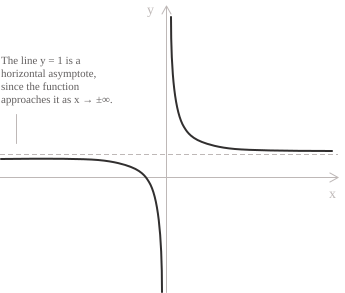
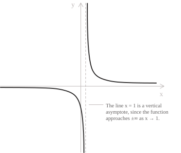
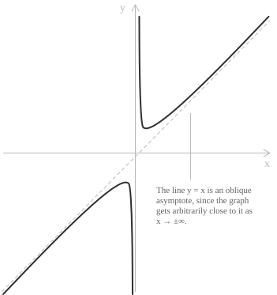

## Asintoti orizzontali

Un asintoto di una funzione $f(x)$ è una retta a cui il suo grafico si avvicina arbitrariamente, quando la variabile tende all'infinito oppure in prossimità di un punto di discontinuità. Esistono sostanzialmente tre tipi di asintoti, orizzontali, verticali e obliqui. Iniziamo la nostra illustrazione con gli asintoti orizzontali, considerando una funzione reale $y = f(x)$ definita su un intervallo della forma $[a, +\infty),$ $(-\infty, b]$ oppure su tutto $\mathbb{R}.$ Si definisce asintoto orizzontale di $f(x)$ la retta di equazione $y = L$ se vale questo limite:

$$
\begin{align}
\lim_{x \to \pm\infty} f(x) = L &\tag{1}
\end{align}
$$

Per mostrare il significato della $(1)$ consideriamo la seguente funzione razionale, definita per $x \neq 0,$ e determiniamo i suoi asintoti:

$$y = \frac{x + 1}{x} \tag{3}$$

Applicando la $(1)$ calcoliamo il limite per $x \to \pm\infty,$ ottenendo:

$$\lim_{x \to \pm\infty} \frac{x + 1}{x} = \lim_{x \to \pm\infty} \left( 1 + \frac{1}{x} \right) = 1 \tag{2}$$

Per la $(2)$ esiste quindi un asintoto orizzontale che determina il comportamento del grafico della funzione in corrispondenza della retta $y=1$ che è rappresentato di seguito:

Come descritto nella voce sullo studio delle funzioni, gli asintoti aiutano a tracciare qualitativamente il grafico di una generica funzione, indicando a quali rette esso si avvicina nelle condizioni specificate.

## Asintoti verticali

Vediamo ora il caso degli asintoti verticali che si presentano sostanzialmente quando una funzione diverge nell'intorno di un punto $x_0.$ Consideriamo sempre una funzione reale $y = f(x)$ definita in un intorno di $x_0,$ eventualmente escluso il punto stesso, oppure soltanto da uno dei due lati e definiamo asintoto verticale la retta di equazione $x = x_0$ che esiste quando è verificato il seguente limite:

$$
\begin{align}
\lim_{x \to x_0^\pm} f(x) = \pm\infty &\tag{5}
\end{align}
$$

Per applicare la $(5),$ consideriamo un'altra funzione razionale che è definita per $x\neq 1$ e verifichiamo l'esistenza di eventuali asintoti verticali:

$$y = \frac{1}{x - 1} \tag{6}$$

Per verificare la $(5),$ esaminiamo separatamente il limite sinistro e quello destro ottenendo:
$$
\begin{align}
\lim_{x \to 1^-} \frac{1}{x - 1} = -\infty &\notag \\[6pt]
\lim_{x \to 1^+} \frac{1}{x - 1} = +\infty &\tag{7}
\end{align}
$$

Per la $(7)$ la funzione diverge da entrambi i lati e quindi possiamo concludere che la retta $x = 1$ è un asintoto verticale di $f.$

> A livello generale, vale la pena notare che una funzione razionale può spesso presentare degli asintoti verticali nei punti in cui la funzione non è definita.

- - -

La presenza di un asintoto verticale non esclude quella di un asintoto orizzontale e infatti per verificare se la funzione $(6)$ ne ammette uno, applichiamo la $(1)$ ottenendo:

$$
\begin{align}
\lim_{x \to \pm\infty} \frac{1}{x - 1} = \lim_{x \to \pm\infty} \frac{1/x}{1 - 1/x} = 0 &\tag{8}
\end{align}
$$

Per la $(8),$ la retta $y = 0$ è un asintoto orizzontale.

## Asintoti obliqui

Gli asintoti obliqui sono rette con coefficiente angolare diverso da zero, a differenza degli asintoti orizzontali. Consideriamo la solita funzione reale $f(x)$ e definiamo asintoto obliquo la retta di equazione $y = px + q,$ con $p,q \in \mathbb{R}$ e $p \neq 0$ se vale il seguente limite:

$$
\begin{align}
\lim_{x \to \pm\infty} \big[ f(x) - (px + q) \big] = 0 &\tag{9}
\end{align}
$$

La condizione $(9)$ permette di determinare i coefficienti della retta, partendo dal suo coefficiente angolare che è dato dalla seguente formula:

$$
\begin{align}
p = \lim_{x \to \pm\infty} \frac{f(x)}{x} &\tag{10}
\end{align}
$$

Se la $(10)$ dà un valore finito e diverso da zero, si usa tale valore per calcolare l'ordinata all'origine $q.$ Infatti, per la $(9),$ la differenza $f(x) - px$ deve tendere a $q,$ per cui si ha:

$$
\begin{align}
q = \lim_{x \to \pm\infty} \big[ f(x) - px \big] &\tag{11}
\end{align}
$$

Se anche il limite nella $(11)$ è finito, la retta $y = px + q$ soddisfa la $(9)$ ed è quindi un asintoto obliquo della funzione. Per fare un esempio, consideriamo la seguente funzione:

$$f(x) = \frac{x^2 + 1}{x} \tag{12}$$

Applicando la $(10)$ alla $(12)$ calcoliamo il coefficiente angolare e otteniamo:

$$
\begin{align}
p = \lim_{x \to \pm\infty} \frac{x^2 + 1}{x^2} = \lim_{x \to \pm\infty} \left(1 + \frac{1}{x^2}\right) = 1 &\tag{13}
\end{align}
$$

Il valore $p = 1$ è finito e diverso da zero e possiamo quindi applicare la $(11)$ per determinare $q:$

$$
\begin{align}
q &= \lim_{x \to \pm\infty} \left(\frac{x^2 + 1}{x} - x\right) \notag \\[6pt]
  &= \lim_{x \to \pm\infty} \frac{1}{x} \notag \\[6pt]
  &= 0 \tag{14}
\end{align}
$$

La $(12)$ ammette quindi, sia per $x \to +\infty$ sia per $x \to -\infty,$ l'asintoto obliquo di equazione:

$$
\begin{align}
y = x &\tag{15}
\end{align}
$$

In questo caso l'asintoto obliquo passa per l'origine e abbiamo $q = 0,$ ma in generale $q$ non è necessariamente nullo. Per esempio, possiamo scrivere:

$$
\begin{align}
f(x) = \frac{2x^2 - x + 3}{2x} = x - \frac{1}{2} + \frac{3}{2x} &\tag{16}
\end{align}
$$

Poiché il termine $3/(2x)$ tende a zero per $x \to \pm\infty,$ la differenza tra la funzione $(16)$ e la retta $y = x - 1/2$ tende a zero, come richiesto dalla $(9),$ perciò l'asintoto obliquo è:

$$
\begin{align}
y = x - \frac{1}{2} &\tag{17}
\end{align}
$$

Tutte le funzioni razionali in cui il grado del numeratore è $n+1$ e quello del denominatore è pari a $n$ ammettono un asintoto obliquo. In questo caso, quindi, sapete già cosa aspettarvi. Torniamo adesso alla $(12)$ e verifichiamo se la funzione ammette anche asintoti verticali e orizzontali. Intanto, possiamo riscriverla come $f(x) = x + 1/x$ e calcolare agevolmente i limiti che determinano l'asintoto verticale: 

$$
\begin{align}
\lim_{x \to 0^-} \left(x + \frac{1}{x}\right) = -\infty &\notag \\[6pt]
\lim_{x \to 0^+} \left(x + \frac{1}{x}\right) = +\infty &\tag{18}
\end{align}
$$

Per le $(5)$ e $(18),$ la retta $x = 0$ è quindi un asintoto verticale. Una funzione può avere più di un asintoto verticale, ma in questo caso $x = 0$ è l'unico, perché la funzione è continua per ogni $x \neq 0$ e zero è l'unico punto escluso dal dominio. Verifichiamo ora se la funzione ammette anche un asintoto orizzontale e calcoliamo i seguenti limiti:

$$
\begin{align}
\lim_{x \to -\infty} \left(x + \frac{1}{x}\right) = -\infty &\notag \\[6pt]
\lim_{x \to +\infty} \left(x + \frac{1}{x}\right) = +\infty &\tag{19}
\end{align}
$$

Poiché i limiti della $(19)$ divergono, la condizione $(1)$ non è soddisfatta e dunque la funzione $(12)$ non ammette asintoti orizzontali.

## Note conclusive

Prima di concludere è utile elencare alcune proprietà generali degli asintoti. Prima di tutto, non tutte le funzioni ammettono asintoti. Per esempio, $f(x) = x^2$ non ha asintoti verticali, poiché è continua su tutto $\mathbb{R},$ né orizzontali, poiché tende a $+\infty$ in entrambe le direzioni e non ha nemmeno asintoti obliqui, perché il rapporto $f(x)/x = x$ non tende a un valore finito, come richiesto dalla $(10).$

Il caso speculare è quello di una stessa funzione che presenta contemporaneamente più asintoti, come nel caso della $(12),$ che ammette l'asintoto verticale $x = 0$ e l'asintoto obliquo $y = x.$

Va fatta poi una precisazione per gli asintoti orizzontali che di fatto non sono una sorta di limite invalicabile. Per la condizione $(1)$ infatti è richiesto soltanto che la differenza $f(x) - L$ tenda a zero, senza imporre che mantenga lo stesso segno. Per esempio, la funzione $f(x) = \sin x/x,$ definita per $x \neq 0,$ soddisfa:

$$
\begin{align}
\left|\frac{\sin x}{x}\right| \leq \frac{1}{|x|} &\notag \\[6pt]
\lim_{x \to \pm\infty} \frac{1}{|x|} = 0 &\tag{20}
\end{align}
$$

Se applichiamo il teorema del confronto dei limiti alla $(20)$ otteniamo che $f(x)$ tende a zero e che quindi $y = 0$ è un asintoto orizzontale. Tuttavia, la funzione si annulla in $x = k\pi,$ per ogni intero $k \neq 0,$ e cambia segno in ciascuno di questi punti. Perciò il grafico attraversa l'asintoto infinite volte, mentre l'ampiezza delle oscillazioni tende a zero.

- - -

La condizione $(9)$ si può esprimere anche usando la notazione o-piccolo. Per prima cosa definiamo con $r(x)$ l'errore che si commette approssimando la funzione con la retta:

$$
\begin{align}
r(x) = f(x) - (px + q) &\tag{21}
\end{align}
$$

Dalla $(21)$ e dalla condizione $(9)$ otteniamo:

$$
\begin{align}
&f(x) = px + q + r(x) \notag \\[6pt]
&\lim_{x \to \pm\infty} r(x) = 0 \tag{22}
\end{align}
$$

La scrittura $r(x) = o(1)$ significa proprio che $r(x)$ tende a zero e la $(22)$ si può scrivere quindi in forma abbreviata per $x \to \pm\infty$ come:

$$
\begin{align}
f(x) = px + q + o(1) &\tag{23}
\end{align}
$$

La $(23)$ serve a separare la retta che approssima la funzione dall'errore che si commette, il cui valore assoluto diventa arbitrariamente piccolo. Per vedere un'applicazione pratica, riprendiamo la funzione $(12),$ ottenendo per $x \to \pm\infty$ la seguente identità:

$$
\begin{align}
f(x) = x + \frac{1}{x} = x + o(1)\tag{24}
\end{align}
$$

Nella $(24),$ per la $(21),$ l'errore è $r(x) = 1/x$ e $o(1)$ indica che questo errore tende a zero, senza specificarne quanto velocemente. Questa forma è utile negli sviluppi asintotici, perché consente di conservare i termini che descrivono l'approssimazione e raccogliere in un resto quelli che tendono a zero. La $(23)$ può anche descrivere un asintoto orizzontale, ponendo $p = 0$ e $q = L,$ ottenendo dalla $(1)$ la seguente identità:

$$f(x) = L + o(1) \tag{25}$$

Nella $(25),$ $o(1)$ è l'errore $f(x)-L$ rispetto all'asintoto orizzontale mentre nella $(23),$ con $p\neq0,$ è l'errore $f(x)-(px+q)$ rispetto all'asintoto obliquo. Queste forme non descrivono gli asintoti verticali, per i quali vale il limite infinito della $(5).$
