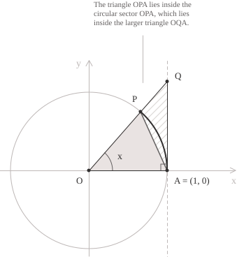

## Limiti notevoli del seno

I limiti notevoli sono limiti di funzioni che presentano forme indeterminate, il cui valore è noto e permettono di calcolare limiti più complessi riconoscendo espressioni note o riconducendosi a esse mediante opportune trasformazioni. Partiamo dal limite notevole del seno, che è uno dei più significativi nell'ambito della trigonometria e il cui valore è dato dalla seguente espressione:

$$
\lim_{x \to 0} \frac{\sin x}{x} = 1 \tag{1}
$$

La $(1)$ mostra che $\sin x$ si può approssimare con $x,$ e in questo senso la funzione seno ha un comportamento che si definisce localmente lineare nell'origine, dove il suo grafico è tangente alla retta $y = x.$ Poiché $\sin 0 = 0,$ il limite nella $(1)$ coincide con quello della derivata del seno in zero, perciò vale la seguente relazione:

$$
\left.\frac{d}{dx}\sin x\right|_{x=0}
= \lim_{x \to 0}\frac{\sin x-\sin 0}{x-0}
= 1 \tag{2}
$$

Dalla $(2)$ seguono le seguenti relazioni:

$$
\begin{align}
\lim_{x \to 0} \frac{\sin(a x)}{a x} &= 1 \\[6pt]
\lim_{x \to 0} \frac{\sin(a x)}{x} &= a
\end{align}
$$

Per dimostrare la $(1),$ si procede con un confronto tra tre aree nel cerchio unitario. Per prima cosa, fissiamo un angolo $x \in (0, \pi/2)$ e definiamo $O = (0, 0),$ $A = (1, 0)$ e $P = (\cos x, \sin x).$ La retta $OP$ incontra la tangente alla circonferenza in $A$ nel punto $Q = (1, \tan x).$

Il triangolo $OPA$ è contenuto nel settore circolare delimitato dai raggi $OA$ e $OP,$ che a sua volta è contenuto nel triangolo $OQA.$ Le loro aree sono rispettivamente $\sin x/2,$ $x/2$ e $\tan x/2.$ Confrontandole e moltiplicando per $2$ otteniamo la seguente catena di disuguaglianze:

$$
\sin x \lt x \lt \tan x \tag{3}
$$

Poiché $\sin x \gt 0,$ possiamo dividere la $(3)$ per $\sin x$ e poi passare ai reciproci, così da ottenere:

$$
\begin{align}
\cos x &\lt \frac{\sin x}{x} \lt 1 \tag{4}
\end{align}
$$

Per $x \to 0^+,$ entrambi gli estremi dell'ultima disuguaglianza nella $(4)$ tendono a $1$ e per il teorema del confronto, poiché l'elemento centrale della disuguaglianza è delimitato da quei valori, si ottiene:

$$
\lim_{x \to 0^+} \frac{\sin x}{x} = 1 \tag{5}
$$

Poiché $\sin x/x$ è una funzione pari, anche il limite sinistro vale $1.$ I due limiti unilaterali coincidono, quindi la $(1)$ è dimostrata.

Per la funzione inversa del seno, un altro limite notevole è:

$$
\lim_{x \to 0}\frac{\arcsin x}{x} = 1 \tag{6}
$$

## Limiti notevoli del coseno

Vediamo ora un limite notevole del coseno dato dalla seguente relazione:

$$
\lim_{x \to 0} \frac{1 - \cos x}{x^2} = \frac{1}{2} \tag{7}
$$

Mentre il seno nella $(1)$ si comporta come $x$ vicino a zero, la $(7)$ mostra che $1 - \cos x$ si comporta come $x^2/2$ e ciò significa che lo scostamento del coseno dal valore $1$ è quadratico, come si vede anche dal suo sviluppo di Taylor nell'origine:

$$
\cos x = 1 - \frac{x^2}{2} + o(x^2) \tag{8}
$$

Nella $(8),$ il termine $o(x^2)$ è trascurabile rispetto a $x^2,$ cioè $o(x^2)/x^2 \to 0$ per $x \to 0$ e infatti il termine lineare è assente perché la derivata del coseno in zero è nulla. Per calcolare il limite nella $(7),$ usiamo la $(8)$ per riscrivere il numeratore e dividiamo ogni termine per $x^2$ ottenendo:

$$
\frac{1 - \cos x}{x^2}
= \frac{x^2/2 - o(x^2)}{x^2}
= \frac{1}{2} - \frac{o(x^2)}{x^2}
$$

L'ultimo termine tende a zero per la definizione di $o(x^2),$ quindi il quoziente tende a $1/2,$ come mostrato nella $(7).$ Più in generale, per ogni costante reale $a,$ vale:

$$
\lim_{x \to 0} \frac{1 - \cos(ax)}{x^2} = \frac{a^2}{2} \tag{9}
$$

Per ricavare la $(9)$ dalla $(1),$ usiamo la formula di bisezione, ottenendo:

$$
1 - \cos(ax) = 2\sin^2\left(\frac{ax}{2}\right) \tag{10}
$$

Se $a \neq 0,$ dividendo la $(10)$ per $x^2$ e riordinando otteniamo:

$$
\frac{1 - \cos(ax)}{x^2}
= \frac{a^2}{2}\left(\frac{\sin(ax/2)}{ax/2}\right)^2 \tag{11}
$$

Per $x \to 0,$ il rapporto tra parentesi tende a $1$ per la $(1),$ quindi la $(11)$ dà la $(9).$ Infine, ponendo $a = 1$ si ritrova la $(7).$ Per la funzione inversa del coseno, un altro limite notevole è:

$$
\lim_{x \to 1^-}\frac{\arccos x}{\sqrt{2(1-x)}} = 1 \tag{12}
$$

## Limiti notevoli della tangente

Vediamo ora un altro caso, partendo dal limite notevole del seno nella $(1)$ da cui si ricava quello della tangente che è dato dalla seguente identità:

$$
\frac{\tan x}{x} = \frac{\sin x}{x} \cdot \frac{1}{\cos x} \tag{13}
$$

Il primo fattore della $(13)$ tende a $1$ per la $(1),$ mentre il secondo tende a $1$ perché $\cos 0 = 1$ e quindi il limite del prodotto è dato da:

$$
\lim_{x \to 0} \frac{\tan x}{x} = 1 \tag{14}
$$

Per $a \neq 0,$ ponendo $u = ax$ si ha $\tan(ax)/x = a\tan u/u$ e dalla $(14)$ si ottiene:

$$
\lim_{x \to 0} \frac{\tan(a x)}{x} = a \tag{15}
$$

## Limiti notevoli dell'esponenziale

Dopo i limiti trigonometrici, vediamo adesso un limite notevole della funzione esponenziale dato dalla seguente espressione:

$$
\lim_{x \to 0} \frac{e^x - 1}{x} = 1 \tag{16}
$$

Poiché nella $(16)$ $e^0 = 1,$ il quoziente coincide con quello che definisce la derivata dell'esponenziale in zero:

$$
\left.\frac{d}{dx}e^x\right|_{x=0}
= \lim_{x \to 0}\frac{e^x-e^0}{x-0}
= 1 \tag{17}
$$

Come per il coseno nella $(8),$ possiamo ricavare il limite dallo sviluppo di Taylor dell'esponenziale nell'origine, ottenendo:

$$
e^x = 1 + x + \frac{x^2}{2!} + o(x^2) \tag{18}
$$

Sottraendo $1$ nella $(18)$ e dividendo per $x$ otteniamo:

$$
\frac{e^x - 1}{x} = 1 + \frac{x}{2!} + \frac{o(x^2)}{x} \tag{19}
$$

Gli ultimi due termini tendono a zero, quindi la $(19)$ dà la $(16).$ In particolare, $o(x^2)/x = x\bigl(o(x^2)/x^2\bigr)$ tende a zero per la definizione di o-piccolo. Per $a \neq 0,$ la sostituzione $u = ax$ dà:

$$\frac{e^{ax}-1}{x} = a\frac{e^u-1}{u}$$ 
Applicando la $(16)$ si ottiene:

$$
\lim_{x \to 0} \frac{e^{ax} - 1}{x} = a \tag{20}
$$

Un altro limite notevole dell'esponenziale, per una base reale $a \gt 0,$ è:

$$
\lim_{x \to 0}\frac{a^x-1}{x} = \ln a \tag{21}
$$

La dimostrazione della $(16)$ si può ottenere anche mediante la serie di Taylor completa dell'esponenziale, di cui la $(18)$ riporta i primi termini:

$$
e^x = \sum_{n=0}^{\infty} \frac{x^n}{n!}
= 1 + x + \frac{x^2}{2!} + \frac{x^3}{3!} + \cdots \tag{22}
$$

Sottraendo $1$ nella $(22)$ e dividendo per $x \neq 0$ otteniamo:

$$
\frac{e^x - 1}{x}
= \sum_{n=0}^{\infty} \frac{x^n}{(n+1)!}
= 1 + \frac{x}{2!} + \frac{x^2}{3!} + \cdots \tag{23}
$$

La serie nella $(23)$ converge uniformemente su ogni intervallo limitato, quindi possiamo passare al limite termine a termine. Per $x \to 0,$ tutti i termini con potenze positive di $x$ tendono a zero e rimane il termine costante:

$$
\lim_{x \to 0} \frac{e^x - 1}{x} = 1 \tag{24}
$$
- - -

Un limite classico che coinvolge l'esponenziale è quello che definisce $e$ ed è dato dalla seguente espressione:

$$
\lim_{x \to 0} (1+x)^{\frac{1}{x}} = e \tag{25}
$$

La forma discreta di questo limite riguarda una successione e si ottiene dalla $(25)$ ponendo $x = 1/n,$ così che $1/x = n$ e $x \to 0^+$ quando $n \to \infty$:

$$
\lim_{n \to \infty} \left(1+\frac{1}{n}\right)^n = e \tag{26}
$$

Una trattazione autonoma di questa successione è sviluppata nella pagina dedicata alla derivazione del numero di Eulero come limite della successione. Infine, per $a \neq 0,$ la sostituzione $u = ax$ nella $(25)$ permette di ricavare la forma generale:

$$
\lim_{x \to 0} (1+ax)^{\frac{1}{x}} = e^a \tag{27}
$$

## Limiti notevoli del logaritmo

Dal limite esponenziale nella $(16)$ si ricava quello del logaritmo naturale che è dato dalla seguente espressione:

$$
\lim_{x \to 0} \frac{\ln(1+x)}{x} = 1 \tag{28}
$$

Per dimostrare la $(28),$ poniamo:

$$
y = \ln(1+x) \quad \Longleftrightarrow \quad x = e^y-1 \tag{29}
$$

Per la continuità del logaritmo in $1$ e poiché $\ln 1 = 0,$ si ha $y \to 0$ quando $x \to 0$ e sostituendo i valori nella $(29)$ si ottiene:

$$
\frac{\ln(1+x)}{x} = \frac{y}{e^y-1} \tag{30}
$$

Il reciproco del rapporto a destra nella $(30)$ tende a $1$ per la $(16)$ e quindi anche il suo reciproco tende a $1,$ per cui la $(28)$ è dimostrata. Come per il seno nella $(2)$ e l'esponenziale nella $(17),$ il limite corrisponde a una derivata e ponendo $t = 1+x$ nella $(28)$ otteniamo:

$$
\left.\frac{d}{dt}\ln t\right|_{t=1}
= \lim_{t \to 1}\frac{\ln t-\ln 1}{t-1}
= 1 \tag{31}
$$

Per $a \neq 0,$ la sostituzione $u = ax$ dà:

$$\frac{\ln(1+ax)}{x} = a\frac{\ln(1+u)}{u}$$

Perciò possiamo scrivere:

$$
\lim_{x \to 0} \frac{\ln(1+ax)}{x} = a \tag{32}
$$

Un altro limite notevole del logaritmo, per una base reale $a \gt 0$ con $a \neq 1,$ è:

$$
\lim_{x \to 0}\frac{\log_a(1+x)}{x} = \frac{1}{\ln a} \tag{33}
$$

## Limiti delle funzioni potenza

Vediamo per ultimo il limite notevole della potenza con esponente reale $\alpha,$ che vale:

$$\lim_{x \to 0} \frac{(1 + x)^\alpha - 1}{x} = \alpha \tag{34}$$

La $(34)$ si dimostra usando i limiti dell'esponenziale nella $(16)$ e del logaritmo nella $(28),$ già dimostrati. Per $\alpha \neq 0,$ poniamo $u=\alpha\ln(1+x),$ così che $(1+x)^\alpha=e^u$ e:

$$
\frac{(1+x)^\alpha-1}{x}
= \frac{e^u-1}{u}\cdot\alpha\frac{\ln(1+x)}{x} \tag{35}
$$

Per $x \to 0,$ anche $u \to 0$ e i due rapporti nella $(35)$ tendono a $1$ per le $(16)$ e $(28)$ e il prodotto tende quindi a $\alpha,$ dimostrando la $(34).$ Per $\alpha=0$ il quoziente è nullo e il risultato resta valido.

## Equivalenza asintotica

Due funzioni $f$ e $g$ sono asintoticamente equivalenti $f(x) \sim g(x)$ se vale la seguente relazione:

$$
f(x) \sim g(x) \quad \Longleftrightarrow \quad \lim_{x \to 0}\frac{f(x)}{g(x)} = 1 \tag{36}
$$

Grazie alla $(36)$ possiamo esprimere i limiti notevoli visti sopra proprio come equivalenze di questo tipo. Sempre secondo la $(36),$ i limiti del seno nella $(1),$ della tangente nella $(14)$ e del coseno nella $(7)$ si riscrivono, per $x \to 0,$ come:

$$
\begin{align}
\sin x &\sim x \notag \\[6pt]
\tan x &\sim x \notag \\[0pt]
1-\cos x &\sim \frac{x^2}{2} \tag{37}
\end{align}
$$

Analogamente, dalla $(16)$ e dalla $(28)$ otteniamo:

$$
\begin{align}
e^x-1 &\sim x \notag \\[6pt]
\ln(1+x) &\sim x \tag{38}
\end{align}
$$

Le equivalenze nelle $(37)$ e $(38)$ permettono di semplificare prodotti e quozienti nel calcolo dei limiti semplicemente attraverso una sostituzione. Per esempio, se sostituiamo $x^2/2$ a $1-\cos x$ e $x$ a $\sin x$ otteniamo:

$$
\lim_{x \to 0}\frac{1-\cos x}{x\sin x}
= \lim_{x \to 0}\frac{x^2/2}{x^2}
= \frac{1}{2} \tag{39}
$$

Questa sostituzione vale sempre, ma è necessario ricordare che quando ci si trova davanti a somme e differenze occorre prima controllare che i termini non si cancellino tra loro. Per esempio, in $\sin x-x$ la sostituzione $\sin x \sim x$ eliminerebbe entrambi i termini e quindi non ci dice niente sul comportamento della differenza.
