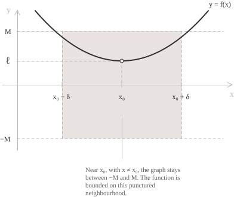

## Limitatezza locale

Questa pagina presenta alcuni teoremi fondamentali sui limiti, in particolare sulla limitatezza locale, sulla permanenza del segno e sul confronto. Ho preferito mantenere il teorema di unicità nella voce sui limiti, poiché costituisce uno dei fondamenti della teoria, mentre ho dedicato una voce separata al teorema dei carabinieri, in quanto permette di dimostrare l'esistenza e determinare il valore di un limite mediante il confronto con altre due funzioni e richiede una trattazione più ampia, con esempi e applicazioni. Negli enunciati che seguono, $f$ e $g$ sono funzioni reali, $x_0$ è un punto di accumulazione finito del loro dominio e tutte le condizioni sugli intorni si riferiscono ai punti del dominio diversi da $x_0.$

Partiamo dal teorema di limitatezza locale che afferma che se $\lim_{x \to x_0} f(x) = \ell$ con $\ell \in \mathbb{R},$ i valori di $f$ rimangono limitati quando $x$ è sufficientemente vicino a $x_0$ e diverso da esso. In altre parole, esistono due costanti $M > 0$ e $\delta > 0$ tali che, per ogni $x$ del dominio con $0 < |x - x_0| < \delta,$ vale la seguente disuguaglianza:

$$|f(x)| \leq M \tag{1}$$

La $(1)$ significa che, in questo intorno bucato, tutti i valori della funzione sono compresi tra $-M$ e $M$ e che quindi la funzione è limitata.

L'esistenza di un limite finito garantisce la $(1),$ mentre un limite infinito non consente questa limitazione. Consideriamo infatti la funzione $f(x) = 1/x$ che per $x \to 0^+$ tende a $+\infty$ e quindi i suoi valori sono maggiori di qualsiasi $M > 0$ quando $x$ è abbastanza vicino a zero da destra. La funzione è quindi illimitata in ogni intervallo $(0,\delta),$ per quanto piccolo sia $\delta > 0.$

Per dimostrare la $(1)$ procediamo applicando la definizione di limite con $\varepsilon = 1,$ per cui esiste un $\delta > 0$ tale che, per ogni $x$ che soddisfa $0 < |x - x_0| < \delta,$ si ha:

$$|f(x) - \ell| < 1 \tag{2}$$

Per la disuguaglianza triangolare possiamo scrivere:

$$|f(x)| \leq |f(x) - \ell| + |\ell| < 1 + |\ell| \tag{3}$$

La stima ottenuta nella $(3)$ mostra che, scegliendo $M = |\ell| + 1,$ vale la $(1)$ per ogni $x$ del dominio con $0 < |x - x_0| < \delta$ e quindi il teorema è dimostrato.

## Permanenza del segno

Come abbiamo appena visto, il teorema di limitatezza locale assicura che, vicino a $x_0,$ i valori della funzione rimangono limitati. Se il limite è anche diverso da zero, il teorema di permanenza del segno garantisce che, sufficientemente vicino a $x_0,$ la funzione ha lo stesso segno del limite. Supponiamo infatti che $\lim_{x \to x_0} f(x) = \ell$ con $\ell > 0.$ Esiste allora un $\delta > 0$ tale che, per ogni $x$ del dominio con $0 < |x - x_0| < \delta,$ vale la seguente disuguaglianza:

$$f(x) > 0 \tag{4}$$

Se invece $\ell < 0,$ il teorema assicura che $f(x) < 0$ in un opportuno intorno bucato di $x_0.$ Attenzione al fatto che se $\ell = 0,$ la funzione può cambiare segno vicino a $x_0,$ come accade ad esempio per $f(x) = x\sin(1/x),$ che tende a zero per $x \to 0$ ma assume valori sia positivi sia negativi in ogni intorno bucato di zero.

Per dimostrare la $(4),$ torniamo al caso $\ell > 0$ e richiediamo che valga la seguente relazione per mantenere la $f(x)$ sopra lo zero:

$$\varepsilon = \frac{\ell}{2} > 0 \tag{5}$$

Per la $(5),$ infatti, esiste un $\delta > 0$ tale che, per ogni $x$ del dominio con $0 < |x - x_0| < \delta,$ si ha:

$$|f(x) - \ell| < \frac{\ell}{2} \implies \frac{\ell}{2} < f(x) < \frac{3\ell}{2} \tag{6}$$

Dalla $(6)$ segue $f(x) > \ell/2 > 0,$ che dimostra la $(4).$ Il caso $\ell < 0$ si ottiene applicando lo stesso ragionamento a $-f,$ il cui limite è $-\ell > 0.$

## Teorema del confronto

Consideriamo due funzioni $f$ e $g$ definite sullo stesso dominio $D,$ di cui $x_0$ è un punto di accumulazione. Supponiamo ora che $f(x) \leq g(x)$ per ogni $x \in D$ sufficientemente vicino a $x_0$ e diverso da esso. Se i due limiti per $x \to x_0$ esistono, finiti o infiniti, allora vale la seguente disuguaglianza:

$$\lim_{x \to x_0} f(x) \leq \lim_{x \to x_0} g(x) \tag{7}$$

Vediamo prima il caso di limiti finiti e procediamo con una dimostrazione per assurdo. Supponiamo che $\ell_f > \ell_g$ e individuiamo due intorni disgiunti di raggio $\varepsilon,$ centrati nei due presunti limiti:

$$\varepsilon = \frac{\ell_f - \ell_g}{2} \tag{8}$$

Per la definizione di limite, possiamo scegliere $\delta > 0$ abbastanza piccolo affinché, per ogni $x \in D$ con $0 < |x - x_0| < \delta,$ valgano $f(x) \leq g(x)$ e le seguenti disuguaglianze:

$$
\begin{align}
|f(x) - \ell_f| &< \varepsilon \notag \\[6pt]
|g(x) - \ell_g| &< \varepsilon \tag{9}
\end{align}
$$

Per come abbiamo scelto $\varepsilon$ nella $(8),$ la prima disuguaglianza impone che $f(x)$ sia sopra il punto medio tra i due limiti, mentre la seconda impone che $g(x)$ si trovi sotto, e quindi possiamo scrivere:

$$
\begin{align}
f(x) &> \ell_f - \varepsilon = \frac{\ell_f + \ell_g}{2} \notag \\[6pt]
g(x) &< \ell_g + \varepsilon = \frac{\ell_f + \ell_g}{2} \tag{10}
\end{align}
$$

Le due disuguaglianze nella $(10)$ danno quindi $g(x) < f(x),$ in contraddizione con $f(x) \leq g(x).$ Quindi l'ipotesi $\ell_f > \ell_g$ è impossibile e la $(7)$ è dimostrata. Questo risultato, come abbiamo detto sopra, vale per i limiti finiti, ma si può estendere anche ai limiti infiniti.

Nella $(7)$ abbiamo ottenuto una disuguaglianza non stretta tra i limiti partendo dall'ipotesi $f(x) \leq g(x).$ Supponiamo ora che valga invece la disuguaglianza stretta:

$$f(x) < g(x) \tag{11}$$

La $(11)$ implica anche $f(x) \leq g(x),$ quindi, se entrambi i limiti esistono, resta valida la $(7),$ tuttavia non possiamo concludere che il limite di $f$ sia strettamente minore di quello di $g,$ perché i due limiti potrebbero coincidere. Per esempio, se consideriamo $f(x) = -|x|$ e $g(x) = |x|$ per $x \to 0,$ per ogni $x \neq 0$ otteniamo $-|x| < |x|,$ così come riportato nella $(11),$ ma se calcoliamo i limiti otteniamo invece:

$$\lim_{x \to 0} f(x) = \lim_{x \to 0} g(x) = 0 \tag{12}$$

La $(12)$ mostra quindi che anche una disuguaglianza stretta tra i valori delle funzioni può generare un'uguaglianza tra i loro limiti. Anche nel confronto con una costante $c,$ una disuguaglianza stretta tra i valori della funzione e $c$ può diventare un'uguaglianza nel passaggio al limite come nella $(12).$ Infatti, se $f(x) \geq c$ vicino a $x_0$ e il limite esiste, applicando la $(7)$ al confronto con la funzione costante di valore $c$ si ottiene:

$$\lim_{x \to x_0} f(x) \geq c$$

Anche se $f(x) > c,$ il limite può essere uguale a $c,$ come nell'esempio della $(12)$ con $g(x) = |x|$ e $c = 0.$
