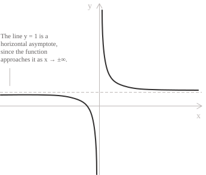
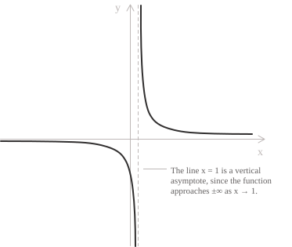
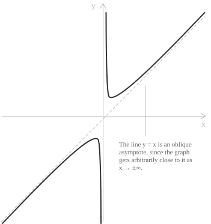

## Horizontal asymptotes

An asymptote of a [function](../functions/) $f(x)$ is a [line](../lines/) that its graph approaches arbitrarily closely as the variable tends to infinity or approaches a point of [discontinuity](../discontinuities-of-real-functions/). There are three main types of asymptotes, horizontal, vertical, and oblique. We begin with horizontal asymptotes, considering a real-valued function $y = f(x)$ defined on an [interval](../intervals/) of the form $[a, +\infty),$ $(-\infty, b]$ or on all of $\mathbb{R}.$ The line with [equation](../equations/) $y = L$ is a horizontal asymptote of $f(x)$ if the following [limit](../limits/) holds:

$$
\begin{align}
\lim_{x \to \pm\infty} f(x) = L &\tag{1}
\end{align}
$$

To illustrate the meaning of $(1),$ we consider the following [rational function](../rational-functions/), defined for $x \neq 0,$ and determine its asymptotes:

$$y = \frac{x + 1}{x} \tag{3}$$

Applying $(1),$ we calculate the limit as $x \to \pm\infty,$ obtaining:

$$\lim_{x \to \pm\infty} \frac{x + 1}{x} = \lim_{x \to \pm\infty} \left( 1 + \frac{1}{x} \right) = 1 \tag{2}$$

By $(2),$ there is therefore a horizontal asymptote at $y=1$ that describes the behaviour of the graph of the function, shown below:

As described in the entry on [curve sketching](../analyzing-the-graphs-of-functions/), asymptotes help us sketch the graph of a general function qualitatively by indicating which lines it approaches under the specified conditions.

## Vertical asymptotes

We now turn to vertical asymptotes, which occur when a function diverges near a point $x_0.$ We again consider a real-valued function $y = f(x)$ defined in a neighbourhood of $x_0,$ possibly excluding the point itself, or only on one side, and define the line with equation $x = x_0$ to be a vertical asymptote when the following limit holds:

$$
\begin{align}
\lim_{x \to x_0^\pm} f(x) = \pm\infty &\tag{5}
\end{align}
$$

To apply $(5),$ we consider another rational function, defined for $x\neq 1,$ and check whether it has any vertical asymptotes:

$$y = \frac{1}{x - 1} \tag{6}$$

To check $(5),$ we examine the left-hand and right-hand limits separately, obtaining:
$$
\begin{align}
\lim_{x \to 1^-} \frac{1}{x - 1} = -\infty &\notag \\[6pt]
\lim_{x \to 1^+} \frac{1}{x - 1} = +\infty &\tag{7}
\end{align}
$$

By $(7),$ the function diverges on both sides, so we can conclude that the line $x = 1$ is a vertical asymptote of $f.$

> In general, it is worth noting that a rational function may often have vertical asymptotes at points where it is undefined.

- - -

The presence of a vertical asymptote does not rule out a horizontal asymptote, and to check whether the function $(6)$ has one, we apply $(1),$ obtaining:

$$
\begin{align}
\lim_{x \to \pm\infty} \frac{1}{x - 1} = \lim_{x \to \pm\infty} \frac{1/x}{1 - 1/x} = 0 &\tag{8}
\end{align}
$$

By $(8),$ the line $y = 0$ is a horizontal asymptote.

## Oblique asymptotes

Oblique asymptotes are lines with nonzero slope, unlike horizontal asymptotes. We again consider a real-valued function $f(x)$ and define the line with equation $y = px + q,$ where $p,q \in \mathbb{R}$ and $p \neq 0,$ to be an oblique asymptote if the following limit holds:

$$
\begin{align}
\lim_{x \to \pm\infty} \big[ f(x) - (px + q) \big] = 0 &\tag{9}
\end{align}
$$

Condition $(9)$ allows us to determine the coefficients of the line, starting with its slope, which is given by the following formula:

$$
\begin{align}
p = \lim_{x \to \pm\infty} \frac{f(x)}{x} &\tag{10}
\end{align}
$$

If $(10)$ gives a finite, nonzero value, we use that value to calculate the intercept $q.$ Indeed, by $(9),$ the difference $f(x) - px$ must tend to $q,$ so we have:

$$
\begin{align}
q = \lim_{x \to \pm\infty} \big[ f(x) - px \big] &\tag{11}
\end{align}
$$

If the limit in $(11)$ is also finite, the line $y = px + q$ satisfies $(9)$ and is therefore an oblique asymptote of the function. As an example, consider the following function:

$$f(x) = \frac{x^2 + 1}{x} \tag{12}$$

Applying $(10)$ to $(12),$ we calculate the slope and obtain:

$$
\begin{align}
p = \lim_{x \to \pm\infty} \frac{x^2 + 1}{x^2} = \lim_{x \to \pm\infty} \left(1 + \frac{1}{x^2}\right) = 1 &\tag{13}
\end{align}
$$

The value $p = 1$ is finite and nonzero, so we can apply $(11)$ to determine $q:$

$$
\begin{align}
q &= \lim_{x \to \pm\infty} \left(\frac{x^2 + 1}{x} - x\right) \notag \\[6pt]
  &= \lim_{x \to \pm\infty} \frac{1}{x} \notag \\[6pt]
  &= 0 \tag{14}
\end{align}
$$

The function $(12)$ therefore has an oblique asymptote both as $x \to +\infty$ and as $x \to -\infty,$ with equation:

$$
\begin{align}
y = x &\tag{15}
\end{align}
$$

In this case the oblique asymptote passes through the origin and we have $q = 0,$ but in general $q$ need not be zero. For example, we can write:

$$
\begin{align}
f(x) = \frac{2x^2 - x + 3}{2x} = x - \frac{1}{2} + \frac{3}{2x} &\tag{16}
\end{align}
$$

Since the term $3/(2x)$ tends to zero as $x \to \pm\infty,$ the difference between the function $(16)$ and the line $y = x - 1/2$ tends to zero, as required by $(9),$ so the oblique asymptote is:

$$
\begin{align}
y = x - \frac{1}{2} &\tag{17}
\end{align}
$$

Every rational function whose numerator has degree $n+1$ and whose denominator has degree $n$ has an oblique asymptote. In this case, then, you already know what to expect. We now return to $(12)$ and check whether the function also has vertical and horizontal asymptotes. We can first rewrite it as $f(x) = x + 1/x$ and readily calculate the limits that determine the vertical asymptote:

$$
\begin{align}
\lim_{x \to 0^-} \left(x + \frac{1}{x}\right) = -\infty &\notag \\[6pt]
\lim_{x \to 0^+} \left(x + \frac{1}{x}\right) = +\infty &\tag{18}
\end{align}
$$

By $(5)$ and $(18),$ the line $x = 0$ is therefore a vertical asymptote. A function can have more than one vertical asymptote, but in this case $x = 0$ is the only one, because the function is [continuous](../continuous-functions/) for every $x \neq 0$ and zero is the only point excluded from its [domain](../determining-the-domain-of-a-function/). We now check whether the function also has a horizontal asymptote by calculating the following limits:

$$
\begin{align}
\lim_{x \to -\infty} \left(x + \frac{1}{x}\right) = -\infty &\notag \\[6pt]
\lim_{x \to +\infty} \left(x + \frac{1}{x}\right) = +\infty &\tag{19}
\end{align}
$$

Since the limits in $(19)$ are infinite, condition $(1)$ is not satisfied, so the function $(12)$ has no horizontal asymptotes.

## Concluding remarks

Before concluding, it is useful to list some general properties of asymptotes. First, not every function has asymptotes. For example, $f(x) = x^2$ has no vertical asymptotes because it is continuous on all of $\mathbb{R},$ no horizontal asymptotes because it tends to $+\infty$ in both directions, and no oblique asymptotes because the ratio $f(x)/x = x$ does not tend to a finite value, as required by $(10).$

Conversely, a single function may have several asymptotes at once, as in $(12),$ which has the vertical asymptote $x = 0$ and the oblique asymptote $y = x.$

A further clarification concerns horizontal asymptotes, which are not barriers that the graph cannot cross. Condition $(1)$ only requires the difference $f(x) - L$ to tend to zero, without requiring it to keep the same sign. For example, the function $f(x) = \sin x/x,$ defined for $x \neq 0,$ satisfies:

$$
\begin{align}
\left|\frac{\sin x}{x}\right| \leq \frac{1}{|x|} &\notag \\[6pt]
\lim_{x \to \pm\infty} \frac{1}{|x|} = 0 &\tag{20}
\end{align}
$$

Applying the [squeeze theorem](../squeeze-theorem/) to $(20)$ shows that $f(x)$ tends to zero and hence that $y = 0$ is a horizontal asymptote. However, the function is zero at $x = k\pi,$ for every integer $k \neq 0,$ and changes sign at each of these points. The graph therefore crosses the asymptote infinitely many times, while the amplitude of the oscillations tends to zero.

- - -

Condition $(9)$ can also be expressed using [little-o notation](../little-o-notation/). We first define $r(x)$ to be the error incurred when approximating the function by the line:

$$
\begin{align}
r(x) = f(x) - (px + q) &\tag{21}
\end{align}
$$

From $(21)$ and condition $(9),$ we obtain:

$$
\begin{align}
&f(x) = px + q + r(x) \notag \\[6pt]
&\lim_{x \to \pm\infty} r(x) = 0 \tag{22}
\end{align}
$$

The notation $r(x) = o(1)$ means precisely that $r(x)$ tends to zero, so $(22)$ can be written in the following abbreviated form as $x \to \pm\infty$:

$$
\begin{align}
f(x) = px + q + o(1) &\tag{23}
\end{align}
$$

Equation $(23)$ separates the line that approximates the function from the approximation error, whose absolute value becomes arbitrarily small. To see a practical application, we return to the function $(12),$ obtaining the following identity as $x \to \pm\infty$:

$$
\begin{align}
f(x) = x + \frac{1}{x} = x + o(1)\tag{24}
\end{align}
$$

In $(24),$ by $(21),$ the error is $r(x) = 1/x,$ and $o(1)$ indicates that this error tends to zero without specifying how quickly. This form is useful in [asymptotic expansions](../asymptotic-expansion/) because it allows us to retain the terms that describe the approximation and collect those that tend to zero into a remainder. Equation $(23)$ can also describe a horizontal asymptote by setting $p = 0$ and $q = L,$ which gives the following identity from $(1)$:

$$f(x) = L + o(1) \tag{25}$$

In $(25),$ $o(1)$ is the error $f(x)-L$ relative to the horizontal asymptote, while in $(23),$ with $p\neq0,$ it is the error $f(x)-(px+q)$ relative to the oblique asymptote. These forms do not describe vertical asymptotes, which are governed by the infinite limit in $(5).$
