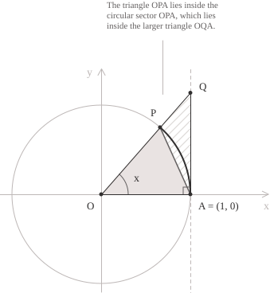

## Remarkable limits of the sine function

Remarkable [limits](../limits/) are limits of [functions](../functions/) that yield [indeterminate forms](../indeterminate-forms/) and whose values are known; they allow us to evaluate more complex limits by recognising familiar expressions or reducing them to such expressions through suitable transformations. We begin with the remarkable limit of the [sine function](../sine-and-cosine/), one of the most significant limits in trigonometry, whose value is given by the following expression:

$$
\lim_{x \to 0} \frac{\sin x}{x} = 1 \tag{1}
$$

Equation $(1)$ shows that $\sin x$ can be approximated by $x,$ and in this sense the sine function has what is called locally linear behaviour at the origin, where its graph is tangent to the line $y = x.$ Since $\sin 0 = 0,$ the limit in $(1)$ is the same as the limit defining the [derivative](../derivatives/) of the sine function at zero, so the following relation holds:

$$
\left.\frac{d}{dx}\sin x\right|_{x=0}
= \lim_{x \to 0}\frac{\sin x-\sin 0}{x-0}
= 1 \tag{2}
$$

The following relations are consequences of $(2)$:

$$
\begin{align}
\lim_{x \to 0} \frac{\sin(a x)}{a x} &= 1 \\[6pt]
\lim_{x \to 0} \frac{\sin(a x)}{x} &= a
\end{align}
$$

To prove $(1),$ we compare three areas in the [unit disk](../unit-circle/). First, we fix an [angle](../angles-and-angular-measure/) $x \in (0, \pi/2)$ and define $O = (0, 0),$ $A = (1, 0)$ and $P = (\cos x, \sin x).$ The line $OP$ meets the tangent to the circle at $A$ at the point $Q = (1, \tan x).$

The triangle $OPA$ is contained in the circular sector bounded by the radii $OA$ and $OP,$ which in turn is contained in the triangle $OQA.$ Their areas are $\sin x/2,$ $x/2$ and $\tan x/2,$ respectively. Comparing them and multiplying by $2$ gives the following chain of inequalities:

$$
\sin x \lt x \lt \tan x \tag{3}
$$

Since $\sin x \gt 0,$ we can divide $(3)$ by $\sin x$ and then take reciprocals to obtain:

$$
\begin{align}
\cos x &\lt \frac{\sin x}{x} \lt 1 \tag{4}
\end{align}
$$

As $x \to 0^+,$ both bounds in the last inequality in $(4)$ tend to $1,$ and since the middle expression lies between these values, the [squeeze theorem](../squeeze-theorem/) gives:

$$
\lim_{x \to 0^+} \frac{\sin x}{x} = 1 \tag{5}
$$

Since $\sin x/x$ is an [even function](../even-and-odd-functions/), the left-hand limit also equals $1.$ The two one-sided limits coincide, so $(1)$ is proved.

For the [inverse sine function](../arcsine-function/), another remarkable limit is:

$$
\lim_{x \to 0}\frac{\arcsin x}{x} = 1 \tag{6}
$$

## Remarkable limits of the cosine function

We now consider a remarkable limit of the [cosine function](../sine-and-cosine/), given by the following relation:

$$
\lim_{x \to 0} \frac{1 - \cos x}{x^2} = \frac{1}{2} \tag{7}
$$

Whereas the sine function in $(1)$ behaves like $x$ near zero, $(7)$ shows that $1 - \cos x$ behaves like $x^2/2,$ which means that the deviation of the cosine function from $1$ is quadratic, as can also be seen from its [Taylor expansion](../taylor-series/) at the origin:

$$
\cos x = 1 - \frac{x^2}{2} + o(x^2) \tag{8}
$$

In $(8),$ the term $o(x^2)$ is negligible compared with $x^2,$ meaning that $o(x^2)/x^2 \to 0$ as $x \to 0,$ and indeed the linear term is absent because the derivative of the cosine function at zero vanishes. To evaluate the limit in $(7),$ we use $(8)$ to rewrite the numerator and divide each term by $x^2,$ obtaining:

$$
\frac{1 - \cos x}{x^2}
= \frac{x^2/2 - o(x^2)}{x^2}
= \frac{1}{2} - \frac{o(x^2)}{x^2}
$$

The last term tends to zero by the definition of $o(x^2),$ so the quotient tends to $1/2,$ as shown in $(7).$ More generally, for every real constant $a,$ we have:

$$
\lim_{x \to 0} \frac{1 - \cos(ax)}{x^2} = \frac{a^2}{2} \tag{9}
$$

To derive $(9)$ from $(1),$ we use the [half-angle formula](../trigonometric-identities/) to obtain:

$$
1 - \cos(ax) = 2\sin^2\left(\frac{ax}{2}\right) \tag{10}
$$

If $a \neq 0,$ dividing $(10)$ by $x^2$ and rearranging gives:

$$
\frac{1 - \cos(ax)}{x^2}
= \frac{a^2}{2}\left(\frac{\sin(ax/2)}{ax/2}\right)^2 \tag{11}
$$

As $x \to 0,$ the ratio in parentheses tends to $1$ by $(1),$ so $(11)$ gives $(9).$ Finally, setting $a = 1$ recovers $(7).$ For the [inverse cosine function](../arccosine-function/), another remarkable limit is:

$$
\lim_{x \to 1^-}\frac{\arccos x}{\sqrt{2(1-x)}} = 1 \tag{12}
$$

## Remarkable limits of the tangent function

We now consider another case, starting from the remarkable limit of the sine function in $(1),$ from which we derive the [tangent limit](../tangent-and-cotangent/) using the following identity:

$$
\frac{\tan x}{x} = \frac{\sin x}{x} \cdot \frac{1}{\cos x} \tag{13}
$$

The first factor in $(13)$ tends to $1$ by $(1),$ while the second tends to $1$ because $\cos 0 = 1,$ so the limit of the product is:

$$
\lim_{x \to 0} \frac{\tan x}{x} = 1 \tag{14}
$$

For $a \neq 0,$ setting $u = ax$ gives $\tan(ax)/x = a\tan u/u,$ and $(14)$ yields:

$$
\lim_{x \to 0} \frac{\tan(a x)}{x} = a \tag{15}
$$

## Remarkable limits of the exponential function

After the trigonometric limits, we now consider a remarkable limit of the [exponential function](../exponential-function/), given by the following expression:

$$
\lim_{x \to 0} \frac{e^x - 1}{x} = 1 \tag{16}
$$

Since $e^0 = 1$ in $(16),$ the quotient is the one defining the derivative of the exponential function at zero:

$$
\left.\frac{d}{dx}e^x\right|_{x=0}
= \lim_{x \to 0}\frac{e^x-e^0}{x-0}
= 1 \tag{17}
$$

As with the cosine function in $(8),$ we can derive the limit from the Taylor expansion of the exponential function at the origin, obtaining:

$$
e^x = 1 + x + \frac{x^2}{2!} + o(x^2) \tag{18}
$$

Subtracting $1$ in $(18)$ and dividing by $x$ gives:

$$
\frac{e^x - 1}{x} = 1 + \frac{x}{2!} + \frac{o(x^2)}{x} \tag{19}
$$

The last two terms tend to zero, so $(19)$ gives $(16).$ In particular, $o(x^2)/x = x\bigl(o(x^2)/x^2\bigr)$ tends to zero by the definition of [little-o notation](../little-o-notation/). For $a \neq 0,$ the substitution $u = ax$ gives:

$$\frac{e^{ax}-1}{x} = a\frac{e^u-1}{u}$$ 
Applying $(16)$ gives:

$$
\lim_{x \to 0} \frac{e^{ax} - 1}{x} = a \tag{20}
$$

Another remarkable limit of the exponential function, for a real base $a \gt 0,$ is:

$$
\lim_{x \to 0}\frac{a^x-1}{x} = \ln a \tag{21}
$$

A proof of $(16)$ can also be obtained from the full [Taylor series](../taylor-series/) of the exponential function, whose first terms appear in $(18)$:

$$
e^x = \sum_{n=0}^{\infty} \frac{x^n}{n!}
= 1 + x + \frac{x^2}{2!} + \frac{x^3}{3!} + \cdots \tag{22}
$$

Subtracting $1$ in $(22)$ and dividing by $x \neq 0$ gives:

$$
\frac{e^x - 1}{x}
= \sum_{n=0}^{\infty} \frac{x^n}{(n+1)!}
= 1 + \frac{x}{2!} + \frac{x^2}{3!} + \cdots \tag{23}
$$

The series in $(23)$ converges uniformly on every bounded interval, so we can take the limit term by term. As $x \to 0,$ all terms containing positive powers of $x$ tend to zero, leaving the constant term:

$$
\lim_{x \to 0} \frac{e^x - 1}{x} = 1 \tag{24}
$$
- - -

A classical limit involving the exponential function defines $e$ and is given by the following expression:

$$
\lim_{x \to 0} (1+x)^{\frac{1}{x}} = e \tag{25}
$$

The discrete form of this limit concerns a [sequence](../sequences/) and is obtained from $(25)$ by setting $x = 1/n,$ so that $1/x = n$ and $x \to 0^+$ as $n \to \infty$:

$$
\lim_{n \to \infty} \left(1+\frac{1}{n}\right)^n = e \tag{26}
$$

A self-contained treatment of this sequence is provided on the page devoted to [deriving Euler's number as the limit of a sequence](../euler-number-limit-sequence/). Finally, for $a \neq 0,$ the substitution $u = ax$ in $(25)$ yields the general form:

$$
\lim_{x \to 0} (1+ax)^{\frac{1}{x}} = e^a \tag{27}
$$

## Remarkable limits of the logarithm

From the exponential limit in $(16)$ we obtain the [natural logarithm](../logarithms/) limit, given by the following expression:

$$
\lim_{x \to 0} \frac{\ln(1+x)}{x} = 1 \tag{28}
$$

To prove $(28),$ we set:

$$
y = \ln(1+x) \quad \Longleftrightarrow \quad x = e^y-1 \tag{29}
$$

By [continuity](../continuous-functions/) of the logarithm at $1$ and since $\ln 1 = 0,$ we have $y \to 0$ as $x \to 0,$ and substituting the expressions in $(29)$ gives:

$$
\frac{\ln(1+x)}{x} = \frac{y}{e^y-1} \tag{30}
$$

The reciprocal of the ratio on the right-hand side of $(30)$ tends to $1$ by $(16),$ so its reciprocal also tends to $1,$ proving $(28).$ As with the sine function in $(2)$ and the exponential function in $(17),$ the limit corresponds to a derivative, and setting $t = 1+x$ in $(28)$ gives:

$$
\left.\frac{d}{dt}\ln t\right|_{t=1}
= \lim_{t \to 1}\frac{\ln t-\ln 1}{t-1}
= 1 \tag{31}
$$

For $a \neq 0,$ the substitution $u = ax$ gives:

$$\frac{\ln(1+ax)}{x} = a\frac{\ln(1+u)}{u}$$

We can therefore write:

$$
\lim_{x \to 0} \frac{\ln(1+ax)}{x} = a \tag{32}
$$

Another remarkable limit of the logarithm, for a real base $a \gt 0$ with $a \neq 1,$ is:

$$
\lim_{x \to 0}\frac{\log_a(1+x)}{x} = \frac{1}{\ln a} \tag{33}
$$

## Limits of power functions

Finally, we consider the remarkable limit of a [power function](../power-function/) with real exponent $\alpha,$ which is:

$$\lim_{x \to 0} \frac{(1 + x)^\alpha - 1}{x} = \alpha \tag{34}$$

We prove $(34)$ using the exponential limit in $(16)$ and the logarithmic limit in $(28),$ both already established. For $\alpha \neq 0,$ we set $u=\alpha\ln(1+x),$ so that $(1+x)^\alpha=e^u,$ and obtain:

$$
\frac{(1+x)^\alpha-1}{x}
= \frac{e^u-1}{u}\cdot\alpha\frac{\ln(1+x)}{x} \tag{35}
$$

As $x \to 0,$ we also have $u \to 0,$ and the two ratios in $(35)$ tend to $1$ by $(16)$ and $(28),$ so the product tends to $\alpha,$ proving $(34).$ For $\alpha=0,$ the quotient is zero and the result remains valid.

## Asymptotic equivalence

Two functions $f$ and $g$ are asymptotically equivalent, written $f(x) \sim g(x),$ if the following relation holds:

$$
f(x) \sim g(x) \quad \Longleftrightarrow \quad \lim_{x \to 0}\frac{f(x)}{g(x)} = 1 \tag{36}
$$

Using $(36),$ we can express the remarkable limits above as equivalences of this kind. Again by $(36),$ the sine limit in $(1),$ the tangent limit in $(14)$ and the cosine limit in $(7)$ can be rewritten, for $x \to 0,$ in the form:

$$
\begin{align}
\sin x &\sim x \notag \\[6pt]
\tan x &\sim x \notag \\[0pt]
1-\cos x &\sim \frac{x^2}{2} \tag{37}
\end{align}
$$

Similarly, $(16)$ and $(28)$ give:

$$
\begin{align}
e^x-1 &\sim x \notag \\[6pt]
\ln(1+x) &\sim x \tag{38}
\end{align}
$$

The equivalences in $(37)$ and $(38)$ allow us to simplify [products and quotients](../algebra-of-limits/) when evaluating limits simply by substitution. For example, substituting $x^2/2$ for $1-\cos x$ and $x$ for $\sin x$ gives:

$$
\lim_{x \to 0}\frac{1-\cos x}{x\sin x}
= \lim_{x \to 0}\frac{x^2/2}{x^2}
= \frac{1}{2} \tag{39}
$$

This substitution is always valid, but when dealing with sums and differences we must first check that the terms do not cancel each other. For example, in $\sin x-x,$ the substitution $\sin x \sim x$ would eliminate both terms and therefore tell us nothing about the behaviour of the difference.
