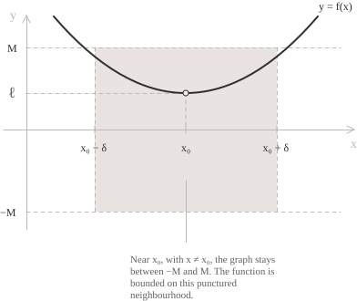

## Local boundedness

This page presents some fundamental theorems on limits, particularly those concerning local boundedness, sign permanence and comparison. I have chosen to keep the [uniqueness theorem](../limits/) in the entry on limits, since it is one of the foundations of the theory, while I have devoted a separate entry to the [squeeze theorem](../squeeze-theorem/), since it allows us to prove the existence and determine the value of a limit by comparison with two other functions and requires a fuller treatment, with examples and applications. In the following statements, $f$ and $g$ are [real-valued functions](../functions/), $x_0$ is a finite [accumulation point](../topology-of-the-real-line/) of their [domain](../determining-the-domain-of-a-function/), and all neighbourhood conditions refer to points of the domain other than $x_0.$

We begin with the local boundedness theorem, which states that if $\lim_{x \to x_0} f(x) = \ell$ with $\ell \in \mathbb{R},$ the values of $f$ remain bounded when $x$ is sufficiently close to $x_0$ and distinct from it. In other words, there are two constants $M \gt 0$ and $\delta \gt 0$ such that, for every $x$ in the domain with $0 \lt |x - x_0| \lt \delta,$ the following inequality holds:

$$|f(x)| \leq M \tag{1}$$

Inequality $(1)$ means that, in this [punctured neighbourhood](../topology-of-the-real-line/), all values of the function lie between $-M$ and $M$ and hence the function is bounded.

The existence of a finite limit guarantees $(1),$ whereas an infinite limit rules out such a bound. Indeed, consider the function $f(x) = 1/x,$ which tends to $+\infty$ as $x \to 0^+,$ so its values exceed any $M \gt 0$ when $x$ is sufficiently close to zero from the right. The function is therefore unbounded on every [interval](../intervals/) $(0,\delta),$ however small $\delta \gt 0$ may be.

To prove $(1),$ we apply the [definition of limit](../limits/) with $\varepsilon = 1,$ which gives a $\delta \gt 0$ such that, for every $x$ satisfying $0 \lt |x - x_0| \lt \delta,$ we have:

$$|f(x) - \ell| \lt 1 \tag{2}$$

By the [triangle inequality](../absolute-value/), we can write:

$$|f(x)| \leq |f(x) - \ell| + |\ell| \lt 1 + |\ell| \tag{3}$$

The estimate in $(3)$ shows that, by choosing $M = |\ell| + 1,$ we obtain $(1)$ for every $x$ in the domain with $0 \lt |x - x_0| \lt \delta,$ which proves the theorem.

## Sign permanence

As we have just seen, the local boundedness theorem ensures that the values of the function remain bounded near $x_0.$ If the limit is also nonzero, the sign permanence theorem guarantees that, sufficiently close to $x_0,$ the function has the same sign as its limit. Indeed, suppose that $\lim_{x \to x_0} f(x) = \ell$ with $\ell \gt 0.$ Then there is a $\delta \gt 0$ such that, for every $x$ in the domain with $0 \lt |x - x_0| \lt \delta,$ the following inequality holds:

$$f(x) \gt 0 \tag{4}$$

If instead $\ell \lt 0,$ the theorem ensures that $f(x) \lt 0$ in some punctured neighbourhood of $x_0.$ Note that if $\ell = 0,$ the function may change sign near $x_0,$ as happens, for example, with $f(x) = x\sin(1/x),$ which tends to zero as $x \to 0$ but takes both positive and negative values in every punctured neighbourhood of zero.

To prove $(4),$ we return to the case $\ell \gt 0$ and impose the following condition to keep $f(x)$ above zero:

$$\varepsilon = \frac{\ell}{2} \gt 0 \tag{5}$$

With the choice in $(5),$ there is a $\delta \gt 0$ such that, for every $x$ in the domain with $0 \lt |x - x_0| \lt \delta,$ we have:

$$|f(x) - \ell| \lt \frac{\ell}{2} \implies \frac{\ell}{2} \lt f(x) \lt \frac{3\ell}{2} \tag{6}$$

Inequality $(6)$ gives $f(x) \gt \ell/2 \gt 0,$ which proves $(4).$ The case $\ell \lt 0$ follows by applying the same argument to $-f,$ whose limit is $-\ell \gt 0.$

## Comparison theorem

Consider two functions $f$ and $g$ defined on the same domain $D,$ of which $x_0$ is an accumulation point. Suppose now that $f(x) \leq g(x)$ for every $x \in D$ sufficiently close to $x_0$ and distinct from it. If the two limits as $x \to x_0$ exist, whether finite or infinite, the following inequality holds:

$$\lim_{x \to x_0} f(x) \leq \lim_{x \to x_0} g(x) \tag{7}$$

We first consider finite limits and proceed by contradiction. Suppose that $\ell_f \gt \ell_g$ and choose two disjoint neighbourhoods of radius $\varepsilon,$ centred at the two proposed limits:

$$\varepsilon = \frac{\ell_f - \ell_g}{2} \tag{8}$$

By the definition of limit, we can choose $\delta \gt 0$ small enough that, for every $x \in D$ with $0 \lt |x - x_0| \lt \delta,$ both $f(x) \leq g(x)$ and the following inequalities hold:

$$
\begin{align}
|f(x) - \ell_f| &\lt \varepsilon \notag \\[6pt]
|g(x) - \ell_g| &\lt \varepsilon \tag{9}
\end{align}
$$

With $\varepsilon$ chosen as in $(8),$ the first inequality requires $f(x)$ to lie above the midpoint between the two limits, while the second requires $g(x)$ to lie below it, so we can write:

$$
\begin{align}
f(x) &\gt \ell_f - \varepsilon = \frac{\ell_f + \ell_g}{2} \notag \\[6pt]
g(x) &\lt \ell_g + \varepsilon = \frac{\ell_f + \ell_g}{2} \tag{10}
\end{align}
$$

The two inequalities in $(10)$ therefore give $g(x) \lt f(x),$ contradicting $f(x) \leq g(x).$ Thus the assumption $\ell_f \gt \ell_g$ is impossible, and $(7)$ is proved. This result, as stated above, holds for finite limits but can also be extended to infinite limits.

In $(7),$ we obtained a non-strict inequality between the limits from the assumption $f(x) \leq g(x).$ Suppose now that the following [strict inequality](../inequalities/) holds instead:

$$f(x) \lt g(x) \tag{11}$$

Inequality $(11)$ also implies $f(x) \leq g(x),$ so if both limits exist, $(7)$ still holds; however, we cannot conclude that the limit of $f$ is strictly less than that of $g,$ because the two limits may coincide. For example, if we consider $f(x) = -|x|$ and $g(x) = |x|$ as $x \to 0,$ we have $-|x| \lt |x|$ for every $x \neq 0,$ as required by $(11),$ but calculating the limits gives:

$$\lim_{x \to 0} f(x) = \lim_{x \to 0} g(x) = 0 \tag{12}$$

Equation $(12)$ therefore shows that even a strict inequality between the values of the functions can lead to equality between their limits. When comparing a function with a constant $c,$ a strict inequality between the values of the function and $c$ can likewise become an equality on passing to the limit, as in $(12).$ Indeed, if $f(x) \geq c$ near $x_0$ and the limit exists, applying $(7)$ to the comparison with the constant function of value $c$ gives:

$$\lim_{x \to x_0} f(x) \geq c$$

Even if $f(x) \gt c,$ the limit may equal $c,$ as in the example in $(12)$ with $g(x) = |x|$ and $c = 0.$
