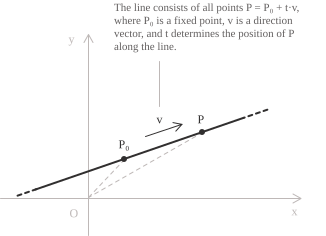

## Dalla forma cartesiana alla forma vettoriale

Abbiamo visto che nel piano cartesiano una retta è descritta da un'equazione che lega le coordinate $x$ e $y$ dei suoi punti. Se la retta è non verticale, a ogni valore di $x$ corrisponde un solo valore di $y.$ Possiamo quindi esprimere $y$ in funzione di $x$ e ottenere l'equazione della retta in forma esplicita data dalla seguente espressione:

$$y = mx + q \tag{1}$$

Possiamo descrivere la $(1)$ anche in forma vettoriale, procedendo nel seguente modo. Per prima cosa consideriamo un vettore $\vec{v}$ non nullo. La retta passante per un punto $P_0$ e parallela a $\vec{v}$ è l'insieme dei punti $P$ per cui $P-P_0$ è un multiplo scalare di $\vec{v}.$ In questo modo, per uno scalare $t \in \mathbb{R}$ l'equazione vettoriale della retta è data dalla seguente identità:

$$P-P_0 = t\vec{v} \tag{2}$$

## Dalla forma vettoriale alla forma parametrica

Vediamo ora come si passa dalla forma vettoriale alla forma parametrica, che esprime le coordinate $x$ e $y$ di un punto della retta in funzione del parametro $t.$ Per ricavare le equazioni, separiamo la relazione vettoriale nelle sue due componenti lungo i rispettivi assi. Per esprimere queste componenti, usiamo due vettori unitari della base ortonormale del piano cartesiano, che sono diretti rispettivamente nel verso positivo degli assi $x$ e $y.$

$$ \tag{3}
\begin{align}
\vec{i} &= (1,0) \\[6pt]
\vec{j} &= (0,1)
\end{align}
$$

Indichiamo con $(x_0,y_0)$ le coordinate del punto fissato $P_0$ e con $(x,y)$ quelle di un punto generico $P.$ Se indichiamo con $O$ l'origine, possiamo esprimere il vettore $P-P_0$ della $(2)$ nella base $(\vec{i},\vec{j})$ e cioè:

$$ \tag{4}
\begin{align}
P-P_0 &= (P-O) - (P_0-O) \\[6pt]
&= (x-x_0)\vec{i} + (y-y_0)\vec{j}
\end{align}
$$

Per esprimere anche il secondo membro della $(2)$ nella stessa base, scriviamo il vettore direttore $\vec{v}$ come combinazione lineare di $\vec{i}$ e $\vec{j},$ indicando con $k$ e $h$ le sue componenti rispettivamente lungo gli assi $x$ e $y:$

$$\vec{v} = k\vec{i} + h\vec{j} \tag{5}$$

In questo modo possiamo riscrivere il termine $t\vec{v}$ della $(2)$ nel seguente modo:

$$t\vec{v} = t(k\vec{i} + h\vec{j})$$

Adesso, se sostituiamo la $(4)$ e la $(5)$ nella $(2)$ otteniamo quindi l'equazione vettoriale nella base $(\vec{i},\vec{j}).$

$$(x-x_0)\vec{i} + (y-y_0)\vec{j} = tk\vec{i} + th\vec{j} \tag{6}$$

Nella $(6),$ i due membri esprimono lo stesso vettore nella base $(\vec{i},\vec{j}).$ Poiché le componenti in questa base sono univoche, il coefficiente di $\vec{i}$ deve essere lo stesso nei due membri, quindi $x-x_0=tk.$ Lo stesso vale per il coefficiente di $\vec{j},$ da cui $y-y_0=th.$ Isolando $x$ nella prima equazione e $y$ nella seconda, per ogni $t \in \mathbb{R}$ otteniamo il sistema di equazioni parametriche della retta che può essere scritto come:

$$ \tag{7}
\begin{cases}
x = x_0 + kt \\[6pt]
y = y_0 + ht
\end{cases}
$$

Nel sistema appena ricavato, abbiamo che lo stesso valore di $t$ determina entrambe le coordinate di un punto della retta. Infatti, quando $k$ e $h$ sono diversi da zero, possiamo ricavare $t$ da ciascuna delle due equazioni del sistema. Quindi, per ciascuna espressione della $(7)$ otteniamo:

$$ \tag{8}
\begin{align}
t &= \frac{x-x_0}{k} \\[6pt]
t &= \frac{y-y_0}{h}
\end{align}
$$

Uguagliando le due espressioni otteniamo:

$$\frac{x-x_0}{k} = \frac{y-y_0}{h} \tag{9}$$

L'uguaglianza $(9)$ è l'equazione simmetrica della retta che può essere usata per ritrovare la forma esplicita data dalla $(1).$ Per farlo, moltiplichiamo entrambi i membri per $h$ e aggiungiamo $y_0$ per isolare $y.$ In questo modo otteniamo:

$$y = y_0 + \frac{h}{k}(x-x_0)\tag{10}$$

Nella $(10)$ il rapporto $h/k$ è il coefficiente angolare $m$ della $(1)$ perché a una variazione di $k$ lungo l'asse $x$ corrisponde una variazione di $h$ lungo l'asse $y.$

## Scelta del punto e del vettore direttore

Abbiamo visto che la $(2)$ è determinata da un punto iniziale $P_0$ e da un vettore direttore, ma non abbiamo esplicitato il modo in cui questi vadano scelti. Per quanto riguarda $P_0$ possiamo scegliere qualsiasi punto della retta poiché al variare di $t$ in $\mathbb{R}$ si ottengono sempre tutti i punti della stessa retta.

Come vettore direttore, invece, possiamo scegliere qualsiasi vettore non nullo parallelo alla retta. Infatti, se sostituiamo $\vec{v}$ con $\lambda\vec{v},$ con $\lambda\neq 0,$ lo spostamento diventa $(\lambda t)\vec{v}.$ Poiché $\lambda t$ assume tutti i valori reali al variare di $t$ in $\mathbb{R},$ la retta rimane la stessa.

Una volta fissati $P_0$ e $\vec{v},$ possiamo limitare i valori di $t$ per descrivere solo una parte della retta. Ad esempio per $0\leq t\leq 1$ otteniamo il segmento che va da $P_0$ a $P_0+\vec{v},$ mentre per $t\geq 0$ otteniamo la semiretta che parte da $P_0$ nel verso di $\vec{v}.$ I valori negativi di $t$ individuano invece i punti dalla parte opposta rispetto a $P_0.$

## Retta passante per due punti

Vediamo ora come possiamo esprimere in forma parametrica le equazioni di una retta che passa per due punti generici. Consideriamo, ad esempio, la retta passante per $P_0=(2,1)$ e $P=(5,4).$ Come sappiamo dalla $(2)$ per descrivere la forma parametrica occorrono un punto e una direzione. Poiché $P_0$ e $P$ appartengono necessariamente alla retta, ricaviamo il vettore direttore $\vec{v}$ sottraendo le loro coordinate.

$$\vec{v} = P-P_0 = (5-2,\ 4-1) = (3, 3)$$

Dobbiamo ricondurre l'equazione parametrica della retta alla $(7).$ Nel nostro esempio abbiamo che le coordinate sono $x_0=2$ e $y_0=1$ e le componenti del vettore direttore $\vec{v}$ sono date da $k=3$ e $h=3.$ Sostituendo questi valori nella $(7)$ otteniamo:

$$
\begin{cases}
x = 2 + 3t \\[6pt]
y = 1 + 3t
\end{cases}
$$

Quindi, al variare di $t$ in $\mathbb{R},$ il sistema descrive tutti i punti della retta passante per $(2,1)$ e $(5,4).$ Se vogliamo determinare l'equazione simmetrica data dalla $(9)$ procediamo eliminando il parametro $t$ ottenendo:

$$\frac{x-2}{3} = \frac{y-1}{3}$$

Questa equazione si riduce a $y=x-1,$ la forma esplicita della stessa retta. Infatti valgono le seguenti equivalenze.

$$
\begin{align}
\frac{x-2}{3} &= \frac{y-1}{3} \\[6pt]
x-2 &= y-1 \\[6pt]
y &= x-1
\end{align}
$$

Il procedimento richiede che i punti $P$ e $P_0$ siano distinti perché se coincidono, la loro differenza è il vettore nullo, che non ha direzione e quindi non può essere usato come vettore direttore.

## Rette nello spazio

Anche nello spazio possiamo scrivere le equazioni di una retta in forma vettoriale o parametrica a partire da un suo punto e da un vettore direttore. Nello spazio, una retta è determinata da un punto $P_0=(x_0,y_0,z_0)$ e da un vettore direttore non nullo $\vec{v}=(k,h,l).$ L'equazione vettoriale ha la stessa forma di quella del piano data dalla $(2)$:

$$P-P_0 = t\vec{v}\tag{11}$$

Nella $(11),$ il vettore $P-P_0$ ha componenti $x-x_0,$ $y-y_0$ e $z-z_0,$ mentre il vettore $t\vec{v}$ ha componenti $kt,$ $ht$ e $lt.$ Poiché i due vettori sono uguali, le componenti corrispondenti coincidono. Quindi se isoliamo $x,$ $y$ e $z$ nelle tre uguaglianze, otteniamo le equazioni parametriche della retta date dal seguente sistema che è un'estensione di quello del piano dato dalla $(7)$:

$$ \tag{12}
\begin{cases}
x = x_0 + kt \\[6pt]
y = y_0 + ht \\[6pt]
z = z_0 + lt
\end{cases}
$$

Quando $k,$ $h$ e $l$ sono diversi da zero, possiamo eliminare il parametro ricavandolo da ciascuna equazione e uguagliando le espressioni, ottenendo l'equazione simmetrica della retta nello spazio:

$$\frac{x-x_0}{k} = \frac{y-y_0}{h} = \frac{z-z_0}{l} \tag{13}$$
