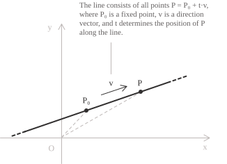

## From Cartesian to vector form

We have seen that a line in the [Cartesian plane](../the-cartesian-coordinate-plane/) is described by an equation relating the coordinates $x$ and $y$ of its points. If the line is nonvertical, each value of $x$ corresponds to exactly one value of $y.$ We can therefore express $y$ as a function of $x$ and write the equation of the line in [explicit form](../lines/).

$$y = mx + q \tag{1}$$

We can also express the line in $(1)$ in vector form as follows. First, consider a nonzero vector $\vec{v}.$ The line through a point $P_0$ and parallel to $\vec{v}$ consists of all points $P$ for which $P-P_0$ is a [scalar multiple](../vectors/) of $\vec{v}.$ The following identity gives the vector equation of the line, with scalar parameter $t\in\mathbb{R}.$

$$P-P_0 = t\vec{v} \tag{2}$$

## From vector to parametric form

We now derive the parametric form from the vector form, expressing the coordinates $x$ and $y$ of a point on the line in terms of the parameter $t.$ To obtain the equations, we separate the vector equation into its two components along the respective axes. We express these components using the two unit vectors of the Cartesian plane's [orthonormal basis](../inner-product-spaces/), which point in the positive directions of the $x$- and $y$-axes, respectively.

$$ \tag{3}
\begin{align}
\vec{i} &= (1,0) \\[6pt]
\vec{j} &= (0,1)
\end{align}
$$

Let $(x_0,y_0)$ be the coordinates of the fixed point $P_0$ and $(x,y)$ those of an arbitrary point $P.$ With $O$ denoting the origin, we can express the vector $P-P_0$ in $(2)$ in the basis $(\vec{i},\vec{j}).$

$$ \tag{4}
\begin{align}
P-P_0 &= (P-O) - (P_0-O) \\[6pt]
&= (x-x_0)\vec{i} + (y-y_0)\vec{j}
\end{align}
$$

To express the right-hand side of $(2)$ in the same basis, we write the direction vector $\vec{v}$ as a [linear combination](../linear-combinations/) of $\vec{i}$ and $\vec{j},$ with $k$ and $h$ denoting its components along the $x$- and $y$-axes, respectively.

$$\vec{v} = k\vec{i} + h\vec{j} \tag{5}$$

We can then rewrite the term $t\vec{v}$ in $(2)$ as follows.

$$t\vec{v} = t(k\vec{i} + h\vec{j})$$

Substituting $(4)$ and $(5)$ into $(2)$ gives the vector equation in the basis $(\vec{i},\vec{j}).$

$$(x-x_0)\vec{i} + (y-y_0)\vec{j} = tk\vec{i} + th\vec{j} \tag{6}$$

In $(6),$ both sides express the same vector in the basis $(\vec{i},\vec{j}).$ Since the components in this basis are unique, the coefficient of $\vec{i}$ must be the same on both sides, so $x-x_0=tk.$ The same applies to the coefficient of $\vec{j},$ which gives $y-y_0=th.$ Solving the first equation for $x$ and the second for $y$ gives the following system of parametric equations for the line, valid for every $t\in\mathbb{R}.$

$$ \tag{7}
\begin{cases}
x = x_0 + kt \\[6pt]
y = y_0 + ht
\end{cases}
$$

In the system we have just derived, the same value of $t$ determines both coordinates of a point on the line. When $k$ and $h$ are nonzero, we can solve each of the two equations for $t.$ The two equations in $(7)$ then give the following expressions.

$$ \tag{8}
\begin{align}
t &= \frac{x-x_0}{k} \\[6pt]
t &= \frac{y-y_0}{h}
\end{align}
$$

Equating the two expressions gives the following relation.

$$\frac{x-x_0}{k} = \frac{y-y_0}{h} \tag{9}$$

Equation $(9)$ is the symmetric equation of the line, which we can use to recover the explicit form in $(1).$ To do so, we multiply both sides by $h$ and add $y_0$ to isolate $y.$ This gives the following equation.

$$y = y_0 + \frac{h}{k}(x-x_0)\tag{10}$$

In $(10),$ the ratio $h/k$ is the [slope](../lines/) $m$ in $(1)$ because a change of $k$ along the $x$-axis corresponds to a change of $h$ along the $y$-axis.

## Choosing the point and direction vector

We have seen that $(2)$ is determined by a starting point $P_0$ and a direction vector, but we have yet to specify how to choose them. We can choose any point on the line as $P_0$ because varying $t$ over $\mathbb{R}$ always gives every point on the same line.

For the direction vector, we can choose any nonzero vector parallel to the line. If we replace $\vec{v}$ with $\lambda\vec{v},$ where $\lambda\neq 0,$ the displacement becomes $(\lambda t)\vec{v}.$ Since $\lambda t$ takes [every real value](../real-numbers/) as $t$ varies over $\mathbb{R},$ the line remains the same.

Once $P_0$ and $\vec{v}$ are fixed, we can restrict the values of $t$ to describe only part of the line. For example, $0\leq t\leq 1$ gives the segment from $P_0$ to $P_0+\vec{v},$ while $t\geq 0$ gives the ray from $P_0$ in the direction of $\vec{v}.$ Negative values of $t$ give the points on the opposite side of $P_0.$

## The line through two points

We now find the parametric equations of a line through two given points. For example, consider the line through $P_0=(2,1)$ and $P=(5,4).$ As $(2)$ shows, we need a point and a direction to write the parametric equations. Since both $P_0$ and $P$ lie on the line, we obtain the direction vector $\vec{v}$ by subtracting their coordinates.

$$\vec{v} = P-P_0 = (5-2,\ 4-1) = (3, 3)$$

We use the parametric form in $(7)$ for this line. In our example, the coordinates are $x_0=2$ and $y_0=1,$ and the components of the direction vector $\vec{v}$ are $k=3$ and $h=3.$ Substituting these values into $(7)$ gives the following system.

$$
\begin{cases}
x = 2 + 3t \\[6pt]
y = 1 + 3t
\end{cases}
$$

As $t$ varies over $\mathbb{R},$ the system describes every point on the line through $(2,1)$ and $(5,4).$ To obtain the symmetric equation in the form of $(9),$ we eliminate the parameter $t$ from the system.

$$\frac{x-2}{3} = \frac{y-1}{3}$$

This equation reduces to $y=x-1,$ the explicit form of the same line. The following equations are equivalent.

$$
\begin{align}
\frac{x-2}{3} &= \frac{y-1}{3} \\[6pt]
x-2 &= y-1 \\[6pt]
y &= x-1
\end{align}
$$

The method requires $P$ and $P_0$ to be distinct because if they coincide, their difference is the zero vector, which has no direction and therefore cannot be used as a direction vector.

## Lines in space

In space, too, we can write the equations of a line in vector or parametric form using a point on the line and a direction vector. A line in space is determined by a point $P_0=(x_0,y_0,z_0)$ and a nonzero direction vector $\vec{v}=(k,h,l).$ The vector equation has the same form as $(2)$ for a line in the plane.

$$P-P_0 = t\vec{v}\tag{11}$$

In $(11),$ the vector $P-P_0$ has components $x-x_0,$ $y-y_0,$ and $z-z_0,$ while the vector $t\vec{v}$ has components $kt,$ $ht,$ and $lt.$ Since the vectors are equal, their corresponding components are equal. Solving the three equalities for $x,$ $y,$ and $z$ gives the following system of parametric equations for the line, which extends the planar system in $(7).$

$$ \tag{12}
\begin{cases}
x = x_0 + kt \\[6pt]
y = y_0 + ht \\[6pt]
z = z_0 + lt
\end{cases}
$$

When $k,$ $h,$ and $l$ are nonzero, we can eliminate the parameter by solving each equation for it and equating the resulting expressions to obtain the symmetric equation of the line in space.

$$\frac{x-x_0}{k} = \frac{y-y_0}{h} = \frac{z-z_0}{l} \tag{13}$$
