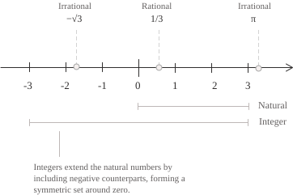

## Definizione

I numeri interi rappresentano l'estensione dei numeri naturali, ottenuta aggiungendo a ciascun numero naturale positivo il suo opposto. L'insieme si indica con $\mathbb{Z}$ e si scrive come segue.

$$ \tag{1}
\mathbb{Z} = \{\ldots,-3,-2,-1,0,1,2,3,\ldots\}
$$

L'insieme $\mathbb{Z}$ si può anche scrivere nella seguente formulazione:

$$ \tag{2}
\mathbb{Z} = \mathbb{N} \cup \{-n : n \in \mathbb{N}^+\}
$$

L'insieme $\mathbb{N}$ è dunque un sottoinsieme proprio di $\mathbb{Z}$ perché contiene tutti gli interi non negativi e lascia fuori quelli negativi. I due insiemi hanno la stessa cardinalità, infatti se disponiamo gli interi nell'ordine $0,-1,1,-2,2,-3,3,\ldots$ e numeriamo le posizioni a partire da zero, a ogni numero naturale corrisponde il relativo intero e ogni intero compare una sola volta. Questo  determina una corrispondenza biunivoca tra $\mathbb{N}$ e $\mathbb{Z}$ e pertanto i due insiemi hanno la stessa cardinalità. Esistono poi delle convenzioni di rappresentazione che intervengono quando occorre specificare il segno o escludere lo zero negli interi. In questi casi si usano i seguenti sottoinsiemi:

$$ \tag{3}
\begin{align}
\mathbb{Z}^+ &= \{1, 2, 3, \ldots\} \\[6pt]
\mathbb{Z}^- &= \{-1, -2, -3, \ldots\} \\[6pt]
\mathbb{Z}^* &= \mathbb{Z} \setminus \{0\}
\end{align}
$$

A livello geometrico, gli interi formano un insieme infinito di punti equidistanti sulla retta numerica.

A livello più formale, la costruzione dell'insieme $\mathbb{Z}$ definisce ogni intero come una classe di coppie ordinate $(a,b)$ di numeri naturali. Due coppie appartengono alla stessa classe quando soddisfano la seguente condizione:

$$ \tag{4}
(a,b) \sim (c,d) \quad \longleftrightarrow \quad a + d = b + c
$$

La coppia $(a,b)$ rappresenta la differenza $a-b.$ Per capire la condizione $(4),$ partiamo dall'uguaglianza $a-b=c-d.$ Aggiungendo $b+d$ a entrambi i membri otteniamo $a+d=b+c.$ Possiamo quindi stabilire se due coppie rappresentano lo stesso intero confrontando due somme di numeri naturali. Il confronto tra $a$ e $b$ determina il segno dell'intero rappresentato da $(a,b),$ quindi se $a=b,$ la coppia appartiene alla classe dello zero, se $a\gt b,$ la differenza è positiva, mentre se $a\lt b$ è negativa. Consideriamo per esempio la coppia di naturali $(2,5).$ Poiché la seconda componente è maggiore della prima, la coppia corrisponde all'intero negativo $-3.$

Quando due coppie rappresentano lo stesso intero si dice che appartengono alla stessa classe di equivalenza. Ad esempio, per verificare che $(4,7)$ e $(2,5)$ appartengono alla stessa classe, applichiamo la $(4)$ e otteniamo che le due somme da confrontare sono $4+5$ e $7+2,$ e sono entrambe uguali a $9.$

La relazione definita dalla $(4)$ è riflessiva perché $a+b=b+a,$ quindi ogni coppia è equivalente a sé stessa. La relazione è anche simmetrica perché, se $a+d=b+c,$ allora $c+b=d+a$ e possiamo scambiare le due coppie. Per la transitività, supponiamo che $(a,b)\sim(c,d)$ e $(c,d)\sim(e,f).$ Dalla $(4)$ otteniamo $a+d=b+c$ e $c+f=d+e.$ Sommando membro a membro e cancellando $c+d$ da entrambi i membri, resta $a+f=b+e.$ Per la $(4),$ questo significa che $(a,b)\sim(e,f).$

Indichiamo ora con $[(a,b)]$ la classe di equivalenza di $(a,b)$ e proviamo a sommare le due classi. L'addizione avviene secondo la seguente relazione:

$$ \tag{5}
[(a,b)]+[(c,d)] := [(a+c,b+d)]
$$

Per il prodotto invece, sviluppiamo prima $(a-b)(c-d)$ e poi raggruppiamo i termini nella forma $(ac+bd)-(ad+bc).$ Il prodotto viene quindi rappresentato come:

$$ \tag{6}
[(a,b)][(c,d)] := [(ac+bd,ad+bc)]
$$

Dimostriamo che la somma $(5)$ e il prodotto $(6)$ sono ben definiti, cioè che la classe del risultato resta la stessa qualunque siano i rappresentanti scelti. Fissiamo ad esempio $(c,d)$ e prendiamo due rappresentanti equivalenti $(a,b)$ e $(a',b').$ Per la $(4)$ vale:

$$a+b'=b+a'\tag{7}$$

Per la somma, aggiungiamo $c+d$ a entrambi i membri della $(7)$ e riordiniamo i termini, ottenendo:

$$ \tag{8}
(a+c)+(b'+d)=(b+d)+(a'+c)
$$

Quindi, la $(8)$ verifica la condizione $(4)$ per le due coppie ottenute con la somma. Per il prodotto, moltiplichiamo $a+b'=b+a'$ per $c$ e per $d,$ scambiando i membri nella seconda uguaglianza ottenendo:

$$ \tag{9}
\begin{align}
ac+b'c &= bc+a'c \\[6pt]
bd+a'd &= ad+b'd
\end{align}
$$

Sommando le due righe della $(9)$ e raggruppando i termini si ha:

$$ \tag{10}
(ac+bd)+(a'd+b'c)=(ad+bc)+(a'c+b'd)
$$

Come per la somma, la $(10)$ verifica la condizione $(4)$ per le due coppie ottenute con il prodotto. Per la simmetria delle formule $(5)$ e $(6),$ lo stesso ragionamento vale quando si cambia il secondo elemento.

- - -

Per vedere come la costruzione per coppie estende i numeri naturali, associamo a ciascun naturale $n$ la classe della coppia $(n,0)$ con la seguente relazione:

$$ \tag{11}
n \longmapsto [(n,0)]
$$

Per la $(4),$ le coppie $(n,0)$ e $(m,0)$ sono equivalenti solo se $n=m.$ Se applichiamo la $(5)$ e la $(6)$ a coppie con la seconda componente nulla, si ottiene la somma e il prodotto dei naturali. Possiamo quindi identificare $\mathbb{N}$ con queste classi in $\mathbb{Z},$ in particolare $0=[(0,0)]$ e $1=[(1,0)].$ Scambiare le componenti di $(a,b)$ dà l'opposto. Infatti, per la $(5),$ la somma delle due classi è la classe dello zero:

$$ \tag{12}
[(a,b)]+[(b,a)]=[(a+b,a+b)]=0
$$

Se $a\gt b,$ la $(4)$ mostra che $(a,b)$ è equivalente a $(a-b,0),$ perché $a=b+(a-b).$ Se $a\lt b,$ applichiamo lo stesso ragionamento alla coppia $(b,a)$ e prendiamo l'opposto. Se $a=b,$ la coppia appartiene alla classe dello zero. Otteniamo così le tre forme, a seconda del segno dell'intero rappresentato.

$$ \tag{13}
[(a,b)]=
\begin{cases}
[(a-b,0)] & \text{se } a\gt b \\[6pt]
0 & \text{se } a=b \\[6pt]
-[(b-a,0)] & \text{se } a\lt b
\end{cases}
$$

## Gli interi come anello

Abbiamo visto che La $(5)$ e la $(6)$ definiscono la somma e il prodotto di due interi e che in entrambi i casi il risultato è ancora un intero. Per l'addizione, la $(5)$ dà l'associatività, la commutatività e l'elemento neutro $0,$ mentre la $(12)$ mostra che ogni intero ha un opposto. Quindi per ogni $a,b,c\in\mathbb{Z}$ valgono quindi le seguenti uguaglianze:

$$ \tag{14}
\begin{align}
(a+b)+c &= a+(b+c) \\[6pt]
a+b &= b+a \\[6pt]
a+0 &= a \\[6pt]
a+(-a) &= 0
\end{align}
$$

Le proprietà della $(14)$ fanno di $(\mathbb{Z},+)$ un gruppo abeliano. Dalle regole $(5)$ e $(6)$ si ricavano anche le proprietà seguenti della moltiplicazione, valide per tutti gli interi $a,b,c:$

$$ \tag{15}
\begin{align}
(ab)c &= a(bc) \\[6pt]
ab &= ba \\[6pt]
a\cdot1 &= a \\[6pt]
a(b+c) &= ab+ac
\end{align}
$$

Per la $(13),$ sappiamo che ogni intero non nullo è un naturale positivo oppure il suo opposto. Il valore assoluto del prodotto di due interi non nulli è quindi il prodotto di due naturali positivi. In particolare, il prodotto è diverso da zero e può essere uguale a $1$ solo se entrambi i fattori hanno valore assoluto $1.$ Gli unici interi con inverso moltiplicativo sono dunque $1$ e $-1.$ In un campo, come $\mathbb{Q}$ o $\mathbb{R},$ ogni elemento non nullo ha un inverso moltiplicativo. In $\mathbb{Z}$ già $2$ è privo di inverso, perciò $\mathbb{Z}$ non è un campo.

L'assenza di divisori dello zero permette di cancellare un fattore non nullo. Se $ab=ac,$ la proprietà distributiva nella $(15)$ dà la seguente uguaglianza:

$$ \tag{16}
a(b-c)=ab-ac=0
$$

Se $a\neq0,$ dalla $(16)$ segue $b-c=0,$ quindi $b=c.$ Le proprietà della $(14)$ e della $(15)$ stabiliscono dunque che $\mathbb{Z}$ è un anello commutativo con unità $1.$ L'assenza di divisori dello zero lo rende un dominio d'integrità.

## Proprietà

Mostriamo adesso quali sono le proprietà fondamentali dei numeri interi, partendo da come le operazioni conservano l'uguaglianza. Se $a=b,$ possiamo aggiungere lo stesso intero $c$ a entrambi i membri oppure moltiplicarli per $c$ ottenendo:

$$ \tag{17}
\begin{align}
a+c &= b+c \\[6pt]
ac &= bc
\end{align}
$$

La proprietà commutativa e associativa della $(14)$ e della $(15)$ permettono di cambiare l'ordine e il raggruppamento dei termini di una somma o dei fattori di un prodotto. Le stesse formule individuano gli elementi neutri $0$ per la somma e $1$ per il prodotto. Per la proprietà distributiva si può sviluppare un prodotto oppure di raccogliere un fattore comune, come nella $(16).$ Un'ulteriore proprietà riguarda la divisibilità che stabilisce quando un intero è un multiplo di un altro. Dati due interi $a$ e $b,$ diciamo che $b$ divide $a$ e scriviamo $b\mid a$ se esiste un intero $q$ tale che valga la seguente uguaglianza:

$$ \tag{18}
a=bq
$$

In questo caso $b$ è un divisore di $a$ e $a$ è un multiplo di $b.$ Se $b\neq0,$ l'intero $q$ è il quoziente della divisione esatta. Nella $(18)$ possiamo prendere $q=0$ per vedere che ogni intero divide $0,$ oppure $q=1$ per vedere che ogni intero divide sé stesso. Se $b=0,$ la $(18)$ impone $a=0,$ quindi $0$ divide soltanto $0.$ La divisibilità è transitiva, infatti se $a\mid b$ e $b\mid c,$ per la $(18)$ possiamo scrivere $b=au$ e $c=bv$ con $u,v\in\mathbb{Z}.$ Sostituendo $b=au$ nell'espressione di $c$ otteniamo la seguente uguaglianza:

$$ \tag{19}
c=bv=(au)v=a(uv)
$$

Poiché $uv$ è un intero, la $(19)$ mostra che $a\mid c.$ Se invece $a$ divide sia $b$ sia $c,$ scriviamo $b=au$ e $c=av.$ Per ogni $s,t\in\mathbb{Z},$ la distributività della $(15)$ permette di raccogliere il fattore comune $a$ ottenendo:

$$ \tag{20}
sb+tc=s(au)+t(av)=a(su+tv)
$$

Dalla $(20)$ segue che $a$ divide ogni combinazione $sb+tc$ a coefficienti interi. Infine, se $a\mid b$ e $b\mid a,$ possiamo scrivere $b=au$ e $a=bv.$ Se $a=0,$ anche $b=0.$ Per $a\neq0,$ sostituiamo $b=au$ nella seconda uguaglianza.

$$ \tag{21}
a=bv=(au)v=a(uv)
$$

Per la cancellazione illustrata nella $(16),$ dalla $(21)$ segue $uv=1.$ Poiché gli unici interi invertibili sono $1$ e $-1,$ da $b=au$ otteniamo $b=a$ oppure $b=-a.$ La divisibilità è alla base del teorema fondamentale dell'aritmetica, secondo cui ogni intero $n\gt1$ si scrive come prodotto di primi positivi in modo unico a meno dell'ordine dei fattori. Per $n\lt-1,$ si fattorizza $|n|$ e si antepone il fattore $-1.$

## Ordine sugli interi

La distinzione tra interi positivi, negativi e nulli nella $(13)$ permette di confrontare due interi e stabilire ad esempio se $a$ è minore o uguale a $b.$ Si ha $a\leq b$ se e solo se questa differenza è non negativa ovvero vale:

$$ \tag{22}
a\leq b \quad\Longleftrightarrow\quad b-a\in\mathbb{N}
$$

Su $\mathbb{Z}$ la $(22)$ è riflessiva perché $a-a=0.$ Inoltre, è antisimmetrica perché $b-a$ e $a-b$ possono essere entrambi non negativi solo se sono nulli. La relazione è anche transitiva perché, se $a\leq b$ e $b\leq c,$ la differenza $c-a=(c-b)+(b-a)$ è una somma di interi non negativi. Infine, il segno di $b-a$ determina quale delle tre possibilità $a\lt b,$ $a=b$ e $b\lt a$ si verifica. La $(22)$ definisce quindi un ordine totale su $\mathbb{Z}.$ Il campo $\mathbb{C}$ non ammette un ordine totale compatibile con l'addizione e la moltiplicazione nel senso della $(23).$

Vediamo ora come quest'ordine è compatibile con le operazioni dell'anello. Se aggiungiamo lo stesso intero $c$ ad $a$ e a $b$ questo lascia invariata la differenza. Se moltiplichiamo entrambi i numeri per $c,$ la distributività nella $(15)$ dà $bc-ac=c(b-a),$ che è non negativo quando $c\geq0$ e $a\leq b.$ Otteniamo così le seguenti implicazioni:

$$ \tag{23}
\begin{align}
a\leq b &\ \Longrightarrow\ a+c\leq b+c \\[6pt]
a\leq b,\ c\geq0 &\ \Longrightarrow\ ac\leq bc
\end{align}
$$

L'insieme $\mathbb{Z}$ è privo di minimo, perché per ogni intero $a$ abbiamo che anche $a-1$ è un intero ed è minore di $a.$ Tuttavia, ogni sottoinsieme non vuoto $S$ di $\mathbb{Z}$ con un minorante intero $m$ ammette comunque un minimo. Sottraendo $m$ a ogni elemento di $S$ otteniamo un sottoinsieme di $\mathbb{N}$ che ha un minimo per il principio del buon ordinamento. Aggiungendo di nuovo $m$ a quel minimo, otteniamo il minimo di $S,$ per la prima implicazione della $(23).$

Il buon ordinamento di $\mathbb{N}$ è equivalente al principio di induzione matematica. Per dimostrare una proprietà $P$ su tutti gli interi, si può dimostrare per induzione su $n\in\mathbb{N}$ sia $P(n)$ sia $P(-n).$ Il primo caso copre gli interi non negativi e il secondo gli interi non positivi. Il valore assoluto $|a|$ misura la distanza dell'intero $a$ dallo zero. Se $a$ è negativo, questa distanza è data dal suo opposto, come descritto nella $(12).$

$$ \tag{24}
|a|=\begin{cases}
a & \text{se } a\geq0 \\[6pt]
-a & \text{se } a\lt0
\end{cases}
$$

La $(24)$ mostra che $|a|$ è il massimo tra $a$ e $-a,$ perciò due interi opposti hanno la stessa distanza dallo zero.