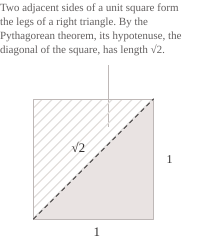

## Definizione

Un numero reale è irrazionale se non si può scrivere come rapporto di due interi con denominatore diverso da zero. L'insieme $\mathbb{I}$ dei numeri irrazionali è quindi il complementare dei numeri razionali $\mathbb{Q}$ in $\mathbb{R}$ e si può scrivere nel seguente modo:

$$
\mathbb{I} = \mathbb{R}\setminus\mathbb{Q} = \{x \in \mathbb{R} \mid x \notin \mathbb{Q}\} \tag{1}
$$

Dalla $(1)$ deriva che ogni numero reale appartiene a uno solo dei due insiemi $\mathbb{Q}$ e $\mathbb{I}$ e cioè valgono le seguenti relazioni che esprimono il fatto che $\mathbb{Q}$ e $\mathbb{I}$ formano una partizione della retta reale.

$$
\mathbb{R} = \mathbb{Q} \cup \mathbb{I}, \qquad \mathbb{Q} \cap \mathbb{I} = \emptyset \tag{2}
$$

Per esempio, $1/2$ e $0.75=3/4$ sono numeri razionali, mentre $\sqrt{2}$ è irrazionale. $\sqrt{2}$ è un numero piuttosto interessante perché è legato proprio alla scoperta dei numeri irrazionali derivante dal calcolo della diagonale del quadrato unitario. Per il teorema di Pitagora, la lunghezza $d$ della diagonale di un quadrato di lato $1$ soddisfa la seguente relazione:

$$
d^2 = 1^2 + 1^2 = 2 \tag{3}
$$

Dalla $(3)$ segue che la diagonale misura $d=\sqrt{2}.$ Per dimostrare che questa lunghezza è irrazionale bastano le proprietà della parità degli interi.

Supponiamo per assurdo che $\sqrt{2}$ sia razionale e dunque possiamo scriverlo come rapporto di due interi $p$ e $q,$ con $q\neq0,$ scegliendo una frazione ridotta ai minimi termini: 

$$
\sqrt{2} = \frac{p}{q} \tag{4}
$$

Se eleviamo al quadrato entrambi i membri della $(4)$ e moltiplichiamo per $q^2$ otteniamo:

$$
p^2 = 2q^2 \tag{5}
$$

Dalla $(5)$ segue che $p^2$ è pari e poiché il quadrato di un intero dispari è dispari, anche $p$ è pari e si può scrivere come $p=2k$ per un intero $k.$ Sostituendo questo valore nella $(5)$ otteniamo $4k^2=2q^2$ e, dividendo per $2,$ si ha:

$$
q^2 = 2k^2 \tag{6}
$$

Per la $(6),$ anche $q^2$ è pari e quindi lo è anche $q.$ I due interi $p$ e $q$ hanno dunque il divisore comune $2,$ in contraddizione con la scelta della frazione ai minimi termini nella $(4).$ Ne segue che $\sqrt{2}$ è irrazionale.

- - - 

Sappiamo che un numero reale è razionale se e solo se il suo sviluppo decimale diventa periodico da una certa cifra in poi. In generale, anche gli sviluppi finiti rientrano in questo criterio, perché dopo l'ultima cifra si possono aggiungere degli zeri. Nel caso degli irrazionali, invece, abbiamo uno sviluppo decimale infinito che non diventa mai periodico. Consideriamo ad esempio il numero:

$$
x = 0.101001000100001000001\ldots \tag{7}
$$

Il numero $x$ della $(7)$ è irrazionale, in quanto il numero di zeri fra due $1$ consecutivi cresce senza limite. Se lo sviluppo diventasse periodico, ogni ripetizione del periodo dovrebbe contenere almeno un $1,$ perché gli $1$ continuano a comparire nello schema e le sequenze di zeri avrebbero allora una lunghezza limitata. Lo sviluppo di $\sqrt{2}=1.41421356\ldots$ permette anche di vedere come un irrazionale si possa approssimare con numeri razionali troncando le cifre decimali e ottenendo una relazione del tipo:

$$
1.414 \lt \sqrt{2} \lt 1.415 \tag{8}
$$

Come nella $(8),$ ogni troncamento a $n$ cifre decimali approssima $\sqrt{2}$ per difetto con un errore minore di $10^{-n}.$

- - -

Gli irrazionali si dividono poi in due classi disgiunte secondo un criterio algebrico. Un reale è algebrico se è radice di un polinomio non nullo a coefficienti interi, altrimenti è un numero trascendente. Ogni razionale $p/q$ è algebrico perché è radice del polinomio $qx-p$ e, di conseguenza, ogni numero trascendente è irrazionale.

Consideriamo sempre $\sqrt{2}$ che è algebrico perché è radice di $x^2-2.$ Più in generale, la radice quadrata $\sqrt{n}$ di un intero positivo $n$ è irrazionale se $n$ non è un quadrato perfetto, come nel caso di $\sqrt{2},$ $\sqrt{3},$ $\sqrt{5},$ $\sqrt{6},$ $\sqrt{7},$ $\sqrt{8}$ e $\sqrt{10}.$ Per le radici cubiche vale lo stesso criterio con i cubi perfetti.

In generale, consideriamo $k\geq2$ e $n$ un intero positivo che non è una potenza $k$-esima perfetta. Nella fattorizzazione di $n$ compare un primo con esponente non divisibile per $k.$ Se $\sqrt[k]{n}=p/q$ per due interi positivi coprimi $p,q,$ allora si ha:

$$p^k=nq^k \tag{9}$$

Confrontiamo nella $(9)$ gli esponenti del primo scelto nella fattorizzazione di $n.$ In $p^k$ il suo esponente è un multiplo di $k,$ perché elevare $p$ alla $k$-esima potenza moltiplica ogni esponente per $k.$ In $nq^k,$ invece, all'esponente che il primo ha in $n$ si aggiunge quello che ha in $q^k,$ che è un multiplo di $k.$ La somma resta quindi non divisibile per $k.$ Poiché due interi uguali hanno gli stessi esponenti nella fattorizzazione in primi, la $(9)$ è impossibile. Dunque $\sqrt[k]{n}$ è irrazionale.

Il numero $\pi,$ che come sappiamo è il rapporto fra la lunghezza della circonferenza e il suo diametro, e il numero $e,$ che rappresenta la base del logaritmo naturale, sono invece numeri trascendenti.

## Operazioni con gli irrazionali

Vediamo ora come si comportano le operazioni nell'insieme degli irrazionali, partendo dalla somma e dal prodotto, mostrando il seguente esempio:

$$
\begin{aligned}
\sqrt{2} + (-\sqrt{2}) &= 0 \\[6pt]
\sqrt{2}\cdot\sqrt{2} &= 2 \\[6pt]
\sqrt{2}\cdot\sqrt{8} &= 4
\end{aligned} \tag{10}
$$

Pur partendo da numeri irrazionali, otteniamo dei numeri razionali, e quindi la $(10)$ mostra che $\mathbb{I}$ non è chiuso né rispetto all'addizione né rispetto alla moltiplicazione. Perciò rispetto alle operazioni dei reali, $\mathbb{I}$ non è un gruppo additivo né un anello. Consideriamo adesso $q\in\mathbb{Q}$ e $\xi\in\mathbb{I}.$ La somma $q+\xi$ è sempre irrazionale, e il prodotto $q\xi$ è irrazionale quando $q\neq0.$ Per vedere perché, basta isolare $\xi$ in ciascuna espressione in modo da ottenere:

$$
\xi=(q+\xi)-q \tag{11}
$$

Se $q+\xi$ fosse razionale, dalla $(11)$ seguirebbe che anche $\xi$ è razionale, perché è la differenza di due razionali. Per il prodotto, se $q\neq0,$ possiamo dividere per $q,$ ottenendo:

$$
\xi=\frac{q\xi}{q} \tag{12}
$$

Se $q\xi$ fosse razionale, dalla $(12)$ seguirebbe che anche $\xi$ è razionale, perché è il quoziente di due razionali.

## Densità e cardinalità

I numeri irrazionali sono densi in $\mathbb{R},$ cioè ogni intervallo aperto $(x,y)$ con $x\lt y$ contiene almeno un irrazionale. Per costruirne uno, cerchiamo un razionale $q$ tale che $q+\sqrt{2}$ rientri in $(x,y).$ Per la densità dei razionali, esiste un $q\in\mathbb{Q}$ tale che:

$$
x - \sqrt{2} \lt q \lt y - \sqrt{2} \tag{13}
$$

Aggiungendo $\sqrt{2}$ ai tre membri della $(13)$ otteniamo:

$$
x \lt q+\sqrt{2} \lt y \tag{14}
$$

Per la proprietà dimostrata con la $(11),$ il numero $q+\sqrt{2}$ è irrazionale e la $(14)$ mostra quindi che appartiene all'intervallo $(x,y).$ In generale, ogni intervallo aperto non vuoto contiene infiniti sottointervalli aperti a due a due disgiunti. Poiché ciascuno contiene almeno un irrazionale e almeno un razionale, nell'intervallo di partenza ci sono infiniti numeri di entrambi i tipi.

Per quanto riguarda la cardinalità, sappiamo che l'insieme $\mathbb{Q}$ è numerabile e se anche $\mathbb{I}$ fosse numerabile, per la $(2)$ l'insieme $\mathbb{R}$ sarebbe unione di due insiemi numerabili. Tuttavia, poiché $\mathbb{R}$ non è numerabile, nemmeno $\mathbb{I}$ lo è. Per la $(2),$ aggiungendo a $\mathbb{I}$ l'insieme numerabile $\mathbb{Q}$ si ottiene $\mathbb{R}.$ L'aggiunta di un insieme numerabile a un insieme infinito ne conserva la cardinalità, quindi $\mathbb{I}$ e $\mathbb{R}$ hanno la stessa cardinalità.

Anche l'insieme $\mathbb{A}$ dei numeri algebrici è numerabile. Ad esempio, tutti i polinomi non nulli a coefficienti interi sono numerabili e ciascuno ha un numero finito di radici reali. L'insieme $\mathbb{A}$ è quindi un'unione numerabile di insiemi finiti e contiene tutti i razionali. Se anche il suo complementare $\mathbb{R}\setminus\mathbb{A}$ fosse numerabile, lo sarebbe tutta la retta reale, e da questo deriva che l'insieme dei trascendenti non è numerabile.
