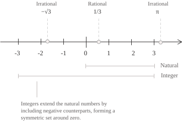

## Definizione

Quando si scrive il rapporto tra due interi $p$ e $q,$ con $q\neq 0,$ si ottiene un numero razionale, indicato dall'insieme $\mathbb{Q}:$

$$
\mathbb{Q} := \left\{\ \frac{p}{q} \mid p,q \in \mathbb{Z},\ q \neq 0\ \right\} \tag{1}
$$

Nella frazione che compare nella $(1),$ $p$ è il numeratore e $q$ il denominatore, che dev'essere diverso da zero perché la divisione per zero non è definita. Poiché ogni intero $n$ si può scrivere come $n/1,$ la $(1)$ mostra anche che tutti gli interi sono razionali. Ricordando che ogni numero naturale è un intero, si ottiene la seguente catena di inclusioni:

$$
\mathbb{N} \subset \mathbb{Z} \subset \mathbb{Q} \tag{2}
$$

L'ultima inclusione nella $(2)$ è propria, come mostra il quoziente $1/2,$ che appartiene a $\mathbb{Q}$ e non a $\mathbb{Z}.$

Per costruire l'insieme $\mathbb{Q}$ definito nella $(1),$ partiamo dalle coppie di interi che possono comparire come numeratore e denominatore di una frazione. Come nella costruzione di $\mathbb{Z}$ a partire da coppie di numeri naturali, coppie diverse possono rappresentare lo stesso numero. Raccogliamo dunque in $P$ tutte le coppie di interi con seconda componente diversa da zero e scriviamo:

$$
P = \{\ (p, q) \in \mathbb{Z} \times \mathbb{Z} \mid q \neq 0\ \} \tag{3}
$$

Date due coppie $(p,q)$ e $(r,s)$ dell'insieme definito nella $(3),$ le consideriamo equivalenti quando il prodotto della prima componente di ciascuna per la seconda componente dell'altra dà lo stesso intero. L'uguaglianza di questi prodotti permette così di confrontare le coppie usando solo la moltiplicazione in $\mathbb{Z}:$

$$
(p, q) \sim (r, s) \quad \longleftrightarrow \quad ps = qr \tag{4}
$$

Il simbolo $\sim$  nella $(4)$ indica la relazione tra le coppie. Poiché questa relazione è riflessiva, simmetrica e transitiva, ripartisce le coppie di $P$ in classi di equivalenza. Ciascuna classe è un numero razionale, e l'insieme di tutte le classi si chiama quoziente di $P$ per la relazione $\sim:$

$$
\mathbb{Q} := P / {\sim} \tag{5}
$$

Nel quoziente della $(5),$ la frazione $p/q$ indica la classe della coppia $(p,q).$ Per esempio, per stabilire se $(4,6)$ e $(-6,-9)$ rappresentano lo stesso razionale di $(2,3),$ applichiamo la $(4)$ a ciascuna delle due coppie e otteniamo le scritture equivalenti:

$$
\begin{aligned}
2 \cdot 6 &= 12 = 3 \cdot 4 \\[6pt]
2 \cdot (-9) &= -18 = 3 \cdot (-6)
\end{aligned} \tag{6}
$$

## Riduzione ai minimi termini

Tra le coppie che rappresentano uno stesso razionale, una sola coppia $(p,q)$ ha la seconda componente positiva e le due componenti coprime. La frazione $p/q$ associata a questa coppia si dice ridotta ai minimi termini e si ha:

$$
\gcd(p,q) = 1, \qquad q \gt 0 \tag{7}
$$

Per ottenere una frazione che soddisfi la $(7),$ dividiamo il numeratore e il denominatore per il loro massimo comune divisore. Se il denominatore ottenuto è negativo, cambiamo il segno di entrambi i termini. Nel caso di $18/24,$ ad esempio, il massimo comune divisore è $6,$ mentre per $-15/35$ è $5.$

$$
\begin{aligned}
\frac{18}{24} &= \frac{18/6}{24/6} = \frac{3}{4} \\[6pt]
\frac{-15}{35} &= \frac{-15/5}{35/5} = \frac{-3}{7}
\end{aligned} \tag{8}
$$

Entrambe le frazioni ottenute nella $(8)$ soddisfano la $(7).$ Per capire perché la forma ridotta sia unica, supponiamo che due frazioni $p/q$ e $r/s$ soddisfino la $(7)$ e rappresentino lo stesso numero razionale. Per la $(4)$ vale $ps=qr.$ Poiché $q$ divide $ps$ ed è coprimo con $p,$ deve dividere $s.$ Allo stesso modo, poiché $s$ divide $qr$ ed è coprimo con $r,$ deve dividere $q.$ I denominatori sono positivi, quindi $q=s,$ e dall'uguaglianza dei prodotti incrociati segue anche $p=r.$

## Operazioni aritmetiche

Per sommare due razionali $p/q$ e $r/s,$ possiamo scrivere entrambe le frazioni con denominatore $qs$ e sommare i numeratori così ottenuti. Per moltiplicarle, prendiamo invece il prodotto dei numeratori e quello dei denominatori.

$$
\begin{aligned}
\frac{p}{q} + \frac{r}{s} &= \frac{ps + qr}{qs} \\[6pt]
\frac{p}{q} \cdot \frac{r}{s} &= \frac{pr}{qs}
\end{aligned} \tag{9}
$$

Poiché $q$ e $s$ sono diversi da zero, anche il denominatore $qs$ è diverso da zero. Sebbene nelle due formule della $(9)$ compaiano i rappresentanti, la somma e il prodotto dipendono solo dalle loro classi di equivalenza. Applicando il criterio dei prodotti incrociati della $(4),$ si verifica che la sostituzione di un rappresentante con un altro della stessa classe produce una frazione equivalente al risultato originario.

Con la formula di addizione nella $(9)$ si esegue la sottrazione sommando a $p/q$ l'opposto di $r/s,$ cioè $(-r)/s.$ Quando $r/s$ è diverso da zero, possiamo invertirlo e usare la formula di moltiplicazione nella $(9)$ per moltiplicare $p/q$ per il reciproco $s/r.$

$$
\begin{aligned}
\frac{p}{q} - \frac{r}{s} &= \frac{ps - qr}{qs} \\[6pt]
\frac{p}{q} \div \frac{r}{s} &= \frac{p}{q} \cdot \frac{s}{r} = \frac{ps}{qr}, \qquad r \neq 0
\end{aligned} \tag{10}
$$

Le formule della $(9)$ e della $(10)$ restituiscono frazioni con numeratore e denominatore interi e denominatore diverso da zero. La somma, la differenza e il prodotto di due razionali sono quindi razionali, così come il loro quoziente quando il divisore è diverso da zero.

Per sommare $2/3$ e $1/4,$ la prima riga della $(9)$ permette di esprimere entrambe le frazioni in dodicesimi. Applicando la seconda riga della $(9)$ alle stesse frazioni, otteniamo un prodotto che si riduce ai minimi termini dividendo numeratore e denominatore per $2.$

$$
\begin{aligned}
\frac{2}{3} + \frac{1}{4} &= \frac{2 \cdot 4 + 3 \cdot 1}{3 \cdot 4} = \frac{11}{12} \\[6pt]
\frac{2}{3} \cdot \frac{1}{4} &= \frac{2}{12} = \frac{1}{6}
\end{aligned} \tag{11}
$$

## Struttura di campo

L'insieme $\mathbb{Q}$ è un campo e questo lo vediamo dalla definizione delle operazioni di somma e prodotto nella $(9).$ Come sappiamo, queste operazioni operazioni godono della proprietà associative e commutative e hanno come elementi neutri, rispettivamente, $0$ e $1.$ Inoltre, la moltiplicazione è anche distributiva rispetto all'addizione, cioè per ogni $a,b,c\in\mathbb{Q}$ abbiamo:

$$a(b+c)=ab+ac$$

Le formule della $(9)$ permettono di verificare che $(-p)/q$ è l'opposto di $p/q$ e che, se $p\neq 0,$ la frazione $q/p$ è il suo inverso moltiplicativo:

$$
\begin{align}
\frac{p}{q} + \frac{-p}{q} &= \frac{p-p}{q} = 0 \notag \\[6pt]
\frac{p}{q} \cdot \frac{q}{p} &= \frac{pq}{qp} = 1 \notag
\end{align}
$$

Partendo dai soli interi, si arriva a tutti i razionali non appena si richiede di poter dividere per ogni elemento diverso da zero. Supponiamo infatti che un sottocampo $F$ di $\mathbb{Q}$ contenga tutti gli interi. Per ogni intero $q\neq 0,$ il campo $F$ contiene anche il suo inverso $1/q$ e quindi, moltiplicandolo per un qualunque intero $p,$ contiene il quoziente $p/q.$ Poiché ogni razionale si ottiene in questo modo, $F$ coincide con $\mathbb{Q}.$ Per questo $\mathbb{Q}$ è il più piccolo campo che contiene $\mathbb{Z}$ e si chiama campo delle frazioni di $\mathbb{Z}.$

L'ordine di $\mathbb{Z}$ si estende a $\mathbb{Q}.$ Se $q,s\gt 0,$ il denominatore $qs$ è positivo, perciò il confronto tra $p/q$ e $r/s$ si riduce a quello tra $ps$ e $rq,$ per cui vale:

$$
\frac{p}{q} \lt \frac{r}{s} \quad \longleftrightarrow \quad ps \lt rq \qquad (q,s \gt 0) \tag{12}
$$

Dalla $(12)$ si vede che l'ordine è totale e si conserva sommando lo stesso razionale ai due membri di una disuguaglianza o moltiplicandoli per uno stesso razionale positivo e quindi si dice che $\mathbb{Q}$ è un campo ordinato.

## Rappresentazione decimale

Per ottenere lo sviluppo decimale di un razionale $p/q,$ scriviamo la frazione ai minimi termini secondo la $(7)$ e dividiamo il numeratore per il denominatore. Come sappiamo, in una divisione ci sono solo $q$ resti possibili e quando si ottiene il resto zero, lo sviluppo termina. Altrimenti, quando un resto si ripete, da quel punto si ripete anche la stessa successione di cifre. Poiché $2$ e $5$ sono gli unici fattori primi di $10,$ nella fattorizzazione di $q$ indichiamo con $a$ e $b$ i rispettivi esponenti e con $m$ il fattore che rimane dopo aver tolto tutte le occorrenze di $2$ e $5:$

$$
\begin{align}
&q = 2^a 5^b m \tag{13} \\[6pt]
&a \geq 0 \notag \\[6pt]
&b \geq 0 \notag \\[6pt]
&m \geq 1 \notag \\[6pt]
&\gcd(m,10) = 1 \notag
\end{align}
$$

Il razionale ammette uno sviluppo decimale finito se e solo se $q$ divide una potenza di $10,$ ossia se nella $(13)$ si ha $m=1.$ Se $m\gt 1,$ la lunghezza del periodo minimo è l'ordine moltiplicativo di $10$ modulo $m,$ che divide $\varphi(m),$ dove $\varphi$ è la funzione toziente di Eulero:

$$
\frac{1}{4} = 0.25, \qquad \frac{5}{6} = 0.8\overline{3} \tag{14}
$$

Per risalire da un decimale periodico a una frazione, si moltiplica il numero per una potenza di $10$ che sposta la virgola di un intero periodo, poi si sottrae il numero iniziale per cancellare la parte che si ripete. Per esempio, se $x=0.\overline{27},$ il periodo ha due cifre e il fattore da usare è $100:$

$$
\begin{aligned}
100x &= 27.\overline{27} \\[6pt]
100x-x &= 27
\end{aligned} \tag{15}
$$

Sottraendo $x$ dalla prima riga della $(15)$ si ottiene la seconda, da cui si ricava $x=27/99.$ Come nella $(8),$ dividiamo numeratore e denominatore per il loro massimo comune divisore.

$$
x = \frac{27}{99} = \frac{3}{11} \tag{16}
$$

Se è presente un antiperiodo, si moltiplica prima per una potenza di $10$ che sposta la virgola oltre l'ultima cifra dell'antiperiodo, poi si applica lo stesso procedimento. Un numero reale è quindi razionale se e solo se il suo sviluppo decimale è finito o periodico da una certa cifra in poi.

## Densità sulla retta reale

Dati due reali $x\lt y,$ la proprietà archimedea permette di scegliere un intero positivo $n$ per cui $n(y-x)\gt 1.$ L'intervallo $(nx,ny)$ ha allora lunghezza maggiore di $1$ e contiene un intero $m.$ Dividendo per $n$ si ottiene un razionale $m/n$ per cui vale:

$$
x \lt \frac{m}{n} \lt y \tag{17}
$$

Ripetendo la costruzione della $(17)$ nell'intervallo $(x,m/n)$ e poi negli intervalli successivi, si trovano infiniti razionali distinti in $(x,y).$ In particolare, preso un reale $x$ e fissato $\varepsilon\gt 0,$ nell'intervallo $(x-\varepsilon,x+\varepsilon)$ si trova un razionale $q$ tale che $|x-q|\lt\varepsilon.$ La stessa proprietà permette di vedere perché $\mathbb{Q}$ non è completo. Consideriamo l'insieme dei razionali il cui quadrato è minore di $2:$

$$
S = \{\ q \in \mathbb{Q} \mid q^2 \lt 2\ \} \tag{18}
$$

L'insieme della $(18)$ contiene $1$ ed è limitato superiormente da $\sqrt{2}.$ Per ogni $u\lt\sqrt{2},$ la $(17)$ fornisce un razionale tra $\max\{u,1\}$ e $\sqrt{2},$ che appartiene a $S$ ed è maggiore di $u.$ Dunque $\sqrt{2}$ è l'estremo superiore di $S$ in $\mathbb{R}.$ Poiché $\sqrt{2}$ è irrazionale, ogni maggiorante razionale di $S$ è strettamente maggiore di $\sqrt{2}$ e, ancora per la $(17),$ tra i due si trova un maggiorante razionale più piccolo. In $\mathbb{Q},$ dunque, $S$ non ha estremo superiore.

## Cardinalità

Per mostrare che $\mathbb{Q}$ è numerabile, enumeriamo prima i razionali positivi, disponendo tutte le frazioni con numeratore e denominatore positivi in una tabella infinita, in modo che $p/q$ occupi la riga $p$ e la colonna $q:$

$$
\begin{array}{cccccc}
1/1 & 1/2 & 1/3 & 1/4 & 1/5 & \cdots \\[6pt]
2/1 & 2/2 & 2/3 & 2/4 & 2/5 & \cdots \\[6pt]
3/1 & 3/2 & 3/3 & 3/4 & 3/5 & \cdots \\[6pt]
4/1 & 4/2 & 4/3 & 4/4 & 4/5 & \cdots \\[6pt]
\vdots & \vdots & \vdots & \vdots & \vdots & \ddots
\end{array} \tag{19}
$$

Nella tabella $(19)$ percorriamo le diagonali in ordine crescente di $p+q,$ e all'interno di ciascuna procediamo per valori crescenti di $p.$ Partiamo così da $1/1,$ passiamo a $1/2$ e $2/1,$ poi a $1/3,$ $2/2$ e $3/1.$ Poiché ogni diagonale contiene un numero finito di celle, raggiungiamo qualunque frazione dopo un numero finito di passi.

Se conserviamo soltanto le frazioni che soddisfano la $(7),$ scartiamo le scritture equivalenti come $2/2$ e incontriamo ogni razionale positivo una sola volta. Indicando con $r_1,r_2,\ldots$ i razionali positivi nell'ordine in cui li abbiamo trovati, aggiungiamo $0$ all'inizio e facciamo seguire a ciascun $r_k$ il suo opposto.

$$
0,\ r_1,\ -r_1,\ r_2,\ -r_2,\ r_3,\ -r_3,\ \ldots \tag{20}
$$

La successione $(20)$ contiene ogni razionale esattamente una volta, quindi $|\mathbb{Q}|=|\mathbb{N}|.$ La densità mostrata nella $(17)$ riguarda la presenza di razionali in ogni intervallo, mentre la numerabilità riguarda la possibilità di elencarli. Poiché $\mathbb{R}$ non è numerabile e l'unione di due insiemi numerabili è numerabile, anche l'insieme dei numeri irrazionali è non numerabile.
