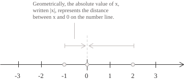

## Definizione

I numeri reali sono i numeri con cui si esprimono grandezze che variano in modo continuo. Il loro insieme si indica con $\mathbb{R}.$ A ogni reale $x$ corrisponde un punto della retta reale, a destra o a sinistra dell'origine a seconda che $x$ sia positivo o negativo, mentre il valore assoluto $|x|$ misura la distanza dall'origine.

Ogni punto ha una sola coordinata reale e la sua posizione rispecchia l'ordine dei numeri, quindi dati due reali $x$ e $y$ se $x\lt y,$ il punto di coordinata $x$ si trova a sinistra di quello di coordinata $y.$ La retta può essere descritta per intervalli, ovvero attraverso porzioni che ne indicano l'ampiezza. Come sappiamo tra gli insiemi numerici vale la seguente catena di inclusioni:

$$
\mathbb{N} \subset \mathbb{Z} \subset \mathbb{Q} \subset \mathbb{R} \subset \mathbb{C}, \qquad \mathbb{I} \subset \mathbb{R} \tag{1}
$$

Nella $(1),$ sia $\mathbb{Q}$ sia $\mathbb{I}$ sono sottoinsiemi di $\mathbb{R}.$ Poiché $\mathbb{I}$ è l'insieme dei reali che non appartengono a $\mathbb{Q},$ i due insiemi sono disgiunti e la loro unione è $\mathbb{R}:$

$$
\mathbb{R} = \mathbb{Q}\cup\mathbb{I}, \qquad \mathbb{Q}\cap\mathbb{I} = \emptyset \tag{2}
$$

A partire da $\mathbb{Q}$ si può costruire $\mathbb{R}$ mediante i tagli di Dedekind o le successioni di Cauchy. La voce sulla costruzione dei numeri reali presenta entrambi i metodi e mostra che i campi ordinati completi così ottenuti sono isomorfi.

- - -

La $(2)$ ripartisce $\mathbb{R}$ in razionali e irrazionali, e per descrivere come questi insiemi si distribuiscono sulla retta reale, consideriamo un intervallo con estremi $x\lt y.$ Per quanto vicini siano $x$ e $y$, esiste sempre un numero razionale $q \in \mathbb{Q}$ tale che:

$$
x\lt q\lt y\tag{3}
$$

Questa proprietà si chiama densità di $\mathbb{Q}$ in $\mathbb{R},$ per cui scegliendo intervalli sempre più piccoli attorno a un punto della retta, possiamo approssimare la sua coordinata reale con dei razionali vicini quanto vogliamo. Ad esempio se applichiamo la $(3)$ all'intervallo $(x-\sqrt{2},y-\sqrt{2}),$ possiamo trovare un razionale $q$ per cui $q+\sqrt{2}$ è compreso fra $x$ e $y.$ Questa somma è irrazionale, perché se fosse razionale anche la differenza $(q+\sqrt{2})-q=\sqrt{2}$ lo sarebbe e dunque anche i numeri irrazionali sono densi in $\mathbb{R}.$ La $(3)$ permette, per esempio, di approssimare $\sqrt{2}$ per difetto con razionali positivi con una serie di approssimazioni che appartengono all'insieme:

$$
S = \{\ q\in\mathbb{Q}\mid q^2\lt 2\ \} \tag{4}
$$

L'insieme $S$ della $(4)$ contiene $1$ e tutti i suoi elementi sono minori di $\sqrt{2},$ che è quindi un maggiorante di $S.$ Un insieme si dice limitato superiormente se ammette un maggiorante, e il minimo dei suoi maggioranti, quando esiste, si chiama estremo superiore. Nel caso di $S,$ nessun reale $m\lt\sqrt{2}$ può essere un maggiorante, perché per la $(3)$ fra $\max\{m,0\}$ e $\sqrt{2}$ c'è un razionale che appartiene a $S$ ed è maggiore di $m.$ Dunque l'estremo superiore di $S$ in $\mathbb{R}$ è $\sqrt{2}.$

Ogni maggiorante razionale $M$ di $S$ è maggiore di $\sqrt{2},$ che è irrazionale, e per la $(3)$ fra i due si trova un maggiorante razionale più piccolo. L'insieme $S$ è quindi limitato superiormente in $\mathbb{Q}$ e privo di estremo superiore in $\mathbb{Q}.$ L'assioma di completezza garantisce che ogni sottoinsieme non vuoto e limitato superiormente di $\mathbb{R}$ ha un estremo superiore in $\mathbb{R}.$

I troncamenti $1.4,1.41,1.414,\ldots$ dello sviluppo decimale di $\sqrt{2}$ appartengono a $S$ e formano una successione di Cauchy di razionali con limite irrazionale $\sqrt{2}.$ Più in generale, la completezza di $\mathbb{R}$ assicura che ogni successione di Cauchy di reali converga in $\mathbb{R}.$

## Proprietà

L'insieme $\mathbb{R}$ gode di una serie di proprietà che sono elencate di seguito, e la prima è quella della chiusura rispetto all'addizione e alla moltiplicazione. Quindi per ogni $a,b\in\mathbb{R}$ valgono le seguenti relazioni:

$$
\begin{align}
a + b &\in \mathbb{R} \notag \\[6pt]
a \cdot b &\in \mathbb{R} \tag{5}
\end{align}
$$

Per la $(5),$ l'addizione e la moltiplicazione sono operazioni binarie su $\mathbb{R},$ perché ciascuna associa a ogni coppia $(a,b)$ di reali un unico risultato reale. Sono anche commutative, perché scambiare i due addendi o i due fattori lascia invariato il risultato:

$$
\begin{align}
a + b &= b + a \notag \\[6pt]
a \cdot b &= b \cdot a \tag{6}
\end{align}
$$

Per questo si dice che i reali sono un campo commutativo. In generale, a differenza della $(6),$ la sottrazione e la divisione non sono commutative, come mostrano i seguenti esempi:

$$
5-2\neq2-5 \qquad \text{e} \qquad \frac{2}{5}\neq\frac{5}{2}
$$

Un'ulteriore proprietà è l'associatività che consente di raggruppare in modi diversi i termini di una somma o di un prodotto senza cambiarne il valore, perciò considerando tre numeri $a,b,c\in\mathbb{R}$ valgono le seguenti uguaglianze:

$$
\begin{align}
a + (b + c) &= (a + b) + c \notag \\[6pt]
a \cdot (b \cdot c) &= (a \cdot b) \cdot c \tag{7}
\end{align}
$$

Anche in questo caso, come per la proprietà commutativa, la sottrazione e la divisione non sono operazioni associative in $\mathbb{R}.$ Infatti si ha:

$$
\begin{align*}
8-(4-2) &= 6 \neq 2 = (8-4)-2 \\[6pt]
16\div(8\div2) &= 4 \neq 1 = (16\div8)\div2
\end{align*}
$$

Infine, per ogni $a,b,c\in\mathbb{R}$ vale la proprietà distributiva:

$$
\begin{align}
a \cdot (b + c) &= a \cdot b + a \cdot c \notag \\[6pt]
(b + c) \cdot a &= b \cdot a + c \cdot a \tag{8}
\end{align}
$$

- - -

I numeri reali hanno un elemento neutro per l'addizione, ovvero lo $0,$ che per ogni $a\in\mathbb{R}$ soddisfa le seguenti identità:

$$
\begin{align}
a + 0 &= a \notag \\[6pt]
0 + a &= a \tag{9}
\end{align}
$$

Dalla $(9)$ deriva che se $a+n=a$ per ogni $a\in\mathbb{R},$ allora $n=0.$ Abbiamo anche un elemento neutro nella moltiplicazione che è pari a $1$ e soddisfa le seguenti uguaglianze per ogni $a\in\mathbb{R}:$

$$
\begin{align}
a \cdot 1 &= a \notag \\[6pt]
1 \cdot a &= a \tag{10}
\end{align}
$$

Per la $(10),$ se $an=a$ per ogni $a\in\mathbb{R},$ allora $n=1.$ Ogni reale $a$ ha anche un opposto $-a$ che soddisfa la seguente identità:

$$
a + (-a) = 0 \tag{11}
$$

Per la $(11),$ se $a+b=0,$ allora $b=-a.$ Infine, ogni $a\in\mathbb{R}$ non nullo ha un inverso moltiplicativo $1/a,$ con $a$ diverso da $0$, che soddisfa la seguente uguaglianza:

$$
a \cdot \frac{1}{a} = 1
$$

Le proprietà di chiusura e associatività e la presenza dell'elemento neutro e dell'opposto fanno di $(\mathbb{R},+)$ un gruppo abeliano e gli assiomi corrispondenti per la moltiplicazione sugli elementi non nulli, insieme alla distributività, fanno di $\mathbb{R}$ un campo.

## Relazione d'ordine

Come abbiamo detto all'inizio, sulla retta reale, $a\lt b$ significa che il punto di coordinata $a$ si trova a sinistra di quello di coordinata $b.$ Scriviamo $a\gt b$ se $b\lt a,$ e con $a\leq b$ e $a\geq b$ ammettiamo anche l'uguaglianza. Il confronto con lo zero distingue i reali positivi da quelli negativi, mentre il valore assoluto $|a|$ misura la distanza di $a$ dall'origine. L'ordine è totale e compatibile con l'addizione e la moltiplicazione, perciò $\mathbb{R}$ è un campo totalmente ordinato. Per la tricotomia, dati due reali $a$ e $b,$ vale esattamente una delle seguenti relazioni:

$$
a\lt b,\qquad a=b,\qquad a\gt b \tag{12}
$$

Per la transitività sappiamo che per ogni terna di reali $a,b,c$ vale l'implicazione:

$$
a\lt b \quad \text{e} \quad b\lt c \quad \Longrightarrow \quad a\lt c \tag{13}
$$

La $(12)$ rende confrontabili due reali e la $(13)$ permette di concatenare i confronti nella forma $a\lt b\lt c.$ L'ordine si conserva anche nell'addizione, infatti aggiungendo lo stesso reale $c$ ai due membri di una disuguaglianza si ottiene:

$$
a\lt b \quad \Longrightarrow \quad a+c\lt b+c \tag{14}
$$

La $(14)$ vale anche per le disuguaglianze non strette e permette di sottrarre la stessa quantità dai due membri aggiungendone l'opposto. Si possono inoltre sommare membro a membro due disuguaglianze dello stesso verso:

$$
a\lt b \quad \text{e} \quad c\lt d \quad \Longrightarrow \quad a+c\lt b+d \tag{15}
$$

La $(15)$ segue dalla $(14)$, che dà $a+c\lt b+c\lt b+d,$ e dalla transitività della $(13).$ Nella moltiplicazione, il verso della disuguaglianza dipende dal segno del fattore $c:$

$$
\begin{align}
a\lt b \ \text{e}\ c\gt 0 &\quad \Longrightarrow \quad ac\lt bc \notag \\[6pt]
a\lt b \ \text{e}\ c\lt 0 &\quad \Longrightarrow \quad ac\gt bc \tag{16}
\end{align}
$$

La $(16)$ vale anche per le disuguaglianze non strette e per la divisione, perché dividere per un numero non nullo equivale a moltiplicare per il suo reciproco, che ha lo stesso segno. Se $0\lt a\lt b,$ dalla prima riga della $(16)$ con $c=1/(ab)$ si ottiene $0\lt 1/b\lt 1/a.$

Applicando la $(16)$ al confronto fra un fattore e lo zero, si ricava che il prodotto di due reali non nulli è positivo se i fattori hanno lo stesso segno e negativo se hanno segni opposti, mentre il prodotto è zero se almeno uno dei fattori è zero. Ne segue che il quadrato di un reale è sempre non negativo e si annulla soltanto in zero. La fattorizzazione nella $(17)$ mostra inoltre che l'elevamento al quadrato è strettamente crescente sui non negativi, perché per $0\leq a\lt b$ entrambi i fattori $b-a$ e $b+a$ sono positivi:

$$
b^2-a^2 = (b-a)(b+a) \gt 0 \qquad (0\leq a\lt b) \tag{17}
$$