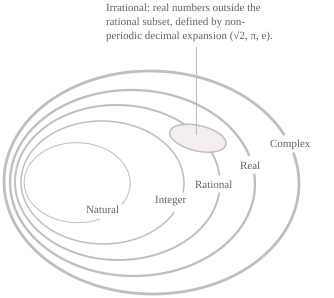

## Organizzazione dei numeri

I numeri sono organizzati in famiglie, ciascuna delle quali estende la precedente con quantità che quest'ultima non può rappresentare. I principali insiemi numerici, in ordine di inclusione, sono i numeri naturali $\mathbb{N},$ gli interi $\mathbb{Z},$ i numeri razionali $\mathbb{Q},$ i numeri reali $\mathbb{R}$ e i numeri complessi $\mathbb{C}.$ Abbiamo poi i numeri irrazionali $\mathbb{I},$ che rappresentano il complemento dei numeri razionali rispetto a $\mathbb{R}.$ Le relazioni di inclusione tra gli insiemi sono le seguenti:

$$
\mathbb{N} \subset \mathbb{Z} \subset \mathbb{Q} \subset \mathbb{R} \subset \mathbb{C}, \qquad \mathbb{I} \subset \mathbb{R} \tag{1}
$$

Oltre alle relazioni di inclusione della $(1)$ esiste un'ulteriore suddivisione, ovvero tra i numeri reali, tutti i razionali e alcuni irrazionali come $\sqrt{2}$ sono detti numeri algebrici e formano l'insieme $\mathbb{A},$ mentre gli altri irrazionali come $\pi$ ed $e$ si chiamano trascendenti. L'insieme dei numeri naturali, indicato con $\mathbb{N},$ comprende gli interi non negativi con cui si contano quantità discrete e può essere rappresentato come segue:

$$
\mathbb{N} = \{0, 1, 2, 3, 4, \ldots\} \tag{2}
$$

A partire da $0,$ si ottiene ogni naturale successivo aggiungendo uno al precedente, e si parla di numeri cardinali quando si usano i naturali per indicare quanti elementi contiene un insieme. Le due convenzioni più comuni per $\mathbb{N},$ che differiscono per l'inclusione dello zero, sono le seguenti.

$$ \tag{3}
\begin{align}
&\mathbb{N}_0 = \{0, 1, 2, 3, \ldots\} \\[6pt]
&\mathbb{N}^+ = \{1, 2, 3, \ldots\}
\end{align}
$$

Una particolarità dell'insieme $\mathbb{N}$ è che rappresenta il più piccolo sottoinsieme induttivo di $\mathbb{R}.$ Infatti, contiene lo $0$ e, ogni volta che contiene un elemento $n,$ contiene anche l'elemento $n+1$ (proprietà su cui si basa il principio di induzione matematica). L'insieme dei numeri interi è invece indicato con $\mathbb{Z}$ ed estende $\mathbb{N}$ aggiungendo l'opposto di ogni naturale positivo e, simmetricamente alla $(2),$ può essere rappresentato come segue:

$$ \tag{4}
\mathbb{Z} = \{\ldots, -3, -2, -1, 0, 1, 2, 3, \ldots\}
$$

L'insieme $\mathbb{Z}$ si può anche scrivere nella seguente formulazione:

$$ \tag{5}
\mathbb{Z} = \mathbb{N} \cup \{-n : n \in \mathbb{N}^+\}
$$

Anche per $\mathbb{Z}$ ci sono delle convenzioni di rappresentazione che intervengono quando occorre specificare il segno o escludere lo zero. In questi casi si usano i seguenti sottoinsiemi:

$$ \tag{6}
\begin{align}
\mathbb{Z}^+ &= \{1, 2, 3, \ldots\} \\[6pt]
\mathbb{Z}^- &= \{-1, -2, -3, \ldots\} \\[6pt]
\mathbb{Z}^* &= \mathbb{Z} \setminus \{0\}
\end{align}
$$

Il passaggio da $\mathbb{N}$ a $\mathbb{Z}$ rende l'operazione di sottrazione sempre definita. Quindi, per ogni $a,b\in\mathbb{Z},$ la differenza $a-b$ è ancora un intero. Una sottrazione come $3-5,$ che non ha un risultato in $\mathbb{N},$ dà $-2$ in $\mathbb{Z}.$ Dal punto di vista algebrico, $(\mathbb{Z},+)$ è un gruppo abeliano e $(\mathbb{Z},+,\cdot)$ è un anello commutativo con unità. Le proprietà di questo insieme sono trattate nella voce sui numeri interi. Vediamo ora l'insieme dei numeri razionali, indicato con $\mathbb{Q},$ che comprende tutti i numeri esprimibili come rapporto di due interi con denominatore diverso da zero. L'insieme può essere rappresentato come segue:

$$ \tag{7}
\mathbb{Q} = \left \{ \frac{p}{q} : p, q \in \mathbb{Z}, \ q \neq 0 \right\}
$$

Ogni numero intero è anche razionale, poiché ogni $n\in\mathbb{Z}$ si può scrivere come $n/1.$ I numeri razionali possono avere uno sviluppo decimale che dipende dall'esito della divisione tra $p$ e $q$ e può essere finito oppure periodico da una certa cifra in poi (per esempio, $1/4=0.25$ e $1/3=0.\overline{3}$). Il passaggio da $\mathbb{Z}$ a $\mathbb{Q}$ rende la divisione per qualsiasi intero non nullo sempre definita. In termini algebrici, $\mathbb{Q}$ è il più piccolo campo che contiene $\mathbb{Z}$ e si costruisce aggiungendo un inverso moltiplicativo a ogni intero non nullo.

- - -

I numeri reali sono i numeri rappresentati dai punti della retta reale. Il loro insieme si indica con $\mathbb{R}$ e comprende tutti i razionali e gli irrazionali. Ogni numero reale ammette una rappresentazione decimale della forma seguente:

$$ \tag{8}
\pm m.\alpha_0 \ \alpha_1 \ \alpha_2 \ \alpha_3 \ldots
$$

Nella $(8),$ $m\in\mathbb{N}_0$ è la parte intera del valore assoluto, $\alpha_0,\alpha_1,\alpha_2,\ldots$ sono le cifre decimali e il segno si applica all'intera rappresentazione decimale. L'insieme $\mathbb{R}$ ha una serie di proprietà. La prima consiste nel fatto che l'insieme è totalmente ordinato, cioè, dati due reali $x$ e $y,$ vale esattamente una delle relazioni:

$$ \tag{9}
\begin{align}
x &\lt y \\[6pt]
x &= y \\[6pt]
x &\gt y
\end{align}
$$

La proprietà archimedea di $\mathbb{R}$ garantisce che per ogni reale $x$ esiste un numero naturale $n$ tale che $n\gt x.$ Se $x$ è positivo, per quanto piccolo sia, possiamo applicare la proprietà al suo reciproco e scegliere $n\gt1/x$ in modo da avere $1/n\lt x,$ come quando prendiamo ad esempio $n=10^{101}$ per $x=10^{-100}.$

Un'altra proprietà di $\mathbb{R}$ è che tra due numeri reali distinti, per quanto vicini, si trova sempre almeno un numero razionale e si dice perciò che i numeri razionali sono densi in $\mathbb{R}.$ Un'altra differenza tra $\mathbb{Q}$ e $\mathbb{R}$ riguarda la cardinalità. I razionali sono numerabili, cioè si possono mettere in corrispondenza biunivoca con $\mathbb{N},$ mentre i reali non lo sono. Un numero reale è irrazionale se non si può scrivere come frazione $p/q$ con $p$ e $q$ interi e $q\neq0.$ L'insieme $\mathbb{I}$ degli irrazionali è quindi il complemento di $\mathbb{Q}$ in $\mathbb{R}$ e ogni numero reale appartiene a uno solo dei due insiemi, per cui si ha:

$$
\begin{align}
& \mathbb{R} = \mathbb{Q} \cup \mathbb{I} \notag \\[6pt]
& \mathbb{Q} \cap \mathbb{I} = \emptyset \tag{10}
\end{align}
$$

Tra due numeri reali distinti, per quanto vicini, si trova sempre almeno un irrazionale e dunque anche $\mathbb{I}$ è denso in $\mathbb{R}.$ Un'altra caratteristica degli irrazionali è che il loro sviluppo decimale prosegue all'infinito senza diventare periodico come nel caso dei seguenti numeri:

$$
\sqrt{2}, \quad \sqrt{3}, \quad \pi, \quad e, \quad -\sqrt[3]{5} \tag{11}
$$

I numeri nella $(11)$ introducono una seconda classificazione dei numeri reali. Un reale è un numero algebrico se è radice di almeno un polinomio non nullo a coefficienti razionali. Altrimenti si dice trascendente. Se $\mathbb{A}$ indica l'insieme dei reali algebrici, i reali trascendenti formano il suo complemento in $\mathbb{R}.$ Come nella $(10),$ i due insiemi sono disgiunti e la loro unione è tutto $\mathbb{R},$ per cui possiamo scrivere:

$$
\begin{align}
&\mathbb{R} = \mathbb{A} \cup (\mathbb{R} \setminus \mathbb{A}) \notag \\[6pt]
&\mathbb{A} \cap (\mathbb{R} \setminus \mathbb{A}) = \emptyset \tag{12}
\end{align}
$$

Ogni numero razionale $p/q$ è anche un numero algebrico perché è radice del polinomio lineare $qx-p.$ Tra gli irrazionali della $(11),$ oltre a $\sqrt{2}$ è algebrico anche $-\sqrt[3]{5},$ che è radice di $x^3+5.$ L'insieme $\mathbb{A}$ contiene quindi tutti i razionali e una parte degli irrazionali.

$$
\begin{align}
&\mathbb{Q} \subset \mathbb{A} \notag \\[6pt]
&\mathbb{A} \setminus \mathbb{Q} \subset \mathbb{I} \tag{13}
\end{align}
$$

Gli altri irrazionali, tra cui $\pi$ ed $e,$ sono trascendenti.

- - -

Vediamo infine l'insieme dei numeri complessi, indicato con $\mathbb{C},$ che estende $\mathbb{R}$ introducendo un elemento $i$ tale che valga la seguente identità:

$$i^2=-1 \tag{14}$$

Il passaggio a $\mathbb{C}$ permette di estrarre radici quadrate di numeri negativi e, più in generale, di scomporre ogni polinomio in fattori lineari. Ogni numero complesso si scrive in forma algebrica come:

$$
z = a + bi \tag{15}
$$

Nella $(15)$ $a$ e $b$ sono numeri reali, detti rispettivamente parte reale e parte immaginaria di $z.$ Se $b=0,$ il numero si riduce a un reale, quindi $\mathbb{R}\subset\mathbb{C}.$ Esistono poi ulteriori rappresentazioni dei numeri complessi in forma trigonometrica ed esponenziale che sono trattati nelle voci dedicate.
