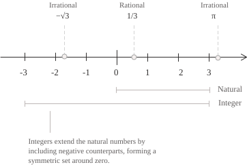

## Definition

The integers extend the [natural numbers](../natural-numbers/) by adjoining the additive inverse of each positive natural number. The set is denoted by $\mathbb{Z}$ and is written as follows.

$$ \tag{1}
\mathbb{Z} = \{\ldots,-3,-2,-1,0,1,2,3,\ldots\}
$$

The set $\mathbb{Z}$ can also be written as:

$$ \tag{2}
\mathbb{Z} = \mathbb{N} \cup \{-n : n \in \mathbb{N}^+\}
$$

Thus $\mathbb{N}$ is a proper subset of $\mathbb{Z}$ because it contains all the nonnegative integers and excludes the negative integers. The two sets have the same [cardinality](../cardinality-and-countable-sets/) because, if we list the integers in the order $0,-1,1,-2,2,-3,3,\ldots$ and number the positions starting at zero, each natural number corresponds to the integer in that position and every integer appears exactly once. This gives a [bijection](../injective-surjective-and-bijective-functions/) between $\mathbb{N}$ and $\mathbb{Z},$ so the two sets have the same cardinality. Further notation is useful when we need to specify the sign of an integer or exclude zero. In these cases, we use the following subsets:

$$ \tag{3}
\begin{align}
\mathbb{Z}^+ &= \{1, 2, 3, \ldots\} \\[6pt]
\mathbb{Z}^- &= \{-1, -2, -3, \ldots\} \\[6pt]
\mathbb{Z}^* &= \mathbb{Z} \setminus \{0\}
\end{align}
$$

Geometrically, the integers form an infinite set of equally spaced points on the number line.

More formally, the construction of $\mathbb{Z}$ defines each integer as a class of [ordered pairs](../cartesian-product/) $(a,b)$ of natural numbers. Two pairs belong to the same class when they satisfy the following condition:

$$ \tag{4}
(a,b) \sim (c,d) \quad \longleftrightarrow \quad a + d = b + c
$$

The pair $(a,b)$ represents the difference $a-b.$ To see where condition $(4)$ comes from, start with the equality $a-b=c-d.$ Adding $b+d$ to both sides gives $a+d=b+c.$ We can therefore determine whether two pairs represent the same integer by comparing two sums of natural numbers. Comparing $a$ and $b$ determines the sign of the integer represented by $(a,b),$ with the pair belonging to the zero class if $a=b,$ the difference being positive if $a\gt b,$ and negative if $a\lt b.$ For example, consider the pair $(2,5)$ of natural numbers. Since the second component is greater than the first, the pair represents the negative integer $-3.$

When two pairs represent the same integer, we say they belong to the same [equivalence class](../sets/). For example, to check that $(4,7)$ and $(2,5)$ belong to the same class, we apply $(4)$ and find that the sums to compare are $4+5$ and $7+2,$ both of which equal $9.$

The relation defined by $(4)$ is reflexive because $a+b=b+a,$ so each pair is equivalent to itself. It is also symmetric because if $a+d=b+c,$ then $c+b=d+a$ and the two pairs can be interchanged. For transitivity, suppose that $(a,b)\sim(c,d)$ and $(c,d)\sim(e,f).$ By $(4),$ we have $a+d=b+c$ and $c+f=d+e.$ Adding the equations and canceling $c+d$ from both sides leaves $a+f=b+e.$ By $(4),$ this means that $(a,b)\sim(e,f).$

Write $[(a,b)]$ for the equivalence class of $(a,b)$ and consider how to add two classes. Addition is defined by:

$$ \tag{5}
[(a,b)]+[(c,d)] := [(a+c,b+d)]
$$

For multiplication, we first expand $(a-b)(c-d)$ and then group the terms as $(ac+bd)-(ad+bc).$ The product is therefore given by:

$$ \tag{6}
[(a,b)][(c,d)] := [(ac+bd,ad+bc)]
$$

We show that the sum $(5)$ and product $(6)$ are well defined, meaning that the resulting class is the same regardless of the representatives chosen. For example, fix $(c,d)$ and take two equivalent representatives $(a,b)$ and $(a',b').$ By $(4),$ we have:

$$a+b'=b+a'\tag{7}$$

For addition, we add $c+d$ to both sides of $(7)$ and rearrange the terms to obtain:

$$ \tag{8}
(a+c)+(b'+d)=(b+d)+(a'+c)
$$

Thus $(8)$ verifies condition $(4)$ for the two pairs obtained by addition. For multiplication, we multiply $a+b'=b+a'$ by $c$ and by $d,$ then reverse the sides of the second equation to obtain:

$$ \tag{9}
\begin{align}
ac+b'c &= bc+a'c \\[6pt]
bd+a'd &= ad+b'd
\end{align}
$$

Adding the two equations in $(9)$ and grouping the terms gives:

$$ \tag{10}
(ac+bd)+(a'd+b'c)=(ad+bc)+(a'c+b'd)
$$

As with addition, $(10)$ verifies condition $(4)$ for the two pairs obtained by multiplication. By the symmetry of formulas $(5)$ and $(6),$ the same argument applies when we change the second representative.

- - -

To see how the construction using pairs extends the natural numbers, we associate each natural number $n$ with the class of the pair $(n,0)$ by the following map:

$$ \tag{11}
n \longmapsto [(n,0)]
$$

By $(4),$ the pairs $(n,0)$ and $(m,0)$ are equivalent only if $n=m.$ Applying $(5)$ and $(6)$ to pairs with second component zero gives the usual sum and product of natural numbers. We can therefore identify $\mathbb{N}$ with these classes in $\mathbb{Z},$ with $0=[(0,0)]$ and $1=[(1,0)]$ in particular. Interchanging the components of $(a,b)$ gives the additive inverse. Indeed, by $(5),$ the sum of the two classes is the zero class:

$$ \tag{12}
[(a,b)]+[(b,a)]=[(a+b,a+b)]=0
$$

If $a\gt b,$ equation $(4)$ shows that $(a,b)$ is equivalent to $(a-b,0),$ since $a=b+(a-b).$ If $a\lt b,$ we apply the same argument to $(b,a)$ and take the additive inverse. If $a=b,$ the pair belongs to the zero class. This gives three forms, depending on the sign of the integer represented.

$$ \tag{13}
[(a,b)]=
\begin{cases}
[(a-b,0)] & \text{if } a\gt b \\[6pt]
0 & \text{if } a=b \\[6pt]
-[(b-a,0)] & \text{if } a\lt b
\end{cases}
$$

## The integers as a ring

We have seen that $(5)$ and $(6)$ define the sum and product of two integers and that the result is an integer in both cases. For addition, $(5)$ gives associativity, commutativity, and the identity element $0,$ while $(12)$ shows that every integer has an additive inverse. Thus, for every $a,b,c\in\mathbb{Z},$ the following equalities hold:

$$ \tag{14}
\begin{align}
(a+b)+c &= a+(b+c) \\[6pt]
a+b &= b+a \\[6pt]
a+0 &= a \\[6pt]
a+(-a) &= 0
\end{align}
$$

The properties in $(14)$ make $(\mathbb{Z},+)$ an [abelian group](../groups/). Rules $(5)$ and $(6)$ also give the following properties of multiplication, which hold for all integers $a,b,c:$

$$ \tag{15}
\begin{align}
(ab)c &= a(bc) \\[6pt]
ab &= ba \\[6pt]
a\cdot1 &= a \\[6pt]
a(b+c) &= ab+ac
\end{align}
$$

By $(13),$ every nonzero integer is either a positive natural number or its additive inverse. The absolute value of the product of two nonzero integers is therefore the product of two positive natural numbers. In particular, the product is nonzero and can equal $1$ only if both factors have absolute value $1.$ The only integers with a multiplicative inverse are therefore $1$ and $-1.$ In a [field](../fields/) such as $\mathbb{Q}$ or $\mathbb{R},$ every nonzero element has a multiplicative inverse. In $\mathbb{Z},$ even $2$ has no multiplicative inverse, so $\mathbb{Z}$ is not a field.

The absence of zero divisors allows us to cancel a nonzero factor. If $ab=ac,$ the distributive law in $(15)$ gives the following equality:

$$ \tag{16}
a(b-c)=ab-ac=0
$$

If $a\neq0,$ equation $(16)$ gives $b-c=0,$ so $b=c.$ The properties in $(14)$ and $(15)$ thus establish that $\mathbb{Z}$ is a [commutative ring](../rings/) with identity $1.$ The absence of zero divisors makes it an integral domain.

## Properties

We now describe the fundamental properties of the integers, beginning with how the operations preserve equality. If $a=b,$ we can add the same integer $c$ to both sides or multiply both sides by $c$ to obtain:

$$ \tag{17}
\begin{align}
a+c &= b+c \\[6pt]
ac &= bc
\end{align}
$$

The commutative and associative laws in $(14)$ and $(15)$ allow us to change the order and grouping of the terms in a sum or the factors in a product. These formulas also identify $0$ as the additive identity and $1$ as the multiplicative identity. The distributive law allows us to expand a product or factor out a common factor, as in $(16).$ Divisibility is another property that tells us when one integer is a multiple of another. Given two integers $a$ and $b,$ we say that $b$ divides $a$ and write $b\mid a$ if there is an integer $q$ satisfying the following equality:

$$ \tag{18}
a=bq
$$

In this case, $b$ is a divisor of $a$ and $a$ is a multiple of $b.$ If $b\neq0,$ the integer $q$ is the [quotient of the division](../euclidean-division/), which has no remainder. In $(18),$ we can take $q=0$ to see that every integer divides $0,$ or $q=1$ to see that every integer divides itself. If $b=0,$ equation $(18)$ forces $a=0,$ so $0$ divides only $0.$ Divisibility is transitive because if $a\mid b$ and $b\mid c,$ then by $(18)$ we can write $b=au$ and $c=bv$ with $u,v\in\mathbb{Z}.$ Substituting $b=au$ into the expression for $c$ gives the following equality:

$$ \tag{19}
c=bv=(au)v=a(uv)
$$

Since $uv$ is an integer, $(19)$ shows that $a\mid c.$ If $a$ divides both $b$ and $c,$ we write $b=au$ and $c=av.$ For every $s,t\in\mathbb{Z},$ the distributive law in $(15)$ lets us factor out $a$ to obtain:

$$ \tag{20}
sb+tc=s(au)+t(av)=a(su+tv)
$$

Equation $(20)$ shows that $a$ divides every combination $sb+tc$ with integer coefficients. Finally, if $a\mid b$ and $b\mid a,$ we can write $b=au$ and $a=bv.$ If $a=0,$ then $b=0$ as well. For $a\neq0,$ we substitute $b=au$ into the second equality.

$$ \tag{21}
a=bv=(au)v=a(uv)
$$

By the cancellation illustrated in $(16),$ equation $(21)$ gives $uv=1.$ Since the only invertible integers are $1$ and $-1,$ it follows from $b=au$ that $b=a$ or $b=-a.$ Divisibility underlies the [fundamental theorem of arithmetic](../fundamental-theorem-of-arithmetic/), which states that every integer $n\gt1$ has a factorization into positive primes that is unique up to the order of the factors. For $n\lt-1,$ factor $|n|$ and multiply the result by $-1.$

## Order on the integers

The distinction in $(13)$ between positive integers, negative integers, and zero lets us compare two integers and determine, for example, whether $a$ is less than or equal to $b.$ We have $a\leq b$ if and only if subtracting the first integer from the second gives a nonnegative result, that is:

$$ \tag{22}
a\leq b \quad\Longleftrightarrow\quad b-a\in\mathbb{N}
$$

On $\mathbb{Z},$ the relation in $(22)$ is reflexive because $a-a=0.$ It is also antisymmetric because $b-a$ and $a-b$ can both be nonnegative only if they are zero. The relation is transitive as well because if $a\leq b$ and $b\leq c,$ then the difference $c-a=(c-b)+(b-a)$ is a sum of nonnegative integers. Finally, the sign of $b-a$ determines which of the three possibilities $a\lt b,$ $a=b,$ and $b\lt a$ holds. Thus $(22)$ defines a total order on $\mathbb{Z}.$ The field $\mathbb{C}$ admits no total order compatible with addition and multiplication in the sense of $(23).$

We now examine how this order is compatible with the ring operations. Adding the same integer $c$ to $a$ and $b$ leaves their difference unchanged. If we multiply both numbers by $c,$ the distributive law in $(15)$ gives $bc-ac=c(b-a),$ which is nonnegative when $c\geq0$ and $a\leq b.$ This gives the following implications:

$$ \tag{23}
\begin{align}
a\leq b &\ \Longrightarrow\ a+c\leq b+c \\[6pt]
a\leq b,\ c\geq0 &\ \Longrightarrow\ ac\leq bc
\end{align}
$$

The set $\mathbb{Z}$ has no least element because for every integer $a,$ the integer $a-1$ is smaller than $a.$ However, every nonempty subset $S$ of $\mathbb{Z}$ with an integer lower bound $m$ has a least element. Subtracting $m$ from each element of $S$ gives a subset of $\mathbb{N}$ that has a least element by the well-ordering principle. Adding $m$ back to that element gives the least element of $S$ by the first implication in $(23).$

The well-ordering principle for $\mathbb{N}$ is equivalent to the [principle of mathematical induction](../principle-of-mathematical-induction/). To prove a property $P$ for all integers, we can use induction on $n\in\mathbb{N}$ to prove both $P(n)$ and $P(-n).$ The first covers the nonnegative integers and the second covers the nonpositive integers. The [absolute value](../absolute-value/) $|a|$ is the distance of the integer $a$ from zero. If $a$ is negative, this distance is its additive inverse, as described in $(12).$

$$ \tag{24}
|a|=\begin{cases}
a & \text{if } a\geq0 \\[6pt]
-a & \text{if } a\lt0
\end{cases}
$$

Equation $(24)$ shows that $|a|$ is the maximum of $a$ and $-a,$ so opposite integers are at the same distance from zero.
