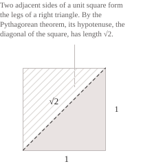

## Definition

A real number is irrational if it cannot be written as a ratio of [two integers](../integers/) with a nonzero denominator. The set $\mathbb{I}$ of irrational numbers is therefore the complement of the [rational numbers](../rational-numbers/) $\mathbb{Q}$ in $\mathbb{R}$ and can be written as follows:

$$
\mathbb{I} = \mathbb{R}\setminus\mathbb{Q} = \{x \in \mathbb{R} \mid x \notin \mathbb{Q}\} \tag{1}
$$

It follows from $(1)$ that every real number belongs to exactly one of the two sets $\mathbb{Q}$ and $\mathbb{I},$ so the following identities express that $\mathbb{Q}$ and $\mathbb{I}$ form a [partition](../sets/) of the [real line](../real-numbers/).

$$
\mathbb{R} = \mathbb{Q} \cup \mathbb{I}, \qquad \mathbb{Q} \cap \mathbb{I} = \emptyset \tag{2}
$$

For example, $1/2$ and $0.75=3/4$ are rational, whereas $\sqrt{2}$ is irrational. The number $\sqrt{2}$ is of particular interest because the discovery of irrational numbers is linked to the problem of finding the length of the diagonal of a unit square. By the [Pythagorean theorem](../pythagorean-theorem/), the length $d$ of the diagonal of a square with side length $1$ satisfies the following relation:

$$
d^2 = 1^2 + 1^2 = 2 \tag{3}
$$

By $(3),$ the diagonal has length $d=\sqrt{2}.$ To prove that this length is irrational, we need only the properties of even and odd integers.

Suppose for contradiction that $\sqrt{2}$ is rational, so that we can write it as a ratio of two integers $p$ and $q,$ with $q\neq0,$ choosing a [fraction in lowest terms](../greatest-common-divisor/):

$$
\sqrt{2} = \frac{p}{q} \tag{4}
$$

Squaring both sides of $(4)$ and multiplying by $q^2$ gives:

$$
p^2 = 2q^2 \tag{5}
$$

Equation $(5)$ shows that $p^2$ is even, and since the square of an odd integer is odd, $p$ is even as well and can be written as $p=2k$ for some integer $k.$ Substituting this expression into $(5)$ gives $4k^2=2q^2,$ and dividing by $2$ yields:

$$
q^2 = 2k^2 \tag{6}
$$

By $(6),$ $q^2$ is also even, so $q$ is even. The integers $p$ and $q$ therefore share the divisor $2,$ contradicting our choice of a fraction in lowest terms in $(4).$ It follows that $\sqrt{2}$ is irrational.

- - -

We know that a real number is rational if and only if its [decimal expansion is eventually periodic](../rational-numbers/). In general, terminating decimal expansions also satisfy this criterion, since zeros can be appended after the last digit. Irrational numbers, by contrast, have infinite decimal expansions that never become periodic. Consider the following example:

$$
x = 0.101001000100001000001\ldots \tag{7}
$$

The number $x$ in $(7)$ is irrational because the number of zeros between successive $1$s grows without bound. If the expansion were eventually periodic, each repetition of the period would have to contain at least one $1,$ since $1$s keep appearing, and the runs of zeros would then have bounded length. The expansion $\sqrt{2}=1.41421356\ldots$ also shows how an irrational number can be approximated by rational numbers by truncating its decimal expansion to obtain bounds such as:

$$
1.414 \lt \sqrt{2} \lt 1.415 \tag{8}
$$

As in $(8),$ truncating the expansion to $n$ decimal places approximates $\sqrt{2}$ from below with an error of less than $10^{-n}.$

- - -

Irrational numbers can be divided into two disjoint classes according to an algebraic criterion. A real number is algebraic if it is a root of a [nonzero polynomial](../polynomials/) with integer coefficients, and transcendental otherwise. Every rational number $p/q$ is algebraic because it is a root of the polynomial $qx-p,$ so every [transcendental number](../types-of-numbers/) is irrational.

Returning to $\sqrt{2},$ we see that it is algebraic because it is a root of $x^2-2.$ More generally, the [square root](../radicals/) $\sqrt{n}$ of a positive integer $n$ is irrational if $n$ is not a perfect square, as in the cases of $\sqrt{2},$ $\sqrt{3},$ $\sqrt{5},$ $\sqrt{6},$ $\sqrt{7},$ $\sqrt{8},$ and $\sqrt{10}.$ The same criterion applies to cube roots, with perfect cubes in place of perfect squares.

More generally, consider $k\geq2$ and a positive integer $n$ that is not a perfect $k$th power. The [prime factorization](../fundamental-theorem-of-arithmetic/) of $n$ contains a prime whose exponent is not divisible by $k.$ If $\sqrt[k]{n}=p/q$ for two coprime positive integers $p,q,$ then:

$$p^k=nq^k \tag{9}$$

In $(9),$ compare the exponents of the prime selected from the factorization of $n.$ Its exponent in $p^k$ is a multiple of $k$ because raising $p$ to the $k$th power multiplies every exponent by $k.$ In $nq^k,$ the exponent of the prime in $n$ is added to its exponent in $q^k,$ which is a multiple of $k.$ The sum therefore remains indivisible by $k.$ Since equal integers have the same exponents in their prime factorizations, $(9)$ cannot hold. Thus $\sqrt[k]{n}$ is irrational.

The number $\pi,$ which is the ratio of a circle's [circumference](../circumference/) to its diameter, and the number $e,$ which is the base of the [natural logarithm](../logarithms/), are both transcendental.

## Operations with irrational numbers

We now examine how arithmetic operations behave on irrational numbers, starting with addition and multiplication, both of which can give rational results. For example, $\sqrt{2},$ $-\sqrt{2},$ and $\sqrt{8}$ are all irrational, but the following operations give rational results:

$$
\begin{aligned}
\sqrt{2} + (-\sqrt{2}) &= 0 \\[6pt]
\sqrt{2}\cdot\sqrt{2} &= 2 \\[6pt]
\sqrt{2}\cdot\sqrt{8} &= 4
\end{aligned} \tag{10}
$$

Equation $(10)$ shows that $\mathbb{I}$ is closed under neither addition nor multiplication. Thus, under the operations inherited from the real numbers, $\mathbb{I}$ is neither an [additive group](../groups/) nor a [ring](../rings/). Now consider $q\in\mathbb{Q}$ and $\xi\in\mathbb{I}.$ The sum $q+\xi$ is always irrational, and the product $q\xi$ is irrational when $q\neq0.$ To see why, we can isolate $\xi$ in each expression, starting with the sum:

$$
\xi=(q+\xi)-q \tag{11}
$$

If $q+\xi$ were rational, $(11)$ would imply that $\xi$ is rational as the difference of two rational numbers. For the product, if $q\neq0,$ we can divide by $q$ to obtain:

$$
\xi=\frac{q\xi}{q} \tag{12}
$$

If $q\xi$ were rational, $(12)$ would imply that $\xi$ is rational as the quotient of two rational numbers.

## Density and cardinality

The irrational numbers are dense in $\mathbb{R},$ meaning that every [open interval](../intervals/) $(x,y)$ with $x\lt y$ contains at least one irrational number. To find one, we look for a rational number $q$ such that $q+\sqrt{2}$ lies in $(x,y).$ By the [density of the rational numbers](../topology-of-the-real-line/), there is a $q\in\mathbb{Q}$ such that:

$$
x - \sqrt{2} \lt q \lt y - \sqrt{2} \tag{13}
$$

Adding $\sqrt{2}$ to all three terms in $(13)$ gives:

$$
x \lt q+\sqrt{2} \lt y \tag{14}
$$

By the property proved using $(11),$ the number $q+\sqrt{2}$ is irrational, and $(14)$ shows that it belongs to $(x,y).$ More generally, every nonempty open interval contains infinitely many pairwise disjoint open subintervals. Since each contains at least one irrational and at least one rational number, the original interval contains infinitely many numbers of each kind.

As for cardinality, $\mathbb{Q}$ is countable, and if $\mathbb{I}$ were also countable, then by $(2)$ the set $\mathbb{R}$ would be the union of [two countable sets](../cardinality-and-countable-sets/). Since $\mathbb{R}$ is uncountable, $\mathbb{I}$ must be uncountable as well. By $(2),$ adding the countable set $\mathbb{Q}$ to $\mathbb{I}$ gives $\mathbb{R}.$ Adding a countable set to an infinite set leaves its cardinality unchanged, so $\mathbb{I}$ and $\mathbb{R}$ have the same cardinality.

The set $\mathbb{A}$ of algebraic numbers is also countable. For example, the set of nonzero polynomials with integer coefficients is countable, and each such polynomial has finitely many real roots. The set $\mathbb{A}$ is therefore a countable union of finite sets and contains all rational numbers. If its complement $\mathbb{R}\setminus\mathbb{A}$ were also countable, the entire real line would be countable, so the set of transcendental numbers is uncountable.
