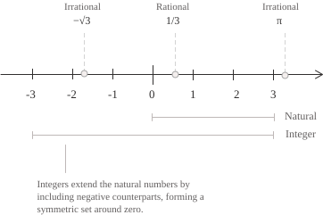

## Definition

The ratio of two [integers](../integers/) $p$ and $q,$ with $q\neq 0,$ is a rational number, and the set of all such numbers is denoted by $\mathbb{Q}:$

$$
\mathbb{Q} := \left\{\ \frac{p}{q} \mid p,q \in \mathbb{Z},\ q \neq 0\ \right\} \tag{1}
$$

In the fraction in $(1),$ $p$ is the numerator and $q$ is the denominator, which must be nonzero because division by zero is undefined. Since every integer $n$ can be written as $n/1,$ equation $(1)$ also shows that every integer is rational. Since every [natural number](../natural-numbers/) is an integer, we obtain the following chain of inclusions:

$$
\mathbb{N} \subset \mathbb{Z} \subset \mathbb{Q} \tag{2}
$$

The last inclusion in $(2)$ is proper, as shown by the quotient $1/2,$ which belongs to $\mathbb{Q}$ but lies outside $\mathbb{Z}.$

To construct the set $\mathbb{Q}$ defined in $(1),$ we start with the pairs of integers that can be the numerator and denominator of a fraction. As in the construction of $\mathbb{Z}$ from pairs of natural numbers, different pairs can represent the same number. We therefore collect all pairs of integers with a nonzero second component in $P$ and write:

$$
P = \{\ (p, q) \in \mathbb{Z} \times \mathbb{Z} \mid q \neq 0\ \} \tag{3}
$$

Given two pairs $(p,q)$ and $(r,s)$ in the set defined in $(3),$ we regard them as equivalent if multiplying the first component of each by the second component of the other gives the same integer. Equality of these products thus lets us compare the pairs using only multiplication in $\mathbb{Z}:$

$$
(p, q) \sim (r, s) \quad \longleftrightarrow \quad ps = qr \tag{4}
$$

The symbol $\sim$ in $(4)$ denotes the relation between the pairs. Since this relation is reflexive, symmetric, and transitive, it partitions the pairs in $P$ into [equivalence classes](../sets/). Each class is a rational number, and the set of all these classes is called the quotient of $P$ by the relation $\sim:$

$$
\mathbb{Q} := P / {\sim} \tag{5}
$$

In the quotient in $(5),$ the fraction $p/q$ denotes the class of the pair $(p,q).$ For example, to determine whether $(4,6)$ and $(-6,-9)$ represent the same rational number as $(2,3),$ we apply $(4)$ to each of the two pairs and obtain the equivalent representations:

$$
\begin{aligned}
2 \cdot 6 &= 12 = 3 \cdot 4 \\[6pt]
2 \cdot (-9) &= -18 = 3 \cdot (-6)
\end{aligned} \tag{6}
$$

## Reduction to lowest terms

Among the pairs that represent the same rational number, exactly one pair $(p,q)$ has a positive second component and coprime components. The fraction $p/q$ associated with this pair is said to be in lowest terms and satisfies:

$$
\gcd(p,q) = 1, \qquad q \gt 0 \tag{7}
$$

To obtain a fraction that satisfies $(7),$ we divide the numerator and denominator by their [greatest common divisor](../greatest-common-divisor/). If the resulting denominator is negative, we change the signs of both terms. For example, the greatest common divisor for $18/24$ is $6,$ and for $-15/35$ it is $5.$

$$
\begin{aligned}
\frac{18}{24} &= \frac{18/6}{24/6} = \frac{3}{4} \\[6pt]
\frac{-15}{35} &= \frac{-15/5}{35/5} = \frac{-3}{7}
\end{aligned} \tag{8}
$$

Both fractions obtained in $(8)$ satisfy $(7).$ To see why the reduced form is unique, suppose that two fractions $p/q$ and $r/s$ satisfy $(7)$ and represent the same rational number. By $(4),$ we have $ps=qr.$ Since $q$ divides $ps$ and is coprime to $p,$ it must divide $s.$ Similarly, since $s$ divides $qr$ and is coprime to $r,$ it must divide $q.$ The denominators are positive, so $q=s,$ and equality of the cross products then gives $p=r.$

## Arithmetic operations

To add two rational numbers $p/q$ and $r/s,$ we can write both fractions with denominator $qs$ and add the resulting numerators. To multiply them, we take the product of the numerators and the product of the denominators.

$$
\begin{aligned}
\frac{p}{q} + \frac{r}{s} &= \frac{ps + qr}{qs} \\[6pt]
\frac{p}{q} \cdot \frac{r}{s} &= \frac{pr}{qs}
\end{aligned} \tag{9}
$$

Since $q$ and $s$ are nonzero, their product $qs$ is also nonzero. Although the two formulas in $(9)$ use representatives, the sum and product depend only on their equivalence classes. The cross-product criterion in $(4)$ shows that replacing a representative with another from the same class yields a fraction equivalent to the original result.

Using the addition formula in $(9),$ we subtract by adding the additive inverse of $r/s,$ namely $(-r)/s,$ to $p/q.$ When $r/s$ is nonzero, we can invert it and use the multiplication formula in $(9)$ to multiply $p/q$ by the reciprocal $s/r.$

$$
\begin{aligned}
\frac{p}{q} - \frac{r}{s} &= \frac{ps - qr}{qs} \\[6pt]
\frac{p}{q} \div \frac{r}{s} &= \frac{p}{q} \cdot \frac{s}{r} = \frac{ps}{qr}, \qquad r \neq 0
\end{aligned} \tag{10}
$$

The formulas in $(9)$ and $(10)$ yield fractions with integer numerators and nonzero integer denominators. The sum, difference, and product of two rational numbers are therefore rational, as is their quotient when the divisor is nonzero.

To add $2/3$ and $1/4,$ we use the first line of $(9)$ to express both fractions in twelfths. Applying the second line of $(9)$ to the same fractions, we obtain a product that reduces to lowest terms when we divide its numerator and denominator by $2.$

$$
\begin{aligned}
\frac{2}{3} + \frac{1}{4} &= \frac{2 \cdot 4 + 3 \cdot 1}{3 \cdot 4} = \frac{11}{12} \\[6pt]
\frac{2}{3} \cdot \frac{1}{4} &= \frac{2}{12} = \frac{1}{6}
\end{aligned} \tag{11}
$$

## Field structure

The definitions of addition and multiplication in $(9)$ show that $\mathbb{Q}$ is a [field](../fields/). As we know, both operations are associative and commutative, with identity elements $0$ and $1,$ respectively. Moreover, multiplication is distributive over addition, so for every $a,b,c\in\mathbb{Q}$ we have:

$$a(b+c)=ab+ac$$

The formulas in $(9)$ show that $(-p)/q$ is the additive inverse of $p/q$ and that, if $p\neq 0,$ the fraction $q/p$ is its multiplicative inverse:

$$
\begin{align}
\frac{p}{q} + \frac{-p}{q} &= \frac{p-p}{q} = 0 \notag \\[6pt]
\frac{p}{q} \cdot \frac{q}{p} &= \frac{pq}{qp} = 1 \notag
\end{align}
$$

Starting from the integers alone, we obtain all rational numbers as soon as we require division by every nonzero element. Indeed, suppose a subfield $F$ of $\mathbb{Q}$ contains all the integers. For every integer $q\neq 0,$ the field $F$ also contains its inverse $1/q$ and thus contains the quotient $p/q,$ obtained by multiplying that inverse by any integer $p.$ Since every rational number is obtained in this way, $F$ coincides with $\mathbb{Q}.$ This is why $\mathbb{Q}$ is the smallest field containing $\mathbb{Z}$ and is called the field of fractions of $\mathbb{Z}.$

The order on $\mathbb{Z}$ extends to $\mathbb{Q}.$ If $q,s\gt 0,$ the denominator $qs$ is positive, so comparing $p/q$ and $r/s$ reduces to comparing $ps$ and $rq,$ which gives:

$$
\frac{p}{q} \lt \frac{r}{s} \quad \longleftrightarrow \quad ps \lt rq \qquad (q,s \gt 0) \tag{12}
$$

Equation $(12)$ shows that the order is total and that adding the same rational number to both sides of an inequality or multiplying both sides by the same positive rational number preserves the inequality, so $\mathbb{Q}$ is called an [ordered field](../properties-of-real-numbers/).

## Decimal representation

To obtain the decimal expansion of a rational number $p/q,$ we write the fraction in lowest terms as in $(7)$ and divide the numerator by the denominator. As we know, there are only $q$ possible [remainders](../euclidean-division/) in the division, and the expansion terminates when the remainder is zero. Otherwise, once a remainder recurs, the same sequence of digits repeats from that point onward. Since $2$ and $5$ are the only [prime factors](../fundamental-theorem-of-arithmetic/) of $10,$ we let $a$ and $b$ denote their respective exponents in the factorization of $q$ and let $m$ denote the factor left after removing all occurrences of $2$ and $5:$

$$
\begin{align}
&q = 2^a 5^b m \tag{13} \\[6pt]
&a \geq 0 \notag \\[6pt]
&b \geq 0 \notag \\[6pt]
&m \geq 1 \notag \\[6pt]
&\gcd(m,10) = 1 \notag
\end{align}
$$

The rational number has a terminating decimal expansion if and only if $q$ divides a power of $10,$ that is, if $m=1$ in $(13).$ If $m\gt 1,$ the length of the shortest repeating block is the [multiplicative order](../groups/) of $10$ modulo $m,$ which divides $\varphi(m),$ where $\varphi$ is [Euler's totient function](../modulo-operator/):

$$
\frac{1}{4} = 0.25, \qquad \frac{5}{6} = 0.8\overline{3} \tag{14}
$$

To convert a repeating decimal to a fraction, we multiply the number by a power of $10$ that shifts the decimal point by one full period, then subtract the original number to cancel the repeating part. For example, if $x=0.\overline{27},$ the period is two digits long and the multiplier is $100:$

$$
\begin{aligned}
100x &= 27.\overline{27} \\[6pt]
100x-x &= 27
\end{aligned} \tag{15}
$$

Subtracting $x$ from both sides of the first line of $(15)$ gives the second line, from which we obtain $x=27/99.$ As in $(8),$ we divide the numerator and denominator by their greatest common divisor.

$$
x = \frac{27}{99} = \frac{3}{11} \tag{16}
$$

If there are nonrepeating digits before the repeating block, we first multiply by a power of $10$ that shifts the decimal point past the last of those digits, then apply the same procedure. A real number is therefore rational if and only if its decimal expansion terminates or is eventually periodic.

## Density on the real line

Given two real numbers $x\lt y,$ the [Archimedean property](../real-numbers/) lets us choose a positive integer $n$ such that $n(y-x)\gt 1.$ The [interval](../intervals/) $(nx,ny)$ then has length greater than $1$ and contains an integer $m.$ Dividing by $n$ gives a rational number $m/n$ satisfying:

$$
x \lt \frac{m}{n} \lt y \tag{17}
$$

Repeating the construction in $(17)$ in the interval $(x,m/n)$ and then in the successive intervals gives infinitely many distinct rational numbers in $(x,y).$ In particular, for any real number $x$ and any $\varepsilon\gt 0,$ the interval $(x-\varepsilon,x+\varepsilon)$ contains a rational number $q$ such that $|x-q|\lt\varepsilon.$ The same property shows why $\mathbb{Q}$ is incomplete. Consider the set of rational numbers whose squares are less than $2:$

$$
S = \{\ q \in \mathbb{Q} \mid q^2 \lt 2\ \} \tag{18}
$$

The set in $(18)$ contains $1$ and is bounded above by $\sqrt{2}.$ For every $u\lt\sqrt{2},$ equation $(17)$ gives a rational number between $\max\{u,1\}$ and $\sqrt{2}$ that belongs to $S$ and is greater than $u.$ Thus $\sqrt{2}$ is the [least upper bound](../supremum-and-infimum/) of $S$ in $\mathbb{R}.$ Since $\sqrt{2}$ is irrational, every rational upper bound of $S$ is strictly greater than $\sqrt{2},$ and another application of $(17)$ yields a smaller rational upper bound between the two. Thus $S$ has no least upper bound in $\mathbb{Q}.$

## Cardinality

To show that $\mathbb{Q}$ is [countable](../cardinality-and-countable-sets/), we first enumerate the positive rational numbers by arranging all fractions with positive numerators and denominators in an infinite table, with $p/q$ in row $p$ and column $q:$

$$
\begin{array}{cccccc}
1/1 & 1/2 & 1/3 & 1/4 & 1/5 & \cdots \\[6pt]
2/1 & 2/2 & 2/3 & 2/4 & 2/5 & \cdots \\[6pt]
3/1 & 3/2 & 3/3 & 3/4 & 3/5 & \cdots \\[6pt]
4/1 & 4/2 & 4/3 & 4/4 & 4/5 & \cdots \\[6pt]
\vdots & \vdots & \vdots & \vdots & \vdots & \ddots
\end{array} \tag{19}
$$

In table $(19),$ we traverse the diagonals in increasing order of $p+q,$ taking the entries on each diagonal in increasing order of $p.$ We start with $1/1,$ move on to $1/2$ and $2/1,$ then to $1/3,$ $2/2,$ and $3/1.$ Since each diagonal contains only finitely many entries, we reach any given fraction after finitely many steps.

By keeping only fractions that satisfy $(7),$ we discard equivalent representations such as $2/2$ and encounter each positive rational number exactly once. Writing $r_1,r_2,\ldots$ for the positive rationals in the order in which we found them, we place $0$ at the beginning and follow each $r_k$ with its additive inverse.

$$
0,\ r_1,\ -r_1,\ r_2,\ -r_2,\ r_3,\ -r_3,\ \ldots \tag{20}
$$

Sequence $(20)$ contains every rational number exactly once, so $|\mathbb{Q}|=|\mathbb{N}|.$ The density shown in $(17)$ concerns the presence of rational numbers in every interval, while countability concerns whether they can be listed. Since $\mathbb{R}$ is uncountable and the union of two countable sets is countable, the set of [irrational numbers](../irrational-numbers/) is also uncountable.
