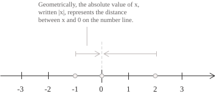

## Definition

Real numbers are the numbers we use to express quantities that vary continuously. Their set is denoted by $\mathbb{R}.$ Each real number $x$ corresponds to a point on the real line, to the right or left of the origin depending on whether $x$ is positive or negative, and the [absolute value](../absolute-value/) $|x|$ gives its distance from the origin.

Each point has exactly one real coordinate, and its position reflects the order of the numbers, so if two real numbers $x$ and $y$ satisfy $x\lt y,$ the point with coordinate $x$ lies to the left of the point with coordinate $y.$ The real line can be described using [intervals](../intervals/), which specify portions of the line and their extent. The following familiar chain of inclusions holds among the [sets of numbers](../types-of-numbers/):

$$
\mathbb{N} \subset \mathbb{Z} \subset \mathbb{Q} \subset \mathbb{R} \subset \mathbb{C}, \qquad \mathbb{I} \subset \mathbb{R} \tag{1}
$$

In $(1),$ both $\mathbb{Q}$ and $\mathbb{I}$ are subsets of $\mathbb{R}.$ Since $\mathbb{I}$ is the set of real numbers that do not belong to $\mathbb{Q},$ the two sets are disjoint and their union is $\mathbb{R}:$

$$
\mathbb{R} = \mathbb{Q}\cup\mathbb{I}, \qquad \mathbb{Q}\cap\mathbb{I} = \emptyset \tag{2}
$$

Starting from $\mathbb{Q},$ we can construct $\mathbb{R}$ using Dedekind cuts or [Cauchy sequences](../cauchy-sequence/). The entry on the construction of the real numbers presents both methods and shows that the resulting complete ordered fields are [isomorphic](../homomorphisms-and-isomorphisms/).

- - -

Equation $(2)$ partitions $\mathbb{R}$ into rational and [irrational numbers](../irrational-numbers/), and to describe how these two sets are distributed along the real line, we consider an interval with endpoints $x\lt y.$ No matter how close $x$ and $y$ are, there is always a [rational number](../rational-numbers/) $q \in \mathbb{Q}$ such that:

$$
x\lt q\lt y\tag{3}
$$

This property is called the density of $\mathbb{Q}$ in $\mathbb{R},$ so by choosing successively smaller intervals around a point on the line, we can approximate its real coordinate by rational numbers as closely as we wish. For example, applying $(3)$ to the interval $(x-\sqrt{2},y-\sqrt{2})$ gives a rational number $q$ such that $q+\sqrt{2}$ lies between $x$ and $y.$ This sum is irrational because if it were rational, the difference $(q+\sqrt{2})-q=\sqrt{2}$ would be rational as well, so the irrational numbers are also dense in $\mathbb{R}.$ Equation $(3)$ allows us, for example, to approximate $\sqrt{2}$ from below by positive rational numbers in a sequence of approximations belonging to the set:

$$
S = \{\ q\in\mathbb{Q}\mid q^2\lt 2\ \} \tag{4}
$$

The set $S$ in $(4)$ contains $1,$ and all its elements are less than $\sqrt{2},$ so $\sqrt{2}$ is an upper bound of $S.$ A set is bounded above if it has an upper bound, and its [least upper bound](../supremum-and-infimum/), when it exists, is called the supremum. For $S,$ no real number $m\lt\sqrt{2}$ can be an upper bound, since by $(3)$ there is a rational number between $\max\{m,0\}$ and $\sqrt{2}$ that belongs to $S$ and is greater than $m.$ Thus the supremum of $S$ in $\mathbb{R}$ is $\sqrt{2}.$

Every rational upper bound $M$ of $S$ is greater than the irrational number $\sqrt{2},$ and by $(3)$ there is a smaller rational upper bound between them. Thus $S$ is bounded above in $\mathbb{Q}$ and has no supremum in $\mathbb{Q}.$ The completeness axiom guarantees that every nonempty subset of $\mathbb{R}$ that is bounded above has a supremum in $\mathbb{R}.$

The truncations $1.4,1.41,1.414,\ldots$ of the decimal expansion of $\sqrt{2}$ belong to $S$ and form a Cauchy sequence of rational numbers with irrational limit $\sqrt{2}.$ More generally, the completeness of $\mathbb{R}$ ensures that every Cauchy sequence of real numbers converges in $\mathbb{R}.$

## Properties

The set $\mathbb{R}$ has a number of properties, listed below, the first of which is closure under addition and multiplication. Thus, for every $a,b\in\mathbb{R},$ the following relations hold:

$$
\begin{align}
a + b &\in \mathbb{R} \notag \\[6pt]
a \cdot b &\in \mathbb{R} \tag{5}
\end{align}
$$

By $(5),$ addition and multiplication are binary operations on $\mathbb{R},$ since each assigns a unique real result to every pair $(a,b)$ of real numbers. Both operations are also commutative, since interchanging the two summands or the two factors leaves the result unchanged:

$$
\begin{align}
a + b &= b + a \notag \\[6pt]
a \cdot b &= b \cdot a \tag{6}
\end{align}
$$

This is why the real numbers are said to form a [commutative field](../fields/). Subtraction and division generally fail to satisfy the commutative laws in $(6),$ as the following examples show:

$$
5-2\neq2-5 \qquad \text{and} \qquad \frac{2}{5}\neq\frac{5}{2}
$$

Another property is associativity, which allows the terms in a sum or the factors in a product to be grouped in different ways without changing its value, so for any three numbers $a,b,c\in\mathbb{R},$ the following equalities hold:

$$
\begin{align}
a + (b + c) &= (a + b) + c \notag \\[6pt]
a \cdot (b \cdot c) &= (a \cdot b) \cdot c \tag{7}
\end{align}
$$

As with commutativity, subtraction and division are not associative operations on $\mathbb{R}.$ Indeed:

$$
\begin{align*}
8-(4-2) &= 6 \neq 2 = (8-4)-2 \\[6pt]
16\div(8\div2) &= 4 \neq 1 = (16\div8)\div2
\end{align*}
$$

Finally, the distributive property holds for all $a,b,c\in\mathbb{R}:$

$$
\begin{align}
a \cdot (b + c) &= a \cdot b + a \cdot c \notag \\[6pt]
(b + c) \cdot a &= b \cdot a + c \cdot a \tag{8}
\end{align}
$$

- - -

The real numbers have an additive identity, namely $0,$ which satisfies the following identities for every $a\in\mathbb{R}:$

$$
\begin{align}
a + 0 &= a \notag \\[6pt]
0 + a &= a \tag{9}
\end{align}
$$

It follows from $(9)$ that if $a+n=a$ for every $a\in\mathbb{R},$ then $n=0.$ There is also a multiplicative identity, equal to $1,$ which satisfies the following equalities for every $a\in\mathbb{R}:$

$$
\begin{align}
a \cdot 1 &= a \notag \\[6pt]
1 \cdot a &= a \tag{10}
\end{align}
$$

By $(10),$ if $an=a$ for every $a\in\mathbb{R},$ then $n=1.$ Every real number $a$ also has an additive inverse $-a$ that satisfies the following identity:

$$
a + (-a) = 0 \tag{11}
$$

By $(11),$ if $a+b=0,$ then $b=-a.$ Finally, every nonzero $a\in\mathbb{R}$ has a multiplicative inverse $1/a,$ defined for $a$ different from $0$, that satisfies the following equality:

$$
a \cdot \frac{1}{a} = 1
$$

Closure and associativity, together with the existence of an identity and additive inverses, make $(\mathbb{R},+)$ an [abelian group](../groups/), and the corresponding axioms for multiplication on the nonzero elements, together with distributivity, make $\mathbb{R}$ a field.

## Order relation

As noted at the beginning, on the real line $a\lt b$ means that the point with coordinate $a$ lies to the left of the point with coordinate $b.$ We write $a\gt b$ if $b\lt a,$ and the symbols $a\leq b$ and $a\geq b$ also allow equality. Comparing a real number with zero distinguishes positive numbers from negative ones, and the absolute value $|a|$ gives the distance from $a$ to the origin. The order is total and compatible with addition and multiplication, so $\mathbb{R}$ is a totally ordered field. By trichotomy, exactly one of the following relations holds for any two real numbers $a$ and $b:$

$$
a\lt b,\qquad a=b,\qquad a\gt b \tag{12}
$$

By transitivity, the following implication holds for any three real numbers $a,b,c:$

$$
a\lt b \quad \text{and} \quad b\lt c \quad \Longrightarrow \quad a\lt c \tag{13}
$$

Equation $(12)$ ensures that any two real numbers can be compared, and $(13)$ allows comparisons to be chained in the form $a\lt b\lt c.$ Addition also preserves order, since adding the same real number $c$ to both sides of an [inequality](../inequalities/) gives:

$$
a\lt b \quad \Longrightarrow \quad a+c\lt b+c \tag{14}
$$

Equation $(14)$ also holds for non-strict inequalities and allows the same quantity to be subtracted from both sides by adding its opposite. Two inequalities in the same direction can also be added term by term:

$$
a\lt b \quad \text{and} \quad c\lt d \quad \Longrightarrow \quad a+c\lt b+d \tag{15}
$$

Equation $(15)$ follows from $(14),$ which gives $a+c\lt b+c\lt b+d,$ and from transitivity in $(13).$ When multiplying an inequality, its direction depends on the sign of the factor $c:$

$$
\begin{align}
a\lt b \ \text{and}\ c\gt 0 &\quad \Longrightarrow \quad ac\lt bc \notag \\[6pt]
a\lt b \ \text{and}\ c\lt 0 &\quad \Longrightarrow \quad ac\gt bc \tag{16}
\end{align}
$$

Equation $(16)$ also applies to non-strict inequalities and to division, since dividing by a nonzero number is equivalent to multiplying by its reciprocal, which has the same sign. If $0\lt a\lt b,$ the first line of $(16)$ with $c=1/(ab)$ gives $0\lt 1/b\lt 1/a.$

Applying $(16)$ to a comparison between one factor and zero shows that the product of two nonzero real numbers is positive when the factors have the same sign and negative when they have opposite signs, and the product is zero if at least one factor is zero. It follows that the square of a real number is always nonnegative and is zero only at zero. The factorization in $(17)$ also shows that squaring is [strictly increasing](../increasing-and-decreasing-functions/) on the nonnegative real numbers, because if $0\leq a\lt b,$ both factors $b-a$ and $b+a$ are positive:

$$
b^2-a^2 = (b-a)(b+a) \gt 0 \qquad (0\leq a\lt b) \tag{17}
$$