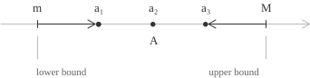
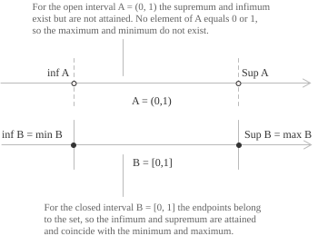

## Upper and lower bounds

Before introducing the concepts of supremum and infimum, we need to define what are known as the upper and lower bounds of a set, namely the values that bound it from above and below. As we will see in detail below, the supremum is the least upper bound, while the infimum is the greatest lower bound. In this discussion, we will consider only subsets of the set of [real numbers](../real-numbers/) $\mathbb{R},$ which satisfies the [completeness axiom](../properties-of-real-numbers/), according to which every non-empty subset of $\mathbb{R}$ bounded above and below has, respectively, a supremum and an infimum in $\mathbb{R}.$ We therefore begin by considering a non-empty [set](../sets/) $A \subseteq \mathbb{R}.$ A real number $M$ is said to be an upper bound of $A$ if the following condition holds:

$$
a \leq M \quad \forall \ a \in A \tag{1}
$$

If such a number exists, the set $A$ is bounded above. Similarly, a real number $m$ is a lower bound of $A$ if the following condition holds:

$$
a \geq m \quad \forall \ a \in A \tag{2}
$$

In this case, $A$ is bounded below. A set is bounded if it is bounded both above and below, that is, if there exists a real constant $K > 0$ such that:

$$
|a| \leq K \quad \forall \ a \in A \tag{3}
$$

Upper bounds, when they exist, are generally not unique, since if $M$ is an upper bound of $A,$ then $M + 1$ and $M + 100$ are also upper bounds of the set. A similar argument applies to lower bounds. If $m$ is a lower bound of $A,$ then $m - 1$ is also a lower bound. Thus, as stated at the beginning, the least upper bound is called the supremum, while the greatest lower bound is called the infimum.

These definitions extend to unbounded sets and the empty set by allowing the values $+\infty$ and $-\infty,$ under the following conventions:

+ If $A$ is non-empty and not bounded above, we set $\sup A = +\infty$ by convention.
+ If $A$ is not bounded below, we set $\inf A = -\infty.$
+ For the empty set, we adopt the conventions $\sup \emptyset = -\infty$ and $\inf \emptyset = +\infty.$

## Supremum and infimum

We now consider a non-empty subset $A \subseteq \mathbb{R}$ that is bounded above. The supremum of $A,$ denoted by $\sup A,$ is its least upper bound. A real number $s$ equals $\sup A$ if and only if it satisfies two conditions. The first mirrors $(1),$ namely:

$$
a \leq s \quad \forall \ a \in A
$$

The second condition ensures that every number strictly less than $s$ is exceeded by at least one element of $A$:

$$
\forall \ \varepsilon > 0 \quad \exists \ a \in A : a > s - \varepsilon \tag{4}
$$

These conditions determine $s$ uniquely, that is, if both $s$ and $s'$ satisfy the definition, then $s$ and $s'$ must be equal, as expressed by the following relation:

$$
s \leq s' \ \wedge \ s' \leq s \ \to \ s = s' \tag{5}
$$

An equivalent characterisation states that $s = \sup A$ if and only if $s$ is an upper bound of $A$ and there exists a [sequence](../sequences/) $(a_n) \subseteq A$ such that $a_n \to s.$

- - -

We now distinguish between $\mathbb{R}$ and $\mathbb{Q}.$ We have already stated that the completeness axiom guarantees that every non-empty set of real numbers bounded above has a real supremum, which is why we have considered subsets of the real numbers. While this property holds for the reals, it does not hold for the [rational numbers](../rational-numbers/). Indeed, consider the following set:
$$A = \{q \in \mathbb{Q} : q^2 < 2\} \tag{6}$$This set contains $0$ and is bounded above, for example by $2.$ If we seek its supremum in $\mathbb{R},$ we obtain $\sqrt{2},$ which is an [irrational number](../irrational-numbers/). If we instead allow only rational upper bounds, no upper bound of $A$ is less than or equal to all the other rational upper bounds. Indeed, every rational upper bound $M$ is greater than $\sqrt{2}$ and, by the density of the rationals, there exists a rational number $r$ such that $\sqrt{2} < r < M,$ so $r$ is also an upper bound of $A.$ Thus, the set given in $(6)$ has a supremum in $\mathbb{R},$ but not in $\mathbb{Q}.$

- - -

We now turn to the definition of infimum, considering, as in the case of the supremum, a non-empty subset $A \subseteq \mathbb{R},$ but this time one that is bounded below. The infimum of $A,$ denoted by $\inf A,$ is its greatest lower bound. A real number $i$ equals $\inf A$ if and only if it satisfies the following conditions. The first corresponds to $(2)$ and states that $i$ is a lower bound of $A$:

$$
	a \geq i \quad \forall \ a \in A \tag{7}
$$

The second condition ensures that every number strictly greater than $i$ is greater than at least one element of $A$:

$$
\forall \ \varepsilon > 0 \quad \exists \ a \in A : a < i + \varepsilon \tag{8}
$$

As with the supremum, these conditions determine $i$ uniquely, so if both $i$ and $i'$ satisfy the definition, we have:

$$
i \geq i' \ \wedge \ i' \geq i \ \to \ i = i' \tag{9}
$$

Here too, we can use sequences to obtain an equivalent definition, under which $i = \inf A$ if and only if $i$ is a lower bound of $A$ and there exists a sequence $(a_n) \subseteq A$ such that $a_n \to i.$

It can happen that a set has an infimum that does not belong to the set and is therefore not a minimum. Consider, for example, the following set:

$$\{1/n : n \in \mathbb{N},\ n \geq 1\} \tag{10}$$

Every element of $(10)$ is positive, so we can readily conclude that $0$ is a lower bound of the set. However, no positive number can be a lower bound, since the [Archimedean property](../real-numbers/) guarantees that, for every positive value, there exists an [integer](../integers/) $n \geq 1$ for which $1/n$ is less than that threshold. The set therefore has the following infimum:

$$
\inf \{1/n : n \in \mathbb{N},\ n \geq 1\} = 0 \tag{11}
$$

However, since the value $0$ does not belong to the set, the set has no minimum.

## The approximation property

Conditions $(4)$ and $(8)$ show that we can find elements of a set arbitrarily close to its supremum or infimum, provided that the bound in question is finite. This consequence of the definitions is called the approximation property and holds even when the supremum or infimum does not belong to the set. Consider a non-empty set $A \subseteq \mathbb{R}.$ If $s = \sup A \in \mathbb{R},$ then for every $\varepsilon > 0$ there exists an element $a \in A$ such that:

$$
s - \varepsilon < a \leq s \tag{12}
$$

Indeed, $s - \varepsilon$ cannot be an upper bound of $A,$ because it is less than the supremum, so there exists an element $a \in A$ greater than $s - \varepsilon.$ We also have $a \leq s$ because $s$ is an upper bound. Similarly, if $i = \inf A \in \mathbb{R},$ then for every $\varepsilon > 0$ there exists an element $a \in A$ such that:

$$
i \leq a < i + \varepsilon
$$

In this case, $i + \varepsilon$ cannot be a lower bound of $A,$ because it is greater than the infimum, so there exists a number $a \in A$ such that $a < i + \varepsilon.$ Moreover, $a \geq i$ because $i$ is a lower bound.

The possibility of finding elements of $A$ arbitrarily close to $s$ allows us to construct a sequence that [converges](../convergent-and-divergent-sequences/) to $s.$ To prove this, we apply the approximation property with values of $\varepsilon$ that tend to zero. Choosing $\varepsilon = 1/n$ for every integer $n \geq 1,$ we obtain an element $a_n \in A$ such that:

$$
s - \frac{1}{n} < a_n \leq s
$$

The [distance](../absolute-value/) between $a_n$ and $s$ therefore satisfies $0 \leq s - a_n < 1/n,$ that is, $(12),$ and since $1/n$ tends to zero, this distance also tends to zero, so $a_n \to s.$ The same procedure applies to the infimum $i.$ For every integer $n \geq 1,$ we choose $b_n \in A$ such that $i \leq b_n < i + 1/n.$ The inequality $0 \leq b_n - i < 1/n$ implies that $b_n \to i.$

## Maximum and minimum

The maximum of a set $A$ is an element of $A$ greater than or equal to every other element of the set. When the maximum exists, it coincides with the supremum of $A$:

$$
\max A = \sup A \tag{13}
$$

For $(13)$ to hold, the supremum must belong to $A,$ but, as we have seen above, the definition of supremum does not impose this condition. Thus, in general, a set can have a supremum without having a maximum. To clarify this point, consider, for example, the open interval $A = (0,1).$ The number $1$ is an upper bound and every number less than $1$ is exceeded by some element of $A,$ so $\sup A = 1.$ However, $1 \notin A,$ so $A$ has no maximum. Similarly, $\inf A = 0,$ but $0 \notin A,$ so $A$ has no minimum. In the closed [interval](../intervals/) $B = [0,1],$ by contrast, both the supremum and the infimum belong to the set and coincide with its maximum and minimum, respectively:

$$
\begin{align}
\sup B &= \max B = 1 \\[6pt]
\inf B &= \min B = 0
\end{align}
$$

The argument is illustrated in the following image:

In general, the following implications hold:

+ If the set $A$ has a maximum, it coincides with its supremum, so $\max A = \sup A.$
+ If the set $A$ has a minimum, it coincides with its infimum, so $\min A = \inf A.$

## Suprema and infima of functions

The notions of supremum and infimum also extend to [functions](../functions/). In general, for a function $f : D \to \mathbb{R},$ the supremum of $f$ over $D$ is the supremum of its image, that is:

$$
\sup_{x \in D} f(x) = \sup \{ f(x) : x \in D \} \tag{14}
$$

Similarly, the infimum is defined by the following equality:

$$
\inf_{x \in D} f(x) = \inf \{ f(x) : x \in D \} \tag{15}
$$

Definitions $(14)$ and $(15)$ specify the supremum and infimum of the image of $f,$ which need not belong to the image itself. In this case, the function does not take the value of the supremum or infimum at any point of its [domain](../determining-the-domain-of-a-function/). The following conditions allow us to determine whether a real number is the supremum or infimum of $f$ over $D$:

+ A real number $s$ equals $\sup_{x \in D} f(x)$ if and only if $f(x) \leq s$ for every $x \in D$ and, for every $\varepsilon > 0,$ there exists $x \in D$ such that $f(x) > s - \varepsilon.$
+ Symmetrically, a real number $i$ equals $\inf_{x \in D} f(x)$ if and only if $f(x) \geq i$ for every $x \in D$ and, for every $\varepsilon > 0,$ there exists $x \in D$ such that $f(x) < i + \varepsilon.$

For example, the function $f(x) = x$ defined on the open interval $(0, 1)$ satisfies $\sup_{x \in (0,1)} f(x) = 1,$ but no $x \in (0, 1)$ satisfies $f(x) = 1,$ so the function has no maximum. When, on the other hand, the supremum is attained at a point $x_0 \in D,$ that is, when $f(x_0) = \sup_{x \in D} f(x),$ it coincides with the maximum of $f$ over $D.$ The same relationship holds between the infimum and the minimum. We can therefore conclude that the supremum and infimum are values that the function can approach without necessarily attaining them, while the maximum and minimum are values that the function must attain at one or more points of its domain.

The [Weierstrass theorem](../weierstrass-theorem/) provides a sufficient condition for a function to attain its supremum and infimum. In particular, if $f : [a,b] \to \mathbb{R}$ is [continuous](../continuous-functions/) on a closed, bounded, non-empty interval, then $f$ is bounded and attains both a maximum and a minimum on $[a,b].$ Its supremum and infimum are therefore finite and coincide with these values, respectively.

## Algebra of suprema and infima

Suprema and infima satisfy some simple algebraic relations that often simplify their calculation. We first consider translating a set and take a non-empty bounded set $A \subseteq \mathbb{R}$ and a real number $c,$ setting $c + A = \{ c + a : a \in A \}$ and $cA = \{ ca : a \in A \}.$ This translation, as one would expect, shifts both the supremum and the infimum by the same amount, so we obtain:

$$
\begin{align}
\sup(c + A) &= c + \sup A \\[6pt]
\inf(c + A) &= c + \inf A
\end{align}
$$

Similarly, multiplication by a positive factor $c$ multiplies both the supremum and the infimum by that factor, giving:

$$
\begin{align}
\sup(cA) &= c \sup A \tag{16} \\[6pt]
\inf(cA) &= c \inf A \notag
\end{align}
$$

When $c$ is negative, the order in $(16)$ is reversed:

$$
\begin{align}
\sup(cA) &= c \inf A \\[6pt]
\inf(cA) &= c \sup A
\end{align}
$$

Now suppose that two sets $A$ and $B$ are non-empty and that every element of $A$ is less than or equal to every element of $B,$ that is, $a \leq b$ for every $a \in A$ and every $b \in B.$ Each $a$ is then a lower bound of $B,$ so $a \leq \inf B.$ Consequently, $\inf B$ is an upper bound of $A.$ By the definition of the supremum of $A,$ we obtain:

$$
\sup A \leq \inf B \tag{17}
$$

Inequality $(17)$ remains non-strict even if the hypothesis is strengthened by requiring $a < b$ for every pair of elements from the two sets. For example, if we consider the sets $A = \{ 0 \}$ and $B = \{1/n : n \in \mathbb{N},\ n \geq 1\},$ we always have $a < b,$ yet $\sup A = \inf B = 0.$

