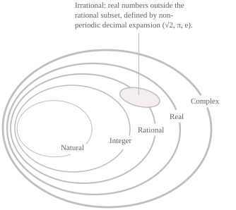

## Organisation of numbers

Numbers are grouped into families, each extending the preceding one to include quantities that the preceding family cannot represent. The main number sets, in order of inclusion, are the [natural numbers](../natural-numbers/) $\mathbb{N},$ the [integers](../integers/) $\mathbb{Z},$ the [rational numbers](../rational-numbers/) $\mathbb{Q},$ the [real numbers](../real-numbers/) $\mathbb{R},$ and the [complex numbers](../complex-numbers/) $\mathbb{C}.$ The [irrational numbers](../irrational-numbers/) $\mathbb{I}$ form the [complement](../sets/) of the rational numbers in $\mathbb{R}.$ The inclusion relations among the sets are as follows:

$$
\mathbb{N} \subset \mathbb{Z} \subset \mathbb{Q} \subset \mathbb{R} \subset \mathbb{C}, \qquad \mathbb{I} \subset \mathbb{R} \tag{1}
$$

Beyond the inclusion relations in $(1),$ there is a further classification of the real numbers in which all rationals and some irrationals, such as $\sqrt{2},$ are called algebraic numbers and form the set $\mathbb{A},$ and the remaining irrationals, such as $\pi$ and $e,$ are called transcendental numbers. The set of natural numbers, denoted by $\mathbb{N},$ consists of the non-negative integers used to count discrete quantities and can be written as follows:

$$
\mathbb{N} = \{0, 1, 2, 3, 4, \ldots\} \tag{2}
$$

Starting from $0,$ each successive natural number is obtained by adding one to the preceding number, and natural numbers are called cardinal numbers when they are used to specify how many elements a set contains. The two most common conventions for $\mathbb{N},$ which differ in whether zero is included, are the following.

$$ \tag{3}
\begin{align}
&\mathbb{N}_0 = \{0, 1, 2, 3, \ldots\} \\[6pt]
&\mathbb{N}^+ = \{1, 2, 3, \ldots\}
\end{align}
$$

One property of $\mathbb{N}$ is that it is the smallest inductive subset of $\mathbb{R}.$ Indeed, it contains $0$ and, whenever it contains an element $n,$ it also contains $n+1$ (the property on which the [principle of mathematical induction](../principle-of-mathematical-induction/) is based). The set of integers, denoted by $\mathbb{Z},$ extends $\mathbb{N}$ by including the additive inverse of every positive natural number and can be written in a form analogous to $(2)$ as follows:

$$ \tag{4}
\mathbb{Z} = \{\ldots, -3, -2, -1, 0, 1, 2, 3, \ldots\}
$$

The set $\mathbb{Z}$ can also be written as follows:

$$ \tag{5}
\mathbb{Z} = \mathbb{N} \cup \{-n : n \in \mathbb{N}^+\}
$$

There are also notational conventions for $\mathbb{Z}$ when the sign needs to be specified or zero excluded. In these cases, the following subsets are used:

$$ \tag{6}
\begin{align}
\mathbb{Z}^+ &= \{1, 2, 3, \ldots\} \\[6pt]
\mathbb{Z}^- &= \{-1, -2, -3, \ldots\} \\[6pt]
\mathbb{Z}^* &= \mathbb{Z} \setminus \{0\}
\end{align}
$$

The passage from $\mathbb{N}$ to $\mathbb{Z}$ makes subtraction well-defined for any pair of elements. Thus, for every $a,b\in\mathbb{Z},$ the difference $a-b$ is still an integer. A subtraction such as $3-5,$ whose result does not belong to $\mathbb{N},$ gives $-2$ in $\mathbb{Z}.$ Algebraically, $(\mathbb{Z},+)$ is an [abelian group](../groups/) and $(\mathbb{Z},+,\cdot)$ is a [commutative ring with unity](../rings/). The properties of this set are discussed in the article on integers. We now turn to the set of rational numbers, denoted by $\mathbb{Q},$ which consists of all numbers that can be expressed as a ratio of two integers with a non-zero denominator. The set can be written as follows:

$$ \tag{7}
\mathbb{Q} = \left \{ \frac{p}{q} : p, q \in \mathbb{Z}, \ q \neq 0 \right\}
$$

Every integer is also rational, since every $n\in\mathbb{Z}$ can be written as $n/1.$ The decimal expansion of a rational number depends on the result of dividing $p$ by $q$ and may terminate or repeat from some digit onwards (for example, $1/4=0.25$ and $1/3=0.\overline{3}$). The passage from $\mathbb{Z}$ to $\mathbb{Q}$ makes division by any non-zero integer well-defined. In algebraic terms, $\mathbb{Q}$ is the smallest [field](../fields/) containing $\mathbb{Z}$ and is constructed by adjoining a multiplicative inverse for every non-zero integer.

- - -

The real numbers are the numbers represented by points on the real line. Their set is denoted by $\mathbb{R}$ and includes all rational and irrational numbers. Every real number admits a decimal representation of the following form:

$$ \tag{8}
\pm m.\alpha_0 \ \alpha_1 \ \alpha_2 \ \alpha_3 \ldots
$$

In $(8),$ $m\in\mathbb{N}_0$ is the integer part of the [absolute value](../absolute-value/), $\alpha_0,\alpha_1,\alpha_2,\ldots$ are the decimal digits, and the sign applies to the entire decimal representation. The set $\mathbb{R}$ has several properties. The first is that it is [totally ordered](../real-numbers/), meaning that for any two real numbers $x$ and $y,$ exactly one of the following relations holds:

$$ \tag{9}
\begin{align}
x &\lt y \\[6pt]
x &= y \\[6pt]
x &\gt y
\end{align}
$$

The Archimedean property of $\mathbb{R}$ guarantees that for every real number $x$ there is a natural number $n$ such that $n\gt x.$ If $x$ is positive, however small, we can apply the property to its reciprocal and choose $n\gt1/x$ so that $1/n\lt x,$ as when we take $n=10^{101}$ for $x=10^{-100}.$

Another property of $\mathbb{R}$ is that between any two distinct real numbers, however close, there is always at least one rational number, so the rational numbers are said to be dense in $\mathbb{R}.$ Another difference between $\mathbb{Q}$ and $\mathbb{R}$ concerns cardinality. The rationals are [countable](../cardinality-and-countable-sets/), meaning that they can be put in one-to-one correspondence with $\mathbb{N},$ and the reals are uncountable. A real number is irrational if it cannot be written as a fraction $p/q$ with $p$ and $q$ integers and $q\neq0.$ The set $\mathbb{I}$ of irrational numbers is therefore the complement of $\mathbb{Q}$ in $\mathbb{R},$ and every real number belongs to exactly one of the two sets, so we have:

$$
\begin{align}
& \mathbb{R} = \mathbb{Q} \cup \mathbb{I} \notag \\[6pt]
& \mathbb{Q} \cap \mathbb{I} = \emptyset \tag{10}
\end{align}
$$

Between any two distinct real numbers, however close, there is always at least one irrational number, so $\mathbb{I}$ is also dense in $\mathbb{R}.$ Another property of irrational numbers is that their decimal expansions continue indefinitely without becoming periodic, as in the following examples:

$$
\sqrt{2}, \quad \sqrt{3}, \quad \pi, \quad e, \quad -\sqrt[3]{5} \tag{11}
$$

The numbers in $(11)$ introduce a second classification of the real numbers. A real number is algebraic if it is a [root](../roots-of-a-polynomial/) of at least one non-zero [polynomial](../polynomials/) with rational coefficients. Otherwise it is called transcendental. If $\mathbb{A}$ denotes the set of algebraic real numbers, the transcendental real numbers form its complement in $\mathbb{R}.$ As in $(10),$ the two sets are disjoint and their union is all of $\mathbb{R},$ so we can write:

$$
\begin{align}
&\mathbb{R} = \mathbb{A} \cup (\mathbb{R} \setminus \mathbb{A}) \notag \\[6pt]
&\mathbb{A} \cap (\mathbb{R} \setminus \mathbb{A}) = \emptyset \tag{12}
\end{align}
$$

Every rational number $p/q$ is also algebraic because it is a root of the linear polynomial $qx-p.$ Among the irrational numbers in $(11),$ both $\sqrt{2}$ and $-\sqrt[3]{5}$ are algebraic, with the latter a root of $x^3+5.$ The set $\mathbb{A}$ therefore contains all rational numbers and some irrational numbers.

$$
\begin{align}
&\mathbb{Q} \subset \mathbb{A} \notag \\[6pt]
&\mathbb{A} \setminus \mathbb{Q} \subset \mathbb{I} \tag{13}
\end{align}
$$

The remaining irrational numbers, including $\pi$ and $e,$ are transcendental.

- - -

Finally, we consider the set of complex numbers, denoted by $\mathbb{C},$ which extends $\mathbb{R}$ by introducing an element $i$ that satisfies the following identity:

$$i^2=-1 \tag{14}$$

Passing to $\mathbb{C}$ makes it possible to take square roots of negative numbers and, more generally, to [factor every polynomial into linear factors](../unique-factorization-of-polynomials/). Every complex number can be written in algebraic form as follows:

$$
z = a + bi \tag{15}
$$

In $(15),$ $a$ and $b$ are real numbers, called the real and imaginary parts of $z,$ respectively. If $b=0,$ the number reduces to a real number, so $\mathbb{R}\subset\mathbb{C}.$ Complex numbers also have [trigonometric](../complex-numbers-trigonometric-form/) and [exponential](../complex-numbers-exponential-form/) representations, which are discussed in the corresponding articles.
