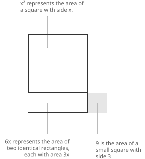

## Introduzione

Il completamento del quadrato è una tecnica che permette di riscrivere un [polinomio](../polynomials/) di secondo grado in una forma che ne mette in evidenza le proprietà. Consideriamo un polinomio della forma:

$$
p(x) = ax^2 + bx + c, \quad a \neq 0
$$

L'obiettivo è determinare due costanti reali $h$ e $k$, che dipendono da $a$, $b$ e $c$, in modo che $p(x)$ si possa scrivere nella forma con il vertice

$$
p(x) = a(x + h)^2 + k
$$

La coppia $(-h, k)$ individua il vertice della [parabola](../parabola/) corrispondente. Il valore $k$ è il minimo di $p$ quando $a > 0$ e il massimo quando $a < 0$. Ponendo $p(x)$ uguale a zero si ottiene l'equazione $a(x+h)^2 = -k$, da cui si possono ricavare le [radici](../roots-of-a-polynomial/) estraendo la radice quadrata di entrambi i membri.

- - -
Per ricavare le espressioni esplicite di $h$ e $k$ si comincia raccogliendo $a$ dai termini quadratico e lineare:

$$
p(x) = a\left(x^2 + \frac{b}{a}x\right) + c
$$

Il passaggio decisivo consiste nell'aggiungere e sottrarre $\left(\dfrac{b}{2a}\right)^{2}$ all'interno delle parentesi. Questa quantità è scelta in modo che i tre termini contenenti $x$ formino un [trinomio](../trinomials/) quadrato perfetto, uno dei [prodotti notevoli](../notable-products/) più comuni:

$$
p(x) = a\left(x^2 + \frac{b}{a}x + \left(\frac{b}{2a}\right)^{2} - \left(\frac{b}{2a}\right)^{2}\right) + c
$$

Riconoscendo il quadrato perfetto, possiamo riscrivere il trinomio in forma compatta:

$$
p(x) = a\left[\left(x + \frac{b}{2a}\right)^{2} - \frac{b^2}{4a^2}\right] + c
$$

Distribuendo $a$ e sommando i termini costanti si ottiene:

$$
p(x) = a\left(x + \frac{b}{2a}\right)^{2} - \frac{b^2}{4a} + c
$$

Questa è la forma con il vertice, in cui:

$$
h = \frac{b}{2a} \qquad k = c - \frac{b^2}{4a}
$$

## Interpretazione geometrica

L'identità algebrica alla base del completamento del quadrato ammette un'interpretazione geometrica diretta. Consideriamo l'espressione seguente:

$$
x^2 + 6x + 9
$$

Ogni termine è l'area di una regione geometrica. $x^2$ corrisponde a un quadrato di lato $x$, $6x$ è la somma delle aree di due rettangoli, ciascuno di dimensioni $x \times 3$, e $9$ è l'area di un quadrato di lato $3$. Disponendo queste regioni attorno a un vertice comune si ricopre un quadrato più grande di lato $x + 3$ e si verifica così l'identità:

$$
x^2 + 6x + 9 = (x + 3)^2
$$

Questo ragionamento geometrico si applica quando il termine costante è il quadrato della metà del coefficiente lineare, come accade in un polinomio con una radice multipla. Ponendo l'espressione uguale a zero si ottiene l'equazione $(x+3)^2 = 0$, la cui unica soluzione è $x = -3$. In generale, il completamento del quadrato permette di introdurre per via algebrica la correzione necessaria, anche quando la configurazione risultante non si può realizzare geometricamente con misure reali positive.

> Quando i coefficienti sono interi piccoli e il polinomio è facile da scomporre, questo approccio geometrico è spesso più diretto della [formula risolutiva](../quadratic-formula/). È meno conveniente quando il coefficiente direttivo o il termine lineare contiene frazioni o numeri irrazionali, perché i calcoli diventano più complessi e in genere è preferibile usare la formula risolutiva.

## Esempio 1

Un'applicazione del metodo si può illustrare con la seguente equazione di secondo grado:

$$
3x^2 - 4x - 1 = 0
$$

Si porta il termine costante al secondo membro e si dividono entrambi i membri per $3$:

$$
x^2 - \frac{4}{3}x = \frac{1}{3}
$$

A entrambi i membri si aggiunge il quadrato della metà del coefficiente di $x$, ossia:

$$
\left(\frac{1}{2} \cdot \frac{4}{3}\right)^{2} = \left(\frac{2}{3}\right)^{2} = \frac{4}{9}
$$

$$
x^2 - \frac{4}{3}x + \frac{4}{9} = \frac{1}{3} + \frac{4}{9}
$$

A questo punto il primo membro è un trinomio quadrato perfetto:

$$
\left(x - \frac{2}{3}\right)^{2} = \frac{3}{9} + \frac{4}{9} = \frac{7}{9}
$$

Estraendo la radice quadrata di entrambi i membri si ottiene

$$
x - \frac{2}{3} = \pm\frac{\sqrt{7}}{3}
$$

L'equazione ha due radici reali:

$$
x = \frac{2 \pm \sqrt{7}}{3}
$$

> Quando i coefficienti non sono interi piccoli, il completamento del quadrato è in genere più laborioso dell'applicazione diretta della [formula risolutiva](../quadratic-formula/). In questi casi di solito è preferibile usare la formula.

## Deduzione della formula risolutiva

Una delle applicazioni principali del completamento del quadrato è la deduzione della [formula risolutiva](../quadratic-formula/), che si ottiene direttamente dal procedimento anziché come risultato indipendente. Si parte dall'equazione generale di secondo grado:

$$
ax^2 + bx + c = 0 \quad a \neq 0.
$$

Dividendo entrambi i membri per $a$ e portando il termine costante al secondo membro si ottiene:

$$
x^2 + \frac{b}{a}x = -\frac{c}{a}
$$

Aggiungendo $\left(\dfrac{b}{2a}\right)^{2}$ a entrambi i membri si completa il quadrato al primo membro:

$$
x^2 + \frac{b}{a}x + \left(\frac{b}{2a}\right)^{2} = \left(\frac{b}{2a}\right)^{2} - \frac{c}{a}
$$

Si ottiene quindi:

$$
\left(x + \frac{b}{2a}\right)^{2} = \frac{b^2 - 4ac}{4a^2}
$$

Estraendo la radice quadrata di entrambi i membri e ricavando $x$ si ottiene:

$$
x = \frac{-b \pm \sqrt{b^2 - 4ac}}{2a}
$$

> La deduzione mostra che la formula risolutiva segue direttamente dal completamento del quadrato applicato all'[equazione generale di secondo grado](../quadratic-equations/).

- - -
L'espressione $b^2 - 4ac$, che nella formula risolutiva compare sotto radice, si chiama discriminante dell'equazione. Il suo segno determina la natura delle radici:

+ Se $b^2 - 4ac > 0$, l'equazione ha due radici reali distinte.
+ Se $b^2 - 4ac = 0$, ha una sola radice reale doppia.
+ Se $b^2 - 4ac < 0$, non ha radici reali, perché la radice quadrata di un numero negativo non è definita in $\mathbb{R}$.
