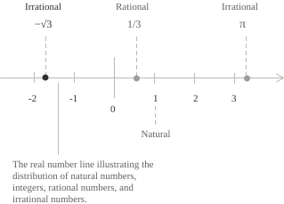
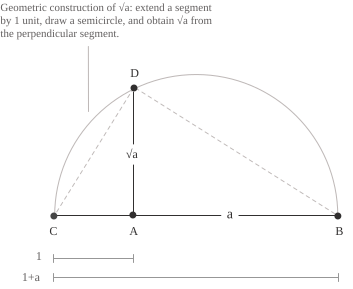

## Definizione di radicale

Un radicale è un'espressione della forma $\sqrt[n]{a}$ che indica l'estrazione della radice $n$-esima di un numero o di un'espressione $a.$ Il termine $a$ si chiama radicando e il numero intero $n \ge 2$ si chiama indice della radice. Il concetto di radice nasce dal problema di risolvere equazioni della forma:

$$x^n = a \tag{1}$$

Nella $(1),$ $a \in \mathbb{R},$ e la radice $n$-esima di $a$ è un numero reale la cui potenza $n$-esima è proprio uguale ad $a.$

Quando $n$ è pari, la $(1)$ ha soluzioni reali solo se $a \ge 0$ e in tal caso, la radice $\sqrt[n]{a}$ è definita come la soluzione non negativa. Per esempio, l'equazione $x^2 = 9$ ha come soluzioni $x = 3$ e $x = -3,$ poiché $3^2 = (-3)^2 = 9.$ Il radicale indica però soltanto la soluzione non negativa, quindi $\sqrt{9} = 3.$

Quando $n$ è dispari, per ogni numero reale $a$ esiste un unico numero reale $x$ tale che $x^n = a.$ Questo vale sia quando $a$ è positivo sia quando è negativo o nullo. Inoltre, una potenza con esponente dispari conserva sempre il segno della base. Per esempio, l'equazione $x^3 = -8$ ha come unica soluzione reale $x = -2,$ poiché $(-2)^3 = -8$ e quindi $\sqrt[3]{-8} = -2.$

Come conseguenza di quanto sopra illustrato, otteniamo la seguente identità:

$$ \tag{2}
\sqrt{a^2} = |a| \qquad \forall a \in \mathbb{R}
$$

Se $a \ge 0,$ la radice quadrata di $a^2$ è $a.$ Se $a < 0,$ è invece $-a,$ che è positivo e ha lo stesso quadrato di $a.$ Il valore assoluto consente quindi di esprimere entrambi i casi correttamente. Per esempio consideriamo il trinomio della $(3)$. Applicando la $(2)$ si ottiene:

$$ \tag{3}
\sqrt{x^2-2xy+y^2} = \sqrt{(x-y)^2} = |x-y|
$$

Il risultato è quindi $x-y$ se $x \ge y,$ mentre è $y-x$ se $x < y.$

A livello generale, per $n \in \mathbb{N}$ con $n \ge 1,$ si ha:

$$\sqrt[2n]{a^{2n}} = |a| \tag{4}$$

Quando invece abbiamo un indice dispari la $(4)$ diventa:

$$\sqrt[2n+1]{a^{2n+1}} = a\tag{5}$$

- - -

I radicali come $\sqrt{2},$ $\sqrt{3}$ e $\sqrt{5}$ sono numeri irrazionali perché non possono essere espressi esattamente come rapporto di due numeri interi. Di seguito è riportato il loro posizionamento nella retta reale:

Inoltre, le loro espansioni decimali sono infinite e non periodiche. Formalmente, se $a \in \mathbb{N}$ non è un quadrato perfetto, allora $\sqrt{a} \notin \mathbb{Q}.$ Quindi, mentre la radice quadrata di un quadrato perfetto, come $4$ o $9,$ è razionale, per i numeri naturali che non lo sono, come $2$ o $5,$ è invece irrazionale.

## Perché $\sqrt{2}$ è irrazionale?

Consideriamo adesso un caso piuttosto noto, e dimostriamo che $\sqrt{2}$ non è un numero razionale. La dimostrazione procede per assurdo, supponiamo proprio che $\sqrt{2}$ sia razionale. Se fosse razionale, potrebbe essere espresso come rapporto di due interi in una frazione ridotta ai minimi termini, perciò esisterebbero $a, b \in \mathbb{Z},$ con $b \neq 0$ e $\gcd(a,b) = 1,$ tali che:

$$ \tag{6}
\sqrt{2} = \frac{a}{b}
$$

Elevando al quadrato entrambi i membri si ottiene:

$$
2 = \frac{a^2}{b^2} \Rightarrow a^2 = 2b^2 \tag{7}
$$

Questa equazione mostra che $a^2$ è pari. Poiché il quadrato di un intero dispari è dispari, $a$ deve essere pari. Possiamo quindi scrivere $a = 2k$ per un opportuno intero $k$ e sostituendo questa espressione alla $(7)$ otteniamo:

$$
(2k)^2 = 2b^2 \Rightarrow 4k^2 = 2b^2 \Rightarrow b^2 = 2k^2
$$

Lo stesso ragionamento sulla parità mostra che $b$ è pari. Quindi $2$ divide sia $a$ sia $b,$ in contraddizione con $\gcd(a,b) = 1$ e pertanto $\sqrt{2}$ è irrazionale.

## Potenze con esponente razionale

Il legame tra radicali e potenze diventa esplicito quando l'esponente è un numero razionale. Per $a > 0$ e $n \in \mathbb{N}$ con $n \ge 1,$ la radice $n$-esima di $a$ può essere scritta nel seguente modo:

$$ \tag{8}
\sqrt[n]{a} = a^{\frac{1}{n}}
$$

Più in generale, per $m \in \mathbb{Z},$ un radicale il cui radicando è elevato a una potenza intera è una potenza con esponente razionale $m/n.$ Vale infatti l'identità:

$$\tag{9}
\sqrt[n]{a^m} = a^{\frac{m}{n}}
$$

Consideriamo $a > 0$ e i seguenti numeri razionali:

$$\frac{m}{n}, \frac{p}{q} \in \mathbb{Q}$$

Applicando le proprietà delle potenze, otteniamo le seguenti identità che sono utili per la semplificazione dei calcoli algebrici nella risoluzione di espressioni di questo tipo:

$$
\begin{align}
a^{\frac{m}{n}} \cdot a^{\frac{p}{q}} &= a^{\frac{m}{n}+\frac{p}{q}} \\[6pt]
a^{\frac{m}{n}}\div {a^{\frac{p}{q}}} &= a^{\frac{m}{n}-\frac{p}{q}} \\[6pt]
\left(a^{\frac{m}{n}}\right)^{\frac{p}{q}} &= a^{\frac{m}{n} \cdot \frac{p}{q}}
\end{align}
$$

Quando i radicali hanno indici diversi, possiamo riscriverli come potenze con esponente razionale. Per esempio, per $a > 0,$ la proprietà del quoziente di potenze con la stessa base permette di sottrarre gli esponenti:

$$
\begin{align}
\frac{\sqrt{a}}{\sqrt[3]{a}} &= \frac{a^{\frac{1}{2}}}{a^{\frac{1}{3}}} \\[6pt]
&= a^{\frac{1}{2}-\frac{1}{3}} \\[6pt]
&= a^{\frac{1}{6}} \\[6pt]
&= \sqrt[6]{a}
\end{align}
$$

## Proprietà

Vediamo adesso nel dettaglio le proprietà dei radicali, richiamando come prima la $(9),$ per cui per $a > 0,$ $n \in \mathbb{N}$ con $n \ge 1$ e $m \in \mathbb{Z},$ vale:

$$
\sqrt[n]{a^m} = a^{\frac{m}{n}}
$$

Se $m > 0,$ l'identità vale anche per $a = 0.$ Quando $m \le 0,$ la condizione $a > 0$ esclude la base nulla.

- - -

Un'altra proprietà riguarda la proprietà distributiva del prodotto e del quoziente di una radice $n$-esima quando $n \in \mathbb{N}$ con $n \ge 2.$ In questo caso valgono le seguenti proprietà:

$$ \tag{10}
\begin{align}
\sqrt[n]{ab} &= \sqrt[n]{a}\sqrt[n]{b} \\[6pt]
\frac{\sqrt[n]{a}}{\sqrt[n]{b}} &= \sqrt[n]{\frac{a}{b}}
\end{align}
$$

Se $n$ è pari, la proprietà del prodotto della $(10)$ richiede che $a \ge 0$ e $b \ge 0,$ mentre quella del quoziente richiede $a \ge 0$ e $b > 0$ in modo da garantire che tutti i termini siano numeri reali. Se $n$ è dispari, invece, entrambe le identità valgono per tutti i valori reali, cioè per ogni $a,b \in \mathbb{R}$ nel prodotto e per ogni $a \in \mathbb{R},$ $b \in \mathbb{R} \setminus \{0\}$ nel quoziente.

- - -

Un'ulteriore proprietà riguarda l'elevamento a potenza intera di un radicale. Per $a > 0,$ $n \in \mathbb{N}$ con $n \ge 1$ e $m \in \mathbb{Z}$ vale l'identità:

$$
\left(\sqrt[n]{a}\right)^m = \sqrt[n]{a^m}
$$

- - -

Moltiplicando l'indice della radice e l'esponente del radicando per lo stesso intero positivo $k,$ il valore del radicale non cambia. Consideriamo $a \ge 0$ e $m,n,k \in \mathbb{N}$ con $m,n,k \ge 1$ e otteniamo la seguente identità: 

$$
\sqrt[n]{a^m} = \sqrt[nk]{a^{mk}}
$$

Viceversa, si può semplificare un fattore positivo comune all'indice e all'esponente ottenendo una situazione del tipo:

$$\sqrt[4]{a^2} = \sqrt{a}$$

- - -

Un'altra proprietà frequentemente usata riguarda la radice di radice. Per $a \ge 0$ e $m, n \in \mathbb{N}$ con $m, n \ge 1,$ una doppia radice può essere riscritta come segue:

$$ \tag{11}
\sqrt[m]{\sqrt[n]{a}} = \sqrt[mn]{a}
$$

Come abbiamo già visto, se almeno uno tra $m$ e $n$ è pari, la condizione $a \ge 0$ è necessaria affinché l'espressione sia definita nei numeri reali, mentre se $m$ e $n$ sono entrambi dispari, la $(11)$ vale per ogni $a \in \mathbb{R}.$

- - -

Siano $m,n \in \mathbb{N}$ con $m \ge n \ge 2.$ Se $n$ è pari, assumiamo $a \ge 0;$ se $n$ è dispari, sia $a \in \mathbb{R}.$ Un radicale della forma $\sqrt[n]{a^m}$ può essere semplificato scrivendo l'esponente come $m = nq+r,$ dove $q$ è il quoziente e $0 \le r < n$ è il resto della divisione di $m$ per $n.$ Questo permette di portare il fattore $a^q$ fuori dal radicale ottenendo la seguente riscrittura:

$$ \tag{12}
\sqrt[n]{a^m} = \sqrt[n]{a^{nq+r}} = a^q \sqrt[n]{a^r}
$$

Per esempio, poiché $5 = 2 \cdot 2 + 1$ possiamo riscrivere $\sqrt{a^5}$ come:

$$\sqrt{a^5} = \sqrt{a^4 \cdot a} = a^2\sqrt{a}$$
Anche questa proprietà è molto utile perché consente di manipolare l'espressione originaria riconducendola a una generalmente più semplice da maneggiare.

- - -

Due radicali si dicono simili se hanno lo stesso indice e lo stesso radicando e si possono sommare e sottrarre operando sui loro coefficienti, come avviene per i termini simili di un polinomio. Vale quindi l'uguaglianza:

$$ \tag{13}
p \sqrt[n]{a}+q \sqrt[n]{a} = (p+q) \sqrt[n]{a}
$$

Per esempio, si ha:

$$
\begin{align}
3\sqrt{2}+5\sqrt{2} &= 8\sqrt{2} \\[6pt]
7\sqrt[3]{5}-2\sqrt[3]{5} &= 5\sqrt[3]{5}
\end{align}
$$

Quando invece ci troviamo a dover avere a che fare con radicali con indici diversi o radicandi diversi, questi non possono essere sommati o sottratti usando la $(13)$. In alcuni casi, però, una semplificazione può renderli simili. Consideriamo il seguente esempio:

$$ \tag{14}
\sqrt{12}+\sqrt{3} = 2\sqrt{3}+\sqrt{3} = 3\sqrt{3}
$$

Riscrivendo $\sqrt{12}$ possiamo quindi sommare i due radicali dell'espressione $(14)$, semplificando i calcoli.

## Razionalizzazione del denominatore e del numeratore

A volte per semplificare i calcoli è utile riscrivere un'espressione in modo che il radicale non compaia al denominatore. Consideriamo $a > 0$ e $m,n \in \mathbb{N}$ con $0 < m < n,$ e la seguente frazione:

$$\frac{1}{\sqrt[n]{a^m}}$$

Quello che vogliamo fare è eliminare il radicando al denominatore, riscrviendola come:

$$ \tag{15}
\frac{1}{\sqrt[n]{a^m}} \cdot \frac{\sqrt[n]{a^{n-m}}}{\sqrt[n]{a^{n-m}}} = \frac{\sqrt[n]{a^{n-m}}}{\sqrt[n]{a^n}} = \frac{\sqrt[n]{a^{n-m}}}{a}
$$

Il caso più comune è quello in cui $n = 2$ e $m = 1,$ cioè il denominatore è una radice quadrata. Applicando la $(15)$ si ottiene:

$$
\frac{1}{\sqrt{a}} \cdot \frac{\sqrt{a}}{\sqrt{a}} = \frac{\sqrt{a}}{a}
$$

Quando il denominatore ha la forma $\sqrt{a} \pm \sqrt{b}$ si moltiplica per l'espressione coniugata, eliminando i radicali dal denominatore grazie al prodotto notevole della differenza di quadrati. Consideriamo $a \ne b \quad a,b \ge 0$ e un'espressione del tipo:

$$
\frac{1}{\sqrt{a}+\sqrt{b}} $$ 
Vale la seguente relazione, dove moltiplichiamo per il coniugato del denominatore:

$$ \tag{16}
\frac{1}{\sqrt{a}+\sqrt{b}} \cdot \frac{\sqrt{a}-\sqrt{b}}{\sqrt{a}-\sqrt{b}} = \frac{\sqrt{a}-\sqrt{b}}{a-b}
$$

Per esempio, possiamo riscrivere la seguente espressione come di seguito:

$$
\begin{align}
\frac{1}{\sqrt{3}+\sqrt{2}} &= \frac{\sqrt{3}-\sqrt{2}}{(\sqrt{3})^2-(\sqrt{2})^2} \\[6pt]
&= \frac{\sqrt{3}-\sqrt{2}}{3-2} \\[6pt]
&= \sqrt{3}-\sqrt{2}
\end{align}
$$

Se al denominatore avessimo avuto $\sqrt{a} - \sqrt{b},$ nella $(16)$ avremmo invece moltiplicato per $\sqrt{a} + \sqrt{b}.$

- - -

La razionalizzazione può essere applicata anche al numeratore quando questo passaggio è utile per semplificare un'espressione. Fissiamo $x > 0$ e consideriamo ad esempio il seguente limite:

$$
\lim_{h \to 0} \frac{\sqrt{x+h}-\sqrt{x}}{h}
$$

La sostituzione diretta di $h = 0$ ci porta ad ottenere una forma indeterminata $0/0.$ Per $h \ne 0,$ moltiplicando numeratore e denominatore per l'espressione coniugata del numeratore otteniamo:

$$
\begin{align}
\frac{\sqrt{x+h}-\sqrt{x}}{h} &= \frac{\sqrt{x+h}-\sqrt{x}}{h} \cdot \frac{\sqrt{x+h}+\sqrt{x}}{\sqrt{x+h}+\sqrt{x}} \\[6pt]
&= \frac{(x+h)-x}{h\left(\sqrt{x+h}+\sqrt{x}\right)} \\[6pt]
&= \frac{h}{h\left(\sqrt{x+h}+\sqrt{x}\right)} \\[6pt]
&= \frac{1}{\sqrt{x+h}+\sqrt{x}}
\end{align}
$$

In questo modo, passando al limite per $h \to 0$ si ha che il limite non è più una forma indeterminata ma un valore finito:

$$
\lim_{h \to 0} \frac{1}{\sqrt{x+h}+\sqrt{x}} = \frac{1}{2\sqrt{x}}
$$

## Costruzione geometrica del segmento $\sqrt{a}$

La radice quadrata può essere rappresentata esattamente come lunghezza di un segmento, anche quando è un numero irrazionale. Vediamo come costruire questo segmento usando una proprietà dei triangoli rettangoli. Dato un segmento di lunghezza $a > 0,$ la costruzione procede nel modo seguente.

+ Tracciamo un segmento $AB$ di lunghezza $a.$
+ Prolunghiamo il segmento verso sinistra di un'unità. Sia $C$ il punto tale che $CA = 1.$ Si ha quindi $CB = a + 1.$
+ Tracciamo una semicirconferenza di diametro $CB.$
+ Dal punto $A,$ tracciamo la perpendicolare a $CB,$ che interseca la semicirconferenza nel punto $D.$
+ Il segmento $AD$ ha lunghezza $\sqrt{a}.$

Il triangolo $\triangle CDB$ è rettangolo in $D$ e $AD$ è l'altezza condotta da $D$ all'ipotenusa $CB.$ Il secondo teorema di Euclide afferma che questa altezza è la media geometrica dei due segmenti in cui divide l'ipotenusa. Si ha quindi:

$$\frac{AC}{AD} = \frac{AD}{AB}$$

Moltiplicando entrambi i membri per $AD \cdot AB$ si ottiene:

$$AD^2 = AB \cdot AC$$

Poiché $AC = 1$ e $AB = a,$ segue che:

$$
AD^2 = a \cdot 1 = a
\quad \Rightarrow \quad
AD = \sqrt{a}
$$

Poiché le lunghezze sono non negative, il segmento $AD$ ha lunghezza $\sqrt{a}.$

La costruzione permette quindi di ottenere, a partire dai segmenti di lunghezza $a$ e $1,$ un segmento di lunghezza esattamente uguale a $\sqrt{a},$ senza calcolarne un'approssimazione decimale. Questo vale anche quando $\sqrt{a}$ è irrazionale, come nel caso di $\sqrt{2}.$