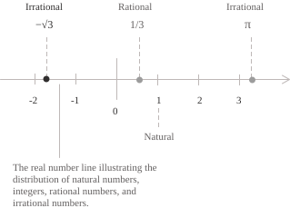
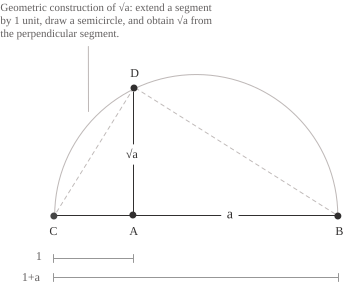

## Definition of a radical

A radical is an expression of the form $\sqrt[n]{a}$ that denotes taking the $n$-th root of a number or an expression $a.$ The term $a$ is called the radicand, and the [integer](../integers/) $n \ge 2$ is called the index of the root. The concept of a root arises from the problem of solving [equations](../equations/) of the form:

$$x^n = a \tag{1}$$

In $(1),$ $a \in \mathbb{R},$ and an $n$-th root of $a$ is a [real number](../real-numbers/) whose $n$-th power is exactly equal to $a.$

When $n$ is even, $(1)$ has real solutions only if $a \ge 0$ and, in that case, the root $\sqrt[n]{a}$ is defined as the non-negative solution. For example, the equation $x^2 = 9$ has the solutions $x = 3$ and $x = -3,$ since $3^2 = (-3)^2 = 9.$ The radical, however, denotes only the non-negative solution, so $\sqrt{9} = 3.$

When $n$ is odd, for every real number $a$ there is a unique real number $x$ such that $x^n = a.$ This holds whether $a$ is positive, negative, or zero. Moreover, a power with an odd exponent always preserves the sign of the base. For example, the equation $x^3 = -8$ has the unique real solution $x = -2,$ since $(-2)^3 = -8$ and hence $\sqrt[3]{-8} = -2.$

The discussion above gives the following identity:

$$ \tag{2}
\sqrt{a^2} = |a| \qquad \forall a \in \mathbb{R}
$$

If $a \ge 0,$ the square root of $a^2$ is $a.$ If $a < 0,$ it is instead $-a,$ which is positive and has the same square as $a.$ The [absolute value](../absolute-value/) therefore expresses both cases correctly. For example, consider the [trinomial](../trinomials/) in $(3)$. Applying $(2)$ gives:

$$ \tag{3}
\sqrt{x^2-2xy+y^2} = \sqrt{(x-y)^2} = |x-y|
$$

The result is therefore $x-y$ if $x \ge y,$ and $y-x$ if $x < y.$

More generally, for $n \in \mathbb{N}$ with $n \ge 1,$ we have:

$$\sqrt[2n]{a^{2n}} = |a| \tag{4}$$

For an odd index, $(4)$ becomes:

$$\sqrt[2n+1]{a^{2n+1}} = a\tag{5}$$

- - -

Radicals such as $\sqrt{2},$ $\sqrt{3}$ and $\sqrt{5}$ are [irrational numbers](../irrational-numbers/) because they cannot be expressed exactly as a ratio of two integers. Their positions on the real number line are shown below:

Moreover, their decimal expansions are infinite and non-repeating. Formally, if $a \in \mathbb{N}$ is not a perfect square, then $\sqrt{a} \notin \mathbb{Q}.$ Thus, while the square root of a perfect square, such as $4$ or $9,$ is rational, the square root of a natural number that is not a perfect square, such as $2$ or $5,$ is irrational.

## Why is $\sqrt{2}$ irrational?

We now consider a familiar case and prove that $\sqrt{2}$ is not a [rational number](../rational-numbers/). The proof is by contradiction, so we assume that $\sqrt{2}$ is rational. If it were rational, it could be expressed as a ratio of two integers [in lowest terms](../greatest-common-divisor/), so there would be $a, b \in \mathbb{Z},$ with $b \neq 0$ and $\gcd(a,b) = 1,$ such that:

$$ \tag{6}
\sqrt{2} = \frac{a}{b}
$$

Squaring both sides gives:

$$
2 = \frac{a^2}{b^2} \Rightarrow a^2 = 2b^2 \tag{7}
$$

This equation shows that $a^2$ is even. Since the square of an odd integer is odd, $a$ must be even. We can therefore write $a = 2k$ for some integer $k$ and substitute this expression into $(7)$ to obtain:

$$
(2k)^2 = 2b^2 \Rightarrow 4k^2 = 2b^2 \Rightarrow b^2 = 2k^2
$$

The same parity argument shows that $b$ is even. Thus $2$ divides both $a$ and $b,$ contradicting $\gcd(a,b) = 1$ and therefore $\sqrt{2}$ is irrational.

## Powers with rational exponents

The connection between radicals and [powers](../powers/) becomes explicit when the exponent is a rational number. For $a > 0$ and $n \in \mathbb{N}$ with $n \ge 1,$ the $n$-th root of $a$ can be written as follows:

$$ \tag{8}
\sqrt[n]{a} = a^{\frac{1}{n}}
$$

More generally, for $m \in \mathbb{Z},$ a radical whose radicand is raised to an integer power is a power with rational exponent $m/n.$ Indeed, the following identity holds:

$$\tag{9}
\sqrt[n]{a^m} = a^{\frac{m}{n}}
$$

Consider $a > 0$ and the following rational numbers:

$$\frac{m}{n}, \frac{p}{q} \in \mathbb{Q}$$

Applying the laws of exponents gives the following identities, which are useful for simplifying algebraic calculations when working with expressions of this kind:

$$
\begin{align}
a^{\frac{m}{n}} \cdot a^{\frac{p}{q}} &= a^{\frac{m}{n}+\frac{p}{q}} \\[6pt]
a^{\frac{m}{n}}\div {a^{\frac{p}{q}}} &= a^{\frac{m}{n}-\frac{p}{q}} \\[6pt]
\left(a^{\frac{m}{n}}\right)^{\frac{p}{q}} &= a^{\frac{m}{n} \cdot \frac{p}{q}}
\end{align}
$$

When radicals have different indices, we can rewrite them as powers with rational exponents. For example, for $a > 0,$ the quotient rule for powers with the same base allows us to subtract the exponents:

$$
\begin{align}
\frac{\sqrt{a}}{\sqrt[3]{a}} &= \frac{a^{\frac{1}{2}}}{a^{\frac{1}{3}}} \\[6pt]
&= a^{\frac{1}{2}-\frac{1}{3}} \\[6pt]
&= a^{\frac{1}{6}} \\[6pt]
&= \sqrt[6]{a}
\end{align}
$$

## Properties

We now examine the properties of radicals in detail, first recalling $(9),$ which states that for $a > 0,$ $n \in \mathbb{N}$ with $n \ge 1$ and $m \in \mathbb{Z},$ we have:

$$
\sqrt[n]{a^m} = a^{\frac{m}{n}}
$$

If $m > 0,$ the identity also holds for $a = 0.$ When $m \le 0,$ the condition $a > 0$ excludes a zero base.

- - -

Another property describes how the $n$-th root distributes over multiplication and division when $n \in \mathbb{N}$ with $n \ge 2.$ In this case, the following properties hold:

$$ \tag{10}
\begin{align}
\sqrt[n]{ab} &= \sqrt[n]{a}\sqrt[n]{b} \\[6pt]
\frac{\sqrt[n]{a}}{\sqrt[n]{b}} &= \sqrt[n]{\frac{a}{b}}
\end{align}
$$

If $n$ is even, the product rule in $(10)$ requires $a \ge 0$ and $b \ge 0,$ while the quotient rule requires $a \ge 0$ and $b > 0$ to ensure that all terms are real numbers. If $n$ is odd, both identities hold for all real values, that is, for every $a,b \in \mathbb{R}$ in the product and for every $a \in \mathbb{R},$ $b \in \mathbb{R} \setminus \{0\}$ in the quotient.

- - -

A further property concerns raising a radical to an integer power. For $a > 0,$ $n \in \mathbb{N}$ with $n \ge 1$ and $m \in \mathbb{Z}$ the following identity holds:

$$
\left(\sqrt[n]{a}\right)^m = \sqrt[n]{a^m}
$$

- - -

If we multiply the index of the root and the exponent of the radicand by the same positive integer $k,$ the value of the radical remains unchanged. Taking $a \ge 0$ and $m,n,k \in \mathbb{N}$ with $m,n,k \ge 1$ gives the following identity:

$$
\sqrt[n]{a^m} = \sqrt[nk]{a^{mk}}
$$

Conversely, a common positive factor of the index and the exponent can be canceled, giving an expression such as:

$$\sqrt[4]{a^2} = \sqrt{a}$$

- - -

Another frequently used property concerns the root of a root. For $a \ge 0$ and $m, n \in \mathbb{N}$ with $m, n \ge 1,$ a nested root can be rewritten as follows:

$$ \tag{11}
\sqrt[m]{\sqrt[n]{a}} = \sqrt[mn]{a}
$$

As we have already seen, if at least one of $m$ and $n$ is even, the condition $a \ge 0$ is necessary for the expression to be defined over the real numbers, whereas if $m$ and $n$ are both odd, $(11)$ holds for every $a \in \mathbb{R}.$

- - -

Let $m,n \in \mathbb{N}$ with $m \ge n \ge 2.$ If $n$ is even, assume $a \ge 0;$ if $n$ is odd, let $a \in \mathbb{R}.$ A radical of the form $\sqrt[n]{a^m}$ can be simplified by writing the exponent as $m = nq+r,$ where $q$ is the quotient and $0 \le r < n$ is the remainder when $m$ is divided by $n.$ This allows us to take the factor $a^q$ outside the radical and rewrite the expression as follows:

$$ \tag{12}
\sqrt[n]{a^m} = \sqrt[n]{a^{nq+r}} = a^q \sqrt[n]{a^r}
$$

For example, since $5 = 2 \cdot 2 + 1$ we can rewrite $\sqrt{a^5}$ as:

$$\sqrt{a^5} = \sqrt{a^4 \cdot a} = a^2\sqrt{a}$$
This property is also very useful because it allows us to transform the original expression into one that is generally easier to work with.

- - -

Two radicals are said to be like if they have the same index and the same radicand, and they can be added and subtracted by combining their coefficients, just as with like terms in a [polynomial](../polynomials/). The following equality therefore holds:

$$ \tag{13}
p \sqrt[n]{a}+q \sqrt[n]{a} = (p+q) \sqrt[n]{a}
$$

For example, we have:

$$
\begin{align}
3\sqrt{2}+5\sqrt{2} &= 8\sqrt{2} \\[6pt]
7\sqrt[3]{5}-2\sqrt[3]{5} &= 5\sqrt[3]{5}
\end{align}
$$

When we encounter radicals with different indices or different radicands, they cannot be added or subtracted using $(13)$. In some cases, however, simplification can turn them into like radicals. Consider the following example:

$$ \tag{14}
\sqrt{12}+\sqrt{3} = 2\sqrt{3}+\sqrt{3} = 3\sqrt{3}
$$

Rewriting $\sqrt{12}$ therefore allows us to add the two radicals in expression $(14)$, simplifying the calculation.

## Rationalizing the denominator and the numerator

To simplify calculations, it is sometimes useful to rewrite an expression so that no radical appears in the denominator. Consider $a > 0$ and $m,n \in \mathbb{N}$ with $0 < m < n,$ and the following fraction:

$$\frac{1}{\sqrt[n]{a^m}}$$

Our aim is to eliminate the radical from the denominator by rewriting the fraction as follows:

$$ \tag{15}
\frac{1}{\sqrt[n]{a^m}} \cdot \frac{\sqrt[n]{a^{n-m}}}{\sqrt[n]{a^{n-m}}} = \frac{\sqrt[n]{a^{n-m}}}{\sqrt[n]{a^n}} = \frac{\sqrt[n]{a^{n-m}}}{a}
$$

The most common case is $n = 2$ and $m = 1,$ so the denominator is a square root. Applying $(15)$ gives:

$$
\frac{1}{\sqrt{a}} \cdot \frac{\sqrt{a}}{\sqrt{a}} = \frac{\sqrt{a}}{a}
$$

When the denominator has the form $\sqrt{a} \pm \sqrt{b}$ we multiply by the conjugate expression, eliminating radicals from the denominator by the [difference-of-squares identity](../notable-products/). Consider $a \ne b \quad a,b \ge 0$ and an expression of the form:

$$
\frac{1}{\sqrt{a}+\sqrt{b}} $$
The following relation holds, in which we multiply by the conjugate of the denominator:

$$ \tag{16}
\frac{1}{\sqrt{a}+\sqrt{b}} \cdot \frac{\sqrt{a}-\sqrt{b}}{\sqrt{a}-\sqrt{b}} = \frac{\sqrt{a}-\sqrt{b}}{a-b}
$$

For example, we can rewrite the following expression as shown below:

$$
\begin{align}
\frac{1}{\sqrt{3}+\sqrt{2}} &= \frac{\sqrt{3}-\sqrt{2}}{(\sqrt{3})^2-(\sqrt{2})^2} \\[6pt]
&= \frac{\sqrt{3}-\sqrt{2}}{3-2} \\[6pt]
&= \sqrt{3}-\sqrt{2}
\end{align}
$$

If the denominator were $\sqrt{a} - \sqrt{b},$ we would instead multiply in $(16)$ by $\sqrt{a} + \sqrt{b}.$

- - -

Rationalization can also be applied to the numerator when this step helps simplify an expression. Fix $x > 0$ and consider, for example, the following [limit](../limits/):

$$
\lim_{h \to 0} \frac{\sqrt{x+h}-\sqrt{x}}{h}
$$

Direct substitution of $h = 0$ gives the [indeterminate form](../indeterminate-forms/) $0/0.$ For $h \ne 0,$ multiplying the numerator and denominator by the conjugate of the numerator gives:

$$
\begin{align}
\frac{\sqrt{x+h}-\sqrt{x}}{h} &= \frac{\sqrt{x+h}-\sqrt{x}}{h} \cdot \frac{\sqrt{x+h}+\sqrt{x}}{\sqrt{x+h}+\sqrt{x}} \\[6pt]
&= \frac{(x+h)-x}{h\left(\sqrt{x+h}+\sqrt{x}\right)} \\[6pt]
&= \frac{h}{h\left(\sqrt{x+h}+\sqrt{x}\right)} \\[6pt]
&= \frac{1}{\sqrt{x+h}+\sqrt{x}}
\end{align}
$$

Taking the limit as $h \to 0$ then gives a finite value rather than an indeterminate form:

$$
\lim_{h \to 0} \frac{1}{\sqrt{x+h}+\sqrt{x}} = \frac{1}{2\sqrt{x}}
$$

## Geometric construction of the segment $\sqrt{a}$

The square root can be represented exactly as the length of a segment, even when it is an irrational number. We can construct this segment using a property of right triangles. Given a segment of length $a > 0,$ the construction proceeds as follows.

+ Draw a segment $AB$ of length $a.$
+ Extend the segment one unit to the left. Let $C$ be the point such that $CA = 1.$ We then have $CB = a + 1.$
+ Draw a semicircle with diameter $CB.$
+ Through point $A,$ draw the perpendicular to $CB,$ which intersects the semicircle at point $D.$
+ The segment $AD$ has length $\sqrt{a}.$

The triangle $\triangle CDB$ is right-angled at $D$ and $AD$ is the altitude from $D$ to the hypotenuse $CB.$ The geometric mean theorem states that this altitude is the [geometric mean](../geometric-mean/) of the two segments into which it divides the hypotenuse. Thus:

$$\frac{AC}{AD} = \frac{AD}{AB}$$

Multiplying both sides by $AD \cdot AB$ gives:

$$AD^2 = AB \cdot AC$$

Since $AC = 1$ and $AB = a,$ it follows that:

$$
AD^2 = a \cdot 1 = a
\quad \Rightarrow \quad
AD = \sqrt{a}
$$

Since lengths are non-negative, the segment $AD$ has length $\sqrt{a}.$

The construction therefore allows us to obtain, from segments of lengths $a$ and $1,$ a segment whose length is exactly $\sqrt{a},$ without calculating a decimal approximation. This holds even when $\sqrt{a}$ is irrational, as in the case of $\sqrt{2}.$
