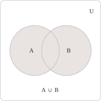
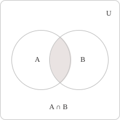
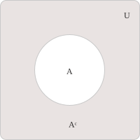
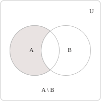
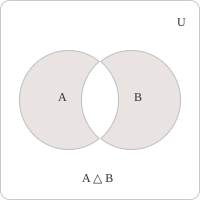

## Introduzione

Un insieme è una collezione di elementi ed è determinato interamente dagli oggetti che gli appartengono. In generale, si indicano con lettere maiuscole $A,$ $B,$ $C,$ e i loro elementi con lettere minuscole. L'ordine in cui si elencano gli elementi e le eventuali ripetizioni non modificano l'insieme. Per esempio, le seguenti tre descrizioni definiscono uno stesso insieme $A$:

$$
A = \{1,2,3\}=\{3,1,2\}=\{1,1,2,3,3\} \tag{1}
$$

L'insieme vuoto non contiene elementi, si indica con $\emptyset$ o $\{\ \},$ e svolge nella teoria degli insiemi un ruolo analogo a quello dello zero in aritmetica. Due insiemi sono uguali quando hanno gli stessi elementi mentre un insieme con esattamente un elemento è detto singoletto e se $a$ è l'unico elemento può essere rappresentato come:

$$\{a\} \tag{2}$$

La notazione $x\in A$ indica che $x$ appartiene ad $A,$ mentre $x\notin A$ indica che $x$ non appartiene ad $A.$ Un insieme si può descrivere per elencazione, come ne caso della $(1)$ o mediante una proprietà caratteristica come vedremo più avanti. L'elencazione consiste nell'indicare ogni elemento dell'insieme ed è utile quando la cardinalità dell'insieme, ovvero il numero dei suoi elementi, è finita e piccola:

$$
A = \{a_1, a_2, a_3, a_4\} \tag{3}
$$

Quando gli elementi sono numerosi o infiniti, la $(3)$ non è materialmente applicabile e si preferisce una rappresentazione mediante una proprietà caratteristica che è più concisa. Per esempio, un sottoinsieme dei numeri interi compresi tra $5$ e $8$ si può scrivere con la seguente uguaglianza.:

$$
A = \{\ x \in \mathbb{Z} \mid x > 4, \ x \leq 8 \ \} \tag{4}
$$

Poiché l'insieme $A$ della $(4)$ contiene solo pochi elementi si può scrivere anche per elencazione, usando la $(3)$ nel seguente modo equivalente:

$$
A = \{5, 6, 7, 8\} \tag{5}
$$

L'insieme universo, indicato con $U,$ è l'insieme di riferimento da cui si scelgono gli elementi degli insiemi che si stanno studiando. Ciascuno di questi insiemi è quindi un sottoinsieme di $U.$ 

## Cardinalità

La cardinalità di un insieme finito $A$ è il numero dei suoi elementi e si indica con $|A|.$ Due insiemi $A$ e $B$ hanno la stessa cardinalità se e solo se esiste una biiezione $f\colon A\to B$ e si scrive $|A|=|B|.$ La cardinalità dell'insieme vuoto è $|\emptyset|=0.$ Il concetto di cardinalità si estende anche agli insiemi infiniti mediante lo stesso criterio. Per esempio, associando a ogni numero naturale $n$ il suo doppio $2n,$ si ottengono tutti i numeri naturali pari, ciascuno una sola volta. I numeri naturali e i numeri naturali pari hanno quindi la stessa cardinalità.

Vediamo ora come determinare la cardinalità del prodotto cartesiano di due insiemi finiti $A$ e $B$ che è data dalla seguente formula:

$$
	|A \times B| = |A| \cdot |B| \tag{6}
$$

Nella $(6)$ ogni elemento di $A$ può essere abbinato a ogni elemento di $B,$ ottenendo un numero di coppie ordinate pari a $|A| \cdot |B|$ . Nel caso dell'unione tra insiemi, la cardinalità è data da:

$$
|A \cup B| = |A| + |B| - |A \cap B| \tag{7}
$$

La $(7)$ esprime il principio di inclusione-esclusione. Nella somma $|A|+|B|$ ogni elemento di $A\cap B$ viene contato due volte, una volta in $A$ e una in $B.$ Sottraendo $|A\cap B|$ si conta ciascun elemento dell'unione una sola volta. Il principio si estende a ogni famiglia finita di insiemi finiti. Per esempio, nel caso di tre insiemi la $(7)$ assume la forma:

$$
|A \cup B \cup C| = |A| + |B| + |C| - |A \cap B| - |A \cap C| - |B \cap C| + |A \cap B \cap C| \tag{8}
$$

## Sottoinsiemi e insieme delle parti

 Un insieme $A$ è un sottoinsieme di $B$ se ogni elemento di $A$ è anche un elemento di $B$ per cui possiamo scrivere la seguente relazione:

$$
A \subseteq B \iff \forall \ x, \ x \in A \rightarrow x \in B \tag{9}
$$

Due insiemi sono uguali se e solo se ciascuno è contenuto nell'altro, e questo è il modo abituale di dimostrare l'uguaglianza tra insiemi in matematica:

$$
A = B \iff (A \subseteq B) \land (B \subseteq A) \tag{10}
$$

Se $A \subseteq B$ e $A \neq B,$ allora $A$ è un sottoinsieme proprio di $B,$ e si indica con $A \subsetneq B.$ In questo caso esiste almeno un elemento di $B$ che non appartiene ad $A.$ L'insieme vuoto è un sottoinsieme di ogni insieme $A.$ Infatti, se l'inclusione $\emptyset \subseteq A$ fosse falsa, dovrebbe esserci un elemento di $\emptyset$ che non appartiene ad $A,$ ma l'insieme vuoto non ha elementi e quindi ciò dimostra la definizione.

Passiamo ora a introdurre l'insieme delle parti di un insieme $A,$ indicato come $\mathcal{P}(A),$ che è l'insieme di tutti i sottoinsiemi di $A$ che comprende l'insieme vuoto $\emptyset$ e l'insieme $A$ stesso. Quindi, se $A$ ha $n$ elementi, $\mathcal{P}(A)$ ha $2^n$ elementi. Per esempio, se $A=\{a,b,c\},$ l'insieme delle parti contiene $2^3=8$ elementi. Per un insieme $A$ qualsiasi, la funzione che registra queste scelte si chiama funzione caratteristica di $E$ e si indica con $\chi_E\colon A\to\{0,1\}.$ Per ogni $x\in A$ il suo valore è dato da:

$$
\chi_E(x)=
\begin{cases}
1 & x\in E \\[6pt]
0 & x\notin E
\end{cases}
\tag{11}
$$

Dalla $(11)$ si può anche risalire al sottoinsieme a partire dai valori della funzione, prendendo tutti e soli gli elementi a cui è assegnato $1.$ Ogni assegnazione di $0$ e $1$ individua così un unico sottoinsieme di $A,$ e ogni sottoinsieme corrisponde a una sola assegnazione.

## Famiglie e partizioni

Una famiglia di insiemi indicizzata da un insieme $I$ è un oggetto che associa un insieme $A_i$ a ciascun indice $i\in I$ e si scrive:

$$(A_i)_{i\in I} \tag{12}$$ 
Una famiglia è in sostanza una funzione il cui dominio è $I$ e il cui valore in $i$ è $A_i.$ Gli indici rimangono distinti anche quando due valori coincidono, quindi $A_i=A_j$ non implica $i=j.$ L'unione della famiglia è l'insieme degli elementi che appartengono ad almeno uno degli insiemi $A_i$ ed è definita da:

$$
\bigcup_{i\in I} A_i = \{\ x \mid \exists \ i\in I,\ x\in A_i \ \} \tag{13}
$$

Fissato un insieme universo $U$ di cui tutti gli $A_i$ sono sottoinsiemi, l'intersezione della famiglia è l'insieme degli elementi di $U$ che appartengono a ogni $A_i:$

$$
\bigcap_{i\in I} A_i = \{\ x\in U \mid \forall \ i\in I,\ x\in A_i \ \} \tag{14}
$$

Se $I=\emptyset,$ ogni elemento di $U$ soddisfa la condizione della $(14),$ quindi l'intersezione della famiglia vuota è $U.$

Una famiglia $(A_i)_{i\in I}$ è formata da insiemi a due a due disgiunti quando due membri qualsiasi con indici distinti non hanno elementi in comune:

$$
A_i \cap A_j = \emptyset \quad \forall \ i \neq j \tag{15}
$$

I singoletti $\{n\},$ uno per ogni $n\in\mathbb{N},$ formano una famiglia di insiemi a due a due disgiunti e la loro unione è l'insieme $\mathbb{N}.$ Quest'esempio dei singoletti illustra il concetto di partizione che possiamo definire in questo modo. Una famiglia $(A_i)_{i\in I}$ di sottoinsiemi di $A$ è una partizione di $A$ se ogni $A_i$ contiene almeno un elemento e ogni elemento di $A$ appartiene a uno e un solo $A_i.$ I sottoinsiemi $A_i$ si chiamano blocchi della partizione. In termini formali siha:

$$
\begin{align}
A_i &\neq \emptyset \quad (\forall \ i\in I) \tag{16}\\[6pt]
A_i \cap A_j &= \emptyset \quad (\forall \ i,j\in I,\ i\neq j) \tag{17}\\[6pt]
\bigcup_{i\in I} A_i &= A \tag{18}
\end{align}
$$

La $(16)$ esclude i blocchi vuoti, la $(18)$ afferma che ogni elemento di $A$ appartiene ad almeno un blocco e per la $(17)$ non può appartenere a due blocchi distinti. Gli interi pari e gli interi dispari soddisfano queste tre condizioni e formano quindi due blocchi di una partizione di $\mathbb{Z}.$ Due interi appartengono allo stesso blocco se e solo se hanno la stessa parità. In generale, ogni partizione di $A$ definisce una relazione di equivalenza in cui due elementi sono equivalenti se e solo se appartengono allo stesso blocco. Viceversa, le classi di ogni relazione di equivalenza su $A$ formano una partizione di $A.$

## Operazioni tra insiemi

Vediamo ora le operazioni possibili tra insiemi che generano nuovi insiemi combinando i rispettivi elementi. Partiamo dall'unione di $A$ e $B$ che è data dall'insieme di tutti gli elementi che appartengono ad almeno uno dei due insiemi. Gli elementi comuni ad $A$ e $B$ sono elencati una sola volta, poiché gli insiemi non ammettono ripetizioni.

$$
A \cup B = \{x \mid x \in A \text{ o } x \in B\} \tag{19}
$$

L'intersezione di $A$ e $B$ è invece l'insieme degli elementi comuni che appartengono a entrambi gli insiemi:

$$
A \cap B = \{x \mid x \in A \text{ e } x \in B\} \tag{20}
$$

Se $A \cap B = \emptyset$ significa che i due insiemi sono disgiunti e non hanno alcun elemento in comune. Un'altra operazione è quella di complemento di un insieme $A$ rispetto a un insieme universo $U$ che rappresenta l'insieme di tutti gli elementi di $U$ che non appartengono ad $A:$

$$
A^c = \{x \in U \mid x \notin A\} \tag{21}
$$

Un altro modo per rappresentare il complementare di $A$ è $\overline{A}$ oppure $U \setminus A.$ È importante notare che uno stesso insieme $A$ può avere complementari diversi perché questo dipende da come si è scelto $U.$ Vediamo ora la differenza tra $A$ e $B,$ che si idnica come $A \setminus B,$ e rappresenta l'insieme degli elementi che appartengono ad $A$ ma non a $B$:

$$
	A \setminus B = \{x \mid x \in A \text{ e } x \notin B\} \tag{22}
$$

Se i due insiemi coincidono, entrambe le differenze sono vuote. Se sono distinti, almeno un elemento appartiene a uno solo dei due e compare quindi in una sola delle due differenze. Vale perciò l'equivalenza:

$$A \setminus B \neq B \setminus A \iff A \neq B \tag{23}$$

 Per ogni insieme universo che contiene sia $A$ sia $B$ vale la seguente identità che esprime la differenza mediante il complementare:
 
$$A \setminus B = A \cap B^c\tag{24}$$

Si definisce differenza simmetrica tra $A$ e $B,$ e si scrive $A \triangle B,$ l'insieme degli elementi che appartengono a uno dei due insiemi ma non a entrambi:

$$
A \triangle B = (A \setminus B) \cup (B \setminus A) \tag{24}
$$

La $(24)$ si può anche in forma equivalente come:

$$
A \triangle B = (A \cup B) \setminus (A \cap B) \tag{25}
$$

La differenza simmetrica è commutativa e associativa e soddisfa le seguenti identità:

$$\tag{26} 
\begin{align}
A \triangle A &= \emptyset \\[6pt]
A \triangle \emptyset &= A
\end{align}
$$

I sottoinsiemi di un dato insieme formano un anello in cui la somma è la differenza simmetrica e il prodotto è l'intersezione. L'anello si dice booleano perché ogni elemento coincide con il proprio quadrato, ossia $E\cap E=E$ per ogni sottoinsieme $E.$

- - -

Le operazioni appena viste soddisfano una serie di identità che costituiscono la base dell'algebra booleana e valgono per tutti gli insiemi generici $A,$ $B,$ e $C$ contenuti in un insieme universo $U.$ L'unione e l'intersezione sono operazioni commutative e quindi l'ordine in cui si combinano due insiemi non influisce sul risultato.

$$ \tag{27}
\begin{align}
A \cup B &= B \cup A \\[6pt]
A \cap B &= B \cap A
\end{align}
$$

Entrambe le operazioni sono anche associative per cui abbiamo:

$$ \tag{28}
\begin{align}
(A \cup B) \cup C &= A \cup (B \cup C) \\[6pt]
(A \cap B) \cap C &= A \cap (B \cap C)
\end{align}
$$

Dalle definizioni di unione $(19)$ e di intersezione $(20)$ si ricavano le due leggi distributive della $(29).$ Nella prima l'intersezione si distribuisce sull'unione, nella seconda l'unione si distribuisce sull'intersezione:

$$
\begin{align}
A \cap (B \cup C) &= (A \cap B) \cup (A \cap C) \\[6pt]
A \cup (B \cap C) &= (A \cup B) \cap (A \cup C) \tag{29}
\end{align}
$$

L'insieme vuoto e l'insieme universo sono gli elementi neutri rispettivamente dell'unione e dell'intersezione per cui valgono le seguenti identità:

$$ \tag{30}
\begin{align}
A \cup \emptyset &= A \\[6pt]
A \cap U &= A
\end{align}
$$

L'insieme vuoto è un elemento assorbente per l'intersezione mentre l'insieme universo è un elemento assorbente per l'unione, il che significa che per ogni insieme considerato si otterranno le seguenti uguaglianze:

$$ \tag{31}
\begin{align}
A \cap \emptyset &= \emptyset \\[6pt]
A \cup U &= U
\end{align}
$$

Per la $(21),$ ogni elemento di $U$ appartiene a uno solo dei due insiemi $A$ e $A^c.$ La loro unione è quindi tutto $U$ e la loro intersezione è vuota. Se prendiamo il complementare di $A^c$ rispetto allo stesso universo, ritroviamo esattamente gli elementi di $A$ e otteniamo così le identità:

$$
\begin{align}
A \cup A^c &= U \\[6pt]
A \cap A^c &= \emptyset \tag{32} \\[6pt]
(A^c)^c &= A
\end{align}
$$

## Unione disgiunta

Abbiamo visto che se un elemento $x$ appartiene sia ad $A$ sia a $B,$ nell'unione $A\cup B$ compare una sola volta. Nell'unione disgiunta invece si distingue la $x$ che proviene da $A$ da quella che proviene da $B$ tramite un'etichetta, per esempio $0$ per gli elementi di $A$ e $1$ per quelli di $B.$ Con questa scelta l'unione disgiunta si definisce come segue:

$$
A\sqcup B=(\{0\}\times A)\cup(\{1\}\times B) \tag{33}
$$

Nella $(33)$ ogni elemento di $A$ o di $B$ è associato alla sua copia etichettata mediante una delle due funzioni:

$$\tag{34}
\begin{align}
i_A\colon A &\to A\sqcup B, & a &\mapsto (0,a) \\[6pt]
i_B\colon B &\to A\sqcup B, & b &\mapsto (1,b) 
\end{align}
$$

Due coppie ordinate sono uguali se e solo se coincidono sia le prime sia le seconde componenti. Le funzioni della $(34)$ sono iniettive perché la seconda componente conserva l'elemento di partenza mentre le loro immagini sono disgiunte perché le prime componenti sono diverse. Poiché la loro unione è tutto $A\sqcup B,$ nel caso finito basta sommare il numero di elementi delle due immagini:

$$
|A\sqcup B|=|A|+|B| \tag{35}
$$

La $(35)$ vale anche quando $A$ e $B$ hanno elementi in comune. Se si eliminano le etichette, ogni coppia della $(33)$ viene mandata nella sua seconda componente e si ottiene tutto $A\cup B.$ Questa funzione è una biiezione se e solo se $A\cap B=\emptyset$ poiché un elemento comune $x$ ha due copie distinte, $(0,x)$ e $(1,x),$ che hanno entrambe immagine $x.$
