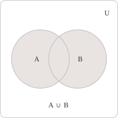
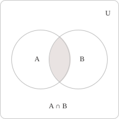
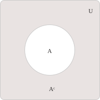
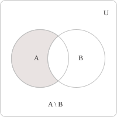
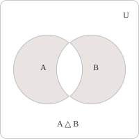

## Introduction

A set is a collection of elements and is entirely determined by the objects that belong to it. Sets are usually denoted by uppercase letters such as $A,$ $B,$ and $C,$ and their elements by lowercase letters. Neither the order in which the elements are listed nor any repetitions in the list affect the set. For example, the following three descriptions define the same set $A$:

$$
A = \{1,2,3\}=\{3,1,2\}=\{1,1,2,3,3\} \tag{1}
$$

The empty set contains no elements, is denoted by $\emptyset$ or $\{\ \},$ and plays a role in set theory analogous to that of zero in arithmetic. Two sets are equal when they have the same elements, while a set with exactly one element is called a singleton and, if $a$ is its only element, can be written as follows:

$$\{a\} \tag{2}$$

The notation $x\in A$ means that $x$ belongs to $A,$ while $x\notin A$ means that $x$ does not belong to $A.$ A set can be described by listing its elements, as in $(1),$ or by specifying a defining property, as we shall see below. Listing means writing out every element of the set and is useful when the cardinality of the set, that is, the number of its elements, is finite and small:

$$
A = \{a_1, a_2, a_3, a_4\} \tag{3}
$$

When the elements are numerous or infinite in number, listing them as in $(3)$ is impractical, and a defining property gives a more concise description. For example, a subset of the [integers](../integers/) consisting of those from $5$ through $8$ can be written as follows:

$$
A = \{\ x \in \mathbb{Z} \mid x \gt 4, \ x \leq 8 \ \} \tag{4}
$$

Since the set $A$ in $(4)$ has only a few elements, we can also list them as in $(3)$ to obtain the following equivalent description:

$$
A = \{5, 6, 7, 8\} \tag{5}
$$

The universal set, denoted by $U,$ is the set from which the elements of the sets under consideration are drawn. Each of these sets is therefore a subset of $U.$

## Cardinality

The [cardinality](../cardinality-and-countable-sets/) of a finite set $A$ is the number of its elements and is denoted by $|A|.$ Two sets $A$ and $B$ have the same cardinality if and only if there is a [bijection](../injective-surjective-and-bijective-functions/) $f\colon A\to B,$ in which case we write $|A|=|B|.$ The cardinality of the empty set is $|\emptyset|=0.$ The same criterion extends the concept of cardinality to infinite sets. For example, pairing each [natural number](../natural-numbers/) $n$ with its double $2n$ gives every even natural number exactly once. The natural numbers and the even natural numbers therefore have the same cardinality.

To find the cardinality of the [Cartesian product](../cartesian-product/) of two finite sets $A$ and $B,$ we use the following formula:

$$
	|A \times B| = |A| \cdot |B| \tag{6}
$$

In $(6),$ each element of $A$ can be paired with each element of $B,$ giving $|A| \cdot |B|$ ordered pairs. For the union of the two sets, the cardinality is given by:

$$
|A \cup B| = |A| + |B| - |A \cap B| \tag{7}
$$

Equation $(7)$ expresses the [inclusion-exclusion principle](../inclusion-exclusion-principle/). The sum $|A|+|B|$ counts each element of $A\cap B$ twice, once in $A$ and once in $B.$ Subtracting $|A\cap B|$ ensures that each element of the union is counted exactly once. The principle extends to any finite family of finite sets. For three sets, for example, $(7)$ takes the following form:

$$
|A \cup B \cup C| = |A| + |B| + |C| - |A \cap B| - |A \cap C| - |B \cap C| + |A \cap B \cap C| \tag{8}
$$

## Subsets and the power set

A set $A$ is a subset of $B$ if every element of $A$ is also an element of $B,$ so we can write:

$$
A \subseteq B \iff \forall \ x, \ x \in A \rightarrow x \in B \tag{9}
$$

Two sets are equal if and only if each is a subset of the other, which gives the usual way to prove that two sets are equal:

$$
A = B \iff (A \subseteq B) \land (B \subseteq A) \tag{10}
$$

If $A \subseteq B$ and $A \neq B,$ then $A$ is a proper subset of $B,$ written $A \subsetneq B.$ In this case, at least one element of $B$ does not belong to $A.$ The empty set is a subset of every set $A.$ Indeed, if the inclusion $\emptyset \subseteq A$ were false, some element of $\emptyset$ would have to lie outside $A,$ but the empty set has no elements, so the inclusion holds by definition.

We now introduce the [power set](../cantor-theorem/) of a set $A,$ denoted by $\mathcal{P}(A),$ which is the set of all subsets of $A$ and includes both the empty set $\emptyset$ and $A$ itself. Thus, if $A$ has $n$ elements, $\mathcal{P}(A)$ has $2^n$ elements. For example, if $A=\{a,b,c\},$ its power set has $2^3=8$ elements. For any set $A,$ the function that records these choices is called the characteristic function of $E$ and is denoted by $\chi_E\colon A\to\{0,1\}.$ For each $x\in A,$ its value is given by:

$$
\chi_E(x)=
\begin{cases}
1 & x\in E \\[6pt]
0 & x\notin E
\end{cases}
\tag{11}
$$

Using $(11),$ we can also recover the subset from the values of the function by taking precisely those elements assigned the value $1.$ Each assignment of $0$ and $1$ thus determines a unique subset of $A,$ and each subset corresponds to exactly one assignment.

## Families and partitions

A family of sets indexed by a set $I$ assigns a set $A_i$ to each index $i\in I$ and is written as follows:

$$(A_i)_{i\in I} \tag{12}$$ 
A family is a [function](../functions/) with domain $I$ whose value at $i$ is $A_i.$ Distinct indices remain distinct even when the corresponding values coincide, so $A_i=A_j$ does not imply $i=j.$ The union of the family consists of the elements that belong to at least one of the sets $A_i$ and is defined by:

$$
\bigcup_{i\in I} A_i = \{\ x \mid \exists \ i\in I,\ x\in A_i \ \} \tag{13}
$$

Given a universal set $U$ of which all the sets $A_i$ are subsets, the intersection of the family consists of the elements of $U$ that belong to every $A_i:$

$$
\bigcap_{i\in I} A_i = \{\ x\in U \mid \forall \ i\in I,\ x\in A_i \ \} \tag{14}
$$

If $I=\emptyset,$ every element of $U$ satisfies the condition in $(14),$ so the intersection of the empty family is $U.$

A family $(A_i)_{i\in I}$ consists of pairwise disjoint sets when any two members with distinct indices have no elements in common:

$$
A_i \cap A_j = \emptyset \quad \forall \ i \neq j \tag{15}
$$

The singletons $\{n\},$ one for each $n\in\mathbb{N},$ form a family of pairwise disjoint sets whose union is $\mathbb{N}.$ This example illustrates the concept of a partition, which we can define as follows. A family $(A_i)_{i\in I}$ of subsets of $A$ is a partition of $A$ if each $A_i$ contains at least one element and each element of $A$ belongs to exactly one $A_i.$ The subsets $A_i$ are called the blocks of the partition. Formally, the conditions are:

$$
\begin{align}
A_i &\neq \emptyset \quad (\forall \ i\in I) \tag{16}\\[6pt]
A_i \cap A_j &= \emptyset \quad (\forall \ i,j\in I,\ i\neq j) \tag{17}\\[6pt]
\bigcup_{i\in I} A_i &= A \tag{18}
\end{align}
$$

Condition $(16)$ rules out empty blocks, $(18)$ says that each element of $A$ belongs to at least one block, and $(17)$ ensures that it cannot belong to two distinct blocks. The even integers and the odd integers satisfy these three conditions and thus form the two blocks of a partition of $\mathbb{Z}.$ Two integers belong to the same block if and only if they have the same parity. In general, every partition of $A$ defines an equivalence relation in which two elements are equivalent if and only if they belong to the same block. Conversely, the classes of any equivalence relation on $A$ form a partition of $A.$

## Set operations

We now consider operations on sets that form new sets by combining their elements. We begin with the union of $A$ and $B,$ the set of all elements that belong to at least one of the two sets. Elements common to $A$ and $B$ are listed only once because sets have no repeated elements.

$$
A \cup B = \{x \mid x \in A \text{ or } x \in B\} \tag{19}
$$

The intersection of $A$ and $B$ consists of the elements common to both sets:

$$
A \cap B = \{x \mid x \in A \text{ and } x \in B\} \tag{20}
$$

If $A \cap B = \emptyset,$ the two sets are disjoint and have no elements in common. Another operation gives the complement of a set $A$ relative to a universal set $U,$ that is, the set of all elements of $U$ that do not belong to $A:$

$$
A^c = \{x \in U \mid x \notin A\} \tag{21}
$$

The complement of $A$ can also be written as $\overline{A}$ or $U \setminus A.$ The same set $A$ can have different complements depending on the choice of $U.$ We now consider the difference of $A$ and $B,$ denoted by $A \setminus B,$ which consists of the elements that belong to $A$ but not to $B:$

$$
	A \setminus B = \{x \mid x \in A \text{ and } x \notin B\} \tag{22}
$$

If the two sets coincide, both differences are empty. If they are distinct, at least one element belongs to just one of them and therefore appears in only one of the two differences. This gives the equivalence:

$$A \setminus B \neq B \setminus A \iff A \neq B \tag{23}$$

For any universal set containing both $A$ and $B$ as subsets, the following identity expresses set difference in terms of the complement:
 
$$A \setminus B = A \cap B^c\tag{24}$$

The symmetric difference of $A$ and $B,$ denoted by $A \triangle B,$ is the set of elements that belong to one of the two sets but not to both:

$$
A \triangle B = (A \setminus B) \cup (B \setminus A) \tag{24}
$$

Equation $(24)$ can also be written in the equivalent form:

$$
A \triangle B = (A \cup B) \setminus (A \cap B) \tag{25}
$$

Symmetric difference is commutative and associative and satisfies the following identities:

$$\tag{26} 
\begin{align}
A \triangle A &= \emptyset \\[6pt]
A \triangle \emptyset &= A
\end{align}
$$

The subsets of a given set form a [ring](../rings/) in which addition is symmetric difference and multiplication is intersection. The ring is called Boolean because each element equals its own square, that is, $E\cap E=E$ for every subset $E.$

- - -

The operations just described satisfy a collection of identities that form the basis of Boolean algebra and hold for any subsets $A,$ $B,$ and $C$ of a universal set $U.$ Union and intersection are commutative, so the order in which two sets are combined does not affect the result.

$$ \tag{27}
\begin{align}
A \cup B &= B \cup A \\[6pt]
A \cap B &= B \cap A
\end{align}
$$

Both operations are also associative, so we have:

$$ \tag{28}
\begin{align}
(A \cup B) \cup C &= A \cup (B \cup C) \\[6pt]
(A \cap B) \cap C &= A \cap (B \cap C)
\end{align}
$$

The definitions of union in $(19)$ and intersection in $(20)$ give the two distributive laws in $(29).$ In the first, intersection distributes over union, and in the second, union distributes over intersection:

$$
\begin{align}
A \cap (B \cup C) &= (A \cap B) \cup (A \cap C) \\[6pt]
A \cup (B \cap C) &= (A \cup B) \cap (A \cup C) \tag{29}
\end{align}
$$

The empty set and the universal set are the identity elements for union and intersection, respectively, so the following identities hold:

$$ \tag{30}
\begin{align}
A \cup \emptyset &= A \\[6pt]
A \cap U &= A
\end{align}
$$

The empty set is an absorbing element for intersection, while the universal set is an absorbing element for union, so the following equalities hold for every set under consideration:

$$ \tag{31}
\begin{align}
A \cap \emptyset &= \emptyset \\[6pt]
A \cup U &= U
\end{align}
$$

By $(21),$ each element of $U$ belongs to exactly one of the two sets $A$ and $A^c.$ Their union is therefore all of $U,$ and their intersection is empty. Taking the complement of $A^c$ relative to the same universal set gives precisely the elements of $A,$ yielding the identities:

$$
\begin{align}
A \cup A^c &= U \\[6pt]
A \cap A^c &= \emptyset \tag{32} \\[6pt]
(A^c)^c &= A
\end{align}
$$

## Disjoint union

We have seen that if an element $x$ belongs to both $A$ and $B,$ it appears only once in the union $A\cup B.$ The disjoint union distinguishes the copy of $x$ from $A$ and the copy from $B$ by attaching a label, for example $0$ for elements of $A$ and $1$ for elements of $B.$ With this choice of labels, the disjoint union is defined as follows:

$$
A\sqcup B=(\{0\}\times A)\cup(\{1\}\times B) \tag{33}
$$

In $(33),$ each element of $A$ or $B$ is mapped to its labeled copy by one of two functions:

$$\tag{34}
\begin{align}
i_A\colon A &\to A\sqcup B, & a &\mapsto (0,a) \\[6pt]
i_B\colon B &\to A\sqcup B, & b &\mapsto (1,b) 
\end{align}
$$

Two ordered pairs are equal if and only if their first components are equal and their second components are equal. The functions in $(34)$ are injective because the second component retains the original element, and their images are disjoint because the first components differ. Since the union of their images is all of $A\sqcup B,$ in the finite case we need only add the sizes of the two images:

$$
|A\sqcup B|=|A|+|B| \tag{35}
$$

Equation $(35)$ holds even when $A$ and $B$ have elements in common. Dropping the labels sends each pair in $(33)$ to its second component and gives all of $A\cup B.$ This map is a bijection if and only if $A\cap B=\emptyset,$ since a common element $x$ has two distinct copies, $(0,x)$ and $(1,x),$ both of which map to $x.$
