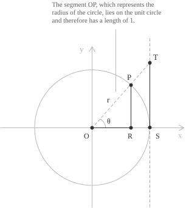
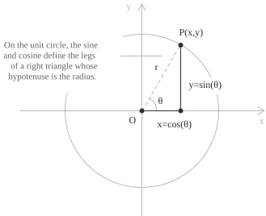
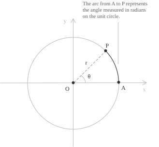
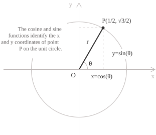

## Definizione

La circonferenza unitaria, detta anche circonferenza goniometrica, è il riferimento per rappresentare gli angoli e le loro posizioni e permette di descrivere le rotazioni, l'orientamento e la relazione tra i punti della circonferenza al variare di un angolo. Consideriamo una circonferenza di raggio $1$ con centro nell'origine $O$ e un punto $P$ sulla circonferenza. Abbiamo la seguente figura, con i seguenti elementi:

Sia $\theta$ l'angolo orientato dal semiasse positivo delle ascisse alla semiretta $OP.$ Il coseno e il seno di $\theta$ sono rispettivamente l'ascissa e l'ordinata di $P$:

$$
\begin{align}
x_P &= \cos\theta \tag{1}\\[6pt]
y_P &= \sin\theta \tag{2}
\end{align}
$$

Se $\cos\theta\ne 0,$ la retta $OP$ incontra in $T$ la tangente verticale alla circonferenza nel punto $S=(1,0).$ Poiché $x_T=1,$ lo spostamento verticale da $S$ a $T$ è pari al coefficiente angolare di $OP,$ che per le $(1)$ e $(2)$ vale $y_P/x_P=\tan\theta.$ Poiché $P$ dista un'unità dall'origine, il teorema di Pitagora dà:

$$x_P^2+y_P^2=1$$

Sostituendo le coordinate di $P$ date dalle $(1)$ e $(2)$ si ottiene l'identità trigonometrica fondamentale:

$$
\sin^2\theta + \cos^2\theta = 1 \tag{3}
$$

Al verso antiorario di rotazione si assegna il segno positivo dell'angolo $\theta,$ mentre al verso orario il segno negativo. Un giro completo sulla circonferenza misura $360^\circ$ e riporta $P$ nella posizione di partenza, quindi due angoli individuano lo stesso punto della circonferenza se e solo se le loro misure in gradi differiscono di un multiplo intero di $360^\circ.$ In tal senso gli angoli si dicono congruenti modulo $360^\circ.$ Per esempio, un angolo di $450^\circ$ rappresenta un giro completo ($360^\circ$) più ulteriori $90^\circ$ e un angolo di $-90^\circ$ corrisponde a un quarto di giro in senso orario. Per le $(1)$ e $(2),$ il coseno e il seno di $\theta$ sono rispettivamente l'ascissa e l'ordinata di $P.$ I loro segni si leggono quindi dal quadrante in cui si trova $P,$ come indica la tabella:

| Quadrante    | 1   | 2   | 3   | 4   |
| ------------ | --- | --- | --- | --- |
| $\cos\theta$ | $+$ | $-$ | $-$ | $+$ |
| $\sin\theta$ | $+$ | $+$ | $-$ | $-$ |

Quando $P$ si trova in uno dei quattro quadranti, l'angolo acuto che il raggio $\overline{OP}$ forma con l'asse delle ascisse è detto angolo di riferimento. Per simmetria, il suo coseno e il suo seno danno i valori assoluti di $\cos\theta$ e $\sin\theta,$ ai quali si assegnano i segni indicati nella tabella.

## Lunghezza dell'arco e radianti

Abbiamo visto che gli angoli si esprimono in gradi, ma un altro modo per esprimerli è attraverso i radianti. Sulla circonferenza unitaria la misura in radianti di $\theta$ coincide con la lunghezza dell'arco percorso da $A=(1,0)$ a $P,$ presa con segno positivo in senso antiorario e negativo in senso orario, quindi un giro completo in senso antiorario misura $2\pi$ radianti, valore che corrisponde alla lunghezza della circonferenza:

Il grado e il radiante sono due unità di misura dell'angolo. Cambiando unità, cambia il valore numerico con cui si esprime la stessa rotazione. Poiché allo stesso giro corrispondono $360^\circ,$ la misura in radianti $\theta_{\mathrm{rad}}$ e quella in gradi $\theta_{\mathrm{deg}}$ sono legate dalla relazione:

$$
\theta_{\mathrm{rad}} = \frac{\pi}{180}\theta_{\mathrm{deg}} \tag{4}
$$

Per esempio, dalla $(4)$ si ricava che un angolo di $30^\circ$ misura $30\cdot\pi/180=\pi/6$ radianti. Per alcuni valori di $\theta,$ il seno e il coseno si possono calcolare senza ricorrere ad approssimazioni numeriche. La tabella seguente riporta i valori per gli angoli più comuni che suggerisco di memorizzare perché sono molto utili nella risoluzione degli esercizi:

$$
\begin{align}
\theta &= 0 &\quad& \cos 0 = 1 &\quad& \sin 0 = 0 \\[6pt]
\theta &= \frac{\pi}{6} &\quad& \cos\frac{\pi}{6} = \frac{\sqrt{3}}{2} &\quad& \sin\frac{\pi}{6} = \frac{1}{2} \\[6pt]
\theta &= \frac{\pi}{4} &\quad& \cos\frac{\pi}{4} = \frac{\sqrt{2}}{2} &\quad& \sin\frac{\pi}{4} = \frac{\sqrt{2}}{2} \\[6pt]
\theta &= \frac{\pi}{3} &\quad& \cos\frac{\pi}{3} = \frac{1}{2} &\quad& \sin\frac{\pi}{3} = \frac{\sqrt{3}}{2} \\[6pt]
\theta &= \frac{\pi}{2} &\quad& \cos\frac{\pi}{2} = 0 &\quad& \sin\frac{\pi}{2} = 1 \\[6pt]
\theta &= \pi &\quad& \cos\pi = -1 &\quad& \sin\pi = 0 \\[6pt]
\theta &= \frac{3\pi}{2} &\quad& \cos\frac{3\pi}{2} = 0 &\quad& \sin\frac{3\pi}{2} = -1
\end{align}
$$

## Coordinate cartesiane e rappresentazione parametrica

Prendendo come parametro la misura in radianti dell'angolo $\theta,$ si possono riunire le coordinate date dalle $(1)$ e $(2)$ in un'unica formula data dalla seguente uguaglianza:

$$
P(\theta) = (\cos\theta,\sin\theta) \tag{5}
$$

Per la $(3),$ le coordinate di $P(\theta)$ soddisfano l'equazione $x^2+y^2=1.$

Per esempio, a un angolo di misura $\pi/3$ radianti la $(5)$ associa il punto:

$$
\begin{align}
P\left(\frac{\pi}{3}\right)
&= \left(\cos\frac{\pi}{3},\sin\frac{\pi}{3}\right) \\[6pt]
&= \left(\frac{1}{2},\frac{\sqrt{3}}{2}\right) \tag{6}
\end{align}
$$

Le coordinate della $(6)$ soddisfano l'equazione della circonferenza, poiché la somma dei loro quadrati è $1/4+3/4=1.$

Nella parametrizzazione $(5),$ aggiungere a $\theta$ un numero intero di giri completi riporta il punto nella stessa posizione. Per ogni $\theta\in\mathbb{R}$ e ogni $k\in\mathbb{Z}$ vale quindi:

$$
P(\theta+2k\pi)=P(\theta) \tag{7}
$$

Due angoli individuano lo stesso punto se e solo se le loro misure in radianti differiscono di un multiplo intero di $2\pi.$ A ogni punto della circonferenza corrisponde quindi un unico valore di $\theta$ nell'intervallo $[0,2\pi).$

## Interpretazione coi numeri complessi

Nel piano complesso il punto $(x,y)$ rappresenta il numero $z=x+iy,$ la cui distanza dall'origine è data dal modulo di $z$ calcolato nel seguente modo:

$$|z|=\sqrt{x^2+y^2}\tag{8}$$

La circonferenza unitaria è dunque l'insieme dei numeri complessi di modulo $1.$ Al punto $P(\theta)$ della $(5)$ corrisponde, per la formula di Eulero, il numero complesso scritto in forma trigonometrica e in forma esponenziale:

$$
\begin{align}
z &= \cos\theta+i\sin\theta \\[6pt]
  &= e^{i\theta} \tag{9}
\end{align}
$$

Nella forma $(9)$ il prodotto di due numeri di modulo $1$ si calcola sommando gli angoli. Infatti, per $z_1=e^{i\alpha}$ e $z_2=e^{i\beta}$ si ha:

$$
z_1z_2=e^{i\alpha}e^{i\beta}=e^{i(\alpha+\beta)} \tag{10}
$$

Iterando la $(10)$ si ottiene la formula di De Moivre. Per ogni intero $n\ge 1,$ elevare $e^{i\theta}$ alla potenza $n$ moltiplica l'angolo per $n.$ Le radici $n$-esime dell'unità corrispondono così agli angoli per cui $n\theta$ è un multiplo intero di $2\pi.$