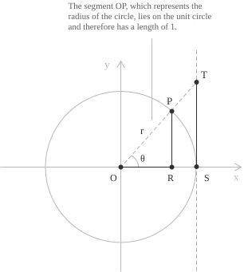
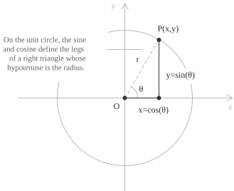
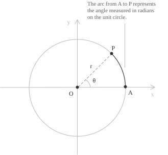
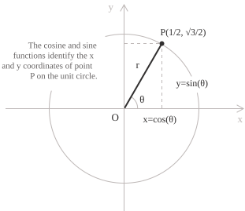

## Definition

The unit circle, also called the trigonometric circle, provides a frame of reference for angles and their positions and lets us describe rotations, orientation, and how points on the circle relate to one another as an angle varies. Consider a circle of radius $1$ centered at the origin $O$ and a point $P$ on the circle. The figure below shows the elements of this construction:

Let $\theta$ be the directed angle from the positive horizontal axis to the ray $OP.$ The [cosine and sine](../sine-and-cosine/) of $\theta$ are the [horizontal and vertical coordinates](../the-cartesian-coordinate-plane/) of $P,$ respectively:

$$
\begin{align}
x_P &= \cos\theta \tag{1}\\[6pt]
y_P &= \sin\theta \tag{2}
\end{align}
$$

If $\cos\theta\ne 0,$ the line $OP$ meets the vertical tangent to the circle at $S=(1,0)$ at a point $T.$ Since $x_T=1,$ the vertical displacement from $S$ to $T$ equals the slope of $OP,$ which by $(1)$ and $(2)$ is $y_P/x_P=\tan\theta.$ Since $P$ is one unit from the origin, the [Pythagorean theorem](../pythagorean-theorem/) gives:

$$x_P^2+y_P^2=1$$

Substituting the coordinates of $P$ from $(1)$ and $(2)$ gives the [Pythagorean trigonometric identity](../pythagorean-identity/):

$$
\sin^2\theta + \cos^2\theta = 1 \tag{3}
$$

The angle $\theta$ is positive for counterclockwise rotation and negative for clockwise rotation. One full turn around the circle measures $360^\circ$ and returns $P$ to its starting position, so two angles determine the same point on the circle if and only if their degree measures differ by an integer multiple of $360^\circ.$ Such angles are said to be congruent modulo $360^\circ.$ For example, an angle of $450^\circ$ represents one full turn ($360^\circ$) plus another $90^\circ,$ and an angle of $-90^\circ$ corresponds to a quarter turn clockwise. By $(1)$ and $(2),$ the cosine and sine of $\theta$ are the horizontal and vertical coordinates of $P,$ respectively. Their signs therefore depend on the quadrant in which $P$ lies, as the table shows:

| Quadrant     | 1   | 2   | 3   | 4   |
| ------------ | --- | --- | --- | --- |
| $\cos\theta$ | $+$ | $-$ | $-$ | $+$ |
| $\sin\theta$ | $+$ | $+$ | $-$ | $-$ |

When $P$ lies in one of the four quadrants, the acute angle between the radius $\overline{OP}$ and the horizontal axis is called the [reference angle](../reduction-formulas-and-reference-angles/). By symmetry, its cosine and sine give the absolute values of $\cos\theta$ and $\sin\theta,$ respectively, and the table gives their signs.

## Arc length and radians

We have seen how to measure angles in degrees, but angles can also be measured in radians. On the unit circle, the radian measure of $\theta$ equals the length of the arc traced from $A=(1,0)$ to $P,$ taken as positive counterclockwise and negative clockwise, so one full counterclockwise turn measures $2\pi$ radians, a value equal to the circumference of the circle:

Degrees and radians are two units of [angular measure](../angles-and-angular-measure/). Changing the unit changes the numerical value used to describe the same rotation. Since the same full turn measures $360^\circ,$ the radian measure $\theta_{\mathrm{rad}}$ and the degree measure $\theta_{\mathrm{deg}}$ are related by:

$$
\theta_{\mathrm{rad}} = \frac{\pi}{180}\theta_{\mathrm{deg}} \tag{4}
$$

For example, $(4)$ shows that an angle of $30^\circ$ measures $30\cdot\pi/180=\pi/6$ radians. For certain values of $\theta,$ the sine and cosine can be calculated exactly. The following table lists the values for the most common angles, which I recommend memorizing because they are particularly useful when solving problems:

$$
\begin{align}
\theta &= 0 &\quad& \cos 0 = 1 &\quad& \sin 0 = 0 \\[6pt]
\theta &= \frac{\pi}{6} &\quad& \cos\frac{\pi}{6} = \frac{\sqrt{3}}{2} &\quad& \sin\frac{\pi}{6} = \frac{1}{2} \\[6pt]
\theta &= \frac{\pi}{4} &\quad& \cos\frac{\pi}{4} = \frac{\sqrt{2}}{2} &\quad& \sin\frac{\pi}{4} = \frac{\sqrt{2}}{2} \\[6pt]
\theta &= \frac{\pi}{3} &\quad& \cos\frac{\pi}{3} = \frac{1}{2} &\quad& \sin\frac{\pi}{3} = \frac{\sqrt{3}}{2} \\[6pt]
\theta &= \frac{\pi}{2} &\quad& \cos\frac{\pi}{2} = 0 &\quad& \sin\frac{\pi}{2} = 1 \\[6pt]
\theta &= \pi &\quad& \cos\pi = -1 &\quad& \sin\pi = 0 \\[6pt]
\theta &= \frac{3\pi}{2} &\quad& \cos\frac{3\pi}{2} = 0 &\quad& \sin\frac{3\pi}{2} = -1
\end{align}
$$

## Cartesian coordinates and parametric representation

Taking the radian measure of the angle $\theta$ as the parameter, we can combine the coordinates in $(1)$ and $(2)$ into a single formula:

$$
P(\theta) = (\cos\theta,\sin\theta) \tag{5}
$$

By $(3),$ the coordinates of $P(\theta)$ satisfy the equation $x^2+y^2=1.$

For example, an angle of $\pi/3$ radians corresponds, by $(5),$ to the point:

$$
\begin{align}
P\left(\frac{\pi}{3}\right)
&= \left(\cos\frac{\pi}{3},\sin\frac{\pi}{3}\right) \\[6pt]
&= \left(\frac{1}{2},\frac{\sqrt{3}}{2}\right) \tag{6}
\end{align}
$$

The coordinates in $(6)$ satisfy the [equation of the circle](../circumference/), since the sum of their squares is $1/4+3/4=1.$

In the parametrization $(5),$ adding an integer number of full turns to $\theta$ returns the point to the same position. The following equality therefore holds for every $\theta\in\mathbb{R}$ and every $k\in\mathbb{Z}$:

$$
P(\theta+2k\pi)=P(\theta) \tag{7}
$$

Two angles determine the same point if and only if their radian measures differ by an integer multiple of $2\pi.$ Each point on the circle therefore corresponds to a unique value of $\theta$ in the interval $[0,2\pi).$

## Interpretation in the complex plane

In the [complex plane](../complex-numbers/), the point $(x,y)$ represents the number $z=x+iy,$ whose distance from the origin is given by the modulus of $z,$ calculated as follows:

$$|z|=\sqrt{x^2+y^2}\tag{8}$$

The unit circle is therefore the set of complex numbers of modulus $1.$ By [Euler's formula](../eulers-formula/), the complex number corresponding to the point $P(\theta)$ in $(5)$ has the following trigonometric and [exponential forms](../complex-numbers-exponential-form/):

$$
\begin{align}
z &= \cos\theta+i\sin\theta \\[6pt]
  &= e^{i\theta} \tag{9}
\end{align}
$$

To multiply two numbers of modulus $1$ written in the form $(9),$ we add their angles. Indeed, for $z_1=e^{i\alpha}$ and $z_2=e^{i\beta}$ we have:

$$
z_1z_2=e^{i\alpha}e^{i\beta}=e^{i(\alpha+\beta)} \tag{10}
$$

Repeated application of $(10)$ gives [De Moivre's formula](../de-moivre-theorem/). For every integer $n\ge 1,$ raising $e^{i\theta}$ to the power $n$ multiplies the angle by $n.$ The $n$th [roots of unity](../roots-of-unity/) therefore correspond to the angles for which $n\theta$ is an integer multiple of $2\pi.$
